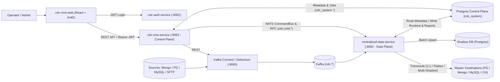

# 🏛️ DATA-HUB: SYSTEM OVERVIEW & CANONICAL DESIGN PATTERN (LIVE PRODUCTION BASELINE)

> **Last Updated:** 2026-11-09
> **Status:** **LIVE PRODUCTION SYSTEM (HỆ THỐNG ĐANG VẬN HÀNH THẬT — KHÔNG PHẢI ĐANG BỊ LỖI)**

---

## 0. NGUYÊN TẮC SỐNG CÒN (CORE INVARIANTS)

1. **Hệ thống đang chạy thật (Live Baseline):** Toàn bộ luồng CDC, Shadow Ingest, Transmute sang Master (Postgres/Mongo/MySQL/ClickHouse), Snapshot, Recon (Smoke, Tier A/B, ChunkStreamBucketEngine), Execute-Heal (SegA & SegB), Governance/DDL và CMS UI đang vận hành thực tế.
2. **Không đánh đồng môi trường test local với lỗi hệ thống:** Các thư mục lưu trữ (`docs/*_bk*`, `scratch/`), bài test thiếu kết nối DB/NATS trên máy local, hoặc các nhánh mã legacy không còn nằm trên đường chạy chính **KHÔNG PHẢI** là lỗi của hệ thống đang chạy.
3. **Open-Closed & Tương thích ngược tuyệt đối (100% Backward Compatibility):**
   - Khi làm tính năng mới, **TUYỆT ĐỐI CẤM** sửa chữ ký hàm, đổi tên/kiểu trường struct JSON/GORM, hoặc thay đổi hành vi mặc định của hàm đang phục vụ luồng cũ.
   - Muốn mở rộng cho tính năng mới (ví dụ thêm nhánh Mongo/SQL, thêm tham số): **Chỉ mở rộng (Open for extension)** qua hàm/method mới, struct option/builder (`With*`), hoặc phân nhánh theo `engine_type` mà giữ nguyên 100% đường chạy của các nguồn/đích cũ (**Closed for modification**).
4. **Giữ nguyên Cấu trúc Thư mục & Design Pattern hiện hữu:** Cấm đề xuất đập bỏ hay đổi tên cây thư mục đang chạy. Mọi code mới phải đặt đúng vào các tầng và nhóm chức năng (Functional Groups) chuẩn bên dưới.

---

## 1. TỔNG QUAN HỆ THỐNG ĐANG VẬN HÀNH (LIVE SYSTEM OVERVIEW)



### 1.1. Hai Mặt Phẳng Vận Hành
- **Control Plane (`cdc-cms-service` + `cdc-cms-web` + `cdc-auth-service`):**
  - Quản lý cấu hình kết nối (`connection_registry`), đăng ký bảng nguồn (`source_object_registry`), liên kết vùng đệm (`shadow_binding`), liên kết đích (`master_binding`), quy tắc ánh xạ (`mapping_rule_v2`, `mapping_rule_master`), lịch chạy (`transmute_schedule`, `cdc_worker_schedule`).
  - Phát lệnh bất đồng bộ qua NATS (`CommandBus.Dispatch` -> `cdc.cmd.*`) và RPC (`natsPublisher.Request` cho introspection/index) xuống Worker.
- **Data Plane (`centralized-data-service` — `cmd/worker`):**
  - **Ingest (Source -> Shadow):** `KafkaConsumer` / `ConsumerPool` / `SnapshotRunner` / `ExecuteHeal SegA` -> `EventHandler.HandleRaw` -> `DynamicMapper` & `MaskingService` -> `BatchBuffer` (`cdcBatchBuffer`, `snapshotBatchBuffer`, `healBatchBuffer` tách biệt để không nghẽn chéo) -> `SchemaAdapter` upsert vào Shadow DB -> lỗi ghi vào `failed_sync_logs` (DLQ).
  - **Transmute (Shadow -> Master):** Sau khi flush Shadow hoặc theo lịch `TransmuteScheduler` / lệnh `ExecuteHeal SegB` -> phát `cdc.cmd.transmute-shadow` / `cdc.cmd.transmute` -> `TransmuteHandler` -> `TransmuterModule` đọc từ Shadow DB, biến đổi theo `mapping_rule_master ⋈ mapping_rule_v2` và `transform_registry` -> ghi sang Master DB (Postgres / MongoDB / MySQL / ClickHouse).
  - **Reconciliation & Self-Healing:**
    - *Smoke Recon*: `CheckAllUnified` đếm nhanh tổng lượng theo chu kỳ -> `cdc_recon_smoke_result`.
    - *Deep / Bucket Recon*: `CheckHandler` -> `ReconJobWorker` + `ChunkStreamBucketEngine` (hoặc `ReconCore` Tier A/B) đối soát theo cửa sổ thời gian/bucket giữa Source↔Shadow (Segment A) và Shadow↔Master (Segment B) -> `cdc_reconciliation_report`.
    - *Execute Heal*: `ExecuteHealHandler` sửa lệch theo report: Segment A kéo trực tiếp bản ghi từ nguồn theo ID (`FetchAndWriteByIDsWithAccepted`) đẩy qua `healEventHandler`; Segment B kích hoạt transmute theo danh sách ID hoặc xóa bản ghi dư (prune).

---

## 2. DESIGN PATTERN CHUẨN CỦA TỪNG SERVICE (CANONICAL DESIGN PATTERNS)

### 2.1. `centralized-data-service` — Clean Layered Architecture theo 7 Nhóm Chức Năng

#### A. Cấu trúc 4 Tầng (Strict Layering — Chiều phụ thuộc từ ngoài vào trong)
```
internal/server/       (1. Entrypoint & Wiring: NewWorkerServer — chỉ khởi tạo & tiêm phụ thuộc)
       ↓
internal/handler/<group>/   (2. Protocol Adapter: nhận NATS/Kafka/HTTP, validate input, gọi Service, gửi reply/result)
       ↓
internal/service/<group>/   (3. Core Business Logic: chứa toàn bộ luật nghiệp vụ, điều phối, tính toán, dialect)
       ↓
internal/repository/<group>/ (4. Data Access: đóng gói CRUD/Query GORM/SQL đối với các bảng cdc_system.*)
       ↓
internal/model/<group>/      (5. Domain Models: struct dữ liệu thuần, không import ngược các tầng trên)
```
*(Các gói hạ tầng dùng chung đặt tại `pkgs/{database,natsconn,kafka,rediscache,mongodb,observability,...}` — tuyệt đối không import `internal/`).*

#### B. 7 Nhóm Chức Năng Miền (`<group>` đồng nhất xuyên suốt `handler`, `service`, `repository`, `model`)
1. **`base/`**: Hạ tầng handler cơ sở (`BaseHandler` gửi reply/result NATS, SQL type safety helpers). Không chứa nghiệp vụ Shadow/Master/Recon.
2. **`source/`**: Kết nối DB nguồn (`ConnectionManager`), cache cấu hình (`MetadataRegistryService`), khám phá/quét schema (`DiscoverService`, `ScanService`, `MongoIntrospection`), Debezium connector sync & bridge.
3. **`shadow/`**: Tiếp nhận CDC event (`EventHandler`, `KafkaConsumer`, `ConsumerPool`), gom lô (`BatchBuffer`), ánh xạ động (`DynamicMapper`, `ChildExplode`), DDL & SQL Upsert bảng shadow (`SchemaAdapter`).
4. **`master/`**: Chuyển đổi dữ liệu Shadow → Master (`TransmuterModule`, chiến lược `transmute/{copy_1_to_1,flatten,multi_shadow}`, `transmuter_{mongo,mysql,clickhouse}`), sinh DDL bảng đích (`MasterDDLGenerator`), lịch & giám sát (`TransmuteScheduler`, `JobMonitor`).
5. **`recon/`**: Đối soát (`ReconCore`, `ChunkStreamBucketEngine`, `ReconJobWorker`, `recon_tier_a`, `recon_tier_b`, `recon_smoke`) và Tự phục hồi (`ExecuteHealHandler`, `ReconHealer`, `ReconSourceAgent`, `ReconDestAgent`).
6. **`governance/`**: Bảo mật & Quản trị (`MaskingService`, `SchemaInspector`, `IndexManager`, `PartitionDropper`, `ActivityLogger`, `DebeziumSignalClient`).
7. **`orchestration/`**: Nhạc trưởng điều phối tiến trình dài (`SnapshotRunner`, `ProvisioningOrchestrator`).

#### C. Luật Thiết Kế Bắt Buộc Khi Sửa / Thêm Tính Năng Ở `centralized-data-service`
- **Rule DS-1 (Decoupled Handler):** Handler mới/sửa **KHÔNG** viết truy vấn SQL/GORM trực tiếp vào bảng `cdc_system.*`; phải gọi qua `service` hoặc `repository` được inject.
- **Rule DS-2 (Multi-Engine Strategy / Dispatch):** Khi hỗ trợ nhiều loại DB nguồn/đích (Postgres, MongoDB, MySQL, ClickHouse, SFTP), phải tách file theo dialect/engine (ví dụ `transmuter_mongo.go`, `master_ddl_generator_mongo.go`, `recon_dest_mongo.go`) và phân nhánh rõ ràng theo `engine_type` / scheme kết nối; **tuyệt đối không sửa làm thay đổi nhánh SQL/Mongo đang chạy**.
- **Rule DS-3 (Constructor & Wiring Compatibility):** Khi một struct cần thêm dependency mới, ưu tiên dùng setter/builder `WithX(...)` (như `.WithEventHandler(healEventHandler)` tại `server_setup.go:461`) thay vì phá chữ ký `NewX(...)` đang được nhiều nơi/test gọi.
- **Rule DS-4 (Tách file đơn trách nhiệm - SRP):** Không nhồi thêm hàm lớn vào các file đã dài (>600 dòng); tách thành file con cùng package theo đúng trách nhiệm (ví dụ `<module>_<feature>.go`).

---

### 2.2. `cdc-cms-service` — Hexagonal + CQRS + Screaming Architecture

#### A. Cấu trúc 4 Tầng (Inside-Out Dependency)
```
internal/api/<group>/              (1. Delivery / HTTP Adapter: Fiber handler mỏng — parse request, gọi Command/Query, trả JSON)
       ↓
internal/app/commands/<group>/     (2. Application Write Side: Use-Case Command + CommandHandler, điều phối qua ports)
internal/app/queries/<group>/      (2. Application Read Side: Read-Model Query + QueryHandler)
       ↓
internal/domain/<group>/           (3. Domain Core: Entities, Value Objects, Repository/Publisher Interfaces — mù công nghệ)
internal/app/ports/                (3. Application Ports: CommandBus, shared Repository/Publisher interfaces)
       ↑ (implements)
internal/infra/persistence/<group>/ (4. Driven Persistence Adapter: GORM/SQL implementations)
internal/infra/messaging/           (4. Driven Messaging Adapter: NATS CommandBus, Publishers, RPC client)
internal/infra/http/                (4. Driven HTTP Adapter: Kafka Connect & Prometheus clients)
```
*(Khởi tạo & tiêm phụ thuộc tập trung tại `internal/server/server.go` và định tuyến tại `internal/router/router.go`).*

#### B. 7 Nhóm Chức Năng (`<group>`)
`source`, `shadow`, `master`, `governance`, `recon`, `scheduler`, `system`.

#### C. Luật Thiết Kế Bắt Buộc Khi Sửa / Thêm Tính Năng Ở `cdc-cms-service`
- **Rule CMS-1 (Slim API Handler):** Không viết raw SQL (`db.Raw/Exec`), không gọi trực tiếp `nats.Conn` hay `KafkaConnectClient` trong `internal/api/`. Mọi thao tác ghi phải đi qua `app/commands/<group>/` (hoặc `CommandBus`), mọi thao tác đọc đi qua `app/queries/<group>/`.
- **Rule CMS-2 (Domain Purity):** `internal/domain/` và `internal/app/` không import `internal/infra/`. Mọi tương tác DB/NATS phải gọi qua interface ở `domain/<group>/` hoặc `app/ports/`.
- **Rule CMS-3 (Contract Parity với Worker & Web):**
  - Mọi command NATS (`cdc.cmd.*`) phát từ CMS phải giữ nguyên tên trường JSON mà Worker đang đọc (chỉ thêm trường mới `omitempty`, không đổi tên/xóa trường cũ).
  - Mọi DTO JSON trả về cho Web chỉ được mở rộng tương thích ngược.

---

### 2.3. `cdc-cms-web` — Feature/Hook-Driven React Architecture
- **Luồng chuẩn:** `src/pages/<Page>.tsx` (View & lắp ráp UI) → `src/hooks/use<Domain>.ts` (State & React Query / API orchestration) → `src/services/api.ts` (`cmsApi` / `authApi`) + `src/types/index.ts`.
- **Luật bắt buộc:**
  - Tách các thành phần UI/Modal phức tạp ra `src/components/<domain>/` (như `src/components/master/CreateMasterModal.tsx`, `MasterSpecFieldsControl.tsx`), không nhồi thêm hàng trăm dòng vào các file page lớn.
  - Giữ tương thích kiểu dữ liệu trong `src/types/index.ts` (trường mới dùng optional `?` để không làm gãy các component cũ).

---

## 3. BẢN ĐỒ 5 ĐIỂM GIAO CẮT DÙNG CHUNG (SHARED CHOKEPOINTS) & MA TRẬN ĐA HÌNH 3 CHIỀU

> **Lý do chính khiến Agent làm thêm 1 feature thì làm lỗi chức năng cũ:**
> Hệ thống `data-hub` có **5 Điểm Giao Cắt Dùng Chung (Shared Chokepoints)** nơi nhiều luồng tính năng cùng hội tụ, và chạy trên **Ma trận Đa hình 3 Chiều**. Khi làm feature mới ở 1 nhánh, Agent thường chỉ nhìn đúng nhánh đó mà sửa điều kiện chung tại Chokepoint hoặc giả định đơn nguồn/đơn tuyến, làm gãy các nhánh đang chạy ổn định khác.

### 3.1. Bản đồ 5 Shared Chokepoints & Toàn bộ Callers Bắt Buộc Bảo Toàn

| Chokepoint (Hàm/Module dùng chung) | Các Luồng Đang Gọi Vào (`callers file:line`) | Bất Biến Tương Thích Ngược (CẤM PHÁ VỠ) |
| :--- | :--- | :--- |
| **CP-1: Phân giải Route Nguồn → Shadow**<br/>`MetadataRegistryService.ResolveSourceRoutes`<br/>(`internal/service/source/metadata_registry_service.go:469`) | 1. `EventHandler.processEvent` (`handler/shadow/event_handler.go:251,255`)<br/>2. `SnapshotRunner` (`handler/orchestration/snapshot_runner_handler.go:528`)<br/>3. `BridgeHandler` (`handler/source/bridge_handler.go:279`, `bridge_upsert_fanout.go:82`)<br/>4. `ExecuteHealHandler` (`handler/recon/recon_heal_route.go:80,82,85,130,132`) | - Phải hỗ trợ cả topic 5-part (`sourceConn != ""`) lẫn 4-part/generic (`sourceConn == ""`).<br/>- Phải hỗ trợ cả bảng có `schema.table` (PostgreSQL `public.<table>`) lẫn bảng không có schema (MongoDB/MySQL).<br/>- Khi 1 bảng nguồn map ra $N$ Shadow Bindings (`1 -> N`), caller có truyền `targetTable`/`bindingScope` thì phải chọn đúng route khớp tên bảng đích, cấm lấy mù quáng `routes[0]`. |
| **CP-2: Tiếp nhận & Chuẩn hóa Sự kiện CDC**<br/>`EventHandler.HandleRaw` & `processEvent`<br/>(`internal/handler/shadow/event_handler.go:95,248`) | 1. `ConsumerPool` NATS (`handler/shadow/event_handler.go:244`)<br/>2. `KafkaConsumer` (`handler/shadow/kafka_consumer.go:748`)<br/>3. `SnapshotRunner` (`handler/orchestration/snapshot_runner_handler.go:822`)<br/>4. `ExecuteHeal` Mongo (`handler/recon/recon_heal_fetch.go:102`)<br/>5. `ExecuteHeal` Postgres (`handler/recon/recon_heal_postgres.go:81`) | - Envelope đầu vào từ mọi nguồn (Kafka CDC, Snapshot, Heal Mongo/PG) phải truyền đủ `source_conn` và `WithBindingScope` (nếu nhắm đích danh 1 bảng Shadow).<br/>- Cách tách `subject` phải an toàn khi tên bảng chứa dấu chấm `schema.table`.<br/>- Cột `_raw_data` là Ground Truth bất biến. |
| **CP-3: Gom Lô, Khử Trùng & Ghi Shadow**<br/>`BatchBuffer` & `shadow.DedupByConflictKey`<br/>(`internal/handler/shadow/batch_buffer.go:181,454`, `internal/model/shadow/upsert_dedup.go:14`, `batch_buffer_fanout.go:23`) | 1. `cdcBatchBuffer` (`server_setup.go:152`)<br/>2. `snapshotBatchBuffer` (`server_setup.go:158`)<br/>3. `healBatchBuffer` (`server_setup.go:159`)<br/>4. `BridgeHandler.batchUpsert` (`handler/source/bridge_upsert_fanout.go:199`) | - `cdc`, `snapshot`, `heal` phải dùng `BatchBuffer` riêng biệt để không trộn lỗi async hay chặn flush của nhau.<br/>- Khử trùng theo `PrimaryKeyValue` giữ `SourceTsMs` mới nhất, gộp `MappedData` partial update theo `recordSignature`, và giữ `RawData` giàu thông tin khi `DELETE` chỉ có stub.<br/>- Chỉ phát `publishTransmuteTrigger` cho những bản ghi thực sự `persisted` thành công xuống Shadow DB. |
| **CP-4: Điều phối & Thực thi Transmute (Shadow → Master)**<br/>`TransmuteHandler` + `TableDebouncer` + `TransmuterModule`<br/>(`internal/handler/master/transmute_handler.go:132,293`, `transmute_event_date_split.go:121`, `internal/service/master/transmuter.go:167,653`) | 1. `BatchBuffer` fanout (`cdc.cmd.transmute-shadow`)<br/>2. `BridgeHandler.triggerTransmute` (`bridge_upsert_fanout.go:342`)<br/>3. `TransmuteScheduler` (`service/master/transmute_scheduler.go:171`)<br/>4. `ExecuteHeal SegB` (`handler/recon/recon_execute_heal_segb.go:774,784`)<br/>5. CMS `RunNow` / `MasterSwap` (`cdc.cmd.transmute`) | - `switch req.TriggeredBy` phải bảo toàn đúng nhãn nguồn gọi (`"kafka-consumer-hook"`, `"snapshot-hook"`, `"bridge-oplog"`, `"heal"`, `"schedule"`, `"manual"`), cấm dùng `if/else` ghi đè mất nhãn.<br/>- Khi có `events` / `_source_ids` (như `bridge-oplog` hoặc `heal` lấp outage gap có `_gpay_id` cũ), phải đi vào `execRunEvents` / lọc theo `_source_ids` thay vì chỉ dựa vào con trỏ `_gpay_id` tăng dần.<br/>- Hỗ trợ đầy đủ các chiến lược `copy_1_to_1`, `flatten`, `multi_shadow` và các đích Postgres, MongoDB, MySQL, ClickHouse. |
| **CP-5: Đối soát & Tự Phục Hồi (Recon & Execute-Heal)**<br/>`ReconCore` + `ChunkStreamBucketEngine` + `ExecuteHealHandler`<br/>(`internal/service/recon/recon_smoke.go:681`, `recon_tier_a.go`, `recon_tier_b.go`, `recon_stream_bucket_engine.go:233`, `internal/handler/recon/recon_execute_heal_handler.go:79`, `recon_execute_heal_segb.go:26`) | 1. Scheduler `reconcile` job (`server_jobs.go:182`)<br/>2. CMS Trigger Check (`cdc.cmd.recon-check`)<br/>3. CMS Trigger Heal / Execute-Heal (`cdc.cmd.recon-heal`, `cdc.cmd.execute-heal`) | - Trục thời gian đối soát giữa Segment A và Segment B phải đồng nhất theo cột thời gian nghiệp vụ (`timestamp_field` / `resolveSegmentBTSCol`), có lùi `WindowFreezeMargin` tại bước prefetch, và hỗ trợ chế độ `_id_only` khi bảng nguồn không có cột timestamp.<br/>- `ExecuteHeal SegA` bắt buộc phân nhánh theo loại DB nguồn (`mongodb://` qua `recon_heal_fetch.go` vs `postgres://` qua `recon_heal_postgres.go`), cấm gọi cứng Mongo client cho mọi nguồn.<br/>- `ExecuteHeal SegB` hỗ trợ cả đích SQL (Postgres/MySQL) lẫn đích MongoDB. |

### 3.2. Ma Trận Đa Hình 3 Chiều (3D Polymorphism Checklist)

Trước khi chốt bất kỳ thiết kế (`09_tasks_solution`) hay sửa bất kỳ dòng code nào, Agent phải tự hỏi: *"Thay đổi này có làm gãy ô nào trong 3 chiều đang chạy dưới đây không?"*

1. **Chiều 1 — Loại DB Nguồn (`Source Engine`):**
   - `mongodb` (BSON `_id`, Extended JSON `$oid`/`$date`, Oplog/ChangeStream)
   - `postgresql` (có `schema.table` như `public.trans_his`, khóa chính tùy chỉnh hoặc `id`, kiểu ANSI SQL)
   - `mysql` / `mariadb`
   - `sftp` / `file` (CSV header, không có DB connection sống kiểu SQL/Mongo)
2. **Chiều 2 — Quan hệ Tuyến (`Lineage Cardinality`):**
   - `1 Source -> 1 Shadow -> 1 Master` (tuyến đơn chuẩn)
   - `1 Source -> N Shadows -> M Masters` (nhiều bảng Shadow/Master cùng nghe 1 bảng nguồn — phải lọc đúng `shadow_schema.shadow_table` / `master_binding_id`, cấm lấy `routes[0]` hoặc `LIMIT 1` theo tên bảng trần)
   - `N Shadows -> 1 Master` (`multi_shadow` 1:1 join theo PK)
   - `1 Shadow -> N Child Shadows` (`child_explode` tách mảng con)
3. **Chiều 3 — Loại DB Đích (`Master Destination Engine`):**
   - `postgresql` (SQL chuẩn, JSONB, Partial/Unique Index)
   - `mongodb` (BSON document, Aggregation Pipeline OCC `$cond`, `SetOrdered(false)`)
   - `mysql` / `clickhouse`

---

### 3.3. Danh Mục Toàn Bộ Hành Động Nghiệp Vụ (100 Domain Actions Catalog) & Đánh Giá Độ Phủ Đa Hệ Quản Trị ("Đủ Chưa?")

> **Tại sao bắt buộc phải có bảng kiểm kê này trước khi đóng khung Design Pattern?**
> Nếu một Interface (`Driver` / `Strategy`) chỉ liệt kê 3–4 hàm tiêu biểu mà bỏ sót các hành động thực tế của thực thể đó (ví dụ: có `CreateMaster` nhưng quên `AlterColumn`, `DropColumn`, `SwapTable`, `Preview`; hoặc có `Introspect` nhưng quên `Snapshot`, `BridgeOplog`, `DetectTimestampField`, `ValidateConnectorPrereqs`), thì khi làm tới các hành động bị bỏ sót đó, lập trình viên / Agent sẽ lại nhồi `if/else` ra ngoài Design Pattern!

Dưới đây là toàn bộ **99 hành động hiện có + các hành động còn khuyết trên một số Engine (`Đủ chưa?`)** trải dài trên 7 miền chức năng của `data-hub`:

#### Miền 1: SYSTEM CONNECTOR (`Debezium / Kafka Connect` & Oplog/WAL Bridge — 15 Actions)

| # | Action | Điểm vào CMS (`cdc-cms-service`) | NATS Subject / Điểm thực thi Worker (`centralized-data-service`) | Đánh giá "Đủ chưa?" (Multi-Source: `Mongo` / `PG` / `MySQL` / `SFTP`) |
| :-: | :--- | :--- | :--- | :--- |
| 1 | `ListConnectors` | `GET /api/v1/system/connectors` (`system_connectors_handler.go:66`) | `ListConnectorsQuery` → Kafka Connect REST | Đủ (chung mọi plugin) |
| 2 | `GetConnectorStatusAndConfig` | `GET /api/v1/system/connectors/:name` (`:75`) | `GetConnectorQuery` → Kafka Connect REST | Đủ |
| 3 | `ListConnectorPlugins` | `GET /api/v1/system/connector-plugins` (`:92`) | `ListConnectorPluginsQuery` | Đủ |
| 4 | `CreateConnector` | `POST /api/v1/system/connectors` (`:133`) | `validateConnectorCreationPrereqs` (`:150`) + `injectConnectorSignalConfiguration` (`:156`) + `upsertSystemSourceRegistry` (`:425`) | **CHƯA ĐỦ:** `validateConnectorCreationPrereqs` (`system_connectors_credentials.go:19-93`) mới có `Mongo` (`replicaSet=`) & `Postgres` (`wal_level=logical`, `rolreplication`); **thiếu `MySQL`** (`binlog_format=ROW`, `binlog_row_image=FULL`) và **`SFTP`**. |
| 5 | `UpdateConnectorConfig` | `PATCH /api/v1/system/connectors/:name/config` (`:198`) | `UpdateSystemConnectorConfigCommand` + `upsertSystemSourceRegistry` | **CHƯA ĐỦ:** Chưa gọi `ValidatePrereqs` khi đổi host/URI trong `PATCH`. |
| 6 | `DeleteConnector` | `DELETE /api/v1/system/connectors/:name` (`:254`) | `DeleteSystemConnectorCommand` | Đủ |
| 7 | `RestartConnector` | `POST /api/v1/system/connectors/:name/restart` (`:101`) | `LifecycleSystemConnectorCommand("restart")` hoặc NATS `cdc.cmd.restart-debezium` → `SyncHandler.HandleRestartDebezium` (`sync_handler.go:217`) | Đủ (`SyncHandler` đã tự tạo/cập nhật danh sách `table.include.list` / `collection.include.list`) |
| 8 | `RestartConnectorTask` | `POST /api/v1/system/connectors/:name/tasks/:taskId/restart` (`:114`) | `LifecycleSystemConnectorCommand("restart-task")` | Đủ |
| 9 | `PauseConnector` | `POST /api/v1/system/connectors/:name/pause` (`:309`) | `LifecycleSystemConnectorCommand("pause")` + `cdc.cmd.sync-state` (`action="deactivate"`, `sync_handler.go:129`) | Đủ |
| 10 | `ResumeConnector` | `POST /api/v1/system/connectors/:name/resume` (`:314`) | `LifecycleSystemConnectorCommand("resume")` + `cdc.cmd.sync-state` (`action="activate"`) | Đủ |
| 11 | `StopConnector` | `POST /api/v1/system/connectors/:name/stop` (`:273`) | `client.Stop` | Đủ |
| 12 | `ResetConnectorOffsets` | `POST /api/v1/system/connectors/:name/offsets` (`:286`) & `POST /api/reconciliation/tools/reset-debezium-offset` (`router.go:196`) | `client.Stop` + `client.DeleteOffsets` / NATS `cdc.cmd.debezium-signal` | Đủ |
| 13 | `RecoverConnector` | `POST /api/v1/system/connectors/recover` (`:319`) | NATS `cdc.cmd.system-connector-recover` → `SyncHandler.HandleRecoverConnector` (`sync_handler.go:305-455`: Delete → Create `snapshot.mode=no_data` → Stop → DeleteOffsets → Resume) | **CHƯA ĐỦ:** `snapshot.mode=no_data` đúng chuẩn Mongo/PG Debezium 2.x, nhưng với MySQL Debezium tên mode tương đương là `schema_only` / `no_data` tùy bản — cần qua `ConnectorEngineDriver.NoDataSnapshotMode()`. |
| 14 | `BridgeOplog / WAL / Binlog` | `POST /api/v1/system/connectors/bridge-oplog` (`:331`) | NATS `cdc.cmd.bridge-oplog` → `BridgeHandler.HandleBridgeOplog` (`bridge_handler.go:130`) | Đã có `BridgeStrategy` (`bridge_mongo.go`, `bridge_postgres.go`, `bridge_mysql.go`); riêng `sftp` không có oplog (dùng `SnapshotV2`). |
| 15 | `SendDebeziumSignal / IncrementalSnapshot` | `POST /api/reconciliation/tools/trigger-snapshot/:table` (`router.go:197`) | NATS `cdc.cmd.debezium-snapshot` / `cdc.cmd.debezium-signal` → `SysOpsHandler.HandleDebeziumSignal` (`server_setup.go:404-405`) | Đủ cho Mongo/PG/MySQL có cấu hình bảng `debezium_signal`. |
| *(+)* | **`ValidatePluginConfigDryRun`** *(Đề xuất bổ sung)* | *(Chưa có route riêng — hiện FE tự ráp JSON ở `SourceConnectors.tsx:190-360`)* | Gọi Kafka Connect `PUT /connector-plugins/{plugin}/config/validate` + `ConnectorEngineDriver.BuildDefaultConfig()` | **CẦN BỔ SUNG** vào `ConnectorEngineDriver` để Backend kiểm soát cấu hình chuẩn thay vì để FE tự ráp cứng. |

---

#### Miền 2: SOURCE (`Source Connection` + `Source Object Registry` — 20 Actions)

| # | Action | Điểm vào CMS (`cdc-cms-service`) | NATS Subject / Điểm thực thi Worker (`centralized-data-service`) | Đánh giá "Đủ chưa?" (Multi-Source: `Mongo` / `PG` / `MySQL` / `SFTP`) |
| :-: | :--- | :--- | :--- | :--- |
| 1 | `ListSourceConnections` | `GET /api/v1/sources`, `GET /api/v1/registry/connections` (`router.go:294,297`) | Query `cdc_system.sources` (`sources_handler.go:46`) | Đủ |
| 2 | `GetSourceConnection` | `GET /api/v1/sources/:id` (`:296`) | Query `cdc_system.sources` | Đủ |
| 3 | `CreateUpsertSourceConnection` | `POST /api/v1/sources` (`:295`) | Upsert `cdc_system.sources` | **CHƯA ĐỦ:** So với Master Connection (`router.go:308-315` có `Test`, `Update`, `Delete`), **Source Connection đang THIẾU 3 action: `TestSourceConnection` (`POST /v1/sources/test`), `UpdateSourceConnection` (`PUT /v1/sources/:id`), `DeleteSourceConnection` (`DELETE /v1/sources/:id`)**. |
| 4 | `DiscoverMongoDatabases` | `GET/POST /api/introspection/mongo/databases` (`:343,345`) | NATS `cdc.cmd.introspect.mongo.databases` → `DiscoverHandler` (`server_setup.go:281`) | Chỉ cho `Mongo` |
| 5 | `DiscoverMongoCollections` | `GET/POST /api/introspection/mongo/collections` (`:344,346`) | NATS `cdc.cmd.introspect.mongo.collections` → `DiscoverHandler` (`:282`) | Chỉ cho `Mongo` |
| 6 | `DiscoverPostgresTables` | `POST /api/introspection/postgres/tables` (`:347`) | CMS trực tiếp query `information_schema.tables` (`introspection_handler_postgres.go:70`) | **CHƯA ĐỦ:** Đang tách rời route theo từng DB và **THIẾU `DiscoverMySQLTables` / `DiscoverSFTPFiles`**. Cần hợp nhất về `SourceIntrospectorDriver.ListNamespaces` & `ListObjects`. |
| 7 | `IntrospectObjectSchema` | `GET /api/introspection/scan/:table` (`:348`) | NATS `cdc.cmd.introspect` / `cdc.cmd.discover` → `DiscoverHandler.HandleDiscover` (`server_setup.go:279-280`) | Đủ (lấy mẫu từ `_raw_data` hoặc nguồn) |
| 8 | `GetSyncHealth` | `GET /api/sync/health` (`:285`) | `ListSyncHealthQuery` | Đủ |
| 9 | `ListSourceObjects` & `GetStats` | `GET /api/v1/source-objects`, `/stats`, `/registry/:registry_id` (`:286-288`) | Query `source_object_registry` + `shadow_binding` | Đủ |
| 10 | `RegisterSourceObject` | `POST /api/v1/source-objects/register` (`:385`) & `POST /v2/sources/register` | `RegisterRegistryCommand` → `cdc.cmd.create-default-columns` → `V2Sync` → `cdc.cmd.restart-debezium` (`source_objects_handler.go:108-183`) | Đủ |
| 11 | `BulkRegisterSourceObjects` | `POST /api/v1/source-objects/register-batch` (`:386`) | `BulkRegisterSourceObjects` (`source_objects_handler.go:185`) | Đủ |
| 12 | `UpdateSourceObjectV2` | `PATCH /api/v1/source-objects/:id` (`:387`) | Cập nhật `is_active`, `timestamp_field`, `primary_key_field`, `primary_key_type`, `snapshot_batch_size`, `snapshot_max_rps`, `notes` + `cdc.cmd.sync-state` | Đủ |
| 13 | `CreateDefaultColumns` | `POST /api/v1/source-objects/:id/create-default-columns` (`:389`) | NATS `cdc.cmd.create-default-columns` → `SchemaDDLHandler.HandleCreateDefaultColumns` (`server_setup.go:288`) | Đủ |
| 14 | `ScanFields` | `POST /api/v1/source-objects/:id/scan-fields` (`:390`) | NATS `cdc.cmd.scan-fields` → `DiscoverHandler.HandleScanFields` → `ScanService.ScanTableFields` (`server_setup.go:291`) | Đủ (`scan_service.go:96` phân biệt envelope Debezium vs Direct) |
| 15 | `ScanRawData` & `ScanArrayFields` | `GET /api/introspection/scan-raw/:table`, `POST /api/introspection/scan-array[/:table\|-all]` (`:349-351`) | NATS `cdc.cmd.scan-raw-data`, `cdc.cmd.scan-array` → `ScanHandler` (`server_setup.go:284-285`) | Đủ (quét trên bảng Shadow `_raw_data`) |
| 16 | `StandardizeShadowTable` | `POST /api/v1/source-objects/:id/standardize` (`:391`) | NATS `cdc.cmd.standardize` → `SchemaDDLHandler.HandleStandardize` (`server_setup.go:290`) | Đủ |
| 17 | `DetectTimestampField` | `POST /api/v1/source-objects/:id/detect-timestamp-field` (`:392`) | NATS `cdc.cmd.detect-timestamp-field` → `SysOpsHandler.HandleDetectTimestampField` (`server_setup.go:406,424`) | **CHƯA ĐỦ:** `TimestampDetector` (`server_setup.go:424`) chỉ khởi tạo với `mongoClientShared`; **chưa hỗ trợ dò tự động cột timestamp cho `PostgreSQL` / `MySQL`** qua `information_schema.columns`. |
| 18 | `TriggerSnapshotV2` + `Pause` + `Resume` + `Progress` | `POST /api/v1/source-objects/:id/snapshot-v2` (`:393`), `POST /api/v1/snapshot-progress/:id/pause\|resume` (`:252-253`), `GET /api/v1/snapshot-progress` (`:326`) | NATS `cdc.cmd.snapshot.v2` → `SnapshotRunner.Handle` (`snapshot_runner_handler.go:196`) + `cdc.control.commands.<id>` | **CHƯA ĐỦ:** `SnapshotRunner.executeJob` (`snapshot_runner_handler.go:228-262`) mới chỉ có nhánh `SFTP` (`executeSFTPLazyConnector`) và `MongoDB` (đọc cursor Mongo trực tiếp); **thiếu `SourceSnapshotDriver` cho `PostgreSQL` và `MySQL`**! |
| 19 | `TriggerBatchTransform` + `Cancel` + `Status` | `POST /api/v1/source-objects/:id/transform` (`:394`), `/transform-cancel` (`:395`), `GET .../transform-job-status`, `/dispatch-status`, `/transform-status` (`:290-293,396`) | NATS `cdc.cmd.batch-transform`, `cdc.cmd.transform-cancel`, `cdc.cmd.transform-job-status` → `BatchTransformHandler` (`server_setup.go:295-297`) | Đủ (biến đổi từ `_raw_data` sang các cột định danh của bảng Shadow PG) |
| 20 | `ScheduledSourceCount` | Worker Cron Job `source_count` | `SourceCountRunner.Run` (`server_jobs.go:241`) | Cần đi qua `ReconSourceDriver.CountWindow` cho mọi loại DB nguồn. |

---

#### Miền 3: SHADOW (`Shadow Binding` + `Mapping Rule V2` + `CDC Ingest / DLQ` — 16 Actions)

| # | Action | Điểm vào CMS (`cdc-cms-service`) | NATS Subject / Điểm thực thi Worker (`centralized-data-service`) | Đánh giá "Đủ chưa?" |
| :-: | :--- | :--- | :--- | :--- |
| 1 | `ListShadowBindings` | `GET /api/v1/shadow-bindings` (`router.go:289`) | Query `cdc_system.shadow_binding` | Đủ |
| 2 | `ToggleShadowBindingActive` | `PATCH /api/v1/shadow-bindings/:id` (`:388`) | Cập nhật `is_active` trên `shadow_binding` | Đủ |
| 3 | `DeleteShadowBinding` | `DELETE /api/v1/shadow-bindings/:id` (`:241`) | `DeleteShadowBinding` (`source_objects_handler.go:534`) | Đủ |
| 4 | `ProvisionShadowBind` | Orchestrator / Wizard | NATS `cdc.cmd.shadow.bind` → `ShadowBindHandler.HandleShadowBind` (`server_setup.go:368`) | Đủ |
| 5 | `ListShadowMappingRulesV2` | `GET /api/mapping-rules` (`router.go:319`) | `ListMappingRulesQuery` (`cdc_system.mapping_rule_v2`) | Đủ |
| 6 | `CreateShadowMappingRule` | `POST /api/mapping-rules` (`:378`) | `CreateMappingRuleCommand` + `schema.config.reload` | Đủ |
| 7 | `UpdateShadowMappingRuleStatus` | `PATCH /api/mapping-rules/:id` (`:380`) | `UpdateMappingRuleStatusCommand` + `schema.config.reload` | Đủ |
| 8 | `BatchUpdateShadowMappingRules` | `PATCH /api/mapping-rules/batch` (`:379`) | `BatchUpdateMappingRulesCommand` → `cdc.cmd.alter-column` + `schema.config.reload` | Đủ |
| 9 | `PreviewShadowMapping` | `POST /api/v1/mapping-rules/preview` (`:251`) | `PreviewShadowMapping` trên mẫu `_raw_data` | Đủ |
| 10 | `ReloadSchemaConfig` | `POST /api/mapping-rules/reload` (`:381`) | NATS `schema.config.reload` → `DynamicMapper.Reload` + `MaskingService.Reload` + `SchemaInspector.Reload` (`server_setup.go:275`) | Đủ |
| 11 | `BackfillSingleShadowColumn` | `POST /api/mapping-rules/:id/backfill` (`:382`) | Publish `cdc.cmd.backfill` | **LƯU Ý:** Subscriber `cdc.cmd.backfill` tại `server_setup.go:283` đang bị comment (`//natsClient.Conn.Subscribe("cdc.cmd.backfill", ...)`), thực tế đang dùng `TriggerBatchTransform` (`cdc.cmd.batch-transform`) ở Miền 2. Cần nối về chung `BatchTransformHandler` hoặc gỡ nút thừa. |
| 12 | `InspectShadowColumns` | `GET /api/introspection/shadow-columns[/-with-types]/:table` (`:352-353`) | NATS `cdc.cmd.introspect-columns[/-with-types]` → `DiscoverHandler` (`server_setup.go:286-287`) | Đủ |
| 13 | `AlterShadowColumn` & `DropGinIndex` | Từ CMS Mapping / Governance | NATS `cdc.cmd.alter-column`, `cdc.cmd.drop-gin-index` → `SchemaDDLHandler` (`server_setup.go:289,301`) | Đủ |
| 14 | `IngestCDCEvent` | Kafka Consumer / JetStream `CDC_EVENTS` | `EventHandler.HandleRaw` → `ResolveSourceRoutes` → `DynamicMapper` + `ChildExplodeService` + `MaskingService` → `BatchBuffer` (`cdc`/`snapshot`/`heal`) → `SchemaAdapter` upsert PG Shadow | Đủ |
| 15 | `DLQEvacuateAndReplay` | `GET /api/failed-sync-logs` (`:337`), `POST /api/failed-sync-logs/:id/retry` (`:195`) | `batch_buffer_dlq.go` + `DLQStateMachine.RunOnce` + NATS `cdc.cmd.retry-failed` → `SysOpsHandler.HandleRetryFailed` (`server_setup.go:402`) | Đủ |
| 16 | `RefreshKafkaTopics` | Khi thêm Source Object / Connector | NATS `cdc.cmd.kafka.refresh-topics` → `kafkaConsumer.RefreshTopics` (`server_setup.go:538`) | Đủ |

---

#### Miền 4: MASTER (`Master Connection` + `Master Binding` + `Master Mapping Rules` + `DDL` + `Transmute` — 26 Actions)

| # | Action | Điểm vào CMS (`cdc-cms-service`) | NATS Subject / Điểm thực thi Worker (`centralized-data-service`) | Đánh giá "Đủ chưa?" (Multi-Master: `PG`/`Mongo`/`MySQL`/`CH` & Multi-Transform: `1-1`/`flatten`/`multi_shadow`/...) |
| :-: | :--- | :--- | :--- | :--- |
| 1 | `ListMasterConnections` | `GET /api/v1/master-connections` (`router.go:306`) | Query `cdc_system.master_connections` | Đủ |
| 2 | `TestMasterConnection` | `POST /api/v1/master-connections/test` (`:308`) | `TestMasterConnection` (`master_registry_handler_connections_probe.go:159`) | Đủ (`postgresql`, `mongodb`, `mysql`, `clickhouse`) |
| 3 | `CreateMasterConnection` | `POST /api/v1/master-connections` (`:310`) | Insert `cdc_system.master_connections` | Đủ |
| 4 | `UpdateMasterConnection` | `PUT /api/v1/master-connections/:id` (`:312`) | Update + NATS `connection.config.changed` → `ConnectionManager.InvalidateConnection` (`server_setup.go:360`) | Đủ |
| 5 | `DeleteMasterConnection` | `DELETE /api/v1/master-connections/:id` (`:314`) | Delete `master_connections` + NATS `connection.config.changed` | Đủ |
| 6 | `ListMasterBindings` | `GET /api/v1/masters` (`:305`) | `ListMastersQuery` (`cdc_system.master_binding`) | Đủ |
| 7 | `CreateMasterBinding` | `POST /api/v1/masters` (`:234`) | `CreateMasterCommand` (lưu `engine_type`, `transform_type`, `transform_spec`, `source_shadow_tables`) | **CHƯA ĐỦ:** Cần gọi `transmute.Strategy.ValidateSpec(spec)` ngay tại CMS trước khi lưu. |
| 8 | `UpdateMasterTransformSpec` | `PATCH /api/v1/masters/:name/spec` (`:239`) | Cập nhật `transform_type`, `transform_spec` | **CHƯA ĐỦ:** Cần validate qua `Strategy.ValidateSpec(spec)`. |
| 9 | `ApproveMasterAndCreateDDL` | `POST /api/v1/masters/:name/approve` (`:235`) | `ApproveMasterCommand` → NATS `cdc.cmd.master-create` → `MasterDDLHandler.HandleMasterCreate` → `MasterDDLGenerator.Generate` & `Apply` (`server_setup.go:351`) | Đã hỗ trợ `PG`, `Mongo`, `MySQL`, `ClickHouse` (`master_ddl_generator.go:126`), cần chuyển sang `MasterDDLDriver`. |
| 10 | `RejectMasterBinding` | `POST /api/v1/masters/:name/reject` (`:236`) | `RejectMasterCommand` | Đủ |
| 11 | `ToggleMasterActive` | `POST /api/v1/masters/:name/toggle-active` (`:237`) | `ToggleMasterActiveCommand` | Đủ |
| 12 | `SwapMasterTable` | `POST /api/v1/masters/:name/swap` (`:238`) | `SwapMasterCommand` → NATS `cdc.cmd.master-swap` → `MasterDDLHandler.HandleMasterSwap` (`server_setup.go:353`) | **CHƯA ĐỦ:** `HandleMasterSwap` cần nằm trong `MasterDDLDriver.SwapTarget` cho đủ cả 4 Engine (`PG`, `Mongo` renameCollection, `MySQL` RENAME TABLE, `ClickHouse` EXCHANGE/RENAME TABLE). |
| 13 | `DeleteMasterBinding` | `DELETE /api/v1/masters/:id` (`:240`) | `DeleteMasterBindingCommand` + NATS `cdc.cmd.master-alter-column` (`action="drop-table"`) | **CHƯA ĐỦ:** `action="drop-table"` trong `MasterDDLHandler.HandleMasterAlterColumn` cần đi qua `MasterDDLDriver.DropTarget` cho cả Mongo (`collection.Drop`), MySQL, ClickHouse, PG. |
| 14 | `ListMasterMappingRules` | `GET /api/v1/master-mapping-rules` (`:318`) | Query `cdc_system.mapping_rule_master` | Đủ |
| 15 | `SyncMasterRulesFromShadow` | `POST /api/v1/master-mapping-rules/sync-from-shadow` (`:407`) | Copy cột từ `mapping_rule_v2` / bảng Shadow sang `mapping_rule_master` (`master_mapping_rule_handler.go:65`) | Đủ |
| 16 | `SaveMasterMappingRule` | `POST /api/v1/master-mapping-rules` (`:410`) | Upsert 1 rule vào `mapping_rule_master` | Đủ |
| 17 | `BatchUpdateMasterMappingRules` | `PUT /api/v1/master-mapping-rules/batch` (`:412`) | Upsert hàng loạt rules vào `mapping_rule_master` | Đủ |
| 18 | `UpdateMasterTargetColumnName` | `PUT /api/v1/master-mapping-rules/:id/target-column` (`:413`) | Đổi tên cột đích `target_column` | Đủ |
| 19 | `UpdateMasterColumnDataType` | `PUT /api/v1/master-mapping-rules/:id/data-type` (`:414`) | Đổi `data_type` | Đủ |
| 20 | `DeleteMasterMappingRule` | `DELETE /api/v1/master-mapping-rules/:id` (`:411`) | Xóa rule khỏi `mapping_rule_master` | Đủ |
| 21 | `ApproveSingleColumnDDL` | `POST /api/v1/master-mapping-rules/:id/approve-ddl` (`:415`) | NATS `cdc.cmd.master-alter-column` (`action="alter"`) → `MasterDDLHandler.HandleMasterAlterColumn` (`server_setup.go:352`) | **CHƯA ĐỦ:** Cần đưa vào `MasterDDLDriver.AddOrAlterColumn` để hỗ trợ đúng cú pháp `MySQL` (`ADD COLUMN` / `MODIFY COLUMN`), `ClickHouse` (`ADD COLUMN IF NOT EXISTS` / `MODIFY COLUMN`), `Mongo` (cập nhật `$jsonSchema` / index), `PG`. |
| 22 | `ApproveAllColumnsDDL` | `POST /api/v1/master-mapping-rules/approve-ddl-all` (`:408`) | NATS `cdc.cmd.master-create` → `MasterDDLHandler.HandleMasterCreate` | Đủ |
| 23 | `DropSingleOrRejectedColumnsDDL` | `POST /api/v1/master-mapping-rules/:id/drop-column` (`:416`), `POST .../drop-rejected-columns` (`:409`) | NATS `cdc.cmd.master-alter-column` (`action="drop"`) → `MasterDDLHandler.HandleMasterAlterColumn` | **CHƯA ĐỦ:** Cần đưa vào `MasterDDLDriver.DropColumn` cho đủ cả 4 Engine (với Mongo là `$unset` hoặc no-op schema). |
| 24 | `TriggerTransmuteFullOrIncremental` | `POST /api/v1/schedules/:id/run-now` / `TransmuteScheduler` / `ExecuteHeal SegB` | NATS `cdc.cmd.transmute` → `TransmuteHandler.HandleTransmute` → `TransmuterModule.Run` (`server_setup.go:332`) | Cần rút 6 khối `if isMongoDest ... else if isMySQLDest ...` trong `transmuter.go` về `MasterSinkDriver` và 5 khối `multi_shadow`/`flatten` về `transmute.Strategy` hooks. |
| 25 | `TriggerTransmuteRealtimeShadowHook` | `BatchBuffer` / `BridgeHandler` | JetStream `cdc.cmd.transmute-shadow` → `TransmuteConsumerPool` → `TransmuteHandler.HandleTransmuteShadowTask` → `TableDebouncer` → `TransmuterModule.RunEvents` / `Run` (`server_setup.go:341-348`) | Như trên. |
| 26 | `GetTransmuteJobStatus` & `CancelTransmuteJob` | `GET /api/v1/masters/:name/transmute-job-status` (`:316,418`), `POST /api/v1/masters/:name/transmute-cancel` (`:317,419`) | NATS `cdc.cmd.transmute-job-status`, `cdc.cmd.transmute-cancel` (`server_setup.go:333-334`) | Đủ |
| *(+)* | **`PreviewMasterTransform`** *(Đề xuất bổ sung)* | *(Chưa có — trong khi Shadow đã có `POST /v1/mapping-rules/preview`)* | Chạy thử `Strategy.BuildEmits` + `FieldDirective` + `TransformFunc` trên 5–10 dòng Shadow thật mà không ghi xuống Master | **CẦN BỔ SUNG** (`POST /api/v1/masters/:name/preview`) để kiểm thử cấu hình `flatten`, `multi_shadow`, `@directive` trước khi chạy thật. |

---

#### Miền 5: RECONCILIATION & SELF-HEALING (`Smoke` + `Deep Check SegA/SegB` + `Heal` + `Execute-Heal` + `Prune` — 14 Actions)

| # | Action | Điểm vào CMS (`cdc-cms-service`) | NATS Subject / Điểm thực thi Worker (`centralized-data-service`) | Đánh giá "Đủ chưa?" |
| :-: | :--- | :--- | :--- | :--- |
| 1 | `ScheduledSmokeRecon` | Cron Job `reconcile` (`worker_schedule`) | `ReconCore.CheckAllUnified` (`recon_smoke.go:681`: `RunTotalOnlyA` + `RunTotalOnlyB` → `cdc_recon_smoke_result`) | Cần chuẩn hóa qua `ReconSourceDriver` & `ReconDestDriver` |
| 2 | `TriggerDeepCheckAll` & `Table` | `POST /api/reconciliation/check[/:table]` (`router.go:188-189`) | NATS `cdc.cmd.recon-check` → `CheckHandler.HandleReconCheck` → `ReconJobWorker` + `ChunkStreamBucketEngine` (`server_setup.go:457,491`) | Đủ (Job queue bất đồng bộ + Chunk/Bucket/Stream) |
| 3 | `TriggerPruneCheck` | `POST /api/reconciliation/prune[/:table]` (`:193-194`) | NATS `cdc.cmd.recon-check` (`prune_only=true`) | Đủ |
| 4 | `TriggerCheckAndProposeHeal` | `POST /api/reconciliation/heal[/:table]` (`:190-191`) | NATS `cdc.cmd.recon-heal` → `CheckHealHandler.HandleReconHeal` (`server_setup.go:468`) | Đủ |
| 5 | `TriggerExecuteHeal` | `POST /api/reconciliation/execute-heal` (`:192`) | NATS `cdc.cmd.execute-heal` → `ExecuteHealHandler.HandleExecuteHeal` (`server_setup.go:477`: SegA `SourceHealFetcherDriver` + SegB `Transmuter.RunByIDs` & `ReconDestDriver.PruneOrphanMasterIDs`) | **CHƯA ĐỦ ở SegA:** `recon_heal_fetch.go:47` mới hỗ trợ `Mongo` và `Postgres`, cần bổ sung `MySQL` & `SFTP` vào `SourceHealFetcherDriver`. |
| 6 | `GetLatestReports` & `TableHistory` & `Unhealed` | `GET /api/reconciliation/report`, `/report/:table`, `/report/:table/unhealed` (`:335-336,339`) | Query `cdc_reconciliation_results` & `cdc_recon_smoke_result` | Đủ |
| 7 | `DeleteReconReport` | `DELETE /api/reconciliation/report/:id` (`:199`) | Delete report | Đủ |
| 8 | `GetActiveReconJobs` & `JobStatus` | `GET /api/reconciliation/jobs/active` (`:340`) | NATS `cdc.cmd.recon-job-status` (`server_setup.go:484,560-561`) | Đủ |
| 9 | `TriggerBackfillSourceTs` & `Status` | `POST /api/recon/backfill-source-ts` (`:198`), `GET .../status` (`:338`) | NATS `cdc.cmd.recon-backfill-source-ts[ -status]` → `SysOpsHandler` (`server_setup.go:407-408`) | Hiện chỉ hỗ trợ MongoDB (`server_setup.go:427`) |
| 10 | `ResetCircuitBreaker` *(Nội bộ)* | Health Recovery | `CircuitBreakerRegistry` trong `BatchBuffer` / `Recon` | Đủ |

---

#### Miền 6: GOVERNANCE (`Schema Drift` + `Proposals` + `Masking` + `Indexes` + `Partitions` + `Provisioning` — 15 Actions)

| # | Action | Điểm vào CMS (`cdc-cms-service`) | NATS Subject / Điểm thực thi Worker (`centralized-data-service`) | Đánh giá "Đủ chưa?" |
| :-: | :--- | :--- | :--- | :--- |
| 1 | `DetectSchemaDriftRuntime` | Tự động khi `EventHandler.HandleRaw` chạy | `SchemaInspector.InspectEvent` → ghi `pending_fields` + publish `schema.drift.detected` | Đủ |
| 2 | `ListPendingAndHistorySchemaChanges` | `GET /api/schema-changes/pending\|history` (`router.go:278-279`) | Query `pending_fields` / `schema_change_logs` | Đủ |
| 3 | `ApproveOrRejectSchemaChange` | `POST /api/schema-changes/:id/approve\|reject` (`:376-377`) | `ApprovalService` → `ALTER TABLE` Shadow + `mapping_rule_v2` + `schema.config.reload` | Đủ |
| 4 | `ListGetApproveRejectSchemaProposals` | `GET /api/v1/schema-proposals[/:id]` (`:280-281`), `POST .../approve\|reject` (`:245-246`) | `SchemaProposal` state machine | Đủ |
| 5 | `CRUDAndApplySensitiveFieldsMasking` | `GET/POST/PATCH/DELETE /api/v1/sensitive-fields[/:id]` (`:282,422-424`) | Lưu `cdc_system.sensitive_fields` + runtime `MaskingService` (`hash`, `partial`, `redact`, `null`) | Đủ |
| 6 | `ListCreateDropShadowIndexes` | `GET /api/introspection/indexes/:table`, `POST /api/introspection/indexes`, `DELETE .../indexes/:name` (`:354-356`) | NATS `cdc.cmd.introspect-indexes`, `create-index`, `drop-index` → `IndexHandler` + `IndexManager` (`server_setup.go:515-517`) | Đủ |
| 7 | `EnsureAndDropShadowPartitions` | Cron Job `partition-check` | `IndexManager.EnsureDailyPartitions` + `PartitionDropper` (`server_setup.go:520`, `server_jobs.go:154`) | Đủ |
| 8 | `ProvisioningLifecycleControl` | `GET /api/v1/cms/sources/:id/provisioning`, `POST .../advance\|pause\|resume\|retry\|archive\|mode` (`:263-269`) | `ProvisioningOrchestrator` (`cdc.cmd.shadow.bind`, `cdc.cmd.snapshot.v2`, `cdc.cmd.transmute`) | Đủ |
| 9 | `QAAuditSummaryAndGaps` | `GET /api/audit/qa-summary\|gaps\|metric-health` (`:432-434`) | `AuditHandler` | Đủ |

---

#### Miền 7: SCHEDULER, WIZARD & SYSTEM OBSERVABILITY (14 Actions)

| # | Action | Điểm vào CMS (`cdc-cms-service`) | NATS Subject / Điểm thực thi Worker (`centralized-data-service`) | Đánh giá "Đủ chưa?" |
| :-: | :--- | :--- | :--- | :--- |
| 1 | `WizardSessionLifecycle` | `POST/GET/PATCH /api/v1/wizard/sessions[/:id]`, `GET .../progress`, `POST .../execute` (`router.go:244,322-323,437-438`) | Khởi tạo trọn gói Source Object + Shadow Binding + Mapping + Master Binding + Schedule | Đủ |
| 2 | `CRUDAndRunNowTransmuteSchedule` | `GET/POST /api/v1/schedules`, `PATCH .../toggle`, `DELETE /:id`, `POST /:id/run-now` (`:247-250,324`) | NATS `cdc.schedule.reload` → `TransmuteScheduler.Reload` (`server_setup.go:508`) | Đủ |
| 3 | `CRUDWorkerSchedule` | `GET/POST/PUT/DELETE /api/worker-schedule[/:id]` (`:325,427-429`) | NATS `worker.schedule.reload` → `Scheduler.Reload` (`server_setup.go:526`) | Đủ |
| 4 | `GetAsyncJobStatus` | `GET /api/jobs/:id` (`:367`) | Query `cdc_system.async_jobs` | Đủ |
| 5 | `SystemHealthReadyAndInternalStats` | `/health`, `/ready`, `/api/v1/system/health`, `/api/v1/internal/stats` (`:122-125`, `server_setup.go:562`) | Health check DB, NATS, Kafka, Worker runtime stats | Đủ |
| 6 | `NATSJetStreamMonitorAndGovernance` | `GET /api/v1/system/nats/overview`, `GET .../streams/:stream/messages`, `POST .../purge`, `PATCH .../config`, `DELETE .../messages/:seq\|streams/:stream\|consumers/:consumer` (`:222-230,329-330`) | Quản trị trực tiếp JetStream streams/consumers/messages | Đủ |
| 7 | `ActivityLogAndDailyFlow` | `GET /api/activity-log`, `/stats`, `/daily-flow`, `DELETE /api/activity-log` (`:201,331-334`) | NATS `cdc.activity.log` → `ActivityLogSubscriber` → `cdc_system.activity_logs` | Đủ |
| 8 | `AlertManagement` | `GET /api/alerts/active\|silenced\|history`, `POST /api/alerts/:id/ack\|silence` (`:257-258,360-362`) | `AlertsHandler` + `Notifier` (Telegram/Webhook) | Đủ |

---

### 3.4. Bản Đồ Sở Hữu Bảng Metadata (`cdc_system.*`) & Hợp Đồng NATS / JetStream / Kafka Liên Service

#### A. Bản đồ sở hữu bảng `cdc_system.*` (CẤM ghi lấn sân trái quy ước)

| Miền chức năng | Các bảng `cdc_system.*` cốt lõi | Quyền Ghi Chính (Write Owner) | Quyền Đọc / Cập nhật Runtime |
| :--- | :--- | :--- | :--- |
| **Source & Connector** | `sources`, `connection_registry`, `source_object_registry`, `daily_source_counts` | `cdc-cms-service` (CRUD cấu hình, `upsertSystemSourceRegistry`) | `centralized-data-service` đọc định tuyến (`MetadataRegistryService`), ghi `daily_source_counts` & cập nhật `timestamp_field` khi auto-detect |
| **Shadow & Mapping V2** | `shadow_binding`, `mapping_rule_v2`, `child_explode_configs`, `failed_sync_logs` (DLQ) | `cdc-cms-service` (CRUD binding & rules) | `centralized-data-service` đọc rules (`DynamicMapper`), ghi `failed_sync_logs` (DLQ) |
| **Master & Transmute** | `master_connections`, `master_binding`, `mapping_rule_master`, `transmute_schedule`, `transmute_history` | `cdc-cms-service` (CRUD connections, bindings, rules, schedules) | `centralized-data-service` cập nhật tiến độ runtime (`last_gpay_id`, `last_run_at`, `ddl_status`, `transmute_history`) |
| **Recon & Self-Healing** | `cdc_recon_smoke_result`, `cdc_reconciliation_results`, `cdc_recon_jobs` | `centralized-data-service` (`ReconCore`, `ReconJobWorker`, `ExecuteHealHandler`) | `cdc-cms-service` đọc báo cáo, tạo job khi dispatch `recon-check`/`recon-heal` |
| **Governance & System** | `pending_fields`, `schema_change_logs`, `schema_proposals`, `sensitive_fields`, `cdc_worker_schedule`, `async_jobs`, `activity_logs` | Cả 2 theo luồng: Worker phát hiện drift ghi `pending_fields`, ghi `activity_logs`, cập nhật `async_jobs`; CMS duyệt/từ chối và cấu hình `sensitive_fields`, `cdc_worker_schedule` | Cả 2 cùng đọc |

#### B. Bản đồ Hợp đồng NATS / JetStream / Kafka (`CMS ↔ Worker`)
- **3 JetStream Streams cốt lõi:**
  1. `CDC_EVENTS` (`cdc.goopay.>`): luồng sự kiện CDC nội bộ (`ConsumerPool`).
  2. `CDC_TRANSMUTE` (`cdc.cmd.transmute-shadow`): hàng đợi kích hoạt Transmute từ `BatchBuffer` / `BridgeHandler` sang `TransmuteConsumerPool` (chống mất lệnh khi Worker restart).
  3. `CDC_CONTROL` (`cdc.control.commands.>`): kênh điều khiển tiến trình dài (`pause` / `resume` Snapshot).
- **Nhóm NATS Command & RPC (`cdc.cmd.*` và `*.reload`):**
  - *Source & Connector:* `cdc.cmd.restart-debezium`, `cdc.cmd.sync-state`, `cdc.cmd.system-connector-recover`, `cdc.cmd.bridge-oplog`, `cdc.cmd.debezium-snapshot`, `cdc.cmd.debezium-signal`, `cdc.cmd.introspect[.mongo.databases|.mongo.collections]`, `cdc.cmd.discover`, `cdc.cmd.scan-fields`, `cdc.cmd.scan-raw-data`, `cdc.cmd.scan-array`, `cdc.cmd.detect-timestamp-field`, `cdc.cmd.snapshot.v2`, `cdc.cmd.batch-transform`, `cdc.cmd.transform-cancel`, `cdc.cmd.transform-job-status`, `cdc.cmd.kafka.refresh-topics`.
  - *Shadow & Governance:* `cdc.cmd.shadow.bind`, `cdc.cmd.create-default-columns`, `cdc.cmd.standardize`, `cdc.cmd.alter-column`, `cdc.cmd.drop-gin-index`, `cdc.cmd.introspect-columns[/-with-types]`, `cdc.cmd.introspect-indexes`, `cdc.cmd.create-index`, `cdc.cmd.drop-index`, `schema.config.reload`, `cdc.EventSchemaDriftDetected` (`schema.drift.detected`).
  - *Master:* `cdc.cmd.master-create`, `cdc.cmd.master-alter-column` (`action="alter"|"drop"|"drop-table"`), `cdc.cmd.master-swap`, `cdc.cmd.transmute`, `cdc.cmd.transmute-cancel`, `cdc.cmd.transmute-job-status`, `connection.config.changed`, `cdc.schedule.reload`.
  - *Recon & Heal:* `cdc.cmd.recon-check`, `cdc.cmd.recon-heal`, `cdc.cmd.execute-heal`, `cdc.cmd.recon-job-status`, `cdc.cmd.retry-failed`, `cdc.cmd.recon-backfill-source-ts[ -status]`, `worker.schedule.reload`.
  - *Phản hồi bất đồng bộ từ Worker về CMS:* `cdc.job.result` (cập nhật `cdc_system.async_jobs`) và `cdc.activity.log` (ghi `cdc_system.activity_logs`).

---

## 4. CHI TIẾT CODE-LEVEL DESIGN PATTERNS CHO 4 TRỤC MỞ RỘNG (CHỐNG NHỒI NHÉT `if/else` VÀO GOD-FILE)

> **Quy luật Vàng khi mở rộng Multi-Source, Multi-Master, Multi-Transform Type:**
> 1. **`1 Loại Mới = 1 File Thực Thi Mới + init() Register(...) = 0 câu lệnh if/else mới trong bộ điều phối lõi`**.
> 2. **Giao diện (`Driver` / `Strategy`) phải bao phủ 100% các Action thuộc miền đó đã kiểm kê ở Mục 3.3** (từ Validate/Test, Introspect, DDL Create/Alter/Drop/Swap, Preview, Ingest/Snapshot/Bridge, Transmute tới Recon/Heal).
> 3. Tuyệt đối cấm viết thêm chuỗi `if isMongo ... else if isMySQL ... else if transformType == "..."` vào `transmuter.go` (1874 dòng), `master_ddl_generator.go` (779 dòng), `recon_smoke.go`, `recon_tier_a.go`, `recon_tier_b.go`, hay `recon_execute_heal_handler.go`.

---

### 4.1. Trục 1 — Multi-Transform Type Pattern (`master_binding.transform_type`)
**Pattern sử dụng:** **Pluggable Strategy + Self-Registering Registry + Optional Lifecycle Hook Interfaces (Interface Upgrade Pattern)**

#### A. Điểm nghẽn hiện tại (`file:line`) khiến code bị nhồi nhét
- Package `internal/service/master/transmute/strategy.go:79-149` đã có `Strategy` interface (`Type()`, `ValidateSpec()`, `BuildEmits()`, `OrphanKeySuffixes()`) và `Register(s Strategy)`.
- Tuy nhiên, vì `Strategy` ban đầu chỉ có hàm mức **1 dòng (`ShadowRow -> []Emit`)**, thiếu các hook mức **Batch / Delete / Post-Cursor**, nên khi thêm `multi_shadow` và `flatten`, logic đặc thù đã bị nhồi ngược vào `transmuter.go`:
  - `transmuter.go:1010,1023`: gọi cứng `t.enrichMultiShadowBatchRows(...)` trong `fetchShadowBatch`.
  - `transmuter_events_batch.go:38`: gọi cứng `t.enrichMultiShadowEvents(...)`.
  - `transmuter.go:1168`: rẽ nhánh cứng `if strat.Type() == "copy_1_to_1" || strat.Type() == "multi_shadow" || strat.Type() == ""`.
  - `transmuter.go:1455`: gọi cứng `t.syncLaggingSecondaryShadowRows(...)`.
  - `transmuter.go:1519,1582`: rẽ nhánh cứng `if binding.TransformType != "flatten"` và `if binding.TransformType != "copy_1_to_1" && binding.TransformType != "multi_shadow"`.

#### B. Giao diện chuẩn (Interface Contract) & Cách mở rộng không phá tương thích ngược
Giữ nguyên 100% `transmute.Strategy` hiện hữu và bổ sung **3 Optional Capability Interfaces** ngay trong `internal/service/master/transmute/strategy.go`:

```go
// 1. Giao diện cốt lõi (ĐÃ CÓ — GIỮ NGUYÊN 100% TƯƠNG THÍCH NGƯỢC)
type Strategy interface {
	Type() string
	ValidateSpec(spec []byte) error
	BuildEmits(rc RunContext, row ShadowRow) ([]Emit, BuildStats, error)
	OrphanKeySuffixes(rc RunContext, row ShadowRow, currentEmits []Emit) []string
}

// 2. Optional Hook 1: Định nghĩa hành vi xóa & fan-out (Xóa bỏ if strat.Type() ở transmuter.go:1168,1519,1582)
type DeletePolicyProvider interface {
	// True với chiến lược 1:1 (copy_1_to_1, multi_shadow); False với chiến lược 1:N (flatten, explode...)
	AllowsBusinessPKDirectDelete() bool
	// Trả về danh sách KeySuffix cần thu hồi khi dòng nguồn bị xóa (_deleted = true)
	DeleteKeySuffixes(rc RunContext, row ShadowRow) []string
}

// 3. Optional Hook 2: Làm giàu dữ liệu cấp Batch/Events trước khi BuildEmits (Dành cho multi_shadow, lookup_join...)
type BatchPreEnricher interface {
	PreEnrichBatch(ctx context.Context, h BatchHookContext, rows []ShadowRow) ([]ShadowRow, error)
	PreEnrichEvents(ctx context.Context, h BatchHookContext, events []EventRow) ([]EventRow, error)
}

// 4. Optional Hook 3: Quét đuổi (Catch-up) sau khi chạy Incremental Cursor (Dành cho multi_shadow secondary tables...)
type PostIncrementalCatchupHook interface {
	RunPostIncrementalCatchup(ctx context.Context, h BatchHookContext, cutoff time.Time) error
}
```

- **Quy tắc cho `TransmuterModule` (`transmuter.go`):**
  - Không bao giờ kiểm tra `if strat.Type() == "..."` hay `if binding.TransformType == "..."`.
  - Chỉ kiểm tra capability qua type assertion:
    - `if enricher, ok := strat.(transmute.BatchPreEnricher); ok { rows, err = enricher.PreEnrichBatch(...) }`
    - `if delPol, ok := strat.(transmute.DeletePolicyProvider); ok { ... }`
    - `if catchup, ok := strat.(transmute.PostIncrementalCatchupHook); ok { _ = catchup.RunPostIncrementalCatchup(...) }`
- **Quy tắc khi thêm Transform Type mới (ví dụ `window_agg`, `json_table_explode`, `kv_pivot`):**
  - Tạo **1 file duy nhất**: `internal/service/master/transmute/<transform_type>.go`.
  - Implement `Strategy` (+ các Optional Hook nếu cần) và gọi `func init() { Register(<struct>{}) }`.

---

### 4.2. Trục 2 — Multi-Master Destination Engine Pattern (`master_binding.engine_type`)
**Pattern sử dụng:** **Interface Segregation (ISP) + Self-Registering Engine Driver Registry Pattern**

#### A. Điểm nghẽn hiện tại (`file:line`) khiến code bị nhồi nhét
Hiện tại mỗi khi thêm 1 Master Engine (`postgresql`, `mongodb`, `mysql`, `clickhouse`), Agent phải sửa **9 chỗ `if/else if` rời rạc**:
- 6 chỗ trong `internal/service/master/transmuter.go`: `:276-305` (Verify Table), `:391-399` (Infer `last_gpay_id`), `:545-590` (Delete Orphan `_gpay_id`), `:717-735` (Verify trong `RunEvents`), `:1485-1498` (`deleteFromMasterBySourceAndGpayIDs`), `:1632-1644` (`bulkUpsertMaster`).
- 2 chỗ trong `internal/service/master/master_ddl_generator.go`: `:126-131` (`Generate`) và `Apply`.
- Chuỗi `IsMySQL()` / `IsClickHouse()` / `*ReconDestMongoAgent` trong `internal/service/recon/recon_dest_sql_dialects.go:44-54`, `recon_tier_b.go`, và `internal/handler/recon/recon_execute_heal_segb.go`.

#### B. Giao diện chuẩn (3 Driver Interfaces tách theo đúng trách nhiệm — Phủ kín 100% 26 Actions của Miền Master)

1. **`MasterSinkDriver` — Kết nối, Ghi, Xóa & Suy diễn Con trỏ trên Master (`internal/service/master/sink_driver.go`):**
```go
type MasterSinkDriver interface {
	Engine() string // "postgresql" | "mongodb" | "mysql" | "clickhouse"
	Matches(ctx context.Context, binding *masterBindingRuntime, connMgr *source.ConnectionManager) bool
	TestConnection(ctx context.Context, dsn string) error
	EnsureTargetExists(ctx context.Context, binding *masterBindingRuntime) error
	InferLastGpayID(ctx context.Context, binding *masterBindingRuntime, rules []mappingRuleRow) int64
	BulkUpsert(ctx context.Context, binding *masterBindingRuntime, records []map[string]any, colTypes map[string]string, isFullSync bool) (ins, upd, occSkip int64, err error)
	HardDeleteBySourceAndGpayIDs(ctx context.Context, binding *masterBindingRuntime, colTypes map[string]string, sourceIDs []string, extraGpayIDs []int64) (int64, error)
	DeleteOrphanGpayIDs(ctx context.Context, binding *masterBindingRuntime, orphanGpayIDs []int64) error
}
```
2. **`MasterDDLDriver` — Sinh & Thực thi trọn bộ Vòng đời DDL trên Master (`internal/service/master/ddl_driver.go`):**
   *(Bao phủ đủ 6 hành động DDL ở Miền 4: `ApproveMasterAndCreateDDL`, `ApproveAllColumnsDDL`, `ApproveSingleColumnDDL`, `DropSingleOrRejectedColumnsDDL`, `DeleteMasterBinding/DropTarget`, `SwapMasterTable`)*
```go
type MasterDDLDriver interface {
	Engine() string
	Matches(ctx context.Context, reg *masterDDLBindingRow, connMgr *source.ConnectionManager) bool
	// Action #9 & #22: Tạo bảng/collection mới + Indexes (cdc.cmd.master-create)
	GenerateDDL(ctx context.Context, reg *masterDDLBindingRow, rules []mastermodel.MappingRuleV2) (*MasterDDLResult, error)
	ApplyDDL(ctx context.Context, reg *masterDDLBindingRow, ddl *MasterDDLResult) error
	// Action #21: Thêm hoặc đổi kiểu 1 cột đã duyệt (cdc.cmd.master-alter-column action="alter")
	AddOrAlterColumn(ctx context.Context, reg *masterDDLBindingRow, columnName, dataType string, isNullable bool) error
	// Action #23: Xóa 1 hoặc nhiều cột bị từ chối (cdc.cmd.master-alter-column action="drop")
	DropColumn(ctx context.Context, reg *masterDDLBindingRow, columnName string) error
	// Action #13: Xóa bảng/collection đích khi xóa Master Binding (cdc.cmd.master-alter-column action="drop-table")
	DropTarget(ctx context.Context, reg *masterDDLBindingRow) error
	// Action #12: Hoán đổi bảng/collection staging sang bảng chính nguyên tử (cdc.cmd.master-swap)
	SwapTarget(ctx context.Context, reg *masterDDLBindingRow, stagingName, activeName string) error
}
```
3. **`ReconDestDriver` — Đối soát Segment B & Prune Heal SegB (`internal/service/recon/dest_driver.go`):**
```go
type ReconDestDriver interface {
	Engine() string
	CountActiveRows(ctx context.Context, tableName, pkCol string, window *TimeWindow) (int64, error)
	CountDeletedRows(ctx context.Context, tableName string) (int64, error)
	FetchWindowHashes(ctx context.Context, req DestWindowHashRequest) (map[string]RecordDigest, error)
	PruneOrphanMasterIDs(ctx context.Context, req DestPruneRequest) (int, error)
}
```

- **Quy tắc đặt tên file chuẩn cho mỗi Master Engine (`<engine>` = `postgres` | `mongo` | `mysql` | `clickhouse` | ...):**
  - `internal/service/master/transmuter_<engine>.go` → implement & đăng ký `MasterSinkDriver`.
  - `internal/service/master/master_ddl_generator_<engine>.go` → implement & đăng ký `MasterDDLDriver`.
  - `internal/service/recon/recon_dest_<engine>.go` → implement & đăng ký `ReconDestDriver`.
  - `internal/handler/recon/recon_execute_heal_segb_<engine>.go` → implement nhánh Prune/Heal SegB.
- **Kết quả:** Trong `transmuter.go`, `master_ddl_generator.go` và `master_ddl_handler.go`, chỉ gọi `driver, err := resolveMasterDriver(...)` một lần ở đầu hàm — **xóa sổ hoàn toàn 6 khối `if isMongoDest ... else if isMySQLDest ...` lặp đi lặp lại và phủ kín cả `AlterColumn` / `DropColumn` / `DropTarget` / `SwapTarget`!**

---

### 4.3. Trục 3 — Multi-Source & Connector Engine Pattern (`source_object_registry.source_engine_type`)
**Pattern sử dụng:** **Source Engine Adapter + Scheme/Type Registry Pattern (Phủ kín 100% 35 Actions của Miền Connector + Source + Recon SegA)**

#### A. Điểm nghẽn hiện tại (`file:line`) khiến code bị nhồi nhét hoặc khuyết tính năng theo Engine
- `system_connectors_credentials.go:19-93` chỉ viết hàm lẻ `validateMongoConnectionString` và `validatePostgresConnectorPrereqs`, thiếu MySQL/SFTP.
- `introspection_handler.go` tách route riêng `/introspection/mongo/...` (qua NATS) và `/introspection/postgres/tables` (trực tiếp ở CMS), thiếu MySQL/SFTP.
- `SnapshotRunner` (`snapshot_runner_handler.go:228-262`) chỉ có nhánh `SFTP` và `Mongo`, thiếu `Postgres` / `MySQL`.
- `TimestampDetector` (`server_setup.go:424`) chỉ nhận `mongoClientShared`.
- `ReconSourceAgent` (`recon_source_agent.go:25-35`) và `ExecuteHeal SegA` (`recon_heal_fetch.go:47-55`) rẽ nhánh `if isPostgres(sourceURL)` vs Mongo.

#### B. Giao diện chuẩn (5 Source & Connector Driver Interfaces)

1. **`ConnectorEngineDriver` — Quản trị cấu hình & điều kiện tiên quyết của Connector (`internal/service/source/connector_driver.go`):**
   *(Phủ kín Miền 1 Actions #4, #5, #7, #13, #15)*
```go
type ConnectorEngineDriver interface {
	Engine() string // "mongodb" | "postgresql" | "mysql" | "sftp"
	ConnectorClass() string
	// Action #4 & #5: Kiểm tra replicaSet (Mongo), wal_level=logical/rolreplication (PG), binlog_format=ROW (MySQL), SSH/path (SFTP)
	ValidatePrereqs(ctx context.Context, cfg map[string]string) error
	// Action #4: Tự động bơm cấu hình signal.data.collection / heartbeat / decimal.handling.mode
	InjectSignalAndDefaultConfig(cfg map[string]string) map[string]string
	// Action #7: Sinh danh sách collection.include.list / table.include.list khi đăng ký thêm bảng mới
	BuildObjectIncludeList(existing string, newQualifiedObjects []string) (configKey string, updatedValue string)
	// Action #13: Trả về chế độ snapshot không quét lại dữ liệu cũ khi Recover ("no_data" / "schema_only" / "never")
	NoDataSnapshotMode() string
	// Action #4 & #5: Trích xuất ConnectionURI & Fingerprint chuẩn để lưu vào cdc_system.sources
	ExtractSourceFingerprint(connectorName string, cfg map[string]string) (connURI, host, port, dbName, fingerprint string)
}
```
2. **`SourceIntrospectorDriver` — Kiểm tra kết nối, Khám phá bảng, Cột & Timestamp nguồn (`internal/service/source/source_driver.go`):**
   *(Phủ kín Miền 2 Actions #3 Test, #4, #5, #6, #7, #14, #17)*
```go
type SourceIntrospectorDriver interface {
	Engine() string // "mongodb" | "postgresql" | "mysql" | "sftp"
	TestConnection(ctx context.Context, dsn string) error
	ListNamespaces(ctx context.Context, dsn string) ([]string, error) // Databases (Mongo/MySQL) hoặc Schemas (PG)
	ListObjects(ctx context.Context, dsn, namespace string) ([]DiscoveredObject, error) // Collections / Tables / Files
	IntrospectFields(ctx context.Context, dsn, namespace, objectName string, sampleLimit int) ([]DiscoveredField, error)
	DetectTimestampField(ctx context.Context, dsn, namespace, objectName string) (fieldName, fieldType string, err error)
	RawDataPayloadSQLPath() string // "_raw_data->'after'" (Debezium) hoặc "_raw_data" (Direct/SFTP)
	QualifyObjectName(schemaName, objectName string) string // "schema.table" cho PG, "table" cho Mongo/MySQL
}
```
3. **`SourceSnapshotDriver` — Chụp dữ liệu đầu kỳ Snapshot V2 có kiểm soát tốc độ (`internal/handler/orchestration/snapshot_driver.go`):**
   *(Phủ kín Miền 2 Action #18 cho cả Mongo, Postgres, MySQL, SFTP)*
```go
type SourceSnapshotDriver interface {
	Engine() string
	ExecuteSnapshot(ctx context.Context, runner *SnapshotRunner, job SnapshotJobSpec) error
}
```
4. **`BridgeStrategy` — Cầu nối Oplog / WAL / Binlog khi Kafka Connect gián đoạn (`internal/handler/source/bridge_handler.go:63` — ĐÃ CÓ SẴN):**
   *(Phủ kín Miền 1 Action #14 cho `mongodb`, `postgresql`, `mysql`)*
```go
type BridgeStrategy interface {
	Bridge(ctx context.Context, h *BridgeHandler, req BridgeOplogRequest, since time.Time, startTime time.Time) (int, int, map[string]int, string, error)
}
```
5. **`ReconSourceDriver` & `SourceHealFetcherDriver` — Đếm, Băm & Kéo bản ghi gốc để Heal Segment A (`internal/service/recon/source_driver.go`):**
   *(Phủ kín Miền 2 Action #20 & Miền 5 Actions #1, #2, #4, #5, #9)*
```go
type ReconSourceDriver interface {
	Engine() string
	CanHandleURL(sourceURL string) bool // "mongodb://", "postgres://", "mysql://"...
	CountWindow(ctx context.Context, sourceURL, dbName, tableName, pkField, tsField string, window *TimeWindow) (int64, error)
	StreamWindowDigests(ctx context.Context, req SourceDigestRequest) (map[string]RecordDigest, error)
}

type SourceHealFetcherDriver interface {
	Engine() string
	CanHandleURL(sourceURL string) bool
	FetchAndWriteByIDs(ctx context.Context, h *ExecuteHealHandler, req SourceHealBatchRequest) (processed int, accepted map[string]struct{}, err error)
}
```

- **Quy tắc đặt tên file chuẩn cho mỗi Source Engine (`<engine>` = `mongo` | `postgres` | `mysql` | `sftp`):**
  - `internal/service/source/connector_<engine>.go` (`ConnectorEngineDriver`)
  - `internal/service/source/introspect_<engine>.go` (`SourceIntrospectorDriver`)
  - `internal/handler/orchestration/snapshot_<engine>.go` (`SourceSnapshotDriver`)
  - `internal/handler/source/bridge_<engine>.go` (`BridgeStrategy` — đã có sẵn)
  - `internal/service/recon/recon_source_<engine>.go` (`ReconSourceDriver`)
  - `internal/handler/recon/recon_heal_<engine>.go` (`SourceHealFetcherDriver`)

---

### 4.4. Trục 4 — Field-Level Transform & `@directive` Extractor Pattern (`mapping_rule.transform_fn` & `source_field`)
**Pattern sử dụng:** **Function Registry + Prefix Directive Dispatcher Pattern**

#### A. Điểm nghẽn hiện tại (`file:line`)
- `internal/service/master/transform_registry.go:31-43` đã có `transformRegistry = map[string]TransformFunc`, nhưng trong `transmuter.go:1758-1765`, rule đặc biệt `@type_presence:{...}` lại viết `if isTypePresenceRule(r.SourceField)` trực tiếp trong vòng lặp `extractColumns`.
- Ở `cdc-cms-service`, `internal/api/master/master_mapping_rule_handler.go:174-187` đang chép tay map `allowedTransformFns`.

#### B. Giao diện chuẩn (`FieldDirectiveRegistry` + `TransformFuncRegistry`)
```go
// 1. Directive Extractor cho các cột tổng hợp/đặc biệt có source_field bắt đầu bằng "@"
// Ví dụ: "@type_presence:{a,b}", "@concat:{first_name,last_name}", "@coalesce:{a,b}", "@const:VND"
type FieldDirectiveFunc func(rawJSON string, directiveArg string, rule transmute.MappingRule) (val any, ok bool, err error)

var fieldDirectiveRegistry = map[string]FieldDirectiveFunc{
	"@type_presence:": evalTypePresenceDirective,
}

func RegisterFieldDirective(prefix string, fn FieldDirectiveFunc) {
	fieldDirectiveRegistry[prefix] = fn
}

// 2. Value Transform cho từng giá trị đã rút trích (transform_registry.go)
type TransformFunc func(raw any) (any, error)

func RegisterTransformFunc(name string, fn TransformFunc) {
	transformRegistry[name] = fn
}
```
- **Quy tắc trong `extractColumns` (`transmuter.go:1753`):**
  - Nếu `strings.HasPrefix(r.SourceField, "@")` → gọi `evalRegisteredDirective(rawStr, r)`. **CẤM** viết thêm `if isXxxRule(r.SourceField)` vào `extractColumns`.
  - Mọi hàm biến đổi giá trị mới đăng ký vào `transform_registry.go` (và đồng bộ danh sách tên vào validator của CMS).

---

### 4.5. Bảng Tóm Tắt: Thêm 1 Loại Mới Thì Đặt Ở Đâu & Implement Interface Nào?

| Bài toán mở rộng | Interface bắt buộc implement | Vị trí file cần tạo mới (Single-Responsibility) | File CẤM nhồi nhét `if/else` |
| :--- | :--- | :--- | :--- |
| **Thêm 1 `TransformType` mới**<br/>(vd: `aggregate`, `pivot`, `explode_v2`) | `transmute.Strategy`<br/>*(+ `DeletePolicyProvider`, `BatchPreEnricher`, `PostIncrementalCatchupHook` nếu cần)* | `internal/service/master/transmute/<type>.go`<br/>*(tự gọi `init() { Register(...) }`)* | `transmuter.go`<br/>`transmuter_events_batch.go`<br/>`recon_tier_b.go` |
| **Thêm 1 `transform_fn` / `@directive` mới** | `TransformFunc` hoặc `FieldDirectiveFunc` | `internal/service/master/transform_registry.go` (hoặc `directive_<name>.go`) | `transmuter.go` (`extractColumns`) |
| **Thêm 1 `Master Engine` mới**<br/>(vd: `bigquery`, `elasticsearch`, `oracle`) | 1. `MasterSinkDriver`<br/>2. `MasterDDLDriver`<br/>3. `ReconDestDriver` | 1. `service/master/transmuter_<engine>.go`<br/>2. `service/master/master_ddl_generator_<engine>.go`<br/>3. `service/recon/recon_dest_<engine>.go`<br/>4. `handler/recon/recon_execute_heal_segb_<engine>.go` | `transmuter.go`<br/>`master_ddl_generator.go`<br/>`recon_tier_b.go`<br/>`recon_execute_heal_segb.go` |
| **Thêm 1 `Source Engine` mới**<br/>(vd: `mariadb`, `mssql`, `oracle`, `http_api`) | 1. `SourceIntrospectorDriver`<br/>2. `ReconSourceDriver`<br/>3. `SourceHealFetcherDriver` | 1. `service/source/introspect_<engine>.go`<br/>2. `service/recon/recon_source_<engine>.go`<br/>3. `handler/recon/recon_heal_<engine>.go` | `recon_source_agent.go`<br/>`recon_smoke.go`<br/>`recon_tier_a.go`<br/>`recon_heal_fetch.go`<br/>`scan_service.go` |

---

## 5. QUY TRÌNH 5 BƯỚC BẮT BUỘC TRƯỚC KHI SỬA CODE (CHỐNG LÀM LỖI CÁI CŨ)

Mỗi khi thực hiện bất kỳ yêu cầu tính năng mới hay sửa lỗi nào trên `data-hub`, Agent bắt buộc phải đi qua 5 bước kiểm tra thiết kế này trong `09_tasks_solution`:

1. **Xác định Nhóm Chức Năng & Tầng (Functional Group & Layer Routing):**
   - Liệt kê rõ tính năng thuộc nhóm nào (`source` / `shadow` / `master` / `recon` / `governance` / `scheduler` / `system`) và đi qua những tầng nào theo đúng mục 2.1 / 2.2 / 2.3.
2. **Chọn File Mẫu Hiện Hữu (Canonical Pattern Reference):**
   - Chỉ ra chính xác `file:line` của một luồng tương tự **đang chạy tốt** trong codebase để làm theo đúng khuôn đó (không tự sáng tác pattern mới, không copy-paste thiếu field).
3. **Đối chiếu 5 Shared Chokepoints & Ma trận Đa hình 3 Chiều (Blast-Radius = 0):**
   - Kiểm tra xem code dự định sửa có chạm vào **CP-1..CP-5** (mục 3.1) không. Nếu có: liệt kê toàn bộ callers của Chokepoint đó và chứng minh từng caller cũ vẫn giữ nguyên 100% hành vi.
   - Kiểm tra đủ 3 chiều đa hình (mục 3.2): Nguồn (`Mongo` / `PG` / `MySQL` / `SFTP`), Tuyến (`1-1` / `1-N` / `N-1`), Đích (`PG` / `Mongo` / `MySQL` / `CH`).
   - Dùng `With*` option, thêm hàm mới, hoặc phân nhánh riêng theo `engine_type` thay vì sửa chữ ký hàm hoặc điều kiện mặc định của luồng cũ.
4. **Kiểm Tra Hợp Đồng Liên Service (Cross-Service Contract Check):**
   - Nếu chạm tới NATS payload, bảng `cdc_system.*`, hoặc HTTP DTO: đối chiếu cả 2 đầu (`cdc-cms-service` ↔ `centralized-data-service` ↔ `cdc-cms-web`) để đảm bảo khớp 100% tên trường, kiểu dữ liệu và giá trị mặc định.
5. **Chạy Kiểm Thử Đúng Phạm Vi & Không Cắt Bỏ Bước Nối Dây (End-to-End Wiring + Caller Verification):**
   - Chạy `go build ./internal/... ./cmd/...`, `go vet ./internal/... ./cmd/...` và `go test` trên các package vừa sửa + **tất cả các package callers** (bao gồm cả `test/internal/...`).
   - Kiểm tra trực tiếp điểm nối dây tại `internal/server/server_setup.go` (Worker) và `internal/server/server.go` (CMS) để đảm bảo không bỏ sót setter/dependency lúc khởi tạo runtime.

---

## 6. LỘ TRÌNH CHUẨN HÓA & BỔ SUNG TÍNH NĂNG CÒN KHUYẾT (MASTER ROADMAP `W1 → W6`)

> **Trạng thái hiện tại (2026-11-09):** Nhánh `recon-heal` đã được push lên; không còn khóa hạn chế trên `recon-heal`. Khi triển khai từng hạng mục dưới đây, thực hiện cuốn chiếu từng Wave độc lập (`1 Wave = 1 PR/Commit sạch, bảo toàn 100% hành vi luồng đang chạy`).

| Wave | Mục tiêu trọng tâm | Các việc cụ thể cần thực hiện (Theo đúng Mục 3.3 & Mục 4) | Phạm vi file tác động |
| :--- | :--- | :--- | :--- |
| **W1**<br/>*Multi-Transform & Directive Pattern* | Đưa 100% logic đặc thù của `TransformType` và `@directive` ra khỏi `transmuter.go` + bổ sung `PreviewMasterTransform` | 1. Bổ sung 3 Optional Hook Interfaces (`DeletePolicyProvider`, `BatchPreEnricher`, `PostIncrementalCatchupHook`) vào `internal/service/master/transmute/strategy.go`.<br/>2. Chuyển 5 nhánh `multi_shadow` / `flatten` từ `transmuter.go` (`:1010, :1168, :1455, :1519, :1582`) và `transmuter_events_batch.go` (`:38`) vào `transmute/multi_shadow.go` & `transmute/flatten.go`.<br/>3. Chuẩn hóa `fieldDirectiveRegistry` cho `@type_presence:` tại `transform_registry.go` (`transmuter.go:1758`).<br/>4. Gọi `Strategy.ValidateSpec(spec)` ở CMS khi `CreateMaster` / `UpdateSpec` và bổ sung `POST /api/v1/masters/:name/preview` (dry-run transform trên 10 dòng Shadow mẫu). | `service/master/transmute/*.go`<br/>`service/master/transmuter.go`<br/>`service/master/transform_registry.go`<br/>CMS `api/master/*` |
| **W2**<br/>*Multi-Master Engine Driver Suite* | Xóa bỏ 6 khối `if isMongoDest ... else if isMySQLDest ...` và phủ kín 6 actions DDL trên cả 4 Master Engines | 1. Tạo `sink_driver.go` (`MasterSinkDriver`) & `ddl_driver.go` (`MasterDDLDriver` gồm `GenerateDDL`, `ApplyDDL`, `AddOrAlterColumn`, `DropColumn`, `DropTarget`, `SwapTarget`).<br/>2. Cho 4 file `transmuter_{postgres,mongo,mysql,clickhouse}.go` và `master_ddl_generator_{postgres,mongo,mysql,clickhouse}.go` tự đăng ký vào Registry.<br/>3. Nối `MasterDDLHandler` (`HandleMasterCreate`, `HandleMasterAlterColumn` `alter`/`drop`/`drop-table`, `HandleMasterSwap`) qua `MasterDDLDriver`. | `service/master/sink_driver.go`<br/>`service/master/ddl_driver.go`<br/>`service/master/transmuter*.go`<br/>`service/master/master_ddl*.go`<br/>`handler/master/master_ddl_handler.go` |
| **W3**<br/>*Multi-Source Connector Driver* | Chuẩn hóa 15 actions của System Connector cho `Mongo`, `Postgres`, `MySQL`, `SFTP` | 1. Tạo `ConnectorEngineDriver` (`ValidatePrereqs`, `InjectSignalAndDefaultConfig`, `BuildObjectIncludeList`, `NoDataSnapshotMode`, `ExtractSourceFingerprint`).<br/>2. Bổ sung `validateMySQLConnectorPrereqs` (`binlog_format=ROW`, `binlog_row_image=FULL`) và `validateSFTPConnectorPrereqs` vào `system_connectors_credentials.go`.<br/>3. Thay gán cứng `snapshot.mode=no_data` trong `SyncHandler.HandleRecoverConnector` (`sync_handler.go:387`) bằng `driver.NoDataSnapshotMode()`.<br/>4. Bổ sung API dry-run validate config plugin trước khi tạo connector. | CMS `api/source/system_connectors*.go`<br/>Worker `handler/source/sync_handler.go`<br/>`service/source/connector_*.go` |
| **W4**<br/>*Multi-Source Connection, Introspect & Snapshot Driver* | Bổ sung các actions còn khuyết của Miền Source trên `Postgres`, `MySQL`, `SFTP` | 1. Bổ sung 3 API còn thiếu cho Source Connection tại CMS: `POST /api/v1/sources/test`, `PUT /api/v1/sources/:id`, `DELETE /api/v1/sources/:id` (đồng bộ với Master Connection).<br/>2. Hợp nhất Introspection (`ListNamespaces`, `ListObjects`, `IntrospectFields`, `DetectTimestampField`) qua `SourceIntrospectorDriver` cho cả `Mongo`, `Postgres`, `MySQL`, `SFTP` (hỗ trợ auto-detect cột timestamp cho cả PG/MySQL).<br/>3. Tạo `SourceSnapshotDriver` trong `SnapshotRunner` và bổ sung driver snapshot cho `PostgreSQL` và `MySQL` (bên cạnh `Mongo` và `SFTP` đã có). | CMS `api/source/sources_handler.go`<br/>CMS `api/system/introspection*.go`<br/>Worker `service/source/introspect_*.go`<br/>Worker `handler/orchestration/snapshot_*.go` |
| **W5**<br/>*Recon & Self-Healing Multi-Engine Driver* | Đưa `ReconSourceAgent`, `ReconDestAgent` và `ExecuteHeal SegA/SegB` về `ReconSourceDriver`, `SourceHealFetcherDriver`, `ReconDestDriver` | 1. Đăng ký `ReconSourceDriver` & `SourceHealFetcherDriver` cho `mongodb`, `postgresql`, `mysql`, `sftp` (xóa rẽ nhánh `if isPostgres(sourceURL)` trong `recon_smoke.go`, `recon_tier_a.go`, `recon_heal_fetch.go`).<br/>2. Đăng ký `ReconDestDriver` cho `postgresql`, `mongodb`, `mysql`, `clickhouse` (xóa rẽ nhánh dialect rời rạc trong `recon_tier_b.go` và `recon_execute_heal_segb.go`). | `service/recon/recon_source_*.go`<br/>`service/recon/recon_dest_*.go`<br/>`handler/recon/recon_heal_*.go`<br/>`handler/recon/recon_execute_heal_segb*.go` |
| **W6**<br/>*Cross-Service Hygiene & Automated Architecture Guard* | Khép kín các nút lẻ và gắn chốt chặn kiến trúc tự động | 1. Nối hoặc dọn nút `POST /api/mapping-rules/:id/backfill` (`cdc.cmd.backfill`) về chung `BatchTransformHandler`.<br/>2. Chạy kiểm tra tự động (`arch_check`) đảm bảo không phát sinh `if/else` theo engine/transform_type ngoài Driver/Strategy Registry và không vi phạm chiều phụ thuộc tầng. | `server/server_setup.go`<br/>`.agent-project.json` |
