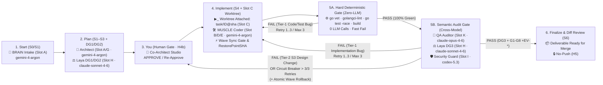

# 09. Tasks Solution & Code Demo — Kiến Trúc Multi-Agent Pipeline Resilience & Cross-Model Gates (`A..E`)

> **Phương án Tối Ưu Duy Nhất (Rule #9.4 & Rule #13 — Propose-Only):** Tài liệu này trình bày **đúng 1 phương án kiến trúc tối ưu nhất** kèm **Code Demo cụ thể** giải quyết trọn vẹn 5 điểm nâng cấp (`A..E`) của anh trên `/Users/trainguyen/Documents/work/ai-orchestrator` (`internal/webui/task_inspector.go`, `internal/webui/server.go`, `internal/webui/static/app.js`). Không sửa bất kỳ file source code nào trước khi có lệnh `APPROVE`.

---

## 1. Tổng Quan Kiến Trúc Giải Pháp (`A..E`)



### Chi tiết 5 Cải tiến Cốt lõi:
1. **A. Đa dạng hóa Model theo Slot (`Cross-Model Auditing` — Xóa bỏ `Monoculture Bias`):**
   - Trong `internal/webui/task_inspector.go:603-652` (`loadCLISettings`) và `internal/webui/server.go:2654-2697` (`buildAutopilotView`):
     - **Nhóm Thực thi (`BRAIN Architect` Slot A/G & `MUSCLE Coder` Slot B/D/E):** dùng `gemini-4-argon (antigravity)` (và `gemini-2.5-flash (antigravity)` cho `Slot D/F` tốc độ cao).
     - **Nhóm Kiểm định Chéo Độc lập (`Cross-Model Auditors`):**
       - `Slot K` (`QA Adversarial Auditor` — S5B): `claude-opus-4-6 (antigravity)`
       - `Slot H` (`Laya Gate DG1/DG2/DG3` — S3 & S5B): `claude-sonnet-4-6 (antigravity)`
       - `Slot I` (`Security & H4b Guard` — S4 & S5B): `codex-5.3 (antigravity)`
     - Bổ sung hàm `EvaluateCrossModelDiversity(cliCfg CLISettingsDTO)` trả về cờ `CrossModelVerified: true` khi `CoderHighModel != QAAuditorModel && CoderHighModel != LayaGateModel`.

2. **B. Chốt chặn `Circuit Breaker (Max 3 Retries)` & Phân tách 2 tầng `Self-Healing` (`Tier-1: S5->S4->S5` vs `Tier-2: S5->S3->Human Gate`):**
   - Bổ sung struct `SelfHealingCircuitStateDTO` lưu tại `.orchestrator/tasks/<key>/self_heal_state.json` (và tương ứng cho từng Sub-Task tại `subtasks/<subID>/self_heal_state.json`):
     - `RetryCount int` (`0..3`), `MaxRetries int` (`= 3`), `CircuitOpen bool`, `LastLoopTier string` (`"TIER1_S5_TO_S4"` | `"TIER2_S5_TO_S3_HUMAN_GATE"`).
     - **Nhánh `Tier-1 (S5 -> S4 -> S5)`:** Khi lỗi compile/test (`5A`) hoặc lỗi implementation (`5B`) không làm thay đổi thiết kế `S3`, cho phép quay về `S4 (MUSCLE)` tối đa `3` lần (`Retry 1/3 .. 3/3`).
     - **Nhánh `Tier-2 (S5 -> S3 -> Human Gate NEEDS_YOU)`:** Nếu phải sửa lại thiết kế ở `S3` (`09_tasks_solution.md`), hệ thống **xóa `.user-approved` và bắt buộc dừng tại `Human Gate (NEEDS_YOU)`** để anh duyệt lại, tuyệt đối không cho chạy thẳng `S3 -> S4 -> S5` ngầm gây **Scope Drift**.
     - **Ngắt mạch `Circuit Breaker (Retry > 3)`:** Ngay khi `RetryCount >= 3` mà vẫn chưa pass `5A/5B`, tự động bật `CircuitOpen = true`, dừng vòng lặp và chuyển Task/Sub-Task về `NEEDS_YOU` (`Escalation Rule #15`).

3. **C. Kéo `Worktree Provisioning (Slot C)` về đầu `Implement (S4)` & Đổi tên Stage 6 thành `Finalize & Diff Review`:**
   - Tại `internal/webui/server.go:2675-2696` và `internal/webui/task_inspector.go:2285-2327`:
     - **Stage 4 (`implement`):** Tích hợp `Slot C (Worktree Attached: task/<id>@<sha>)` ngay vào Stage 4 (`Implement (S4 · Worktree Slot C)`) và hiển thị huy hiệu `🌿 Worktree Attached` trên Header của Task/Sub-Task.
     - **Stage 6 (`pr`):** Đổi tên từ `Isolated Branch (Worktree Ready)` thành **`Finalize & Diff Review`** (`Subtitle: gitRef`, `Meta: "Ready for Merge · No-Push (H5)"`, `RoleLabel: "📦 Deliverable & Diff Review"`, `SkillBadge: "/session-wrapup"`).

4. **D. `Contract/Integration Sync Gate` & `Atomic Wave Rollback` cho `Multi-Repo Wave`:**
   - Bổ sung vào `internal/webui/task_inspector.go`:
     - **`VerifyWaveContractSync(items []SubTaskDTO, waveIdx int)`:** Kiểm tra mọi Sub-Task trong `Wave` có `OutputContract.Deliverables` và `TargetRepo` đồng bộ với `InputContract` của các Sub-Task liên kết.
     - **`AtomicRollbackWave(taskDir string, items []SubTaskDTO, waveIdx int, reason string)`:** Trước khi chạy một `Wave`, lưu `WaveRestorePointSHA` cho tất cả các worktree trong `Wave`. Nếu bất kỳ Sub-Task nào trong `Wave` bị `CircuitOpen` (`3/3 Retries Exhausted`), tự động rollback đồng loạt toàn bộ các Sub-Task và worktree trong cùng `Wave` về `WaveRestorePointSHA` (`Stage = "NEEDS_YOU"`, ghi nhận biên bản `[Atomic Wave Rollback]`).

5. **E. Tách Stage 5 thành 2 tầng: `5A Hard Deterministic Gate (Zero-LLM)` & `5B Semantic Audit Gate (Cross-Model QA + DG3 + G1–G8)`:**
   - Tại Stage 5 (`qa`) trong `buildAutopilotView` (`server.go:2683-2690`) và `buildSubTaskPipelineStages` (`task_inspector.go:2300-2315`), tách rõ 2 thẻ tuần tự:
     - **Card 5A — `5A. Hard Gate (Zero-LLM)`:** `Subtitle: "go vet · lint · go test -race · build"`, `Meta: "0 LLM Calls · Fast-Fail -> S4"`, `RoleLabel: "⚙️ Deterministic Runner"`, `AgentSlot: "Slot C"`, `Model: "zero-llm-Runner"`. Nếu `5A` fail -> trả thẳng `stdout/stderr` về `S4` mà **không gọi `5B`**.
     - **Card 5B — `5B. Semantic Audit & DG3`:** `Subtitle: fmt.Sprintf("Retry %d/%d (Max 3) · S5->S4", retryCount, 3)`, `Meta: "G1-G8 · S5->S3 Re-locks Human Gate"`, `RoleLabel: "🧪 Cross-Model QA & DG3"`, `AgentSlot: "Slot K / H / I"`, `Model: "claude-opus-4-6 + sonnet-4-6"`.

---

## 2. Concrete Code Demo (`Go` & `JS`)

### 2.1. Đa dạng hóa Model theo Slot (`Cross-Model Auditing`) & `SelfHealingCircuitStateDTO` (`internal/webui/task_inspector.go`)
```go
// CLISettingsDTO persists the user's CLI runner and Cross-Model Auditing configuration (TASK-PIPE-01).
type CLISettingsDTO struct {
	DefaultRunner      string `json:"default_runner"`       // antigravity | gemini | claude | codex
	PlannerModel       string `json:"planner_model"`        // Slot A/G: gemini-4-argon (antigravity)
	CoderHighModel     string `json:"coder_high_model"`     // Slot B/E: gemini-4-argon (antigravity)
	CoderStdModel      string `json:"coder_std_model"`      // Slot D/F: gemini-2.5-flash (antigravity)
	QAAuditorModel     string `json:"qa_auditor_model"`     // Slot K (Cross-Model QA): claude-opus-4-6 (antigravity)
	LayaGateModel      string `json:"laya_gate_model"`      // Slot H (Cross-Model DG1/2/3): claude-sonnet-4-6 (antigravity)
	SecurityModel      string `json:"security_model"`       // Slot I (Cross-Model Sec): codex-5.3 (antigravity)
	AgentKernelRoot    string `json:"agent_kernel_root"`    // /Users/trainguyen/Documents/work/agent
	EnforceApproveGate bool   `json:"enforce_approve_gate"` // true -> hard stop at NEEDS_YOU after S3 & on Tier-2 S5->S3 re-plan
	MaxSelfHealRetries int    `json:"max_self_heal_retries"` // Circuit Breaker limit (default: 3)
}

// SelfHealingCircuitStateDTO tracks Tier-1 (S5->S4->S5) retries vs Tier-2 (S5->S3->Human Gate) & Circuit Breaker (TASK-PIPE-02).
type SelfHealingCircuitStateDTO struct {
	RetryCount            int    `json:"retry_count"`              // Current retry count (0..3)
	MaxRetries            int    `json:"max_retries"`              // Hard Circuit Breaker limit (default 3)
	CircuitOpen           bool   `json:"circuit_open"`             // true when RetryCount >= MaxRetries -> forces NEEDS_YOU
	AllowedLoopRoute      string `json:"allowed_loop_route"`       // "Tier-1: S5 -> S4 -> S5 (Max 3)"
	EscalationRoute       string `json:"escalation_route"`         // "Tier-2: S5 -> S3 -> Human Gate (NEEDS_YOU)"
	HardGateZeroLLMPassed bool   `json:"hard_gate_zero_llm_passed"` // Stage 5A status before invoking Stage 5B LLM Auditor
	SemanticGateCalled    bool   `json:"semantic_gate_called"`     // false if 5A failed (0 LLM Auditor calls wasted)
	WaveRestorePointSHA   string `json:"wave_restore_point_sha"`   // Git SHA for Atomic Wave Rollback
	WaveRollbackTriggered bool   `json:"wave_rollback_triggered"`  // true if a sibling Sub-Task in the same Wave tripped Circuit Breaker
}
```

### 2.2. Cổng 2 Tầng `Stage 5A (Hard Gate Zero-LLM)` -> `Stage 5B (Cross-Model Semantic Audit)` & `Circuit Breaker` (`internal/webui/task_inspector.go`)
```go
// ExecuteTwoLayerStage5AndSelfHeal enforces:
// 1. Stage 5A Hard Deterministic Gate (Zero-LLM: go vet, test, on-disk check) BEFORE calling any LLM QA Auditor (TASK-PIPE-05).
// 2. Two-tier Self-Healing separation: Tier-1 (S5->S4->S5, Max 3 retries) vs Tier-2 (S5->S3 forces Human Gate NEEDS_YOU) (TASK-PIPE-02).
// 3. Atomic Wave Rollback across all Sub-Tasks in the same Wave if Circuit Breaker trips (TASK-PIPE-04).
func (s *Server) ExecuteTwoLayerStage5AndSelfHeal(
	ctx context.Context,
	qt queue.QueuedTask,
	items []SubTaskDTO,
	subIdx int,
	requiresS3ArchitectureChange bool,
) ([]SubTaskDTO, SelfHealingCircuitStateDTO) {
	st := &items[subIdx]
	state := s.loadSubTaskSelfHealState(qt.ExternalID, st.SubTaskID)
	if state.MaxRetries <= 0 {
		state.MaxRetries = 3
	}

	// Rule B1 (Anti-Scope-Drift): If fixing the defect requires changing the S3 Plan/Architecture,
	// strictly block automatic S5->S3->S4->S5 and force re-entry into Human Gate (NEEDS_YOU)!
	if requiresS3ArchitectureChange {
		s.revokeSubTaskApproval(qt.ExternalID, st.SubTaskID)
		st.Stage = "NEEDS_YOU"
		st.Status = "waiting"
		state.EscalationRoute = "Tier-2 Triggered: S5 -> S3 Plan Modified -> Locked at Human Gate (NEEDS_YOU)"
		s.saveSubTaskSelfHealState(qt.ExternalID, st.SubTaskID, state)
		return items, state
	}

	// Layer 5A: Hard Deterministic Gate (Zero-LLM — 0 Auditor tokens spent if compile/vet/on-disk check fails)
	hardOK, hardDetail := s.VerifySubTaskCodeOnDisk(ctx, *st)
	state.HardGateZeroLLMPassed = hardOK
	if !hardOK {
		state.SemanticGateCalled = false // Skip 5B Semantic LLM Auditor completely!
		state.RetryCount++
		if state.RetryCount >= state.MaxRetries {
			// Circuit Breaker Tripped (3/3 Retries Exhausted) -> Atomic Wave Rollback + Escalate to NEEDS_YOU!
			state.CircuitOpen = true
			items = s.AtomicRollbackWaveSubTasks(qt.ExternalID, items, st.WaveIndex,
				fmt.Sprintf("Sub-Task %s failed 5A Hard Gate (%d/%d retries): %s", st.SubTaskID, state.RetryCount, state.MaxRetries, hardDetail))
		} else {
			// Tier-1 Implementation Self-Heal: Return stdout/stderr directly to MUSCLE (S4)
			st.Stage = "RUNNING"
			st.Status = "running"
		}
		s.saveSubTaskSelfHealState(qt.ExternalID, st.SubTaskID, state)
		return items, state
	}

	// Layer 5B: Semantic Audit Gate (Cross-Model QA claude-opus-4-6 + Laya DG3 claude-sonnet-4-6 + Security codex-5.3)
	// Only invoked AFTER Layer 5A is 100% green!
	state.SemanticGateCalled = true
	syncOK, syncReason := VerifyWaveContractSync(items, st.WaveIndex)
	if !syncOK {
		state.RetryCount++
		if state.RetryCount >= state.MaxRetries {
			state.CircuitOpen = true
			items = s.AtomicRollbackWaveSubTasks(qt.ExternalID, items, st.WaveIndex, syncReason)
		} else {
			st.Stage = "RUNNING"
			st.Status = "running"
		}
		s.saveSubTaskSelfHealState(qt.ExternalID, st.SubTaskID, state)
		return items, state
	}

	st.Stage = "DONE"
	st.Status = "done"
	s.saveSubTaskSelfHealState(qt.ExternalID, st.SubTaskID, state)
	return items, state
}
```

### 2.3. Định vị `Worktree Provisioned (Slot C)` ở Stage 4, Tách `5A / 5B` ở Stage 5, và Đổi Stage 6 thành `Finalize & Diff Review` (`internal/webui/server.go`)
```go
	stages := []AutopilotStageGroupDTO{
		{
			ID: "start",
			Cards: []AutopilotSubCardDTO{
				{Title: "Start · Scope", Subtitle: startLabel, Meta: "Repo: " + repoName, Status: "done", RoleLabel: "🧠 BRAIN · Intake", AgentSlot: "Slot A", SkillBadge: "/brain-delegate", Model: cliCfg.PlannerModel},
			},
		},
		{
			ID:         "plan",
			RoundBadge: fmt.Sprintf("⟲ %d plan runs (%s)", planRuns, activeTask.ExternalID),
			Cards: []AutopilotSubCardDTO{
				{Title: "Plan (S1-S3)", Subtitle: planSubtitle, Meta: fmt.Sprintf("%d min · $%.2f", planMin, planCost), Status: planStatus, RoleLabel: "🧠 BRAIN · Architect", AgentSlot: "Slot A / G", SkillBadge: "/brain-delegate", Model: cliCfg.PlannerModel},
				{Title: "Laya DG1/DG2", Subtitle: "S2 Scan & S3 Code Demo", Meta: "Cross-Model Gate", Status: planStatus, RoleLabel: "⚖️ Laya Gate", AgentSlot: "Slot H", SkillBadge: "/laya-router", Model: cliCfg.LayaGateModel},
			},
		},
		{
			ID: "you",
			Cards: []AutopilotSubCardDTO{
				{Title: "You (Human Gate)", Subtitle: youSubtitle, Meta: "Propose-Only H4b · Re-Approve on S3 Edit", Status: youStatus, RoleLabel: "👤 You + 🧠 BRAIN", AgentSlot: "Slot A", SkillBadge: "Co-Architect Chat", Model: cliCfg.PlannerModel},
			},
		},
		{
			ID:         "implement",
			RoundBadge: fmt.Sprintf("⟲ %d build runs · 🌿 %s", implRuns, activeIso.BranchName),
			Cards: []AutopilotSubCardDTO{
				{Title: "Implement (S4 · Worktree)", Subtitle: implSubtitle, Meta: fmt.Sprintf("Slot C Ready · %d min · $%.2f", implMin, implCost), Status: implStatus, RoleLabel: "▶_ Worktree + 🛠️ MUSCLE", AgentSlot: "Slot C + B/D/E", SkillBadge: "/muscle-execute", Model: cliCfg.CoderHighModel},
				{Title: "Multi-Repo Wave Sync", Subtitle: "Zero-Mockup H4b · Atomic Rollback", Meta: fmt.Sprintf("%d/%d Sub-Tasks DONE", doneSubTasks, len(activeSubTasks)), Status: implStatus, RoleLabel: "⚡ Wave Sync & Rollback", AgentSlot: "Slot E / F", SkillBadge: "/muscle-execute", Model: cliCfg.CoderHighModel},
			},
		},
		{
			ID:         "qa",
			RoundBadge: fmt.Sprintf("⟲ %d QA runs · Circuit Breaker %d/%d (Max 3)", qaRuns, selfHealRetries, 3),
			Cards: []AutopilotSubCardDTO{
				{Title: "5A. Hard Gate (Zero-LLM)", Subtitle: "go vet · lint · go test -race · build", Meta: "0 LLM Calls · Fail -> S4", Status: qaStatus, RoleLabel: "⚙️ Deterministic Gate", AgentSlot: "Slot C", SkillBadge: "Zero-LLM Gate", Model: "system-compiler (0 LLM)"},
				{Title: "5B. Semantic Audit & DG3", Subtitle: fmt.Sprintf("S5->S4 (%d/3 Max) · S5->S3 => Human Gate", selfHealRetries), Meta: "G1-G8 · Cross-Model QA", Status: qaStatus, RoleLabel: "🧪 QA + 🛡️ Sec + ⚖️ DG3", AgentSlot: "Slot K / H / I", SkillBadge: "/qa-agent · DG3", Model: cliCfg.QAAuditorModel},
			},
		},
		{
			ID: "pr",
			Cards: []AutopilotSubCardDTO{
				{Title: "Finalize & Diff Review", Subtitle: gitRef, Meta: "Deliverable Ready · No-Push (H5)", Status: prStatus, RoleLabel: "📦 Diff Review & Merge Gate", AgentSlot: "Slot C / F", SkillBadge: "/session-wrapup", Model: cliCfg.PlannerModel},
			},
		},
	}
```

---

## 3. Clean-Room Approved Spec (Verified `REF:` Rules)
- **R1 (`TASK-PIPE-01` — Cross-Model Auditing):** Tách họ model mặc định trong `CLISettingsDTO` sao cho `QAAuditorModel` (`claude-opus-4-6 (antigravity)`), `LayaGateModel` (`claude-sonnet-4-6 (antigravity)`), và `SecurityModel` (`codex-5.3 (antigravity)`) độc lập với `CoderHighModel` (`gemini-4-argon (antigravity)`) (`REF: /Users/trainguyen/Documents/work/ai-orchestrator/internal/webui/task_inspector.go:603-652`).
- **R2 (`TASK-PIPE-02` — Two-Tier Self-Healing & Circuit Breaker Max 3):** Tách vòng lặp `Tier-1 (S5 -> S4 -> S5, Max 3 Retries)` cho lỗi code/test khỏi `Tier-2 (S5 -> S3 -> Human Gate NEEDS_YOU)` khi sửa thiết kế `S3`, và tự động ngắt về `NEEDS_YOU` khi chạm `3/3 Retries` (`REF: /Users/trainguyen/Documents/work/ai-orchestrator/internal/webui/server.go:2683-2690`).
- **R3 (`TASK-PIPE-03` — Pre-S4 Worktree Slot C & Stage 6 Finalize & Diff Review):** Gắn `Worktree Provisioned (Slot C)` ngay tại Stage 4 (`Implement S4`) + Header, và đổi Stage 6 thành `Finalize & Diff Review` (`REF: /Users/trainguyen/Documents/work/ai-orchestrator/internal/webui/server.go:2675-2696`).
- **R4 (`TASK-PIPE-04` — Multi-Repo Wave Contract Sync & Atomic Wave Rollback):** Kiểm tra `VerifyWaveContractSync` giữa các Sub-Task trong cùng Wave và thực thi `AtomicRollbackWaveSubTasks` về `WaveRestorePointSHA` nếu bất kỳ Sub-Task nào trong Wave bị đứt cầu dao `Circuit Breaker` (`REF: /Users/trainguyen/Documents/work/ai-orchestrator/internal/webui/task_inspector.go:2376-2400`).
- **R5 (`TASK-PIPE-05` — Stage 5A Hard Deterministic Gate Zero-LLM vs Stage 5B Semantic Audit Gate):** Chạy `5A Hard Gate (Zero-LLM)` chắn trước `5B Semantic Audit Gate (Cross-Model QA + DG3)` để trả thẳng lỗi compile/test về `S4` mà không tốn 1 lần gọi LLM Auditor nào (`REF: /Users/trainguyen/Documents/work/ai-orchestrator/internal/webui/task_inspector.go:2300-2315`).
