# 09 Tasks Solution: Kiến Trúc Fractal Sub-Task Lifecycle (`Sub-Task Là Task Độc Lập`: Đầu Vào -> Plan Riêng -> `Start -> Isolated Branch` -> Đầu Ra)

## 1. Kiến Trúc Giải Pháp Tối Ưu Duy Nhất (Single Optimal Solution)
Biến mỗi `Sub-Task` (`TASK-M01 .. TASK-M10` hoặc `TASK-A01 .. TASK-A07`) sau khi phân rã từ Task cha thành một **Đơn vị Thực thi Task Độc lập (`First-Class Fractal Task Execution Unit`)** có đầy đủ **Đầu vào (`InputContract`)**, **Plan & Hồ sơ giải quyết riêng (`Dedicated Sub-Task Artifact Dir & Plan`)**, **Quy trình 6 bước `Start -> Isolated Branch` riêng (`Stage` & `PipelineStages`)**, và **Đầu ra (`OutputContract`)** truyền tiếp sang Wave sau:

```mermaid
flowchart LR
    subgraph Parent["Task Cha (VD: TASK-11 · Master MongoDB Destination)"]
        Decomp["Phân rã thành 10 Sub-Tasks (TASK-M01 .. TASK-M10) theo Wave 0..4"]
    end

    subgraph SubTaskFlow["Bản chất mỗi Sub-Task (VD: TASK-M01) LÀ MỘT TASK ĐỘC LẬP"]
        direction LR
        IN["📥 1. Đầu Vào (InputContract)\n- Context file:line\n- Upstream Outputs (từ Wave N-1)\n- Input Spec"]
        S_START["🚀 Start\n(S0/S1 Intake riêng)"]
        S_PLAN["📐 Plan & DG1/DG2\n(09_tasks_solution.md\n+ Code Demo riêng)"]
        S_YOU["👤 You (Approve)\n(Duyệt riêng hoặc\ntheo Wave Task cha)"]
        S_IMPL["🛠️ Implement (S4)\n(Worktree & Branch riêng\ntask/<parent>/<subID>)"]
        S_QA["🛡️ Local QA & DG3 (S5)\n(audit_report.md\n+ EV-... riêng)"]
        S_BR["🌿 Isolated Branch (S6)\ntask/<parent>/<subID>\n(DONE)"]
        OUT["📤 4. Đầu Ra (OutputContract)\n- Deliverables (Files/Symbols)\n- diff.patch + EV-...\n- Bàn giao cho Wave N+1"]

        IN --> S_START --> S_PLAN --> S_YOU --> S_IMPL --> S_QA --> S_BR --> OUT
    end

    Decomp --> SubTaskFlow
    OUT -. "Truyền Output làm InputContract cho Sub-Task ở Wave kế tiếp" .-> IN
```



### 1.1. Mở rộng `SubTaskDTO` & Hồ sơ vật lý `.orchestrator/tasks/<parentKey>/subtasks/<subTaskID>/` (`TASK-SUB-01`)
Tại [`internal/webui/task_inspector.go:43-65`](file:///Users/trainguyen/Documents/work/ai-orchestrator/internal/webui/task_inspector.go#L43-L65):
- Bổ sung 2 struct hợp đồng rõ ràng:
  1. `SubTaskInputContractDTO`:
     - `SourceContext`: `file:line` điểm chạm trong `TargetRepo`.
     - `UpstreamSubTaskIDs`: Danh sách Sub-Task ở Wave trước (`DependsOn`).
     - `UpstreamDeliverables`: Danh sách kết quả đầu ra từ các Sub-Task ở Wave trước đã truyền sang làm đầu vào cho Sub-Task này (kèm trạng thái `READY` hoặc `WAITING_UPSTREAM`).
     - `InputRequirements`: Đặc tả dữ liệu/struct/interface đầu vào của Sub-Task.
  2. `SubTaskOutputContractDTO`:
     - `Deliverables`: Danh sách file/struct/hàm/endpoint mà Sub-Task này tạo mới hoặc cập nhật.
     - `DownstreamSubTaskIDs`: Danh sách các Sub-Task ở Wave kế tiếp sẽ tiêu thụ đầu ra của Sub-Task này.
     - `DiffFile`: `.orchestrator/tasks/<parentKey>/subtasks/<subTaskID>/diff.patch`.
     - `AuditFile`: `.orchestrator/tasks/<parentKey>/subtasks/<subTaskID>/audit_report.md`.
     - `EvidenceReceiptID`: Biên lai `EV-...` xác thực kết quả thực thi của Sub-Task.
     - `HandoffReady`: `bool` (`true` khi Sub-Task đạt `DONE` và sẵn sàng bàn giao đầu ra cho Wave sau).
- Bổ sung vào `SubTaskDTO`:
  - `Stage`: `"READY" | "PLANNING" | "NEEDS_YOU" | "APPROVED" | "RUNNING" | "IN_REVIEW" | "DONE"`
  - `BranchName`: `"task/<safeParentKey>/<lowerSubTaskID>"` (nhánh cô lập riêng của Sub-Task)
  - `ArtifactDir`: `".orchestrator/tasks/<safeParentKey>/subtasks/<subTaskID>"`
  - `PlanFile`: `".orchestrator/tasks/<safeParentKey>/subtasks/<subTaskID>/09_tasks_solution.md"`
  - `PlanSummary`: Tóm tắt giải pháp kỹ thuật riêng của Sub-Task
  - `PlanMarkdown`: Nội dung Markdown đầy đủ của `09_tasks_solution.md` riêng cho Sub-Task đó
  - `CodeDemo`: Đoạn Code Demo giải quyết riêng cho đúng Sub-Task đó
  - `InputContract`: `SubTaskInputContractDTO`
  - `OutputContract`: `SubTaskOutputContractDTO`
  - `PipelineStages`: `[]AutopilotStageGroupDTO` (6 bước `Start -> Plan (S1-S3 + DG1/DG2) -> You (Approve) -> Implement (S4) -> Local QA & DG3 (S5) -> Isolated Branch (S6)` của riêng Sub-Task đó).

### 1.2. Engine Thực Thi Vòng Đời Riêng Cho Từng Sub-Task (`RunSubTaskLifecycleStep` — `TASK-SUB-02`)
Tại [`internal/webui/task_inspector.go`](file:///Users/trainguyen/Documents/work/ai-orchestrator/internal/webui/task_inspector.go) và [`internal/webui/server.go`](file:///Users/trainguyen/Documents/work/ai-orchestrator/internal/webui/server.go):
- Xây dựng hàm `EnsureSubTaskFractalArtifacts(qt queue.QueuedTask, st *SubTaskDTO, allSubTasks []SubTaskDTO)` tự động tạo hồ sơ vật lý riêng tại `.orchestrator/tasks/<safeParent>/subtasks/<subTaskID>/`:
  - `01_requirements.md` (Đầu vào `InputContract`, `UpstreamDeliverables`, và `TestDoD` riêng của Sub-Task).
  - `13_analysis.md` (Phân tích `ContextFileLine` trên `TargetRepo` riêng của Sub-Task).
  - `09_tasks_solution.md` (Plan giải quyết riêng + Code Demo riêng cho Sub-Task + kiểm định `DG1/DG2`).
  - `diff.patch` & `audit_report.md` (Diff và báo cáo Audit S5 + `DG3` + `EV-...` riêng của Sub-Task).
  - `05_progress.md` (Nhật ký bất biến `START -> GATE_PASS -> DONE` riêng của Sub-Task).
- Xây dựng hàm `RunSubTaskLifecycleStep(ctx, parentKey, subTaskID, stepAction)` và đăng ký vào `POST /api/action` (`internal/webui/server.go`):
  - `subtask_plan`: Chạy `Start (S1) -> Plan (S2/S3 + DG1/DG2)` cho riêng `subTaskID`, sinh `01_requirements.md`, `13_analysis.md`, `09_tasks_solution.md` riêng và chuyển `st.Stage = "NEEDS_YOU"`.
  - `subtask_approve`: Duyệt Plan riêng của `subTaskID` (`st.Stage = "APPROVED"`).
  - `subtask_implement`: Chạy `S4 Implement` trên nhánh cô lập `task/<parentKey>/<subTaskID>` (`st.WorktreePath`), trích xuất `diff.patch` riêng cho `TargetFiles` của `subTaskID`, chuyển `st.Stage = "IN_REVIEW"`.
  - `subtask_qa`: Chạy `S5 Local QA & DG3 Audit` cho riêng `subTaskID`, xuất `audit_report.md` kèm `EV-...`, đánh dấu `st.Stage = "DONE"`, `st.Status = "done"`, `st.OutputContract.HandoffReady = true` và tự động mở khóa `UpstreamDeliverables` cho các Sub-Task ở Wave kế tiếp!
  - `subtask_autopilot`: Chạy trọn vòng `Start -> Plan -> Implement -> Local QA -> Isolated Branch` cho riêng `subTaskID`.
- Đồng thời: Khi chạy ở cấp **Task Cha** (`Plan S1-S3`, `APPROVE & S4`, `S5 QA`, hoặc `Autopilot`), hệ thống tự động đồng bộ trạng thái xuống từng `Sub-Task` theo đúng thứ tự `Wave 0 -> Wave 1 -> ... -> Wave N` (Đầu ra của `Wave N-1` truyền làm Đầu vào cho `Wave N`).

### 1.3. Giao Diện Web UI: Inspector Luồng `Start -> Isolated Branch` Của Từng Sub-Task (`TASK-SUB-03`)
Tại [`internal/webui/static/app.js`](file:///Users/trainguyen/Documents/work/ai-orchestrator/internal/webui/static/app.js) và [`internal/webui/static/index.html`](file:///Users/trainguyen/Documents/work/ai-orchestrator/internal/webui/static/index.html):
- Trong cả **View 1 (`1. Autopilot & Report`)** và **View 2 (`2. Wave 0..N Dependency DAG — Tầng 3: Sub-Tasks`)**, khi người dùng click chọn bất kỳ `Sub-Task` nào (mặc định chọn Sub-Task đầu tiên đang active hoặc `TASK-M01`), hiển thị **Sub-Task Fractal Lifecycle Panel (`Luồng Thực Thi Sub-Task Độc Lập: Start -> Isolated Branch`)** gồm:
  1. **Thanh Pipeline 6 Bước Riêng Của Sub-Task (`Start -> Plan (S1-S3) -> You (Approve) -> Implement (S4) -> Local QA & DG3 (S5) -> Isolated Branch (S6)`):** Hiển thị rõ Sub-Task đang ở bước nào, nhánh cô lập `task/<parentKey>/<subTaskID>`, worktree riêng, và các nút điều khiển trực tiếp cho Sub-Task đó (`1. Plan Sub-Task`, `✓ APPROVE Sub-Task`, `3. Implement Sub-Task`, `4. QA & Branch Sub-Task`, `▶ Autopilot Sub-Task`).
  2. **Hợp Đồng Đầu Vào (`📥 Input Contract`) & Đầu Ra (`📤 Output Contract`):**
     - **Đầu vào:** Hiển thị `Context (file:line)`, danh sách `DependsOn` từ Wave trước kèm trạng thái bàn giao (`READY / WAITING`), và đặc tả đầu vào.
     - **Đầu ra:** Hiển thị `Deliverables` (symbols/files/endpoints), danh sách `Downstream Consumers` ở Wave kế tiếp, đường dẫn `diff.patch`, `audit_report.md`, và biên lai `EV-...`.
  3. **Bản Kế Hoạch & Code Demo Giải Quyết Riêng Của Sub-Task (`📐 Sub-Task Dedicated Plan & Code Demo`):** Hiển thị trực tiếp nội dung `09_tasks_solution.md` và `CodeDemo` của riêng Sub-Task đang chọn.

---

## 2. Concrete Code Demo (`TASK-SUB-01` .. `TASK-SUB-03`)

```go
// File: internal/webui/task_inspector.go

// SubTaskInputContractDTO defines the explicit input contract of an individual Sub-Task.
type SubTaskInputContractDTO struct {
	SourceContext        string   `json:"source_context"`         // e.g. "cdc-cms-service/internal/api/master/master_registry_handler_connections.go:172-249"
	UpstreamSubTaskIDs   []string `json:"upstream_sub_task_ids"`  // DependsOn sub-task IDs from Wave N-1
	UpstreamDeliverables []string `json:"upstream_deliverables"`  // Outputs handed off from completed upstream sub-tasks
	UpstreamReady        bool     `json:"upstream_ready"`         // true if Wave 0 or all UpstreamSubTaskIDs are DONE
	InputSpec            string   `json:"input_spec"`             // Concrete input payload / interface / context spec
}

// SubTaskOutputContractDTO defines the explicit output deliverables produced by an individual Sub-Task.
type SubTaskOutputContractDTO struct {
	Deliverables         []string `json:"deliverables"`            // Concrete files/functions/endpoints produced
	DownstreamSubTaskIDs []string `json:"downstream_sub_task_ids"` // Sub-Tasks in Wave N+1 consuming this output
	DiffFile             string   `json:"diff_file"`               // .orchestrator/tasks/<parent>/subtasks/<subID>/diff.patch
	AuditFile            string   `json:"audit_file"`              // .orchestrator/tasks/<parent>/subtasks/<subID>/audit_report.md
	EvidenceReceiptID    string   `json:"evidence_receipt_id"`     // EV-... receipt for this sub-task
	HandoffReady         bool     `json:"handoff_ready"`           // true when Sub-Task reaches Isolated Branch (DONE)
}

// SubTaskDTO represents a first-class fractal sub-task with its own Input, Dedicated Plan,
// Start -> Isolated Branch pipeline, and Output contract.
type SubTaskDTO struct {
	SubTaskID       string                    `json:"sub_task_id"`
	ParentKey       string                    `json:"parent_key"`
	GroupTitle      string                    `json:"group_title"`
	WaveIndex       int                       `json:"wave_index"`
	WorkflowStep    string                    `json:"workflow_step"`
	Title           string                    `json:"title"`
	TargetRepo      string                    `json:"target_repo"`
	TargetRepoName  string                    `json:"target_repo_name"`
	WorktreePath    string                    `json:"worktree_path"`
	BranchName      string                    `json:"branch_name"`       // e.g. "task/task-11/task-m01"
	ArtifactDir     string                    `json:"artifact_dir"`      // e.g. ".orchestrator/tasks/task-11/subtasks/task-m01"
	PlanFile        string                    `json:"plan_file"`         // e.g. ".orchestrator/tasks/task-11/subtasks/task-m01/09_tasks_solution.md"
	TargetFiles     string                    `json:"target_files"`
	ContextFileLine string                    `json:"context_file_line"`
	Description     string                    `json:"description"`
	TestDoD         string                    `json:"test_dod"`
	DependsOn       []string                  `json:"depends_on"`
	Stage           string                    `json:"stage"`             // READY | PLANNING | NEEDS_YOU | APPROVED | RUNNING | IN_REVIEW | DONE
	Status          string                    `json:"status"`            // done | running | waiting | pending
	PlanSummary     string                    `json:"plan_summary"`
	PlanMarkdown    string                    `json:"plan_markdown"`
	CodeDemo        string                    `json:"code_demo"`
	InputContract   SubTaskInputContractDTO   `json:"input_contract"`
	OutputContract  SubTaskOutputContractDTO  `json:"output_contract"`
	PipelineStages  []AutopilotStageGroupDTO  `json:"pipeline_stages"`   // Start -> Plan -> You -> Implement -> Local QA -> Isolated Branch
	Assignee        string                    `json:"assignee"`
	RoleLabel       string                    `json:"role_label"`
	AgentSlot       string                    `json:"agent_slot"`
	SkillBadge      string                    `json:"skill_badge"`
	Runner          string                    `json:"runner"`
	Model           string                    `json:"model"`
}
```

---

## 6. S5 → S3 Adversarial Self-Healing Remediation (`GAP-FRAC-AUDIT-01` .. `GAP-FRAC-AUDIT-05`)

Qua quá trình **Line-by-Line Adversarial Audit (`S5`)** trên toàn bộ diff vừa thực hiện (`internal/webui/task_inspector.go:1611-2210` và `internal/webui/server.go:1280-1560`), chúng ta phát hiện **5 lỗ hổng kỹ thuật & tính trung thực runtime** cần được tự chữa lành ngay theo quy trình `S5 → S3 → S4 → S5` (`GEMINI.md` Rule #9.7d):

1. **`GAP-FRAC-AUDIT-01` — Cưỡng chế 3 cổng cứng (`UpstreamReady Wave Gate`, `H4b Approve Gate`, `VerifySubTaskCodeOnDisk Gate`) trong `runSubTaskLifecycleAction` (`internal/webui/task_inspector.go:2163-2204`):**
   - Trước khi cho phép `subtask_implement`, `subtask_qa`, hoặc `subtask_autopilot` (Phase 2) chuyển Sub-Task sang `IN_REVIEW` hoặc `DONE`:
     - **Cổng 1 (`Upstream Wave Dependency Gate`):** Nếu `st.WaveIndex >= 1` và `!st.InputContract.UpstreamReady` (tồn tại `DependsOn` Sub-Task ở Wave trước chưa đạt `DONE`), lập tức **BLOCK**, giữ `st.Stage = "NEEDS_YOU"`, `st.Status = "waiting"`, ghi log `[Wave Dependency Gate BLOCK]` nêu rõ danh sách `DependsOn` chưa hoàn thành.
     - **Cổng 2 (`H4b Approve Gate`):** Nếu gọi `subtask_implement` hoặc `subtask_qa` khi chưa có `.user-approved` ở cấp Sub-Task (`.orchestrator/tasks/<safeParent>/subtasks/<safeSubID>/.user-approved`) hoặc cấp Task cha, lập tức **BLOCK** ở `NEEDS_YOU` kèm log `[Gate H4b BLOCK]`.
     - **Cổng 3 (`On-Disk Code & Evidence Receipt Verification Gate`):** Khi chạy `subtask_qa` hoặc `subtask_autopilot` Phase 2, bắt buộc gọi `VerifySubTaskCodeOnDisk(ctx, *st)` và `writeSubTaskPhysicalEvidenceReceipt(parent, *st, subDir, verifiedOK, verifiedDetail)`. Nếu file/symbol trên đĩa trong `st.TargetRepo` không tồn tại (`!verifiedOK`), chặn không cho lên `DONE` (giữ ở `IN_REVIEW`).
2. **`GAP-FRAC-AUDIT-02` — Thay thế chuỗi tĩnh `"EV-SUB-<ID>-PASS"` và `diff --git` comment giả bằng Biên lai vật lý `06_evidence/EV-SUB-<safeSubID>.json` + Kiểm chứng đĩa thật (`internal/webui/task_inspector.go:1708-1711, 1871-1880`):**
   - Viết hàm `writeSubTaskPhysicalEvidenceReceipt(parent TaskDetailDTO, st SubTaskDTO, subDir string, verifiedOK bool, verifiedDetail string) string` tính SHA-256 `src_fingerprint` trực tiếp trên file nguồn thật trong `st.TargetRepo` (`st.ContextFileLine` / `st.TargetFiles`) và ghi file JSON vật lý tại `.orchestrator/tasks/<safeParent>/subtasks/<safeSubID>/06_evidence/EV-SUB-<safeSubID>.json`.
   - Trong `extractSubTaskDiffFromParentPatch`, nếu `parentDiff` không có hunk uncommitted cho file của Sub-Task, tuyệt đối **KHÔNG** sinh khối `diff --git` comment giả 4 dòng; thay vào đó đọc trực tiếp đoạn code thật trên đĩa qua `readSubTaskRealSourceSnippet(st)` và gắn header trung thực `# [VERIFIED ON-DISK SOURCE AT TargetRepo — NO UNCOMMITTED GIT DIFF HUNK]`.
3. **`GAP-FRAC-AUDIT-03` — Xóa bỏ hàm stub `ExecuteSubTask_` rỗng ở nhánh `default:` của `buildDedicatedSubTaskCodeDemo`, thay bằng đọc source code thật từ `TargetRepo` tại `ContextFileLine` (`internal/webui/task_inspector.go:1883-2008`):**
   - Viết hàm `readSubTaskRealSourceSnippet(st SubTaskDTO) (string, string)` phân tích `st.ContextFileLine` (ví dụ `internal/delivery/http/server.go:25-115`) kết hợp `st.TargetRepo`, mở file thật trên đĩa và trích xuất đúng dải dòng code thật (kèm số dòng). Nhờ đó mọi Sub-Task (kể cả `TASK-13-M01`, `TASK-A04..A07`, hoặc Sub-Task tùy chỉnh) đều có Code Demo và `13_analysis.md` lấy từ source code thật 100%, không bao giờ rơi về stub `return nil`.
4. **`GAP-FRAC-AUDIT-04` — Chuẩn hóa đầy đủ 6 file hồ sơ vật lý chuẩn `/agent` Tier T2 trong `.orchestrator/tasks/<safeParent>/subtasks/<safeSubID>/` (`internal/webui/task_inspector.go:1814-1832`):**
   - Mỗi Sub-Task được ghi đầy đủ: `01_requirements.md` (có YAML frontmatter `tier: T2`), `08_tasks.md` (checklist & DoD riêng), `13_analysis.md` (bảng `VERIFIED` vs `HYPOTHESIS` + snippet code thật), `09_tasks_solution.md`, `diff.patch`, `audit_report.md` (đủ 6 mục S5 Adversarial Audit), và `06_evidence/EV-SUB-<safeSubID>.json`.
5. **`GAP-FRAC-AUDIT-05` — Đồng bộ `Stage`, `.subtask-stage` và hợp đồng Fractal trong `case "qa"` của Task cha (`internal/webui/server.go:1544-1559`):**
   - Khi Task cha chạy `case "qa"` và cập nhật `subTasks[i].Status = "done"`, đồng thời cập nhật `subTasks[i].Stage = "DONE"`, ghi `.subtask-stage` vào thư mục Sub-Task, và gọi `subTasks = s.populateSubTaskFractalContractsAndArtifacts(*qt, subTasks)` trước khi `saveTaskSubTasks`.
