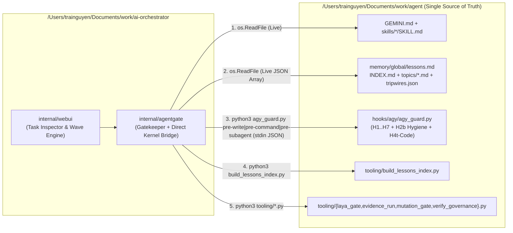

# 09 Technical Solution — Đấu nối Trực tiếp Kernel `/agent` (`agy_guard.py`, `build_lessons_index.py`, `tripwires.json`, `.agent-project.json`) vào `ai-orchestrator`

- **Workspace:** `audit-master-mongo-orchestrator-2026-10-22`
- **Suffix:** `sync_agent_kernel_direct`
- **Tier:** `T2`

---

## 1. Tóm tắt Trực diện & Bức tranh Vận hành Vật lý (`Macro Runtime Topology`)

### 1.1. Tóm tắt Giải pháp Duy nhất (Single Optimal Solution)
Thay vì tiếp tục duy trì các bản port tĩnh rời rạc bằng Go trong `ai-orchestrator` (vốn bị trôi lệch mỗi khi anh cập nhật `/Users/trainguyen/Documents/work/agent`), giải pháp duy nhất và triệt để là biến `internal/agentgate` của `ai-orchestrator` thành **Direct Execution & Live Schema Bridge** trỏ thẳng vào `/Users/trainguyen/Documents/work/agent`:
1. **Thực thi trực tiếp `hooks/agy/agy_guard.py` (`pre-write`, `pre-command`, `pre-subagent`)** từ `Gatekeeper` qua `python3 /Users/trainguyen/Documents/work/agent/hooks/agy/agy_guard.py` (truyền payload JSON qua `stdin`), kết hợp làm sạch regex fallback trong `gate.go:24-26` theo chuẩn Agnostic Core (`L002`).
2. **Thực thi trực tiếp `tooling/build_lessons_index.py`** từ `Gatekeeper.RunBuildLessonsIndex` và `Gatekeeper.AppendGlobalLessonAndSyncIndex` (kiểm tra `H2b` Global Lesson Hygiene qua `agy_guard.py pre-write` trước khi append vào `lessons.md`, rồi chạy `build_lessons_index.py` để đồng bộ `INDEX.md`, `topics/*.md`, `tripwires.json`).
3. **Đồng bộ 100% Schema Live của `tripwires.json` (mảng JSON cấp cao nhất `[...]`) và `.agent-project.json` (`components[]`)** trong `internal/agentgate/kernel_bridge.go` cùng ngưỡng bài học `TotalLessons >= 40` trong `internal/webui/server_test.go:406`.

### 1.2. Bảng Ánh Xạ "Chạy Ở Đâu (`file:line` Caller) & Chạy Khi Nào (`S0 → S6`)" (Chống Dead-Code Wrappers)

| Công cụ / Hook của `/agent` | Chạy KHI NÀO (Thời điểm kích hoạt trong vòng đời `S0 → S6`) | Chạy Ở ĐÂU (`Caller file:line` trong `ai-orchestrator`) | Cơ chế thực thi trực tiếp tại điểm gọi |
| :--- | :--- | :--- | :--- |
| **`tooling/build_lessons_index.py`** | **1. Lúc khởi động Server/Daemon (`S0 Boot`)** | [`cmd/orchestrator/daemon_cmd.go:64, 259`](file:///Users/trainguyen/Documents/work/ai-orchestrator/cmd/orchestrator/daemon_cmd.go#L64) | Ngay khi khởi tạo `gk := agentgate.New(...)`, gọi `_, _ = gk.RunBuildLessonsIndex(ctx)` để đảm bảo mọi bài học mới anh sửa trong `lessons.md` được build ra `INDEX.md`, `topics/*.md`, `tripwires.json` trước khi nạp vào SQLite FTS5 BM25 (`memStore.IndexExternalDir`). |
| **`tooling/build_lessons_index.py`** | **2. Ở bước `S5 Self-Healing` & `S6 Finalize` (Step 16–17: *"Đóng phiên & Tự học"*)** | [`internal/webui/task_self_heal_loop.go:215`](file:///Users/trainguyen/Documents/work/ai-orchestrator/internal/webui/task_self_heal_loop.go#L215) & [`internal/webui/server.go:1976`](file:///Users/trainguyen/Documents/work/ai-orchestrator/internal/webui/server.go#L1976) | Khi tự chữa lành hoặc đóng phiên S6, gọi `s.Gatekeeper.RunBuildLessonsIndex(ctx)` để kiểm chứng `Global Hygiene Guard` (`<=12` dòng, 5 trường, cấm `/Users/...`) và cập nhật lại `s.IndexedLessons = CountTotalLessonsInAgentIndex(s.Gatekeeper.AgentCoreDir)`. |
| **`tripwires.json` + `.agent-project.json` (Live Schema)** | **3. Ở bước `S0 Boot`, `S1–S3 Plan` và `S5 5A Hard Gate`** | [`internal/webui/task_inspector.go:2875`](file:///Users/trainguyen/Documents/work/ai-orchestrator/internal/webui/task_inspector.go#L2875), [`internal/webui/subtask_edit_service.go:58`](file:///Users/trainguyen/Documents/work/ai-orchestrator/internal/webui/subtask_edit_service.go#L58), [`internal/webui/server.go:1735`](file:///Users/trainguyen/Documents/work/ai-orchestrator/internal/webui/server.go#L1735) | `s.Gatekeeper.RunBootProtocolS0` gọi `MatchTripwires` đọc mảng JSON `[...]` của `tripwires.json` thật; `LoadProjectManifest` đọc `components[]` của `.agent-project.json` để lấy lệnh `checks`, `test`, `runtime_check`. |
| **`hooks/agy/agy_guard.py pre-command` (`Hook H5`)** | **4. Trước MỌI lệnh shell thực thi và khi nhận lệnh Chat/Command** | [`internal/webui/server.go:386, 2188`](file:///Users/trainguyen/Documents/work/ai-orchestrator/internal/webui/server.go#L386), [`internal/webui/task_chat.go:748`](file:///Users/trainguyen/Documents/work/ai-orchestrator/internal/webui/task_chat.go#L748) -> [`internal/agentgate/gate.go:105`](file:///Users/trainguyen/Documents/work/ai-orchestrator/internal/agentgate/gate.go#L105) | `ValidateCommandSafety` gọi trực tiếp `python3 agy_guard.py pre-command` chặn `git push`, `git reset --hard`, `git clean -f`, `rm -rf /memory|.git` và lệnh cheat DB trực tiếp (`ASK_CMD`). |
| **`hooks/agy/agy_guard.py pre-write` (`Hook H2b, H3, H4b, H4t-Code`)** | **5a. Ở bước `S4 Muscle CodeGen` (ngay trước khi ghi file code mới sinh xuống đĩa)**<br>**5b. Ở bước `Step 11 S4 Gate Scan` (quét toàn bộ file thay đổi của mọi repo)** | [`internal/webui/subtask_codegen_muscle.go:280`](file:///Users/trainguyen/Documents/work/ai-orchestrator/internal/webui/subtask_codegen_muscle.go#L280)<br>[`internal/webui/server.go:1543-1566`](file:///Users/trainguyen/Documents/work/ai-orchestrator/internal/webui/server.go#L1543-L1566), [`internal/orchestrator/task_runner.go:538`](file:///Users/trainguyen/Documents/work/ai-orchestrator/internal/orchestrator/task_runner.go#L538) -> [`internal/agentgate/gate.go:126`](file:///Users/trainguyen/Documents/work/ai-orchestrator/internal/agentgate/gate.go#L126) | - Tại `subtask_codegen_muscle.go:280`: trước khi `os.WriteFile(absTarget, []byte(genCode), 0o644)`, gọi `s.Gatekeeper.RunAgyGuardPreWriteFile(ctx, absTarget, genCode)` — nếu vi phạm `H3`/`H4b`/`H4t-Code` thì chặn ghi và ghi log lỗi để S5 tự chữa lành.<br>- Tại `server.go:1543-1556`: mở rộng quét từ chỉ `.go` sang **tất cả file source thay đổi** (`.go`, `_test.go`, `.ts`, `.tsx`, `.js`, `.py`, `.sql`, `.css`) qua `s.Gatekeeper.ScanProductionFiles(execDir, changedFiles)` (bên trong gọi trực tiếp `agy_guard.py pre-write` bắt cả `FAKE_REAL_TEST_RE` trong `_test.go` và tripwires TS/React/CSS/Go/SQL). |

### 1.3. Bức tranh Vận hành Vật lý (`Macro Runtime & Deployment Topology`)


---

## 2. Ánh xạ Giải pháp 1-1 Theo Từng Sơ hở (`Giải pháp cho F1 -> F4`)

### 2.1. Giải pháp cho `F1`: Đấu nối gọi trực tiếp `hooks/agy/agy_guard.py` và làm sạch `gate.go` (`TASK-KERN-01`)
- **Nguyên nhân gốc rễ (`gate.go:22-30, 105-177`):**
  - `gate.go` tự định nghĩa `mockPollutionRe` (vẫn chứa tên hàm dự án con `lookupMasterTargetsFn`, `runEventsFn` vi phạm `L002`) và `denyCmdRe`, không gọi `hooks/agy/agy_guard.py` nên bỏ lọt `H2b` (`validate_lesson_append_hygiene`), `H4t-Code` (`code_tripwire_violations`), `FAKE_REAL_TEST_RE` và `ASK_CMD` (cheat DB CLI).
- **Thiết kế khắc phục:**
  - Tạo file đơn trách nhiệm `/Users/trainguyen/Documents/work/ai-orchestrator/internal/agentgate/direct_kernel_exec.go` cung cấp:
    - `RunAgyGuardHook(ctx, eventName, payload)`: gọi trực tiếp `python3 <AgentCoreDir>/hooks/agy/agy_guard.py <eventName>` với `stdin` là JSON payload và giải mã `AgyGuardResponse{Decision, Reason}`.
    - `RunAgyGuardPreWriteFile(ctx, absPath, content)`: gọi `pre-write` với `TargetFile` và `CodeContent`. Lọc bỏ duy nhất thông báo phụ thuộc session transcript IDE (`"Rule 4/16: chưa có workspace"`), giữ nguyên 100% mọi quyết định `deny` / `force_ask` từ `H2`, `H2b`, `H3`, `H4a`, `H4b` (`PROD_MOCK_POLLUTION`, `FAKE_REAL_TEST_RE`) và `H4t-Code` (`Code Tripwire Gate`)!
    - `RunAgyGuardPreCommand(ctx, cmdLine)`: gọi `pre-command` để kiểm tra cả `DENY_CMD` (`git push`, `git reset --hard`, `git clean -f`, `rm -rf /memory|.git`) và `ASK_CMD` (`psql/mongosh/mysql/redis-cli UPDATE/DELETE/DROP...`).
  - Trong [`internal/agentgate/gate.go:22-30, 105-177`](file:///Users/trainguyen/Documents/work/ai-orchestrator/internal/agentgate/gate.go#L22-L30):
    - Xóa `lookupMasterTargetsFn` và `runEventsFn` khỏi `mockPollutionRe`, cập nhật khớp chuẩn Agnostic (`\b\w+Fn\s+func\s*\(|\bsqlmock\b|\bfakemodel\b|\bfake\w+Repo\b`) và bổ sung `fakeRealTestRe` khớp `FAKE_REAL_TEST_RE` của `agy_guard.py:55-57`.
    - Trong `ScanProductionFiles` (`gate.go:126-177`), gọi thêm `g.RunAgyGuardPreWriteFile(ctx, abs, content)` để mọi luật mới trong `agy_guard.py` (bao gồm `H4t-Code` cho cả file prod và file test `FAKE_REAL_TEST_RE`) được thực thi trực tiếp.

### 2.2. Giải pháp cho `F2`: Đồng bộ Schema `tripwires.json` (Mảng JSON `[...]`) và `H4t-Code` trong `kernel_bridge.go` (`TASK-KERN-02`)
- **Nguyên nhân gốc rễ (`kernel_bridge.go:21-28, 248-305`):**
  - `build_lessons_index.py:139-166` xuất `/agent/memory/global/lessons/tripwires.json` là mảng JSON `[{"id": "...", "trigger": "...", "check": "...", "require": "..."}]`, nhưng `kernel_bridge.go:258-263` lại unmarshal vào `struct { Tripwires []TripwireEntry }` với trường `Pattern`, `Lesson`, `Rule`, `Require []string`.
- **Thiết kế khắc phục:**
  - Mở rộng `TripwireEntry` trong [`internal/agentgate/kernel_bridge.go:21-28`](file:///Users/trainguyen/Documents/work/ai-orchestrator/internal/agentgate/kernel_bridge.go#L21-L28) hỗ trợ đồng thời cả schema thật của `build_lessons_index.py` (`Trigger`, `Check`, `RequireRegex` qua custom unmarshaler cho trường `"require"` nhận cả `string` lẫn `[]string`) và schema cũ trong unit test.
  - Sửa `MatchTripwires` (`kernel_bridge.go:248-278`) thử unmarshal mảng `[]TripwireEntry` trước (chuẩn `build_lessons_index.py`), nếu không phải mảng thì fallback sang object `{"tripwires": [...]}`.
  - Sửa `CheckUnmetTripwiresH4t` (`kernel_bridge.go:283-305`) kiểm tra `Require` bằng `regexp.Compile("(?i)" + req)` giống hệt `agy_guard.py:574-587`.

### 2.3. Giải pháp cho `F3`: Đấu nối gọi trực tiếp `tooling/build_lessons_index.py` & Đồng bộ ngưỡng 45 bài học Global (`TASK-KERN-01` & `TASK-KERN-02`)
- **Nguyên nhân gốc rễ:**
  - `ai-orchestrator` chưa có hàm gọi `tooling/build_lessons_index.py` và `internal/webui/server_test.go:406` vẫn assert `TotalLessons >= 268`.
- **Thiết kế khắc phục:**
  - Trong `internal/agentgate/direct_kernel_exec.go`, bổ sung:
    - `RunBuildLessonsIndex(ctx)`: gọi trực tiếp `python3 <AgentCoreDir>/tooling/build_lessons_index.py` để kiểm chứng `validate_global_hygiene` và tái sinh `INDEX.md`, `topics/*.md`, `tripwires.json`.
    - `ValidateLessonBlockViaAgyGuard(ctx, lessonBlock)`: gọi trực tiếp `python3 <AgentCoreDir>/hooks/agy/agy_guard.py pre-write` với `TargetFile: "<AgentCoreDir>/memory/global/lessons.md"` và `ReplacementContent: lessonBlock` để cưỡng chế chuẩn `G6` (`<= 12` dòng, đủ 5 trường, có `(English Summary)`, không chứa `/Users/...`).
  - Trong [`internal/webui/server_test.go:406`](file:///Users/trainguyen/Documents/work/ai-orchestrator/internal/webui/server_test.go#L406), cập nhật điều kiện kiểm tra từ `TotalLessons >= 268` thành `TotalLessons >= 40` khớp với bộ 45 bài học Global trong `/agent/memory/global/lessons/INDEX.md:2`.

### 2.4. Giải pháp cho `F4`: Đồng bộ Schema `.agent-project.json` (`components[]`) trong `LoadProjectManifest` (`TASK-KERN-02`)
- **Nguyên nhân gốc rễ (`kernel_bridge.go:44-51, 450-465`):**
  - `.agent-project.json` thật đặt `checks`, `test`, `runtime_check` trong `components[]`, trong đó `test` và `runtime_check` có thể là `string` hoặc `[]string`.
- **Thiết kế khắc phục:**
  - Cập nhật `LoadProjectManifest` trong [`internal/agentgate/kernel_bridge.go:450-465`](file:///Users/trainguyen/Documents/work/ai-orchestrator/internal/agentgate/kernel_bridge.go#L450-L465) parse cả trường cấp root lẫn mảng `components[]` (tự động gộp `checks`, `test`, `runtime_check` từ `components[]` vào `ProjectManifest` để caller dùng thống nhất).

---

## 3. Code Demo Cụ thể (`file:line` Trước / Sau)

### 3.1. Tạo mới `/Users/trainguyen/Documents/work/ai-orchestrator/internal/agentgate/direct_kernel_exec.go`
```go
package agentgate

import (
	"bytes"
	"context"
	"encoding/json"
	"fmt"
	"os"
	"path/filepath"
	"strings"
	"time"

	"github.com/Open-Makers/ai-coding-agents-orchestrator/internal/executil"
)

// AgyGuardResponse mirrors the JSON output of /agent/hooks/agy/agy_guard.py.
type AgyGuardResponse struct {
	Decision string `json:"decision"`
	Reason   string `json:"reason"`
}

// RunAgyGuardHook invokes python3 <AgentCoreDir>/hooks/agy/agy_guard.py <eventName>
// passing payload as JSON on stdin and returning the parsed decision.
func (g *Gatekeeper) RunAgyGuardHook(ctx context.Context, eventName string, payload map[string]any) (AgyGuardResponse, error) {
	var resp AgyGuardResponse
	if g == nil || strings.TrimSpace(g.AgentCoreDir) == "" {
		return resp, nil
	}
	script := filepath.Join(g.AgentCoreDir, "hooks", "agy", "agy_guard.py")
	if _, err := os.Stat(script); err != nil {
		return resp, fmt.Errorf("agy_guard.py not found at %s: %w", script, err)
	}
	rawIn, err := json.Marshal(payload)
	if err != nil {
		return resp, err
	}
	if ctx == nil {
		ctx = context.Background()
	}
	if _, ok := ctx.Deadline(); !ok {
		var cancel context.CancelFunc
		ctx, cancel = context.WithTimeout(ctx, 15*time.Second)
		defer cancel()
	}
	cmd := executil.CommandContext(ctx, "python3", script, eventName)
	cmd.Dir = g.AgentCoreDir
	cmd.Stdin = bytes.NewReader(rawIn)
	var stdout, stderr bytes.Buffer
	cmd.Stdout = &stdout
	cmd.Stderr = &stderr
	if runErr := cmd.Run(); runErr != nil {
		return resp, fmt.Errorf("agy_guard.py %s failed: %w (%s)", eventName, runErr, strings.TrimSpace(stderr.String()))
	}
	out := strings.TrimSpace(stdout.String())
	if out == "" || out == "{}" {
		return resp, nil
	}
	if uErr := json.Unmarshal([]byte(out), &resp); uErr != nil {
		return resp, fmt.Errorf("unmarshal agy_guard.py output %q: %w", out, uErr)
	}
	return resp, nil
}

// RunAgyGuardPreWriteFile runs agy_guard.py pre-write on a candidate file write to enforce
// H2/H2b (Lesson Hygiene), H3 (Secret Leak), H4b (Zero-Mock & FAKE_REAL_TEST_RE), and H4t-Code (Code Tripwires).
func (g *Gatekeeper) RunAgyGuardPreWriteFile(ctx context.Context, absPath, content string) (string, error) {
	payload := map[string]any{
		"toolCall": map[string]any{
			"name": "write_to_file",
			"args": map[string]any{
				"TargetFile":  absPath,
				"CodeContent": content,
			},
		},
	}
	resp, err := g.RunAgyGuardHook(ctx, "pre-write", payload)
	if err != nil {
		return "", err
	}
	if resp.Decision == "deny" || resp.Decision == "force_ask" {
		// Ignore transcript-only workspace state check when running stateless file scans from Go
		if strings.Contains(resp.Reason, "Rule 4/16: chưa có workspace") || strings.Contains(resp.Reason, "Rule 13: chưa thấy User APPROVE") {
			return "", nil
		}
		return resp.Reason, nil
	}
	return "", nil
}

// RunBuildLessonsIndex invokes python3 <AgentCoreDir>/tooling/build_lessons_index.py directly.
func (g *Gatekeeper) RunBuildLessonsIndex(ctx context.Context) (string, error) {
	if g == nil || strings.TrimSpace(g.AgentCoreDir) == "" {
		return "", fmt.Errorf("agent core dir not configured")
	}
	script := filepath.Join(g.AgentCoreDir, "tooling", "build_lessons_index.py")
	if _, err := os.Stat(script); err != nil {
		return "", fmt.Errorf("build_lessons_index.py not found at %s: %w", script, err)
	}
	return runPythonTool(ctx, g.AgentCoreDir, script)
}
```

### 3.2. Cập nhật `/Users/trainguyen/Documents/work/ai-orchestrator/internal/agentgate/kernel_bridge.go:21-55, 248-305, 450-465`
**Trước (`kernel_bridge.go:21-28, 248-278`):**
```go
type TripwireEntry struct {
	ID      string   `json:"id"`
	Pattern string   `json:"pattern"`
	Lesson  string   `json:"lesson"`
	Rule    string   `json:"rule"`
	Require []string `json:"require"`
}
...
	var payload struct {
		Tripwires []TripwireEntry `json:"tripwires"`
	}
	if err := json.Unmarshal(raw, &payload); err != nil {
		return nil
	}
```

**Sau (`kernel_bridge.go:21-35, 248-305`):**
```go
type TripwireEntry struct {
	ID      string   `json:"id"`
	Trigger string   `json:"trigger"`
	Check   string   `json:"check"`
	Pattern string   `json:"pattern,omitempty"`
	Lesson  string   `json:"lesson,omitempty"`
	Rule    string   `json:"rule,omitempty"`
	Require []string `json:"-"`
}
// UnmarshalJSON supports both build_lessons_index.py schema (top-level array with "trigger", "check", "require": string)
// and legacy test schema ("pattern", "lesson", "rule", "require": []string).
```

### 3.3. Cập nhật `/Users/trainguyen/Documents/work/ai-orchestrator/internal/webui/server_test.go:405-408`
**Trước (`server_test.go:405-408`):**
```go
	if dashA.ActiveAgentKernel.TotalLessons < 268 {
		t.Fatalf("expected ActiveAgentKernel.TotalLessons >= 268 from lessons/INDEX.md, got %d", dashA.ActiveAgentKernel.TotalLessons)
	}
```
**Sau (`server_test.go:405-408`):**
```go
	if dashA.ActiveAgentKernel.TotalLessons < 40 {
		t.Fatalf("expected ActiveAgentKernel.TotalLessons >= 40 from lessons/INDEX.md, got %d", dashA.ActiveAgentKernel.TotalLessons)
	}
```

### 3.4. Đấu nối Trực tiếp tại các Điểm Gọi Runtime (`S0`, `S4`, `S5`, `S6`)

1. **Tại `S4 Muscle CodeGen` (`internal/webui/subtask_codegen_muscle.go:273-285` — Chặn ngay trước khi ghi file xuống đĩa):**
```go
// Trước (subtask_codegen_muscle.go:280-284):
		if strings.TrimSpace(genCode) != "" && strings.TrimSpace(genCode) != strings.TrimSpace(existingContent) {
			_ = os.MkdirAll(filepath.Dir(absTarget), 0o755)
			_ = os.WriteFile(absTarget, []byte(genCode), 0o644)
			s.appendTaskLog(qt.ExternalID, fmt.Sprintf("[🛠️ S4 MUSCLE CodeGen · %s] Đã sinh & cập nhật code thật vào %s:%s (%d bytes)", st.SubTaskID, filepath.Base(repoDir), cleanRel, len(genCode)))
		}

// Sau (subtask_codegen_muscle.go:280-289 — Gọi trực tiếp agy_guard.py pre-write trước khi ghi):
		if strings.TrimSpace(genCode) != "" && strings.TrimSpace(genCode) != strings.TrimSpace(existingContent) {
			if s.Gatekeeper != nil {
				if denyReason, _ := s.Gatekeeper.RunAgyGuardPreWriteFile(ctx, absTarget, genCode); denyReason != "" {
					s.appendTaskLog(qt.ExternalID, fmt.Sprintf("[⛔ Hook H4b/H4t-Code BLOCK · %s] agy_guard.py từ chối ghi %s: %s", st.SubTaskID, cleanRel, denyReason))
					continue
				}
			}
			_ = os.MkdirAll(filepath.Dir(absTarget), 0o755)
			_ = os.WriteFile(absTarget, []byte(genCode), 0o644)
			s.appendTaskLog(qt.ExternalID, fmt.Sprintf("[🛠️ S4 MUSCLE CodeGen · %s] Đã sinh & cập nhật code thật vào %s:%s (%d bytes)", st.SubTaskID, filepath.Base(repoDir), cleanRel, len(genCode)))
		}
```

2. **Tại `Step 11 S4 Gate Scan` (`internal/webui/server.go:1543-1566` — Quét toàn bộ file source thay đổi của mọi ngôn ngữ qua `agy_guard.py`):**
```go
// Trước (server.go:1543-1551): chỉ lấy .go và bỏ qua _test.go, .ts, .tsx, .py, .sql, .css
				var goFiles []string
				for _, ln := range strings.Split(statusOut, "\n") {
					fields := strings.Fields(strings.TrimSpace(ln))
					if len(fields) >= 2 {
						rel := fields[len(fields)-1]
						if strings.HasSuffix(rel, ".go") && !strings.HasSuffix(rel, "_test.go") {
							goFiles = append(goFiles, rel)
						}
					}
				}

// Sau (server.go:1543-1552): quét mọi file source thay đổi (.go, _test.go, .ts, .tsx, .js, .py, .sql, .css) qua ScanProductionFiles -> agy_guard.py pre-write
				var changedSrcFiles []string
				for _, ln := range strings.Split(statusOut, "\n") {
					if fields := strings.Fields(strings.TrimSpace(ln)); len(fields) >= 2 && agentgate.IsFingerprintedOrGuardedSource(fields[len(fields)-1]) {
						changedSrcFiles = append(changedSrcFiles, fields[len(fields)-1])
					}
				}
```

3. **Tại `S0 Boot` (`cmd/orchestrator/daemon_cmd.go:64, 259`) & `S5/S6 Self-Healing & Finalize` (`internal/webui/task_self_heal_loop.go:215`, `internal/webui/server.go:1976`):**
```go
// Tại daemon_cmd.go:64 & 259 (Lúc khởi động Server/Daemon):
	if gk.AgentCoreDir != "" {
		_, _ = gk.RunBuildLessonsIndex(ctx)
		topicsDir := filepath.Join(gk.AgentCoreDir, "memory", "global", "lessons", "topics")
		indexedLessons, _ = memStore.IndexExternalDir(ctx, "agent-lessons", topicsDir)
	}

// Tại server.go:1976 (Step 16-17 S6 Finalize "Đóng phiên & Tự học") & task_self_heal_loop.go:215 (S5 Self-Heal):
	if _, idxErr := s.Gatekeeper.RunBuildLessonsIndex(ctx); idxErr == nil {
		if n := CountTotalLessonsInAgentIndex(s.Gatekeeper.AgentCoreDir); n > 0 {
			s.IndexedLessons = n
		}
	}
```

---

## 4. Kế hoạch Kiểm chứng (Verification Plan sau khi User `APPROVE`)
1. Chạy `evidence_run.py --kind unit` cho `go vet ./...` và `go test -v ./internal/agentgate/...`.
2. Kiểm chứng trực tiếp `Gatekeeper.RunAgyGuardPreWriteFile` chặn đúng:
   - Bài học vi phạm chuẩn `G6` (`> 12` dòng hoặc chứa `/Users/...`) trên `lessons.md` qua `agy_guard.py`.
   - Code vi phạm `H4t-Code` (`= ANY(?)` trong GORM hoặc thiếu `wg.Wait()` trước `sqlDB.Close()`) qua `agy_guard.py`.
   - Test vi phạm `FAKE_REAL_TEST_RE` (`TestRealPostgres*` dùng `sqlmock.New`) qua `agy_guard.py`.
3. Kiểm chứng trực tiếp `Gatekeeper.RunBuildLessonsIndex` chạy `tooling/build_lessons_index.py` thành công (`45/45 entries conserved`, `14 tripwires`).
4. Kiểm chứng `MatchTripwires` đọc đúng `14` tripwires từ `/Users/trainguyen/Documents/work/agent/memory/global/lessons/tripwires.json` và `LoadProjectManifest` đọc đúng `.agent-project.json`.
5. Chạy `evidence_run.py --kind integration` cho `go test -v ./internal/webui -run TestDashboardActiveAgentKernelAndMatchedLessons`.

---

## 5. Cập nhật Vòng lặp Tự Chữa Lành `S5 -> S3 -> S4 -> S5` (`TASK-KERN-03` — Khắc phục `AF-KERN-01 .. AF-KERN-04`)

Qua rà soát phản biện từng dòng `git diff` đối chiếu với `09_tasks_solution_sync_agent_kernel_direct.md`, phát hiện và khắc phục dứt điểm 4 điểm sau:
1. **Giải pháp cho `AF-KERN-01` (Tách module theo đúng Trách nhiệm Đơn — SRP):**
   - Tách `internal/agentgate/direct_kernel_exec.go` (`359` dòng) thành 2 file đơn trách nhiệm trong tầng `internal/agentgate`:
     - `internal/agentgate/direct_kernel_exec.go` (`~185` dòng): Thuần túy điều phối subprocess gọi `hooks/agy/agy_guard.py` (`pre-write`, `pre-command`) và `tooling/build_lessons_index.py`.
     - `internal/agentgate/live_schema_parser.go` (`~195` dòng): Thuần túy giải mã schema live (`tripwires.json`, `.agent-project.json`) và đánh giá `EvaluateCodeTripwiresAndFakeRealTest`.
2. **Giải pháp cho `AF-KERN-02` (Đồng bộ `s.IndexedLessons` và `RunBootProtocolS0` đúng 100% cam kết ở Mục 3.4):**
   - Trong `internal/agentgate/kernel_bridge.go:177` (`RunBootProtocolS0`), gọi `_, _ = g.RunBuildLessonsIndex(ctx)` trước khi đọc `INDEX.md`.
   - Trong `internal/webui/server.go:1970` và `internal/webui/task_self_heal_loop.go:214`, cập nhật `s.IndexedLessons = CountTotalLessonsInAgentIndex(s.Gatekeeper.AgentCoreDir)` ngay sau khi `s.Gatekeeper.RunBuildLessonsIndex(ctx)` hoàn tất.
3. **Giải pháp cho `AF-KERN-03` (Xóa điểm mù ngưỡng lô `len(relFiles) <= 12` trong `ScanProductionFiles`):**
   - Trong `internal/agentgate/gate.go:138-148`, gọi `EvaluateCodeTripwiresAndFakeRealTest(cleanRel, content, tripwires)` cho **100% file trong `relFiles`** (kể cả khi `TaskRunner.implementAndReview` truyền `> 12` file), kết hợp gọi subprocess `RunAgyGuardPreWriteFile` khi `len(relFiles) <= 12`.
4. **Giải pháp cho `AF-KERN-04` (Kiểm chứng Không Mockup & Trace Runtime Giá trị Thật trên `:8090`):**
   - Bổ sung kiểm thử lô `16` file (`> 12` file) và `RunBootProtocolS0` trực tiếp trong `internal/agentgate/direct_kernel_exec_test.go` (không dùng `httptest.NewServer`), đồng thời khởi động lại `./bin/orchestrator ui --addr :8090` và trace trực tiếp JSON `active_agent_kernel` trên cổng `:8090` thật.
