# 10 Gap Analysis: Đối chiếu Chuyên sâu 100% Luồng Thực Thi Task (`Start -> Isolated Branch -> S0..S6`) của `ai-orchestrator` với Hệ Thống Lõi `/agent`

- **Workspace:** `audit-master-mongo-orchestrator-2026-10-22`
- **Suffix:** `flow_gap_vs_agent_core`
- **Tier:** `T2`
- **Trạng thái:** `S2/S3 DEEP AUDIT — VERIFIED ON 100% OF /agent & ai-orchestrator`

---

## 1. Kiến Trúc Thực Tế Của Hệ Thống Lõi `/agent` (Sau Khi Đọc Đủ 100% `agy_guard.py`, `tooling/*.py`, `harness2_engine.py`, `tripwires.json`, `GEMINI_FULL_ARCHIVE_2026-10.md`)

Hệ thống `/agent` không chỉ là tài liệu `GEMINI.md` 130 dòng, mà là một **Kernel Cưỡng Chế Thực Thi 3 Tầng**:
1. **Tầng 1 — Luật & Định tuyến Kỹ năng (`GEMINI.md:1-130`, `rules/GEMINI_FULL_ARCHIVE_2026-10.md:1-255`, `OPERATOR_MAP.md:1-34`, `skills/*/SKILL.md`):**
   - 22 Core Rules, Master Workflow `S0 -> S6`, 8 Quality Gates `G1..G8`, phân tách cứng `Brain (Propose-Only)` vs `Muscle (Execute)` vs `Clean-Room Subagent`.
   - Bộ não dự án (`memory/global/project/<project_name>/{project_context.md,active_plans.md,tech_stack.md}`) + Chỉ mục bài học 2 tầng (`memory/global/lessons/INDEX.md` + `topics/01..05_*.md` + `tripwires.json`).
2. **Tầng 2 — 7 Lifecycle Hooks & 12 Chốt Chặn Nội Bộ (`hooks/agy/agy_guard.py:1-1243`):**
   - **`H1 (PreInvocation / S0 Boot — agy_guard.py:725-755)`:**
     - Kiểm tra Laya `:8200/health` (`laya_up` — `agy_guard.py:678-695`). Nếu down thì tự gọi `ensure_laya_up.sh`.
     - Chạy `Harness² AgentSurfaceValidator` (`validate_agent_surface` — `agy_guard.py:731-739`, `harness2_engine.py:133-175`) kiểm tra `c1..c8` (`GEMINI.md + OPERATOR_MAP.md <= 24KB`, YAML frontmatter các skill, không có dead-weight skill, các script `.py` đều compile sạch).
     - Nạp `Domain Harness Library` (`memory/global/harness_library/*/INDEX.md` — `agy_guard.py:740-743`).
     - Quét **`Lesson Tripwires (G-08)`** (`match_tripwires` từ `memory/global/lessons/tripwires.json` — `agy_guard.py:443-453, 746-750`) và bơm điều kiện tiên quyết vào đầu phiên.
   - **`H2 (Memory Protection — agy_guard.py:766-791)`:**
     - Chặn cứng `Overwrite=True` trên mọi file đã tồn tại trong `memory/`; cưỡng chế Append-Only đối với `lessons.md`, `05_progress*.md`, `04_decisions*.md`, `active_plans.md`, `project_context.md`.
   - **`H3 (Secret & PII Guard — agy_guard.py:29-32, 761-764, 946-951)`:**
     - Chặn ghi thô password, API key, token, URI có mật khẩu (`mongodb://user:pass@`), `sk-`, `ghp_`, `AKIA`, `AIza` vào cả `memory/` lẫn code/diff.
   - **`H4 / H4a / H4b / H4c / H4t (Pre-Write & Pre-Edit Gates — agy_guard.py:793-953)`:**
     - **`H4t (Tripwire Evidence Gate — agy_guard.py:456-509, 793-805)`:** Chặn ghi `13_analysis_*.md`, `09_tasks_solution_*.md`, `audit_report_*.md` nếu các tripwire khớp ở `S0` chưa có bằng chứng đọc/chạy lệnh thật (`TRIPWIRE_EVIDENCE_TOOLS`) ngoài workspace.
     - **`H4c (Claim <-> Evidence Linter with Source Fingerprint — agy_guard.py:512-594, 807-822)`:**
       - Chặn ghi tay vào `06_evidence/`.
       - Mọi dòng trong `06_validation`, `11_report`, `audit_report` có từ khóa `PASS | OK | KILLED | xanh | chạy thật | runtime | a/b` bắt buộc gắn mã biên lai `EV-YYYYMMDDTHHMMSS-xxxx`.
       - Kiểm tra biên lai `06_evidence/<EV>.json`: `exit == 0`, tỷ lệ `a/b` xuất hiện thật trong `stdout_tail`, khẳng định `runtime` phải có `kind in ("runtime", "integration")`, và **`src_fingerprint` (SHA-256 toàn bộ source tree tại thời điểm chạy `evidence_run.py`) phải khớp 100% với `source_fingerprint(cwd)` hiện tại** (chống dùng lại biên lai cũ sau khi sửa code!).
     - **`H4a (Clean-Room Spec Gate G-03 — agy_guard.py:323-355, 845-889)`:**
       - Chặn tạo `09_tasks_solution_<suffix>.md` nếu chưa đủ `S1` (`01_requirements_<suffix>.md`, `05_progress_*.md`, `08_tasks_<suffix>.md`).
       - Nếu `01_requirements` có `mode: clean-room`, bắt buộc `09_tasks_solution` phải có mục `## Clean-Room Approved Spec` chứa các rule `R<n>`/`CR-<n>` mà **mọi dòng rule và bullet đều có `REF: path:line`** và không chứa `[REJECTED|NO_EVIDENCE|UNVERIFIED|BLOCKED]`.
     - **`H4b (Source Code Edit Gate — agy_guard.py:892-953)`:**
       - Chặn sửa code khi đang ở chế độ `Audit` hoặc chưa có `APPROVE` của User sau `S3`.
       - **Chặn sửa mò ở `S5` (`S5 -> S3 -> S4 -> S5` Self-Healing Rule):** Nếu đã vào `S5` (`s5_started_after_approve`) mà phát hiện lỗi cần sửa thêm code, `H4b` chặn sửa code cho tới khi cập nhật lại `09_tasks_solution_<suffix>.md` (`mtime(sol) > s5_ts`) và chạy lại `DG1` (`PASS`, `mtime(dg1) >= mtime(sol)`).
       - **Clean-Room Isolation (`G-01/G-02`):** Nếu task là `clean-room` và phiên hiện tại đã đọc bất kỳ file nào trong `clean_room_forbidden_sources` (`contaminated_clean_room_reads`), `H4b` chặn sửa code trực tiếp — bắt buộc uỷ quyền cho Sub-Agent sạch; đồng thời gọi `assert_pre_flight_clean_room` kiểm tra `clean_room_context/`.
       - **Zero-Mockup Gate:** Chặn mọi struct field/closure giả `*Fn func(...)`, `sqlmock`, `fakemodel` trong file production.
   - **`H4-Subagent (`handle_pre_subagent` G-04 — agy_guard.py:397-428, 991-1014)`:**
     - Chặn `invoke_subagent` / `send_message` nếu prompt gửi cho Sub-Agent làm lộ đường dẫn file trong `clean_room_forbidden_sources` hoặc chứa bất kỳ dòng code nào (`>= 40` ký tự) lấy từ file cấm!
   - **`H5 (Pre-Command Gate — agy_guard.py:956-989)`:**
     - Chặn `git push`, `git reset --hard`, `git clean -f`, `rm -rf /`.
     - Khi chạy `laya_gate.py run`, kiểm tra trước file claims JSON phải có `>=2 control_false`, `>=1 control_true`, và mọi `REF: path:start-end` tồn tại thật trên đĩa.
   - **`H6 (Post-Command & Escalation Loop Mentor — agy_guard.py:1017-1068)`:**
     - Tự động kiểm tra `wc -l` + `build_lessons_index.py` sau khi sửa `lessons.md`.
     - Đếm số vòng lặp check thất bại liên tiếp (`{conv}.{u_idx}.loop`). Khi thất bại **`>= 3` lần liên tiếp** (`Rule #15`), tự động kích hoạt **`harness2_engine.py run-recursion --use-live-model`** để tìm cải tiến trên 2 trục trực giao `INV` vs `DOM`.
   - **`H7 (Stop / Pre-Close Gate — agy_guard.py:1071-1190)`:**
     - Chặn trả lời suông nếu đã đọc `>= 4` file dự án mà không tạo/cập nhật file workspace (**No Shadow Files**).
     - Kiểm tra `DG1` (`PASS`) trước khi trình `09_tasks_solution`.
     - Nếu có sửa source code trong phiên:
       1. Phải có dòng `START` hôm nay trong `05_progress_*.md`.
       2. Phải có `06_laya_summary_dg3_*.json` (`PASS`) với **`mtime(dg3) >= last_src_edit`**.
       3. Phải chạy toàn bộ lệnh `checks` và `runtime_check` trong `<repo>/.agent-project.json` **sau lần sửa code cuối** (`after_ts=last_src_edit`) và qua kiểm định `H4c` (`EV-...` khớp `src_fingerprint`).
       4. Nếu `mode: clean-room`, phải có `06_mutation_summary_*.json` (`gate: "PASS"`, `killed_count >= 3`, `all_restored_sha256: true`, `mtime >= last_src_edit`).
       5. Phải có `audit_report_<suffix>.md` đủ 6 mục phản biện và chạy `verify_governance.py --workspace <ws> --suffix <suffix> --stage S6` đạt `PASSED 🟢`.

---

## 2. Bảng Đối Chiếu Toàn Diện 14 Điểm Giữa `/agent` và 2 Luồng Của `ai-orchestrator` (`Start -> Isolated Branch -> S0..S6`)

| # | Chặng & Cơ chế bắt buộc của `/agent` (`file:line`) | Luồng 1: Core `TaskRunner` (`internal/orchestrator/task_runner.go`) | Luồng 2: WebUI `Server` (`internal/webui/server.go` & `task_inspector.go`) | Kết luận Gap (`GAP-FLOW-01 .. GAP-FLOW-14`) |
| :-: | :--- | :--- | :--- | :--- |
| **01** | **Kiến trúc Điều phối Thống nhất (`Brain -> Wave DAG -> Muscle Worktree -> QA -> S6`)** | `task_runner.go:281-503, 1011-1343`: Có `Negotiate -> Research -> Decompose -> Beads Wave Parallel Execution -> TDD -> Coder -> QA/UX/Sec Review -> PM Arbitrate`, nhưng **không gắn với Queue/UI `:8090` và không tạo bộ hồ sơ `01..13 + audit_report` chuẩn `/agent`**. | `server.go:629-1493`: Quản lý Queue SQLite, Worktree `.orchestrator/worktrees/<task>`, báo cáo `S1..S5`, Telegram S3 Approve, nhưng **chạy hàm Go tĩnh mà chưa gọi sang `TaskRunner` / CLI Runner theo từng Wave `0..N`**. | 🔴 **`GAP-FLOW-01` (Phân mảnh 2 luồng điều phối `TaskRunner` vs `WebUI Server`)** |
| **02** | **`S0 Boot (H1)`: Laya `:8200` Healthcheck + `Harness² Surface c1..c8 <= 24KB` + `harness_library` + `tripwires.json (G-08)` + `memory/global/project/<proj>` + `topics/0X_*.md`** (`agy_guard.py:725-755`, `harness2_engine.py:133-175`, `tripwires.json:1-15`) | `task_runner.go:349-353`, `gate.go:58-101`: Chỉ đọc `GEMINI.md`, 4000 ký tự đầu của `INDEX.md` và 1 file `SKILL.md`. | `server.go:258-288`, `task_inspector.go:137-244`: Quét `INDEX.md` + `topics/01..05_*.md` lấy top 5 bài học, nhưng **chưa ping `:8200/health`, chưa chạy `validate_agent_surface (c1..c8)`, chưa nạp `harness_library/*/INDEX.md`, chưa đọc `memory/global/project/<proj>`, và chưa quét `tripwires.json` (`G-08`)**. | 🔴 **`GAP-FLOW-02` (Thiếu 5 bước kiểm định & nạp tri thức ở `S0 Boot`)** |
| **03** | **`Start -> Isolated Branch / Per-Repo Git Worktree` (Rule #19 `GEMINI.md:120-121`)**: Chạy `git rev-parse --show-toplevel` ở từng repo con và tạo worktree/branch cô lập cho mọi repo bị ảnh hưởng | `task_runner.go:1281-1288`: Chỉ tạo worktree tạm ở `/tmp/orch-wt-...` khi `len(readyBatch) > 1` trên duy nhất `tr.root`, và xóa ngay khi xong (`defer gc.WorktreeRemove`). | `server.go:494-518`: Chỉ chạy `git worktree add -B task/<key>` khi `repoDir == s.Root`. Với task đa repo (`AffectedRepos`) hoặc repo ngoài, chỉ tạo thư mục rỗng chứa file `.task-worktree` chứ chưa khởi tạo worktree/sandbox theo từng repo con `.orchestrator/worktrees/<task>/<repoName>`. | 🔴 **`GAP-FLOW-03` (Cô lập Worktree chưa đồng nhất cho từng Repo trong `AffectedRepos`)** |
| **04** | **`S1 Intake (H2/H4)`: Phân loại Tier `T0\|Audit\|T1\|T2\|T3`, `--suffix`, `mode: clean-room`, và sổ cái bất biến `05_progress_<suffix>.md` + `04_decisions_<suffix>.md`** (`agy_guard.py:766-791`, `verify_governance.py:22-59, 310-338`) | Không tạo `01_requirements`, `05_progress`, `08_tasks`, `04_decisions` (chỉ tạo `task_spec.json` và `task_plan.md`). | `task_inspector.go:1717-1755`: Hardcode `"tier: T2"`, không đặt tên file theo `<suffix>`, dùng `os.WriteFile` ghi đè thay vì Append-Only, và **thiếu hoàn toàn `05_progress_<suffix>.md` chuẩn `- [YYYY-MM-DDTHH:MM:SS+07:00] [Agent:<Model>] START...` cũng như `04_decisions_<suffix>.md`**. | 🔴 **`GAP-FLOW-04` (Thiếu `05_progress_<suffix>.md` Append-Only, `04_decisions_<suffix>.md`, Tier động & `clean-room` frontmatter)** |
| **05** | **`S2 Investigate`: Cổng `H4t Tripwire Evidence Check` + Phân loại `VERIFIED` vs `HYPOTHESIS` + `Gate G2 Red -> Green Bug Reproduction`** (`agy_guard.py:456-509, 793-805`, `GEMINI.md:70, 100`) | `task_runner.go:662-702` (`runResearch`): Coder chạy research tự do rồi ghi `research_report.md`, không kiểm tra `H4t`, không tách `VERIFIED/HYPOTHESIS`, không bắt buộc `G2 Red` trước khi fix. | `task_inspector.go:1533-1642, 1756-1786`: Quét tĩnh 8 file ghi vào `13_analysis.md`, nhưng **chưa kiểm tra `H4t unmet_tripwires()`, chưa tách bảng `VERIFIED` vs `HYPOTHESIS`, và chưa có bước chạy tái hiện lỗi `Gate G2 (Red -> Green)`**. | 🔴 **`GAP-FLOW-05` (Thiếu `H4t Tripwire Check`, bảng `VERIFIED vs HYPOTHESIS` & `Gate G2 Reproduce`)** |
| **06** | **`S3 Solution`: Mục `## Clean-Room Approved Spec` & Kiểm định `spec_rule_issues (G-03)`** (`agy_guard.py:323-355, 863-889`, `verify_governance.py:82-105`) | Không có `09_tasks_solution` hay `Clean-Room Approved Spec`. | `task_inspector.go:1791-1827`: Tạo `09_tasks_solution.md` kèm Code Demo nhưng **chưa có mục `## Clean-Room Approved Spec` (các rule `R1..Rn` / `CR-01..` kèm `REF: path:line`) và chưa chạy kiểm định `spec_rule_issues` (`G-03`)**. | 🔴 **`GAP-FLOW-06` (Thiếu `Clean-Room Approved Spec` & bộ lọc `G-03 spec_rule_issues`)** |
| **07** | **`DG1 + DG2 Gate`: Sinh `06_laya_claims_dg1_<suffix>.json` (`S-*`, `D-*`, `>=2 control_false`, `>=1 control_true`, `REF:` khớp đĩa) & gọi thật `laya_gate.py run --stage dg1` + `resolve` FLAG vào `04_decisions`** (`laya_gate.py:108-141, 284-350`, `agy_guard.py:224-273, 956-983`) | `task_runner.go:838-844`: Chỉ chạy `RunLayaGate("dg1")` nếu biến môi trường `AGENT_DG1_CLAIMS` được truyền từ ngoài, và nếu lỗi chỉ log warning chứ không chặn cổng! | `task_inspector.go:1807`: **Đang ghi chuỗi tĩnh `"Decision Gate DG1 / DG2: PASS 🟢"` vào `09_tasks_solution.md` mà hoàn toàn không sinh file claims JSON và không gọi `Gatekeeper.RunLayaGate("dg1")`!** | 🔴 **`GAP-FLOW-07` (`DG1/DG2` ở WebUI đang ghi tĩnh, chưa sinh claims có `K1,K2,K3` và chưa gọi thật `laya_gate.py`)** |
| **08** | **`S4 Pre-Implement`: Tạo `Git Restore-Point` local (Rule #19) + Cách ly Phòng Sạch (`G-01/G-02/G-04`: `contaminated_clean_room_reads`, `assert_pre_flight_clean_room`, `handle_pre_subagent` chặn lộ path/code `>=40` ký tự)** (`agy_guard.py:358-428, 920-944, 991-1014`, `harness2_engine.py:258-336`) | `task_runner.go:1271-1343`: Không tạo Git Restore-Point trước khi sửa; không kiểm tra `clean_room_forbidden_sources` hay `Subagent Leak Guard`. | `server.go:1129-1300`: Chưa lưu `restore_points.json` (`HEAD` SHA của từng repo trước khi sửa) và chưa có cổng kiểm tra `Clean-Room Pre-Flight / Subagent Prompt Leak Guard (G-04)`. | 🔴 **`GAP-FLOW-08` (Thiếu `Git Restore-Point` trước `S4` & thiếu `Clean-Room Subagent Leak Guard G-01..G-04`)** |
| **09** | **`S4 Post-Implement`: Đọc `<repo>/.agent-project.json` (`checks`, `test`, `runtime_check` — ADR-07) & Thực thi qua `tooling/evidence_run.py` lấy biên lai `06_evidence/EV-<ts>-<hex4>.json` kèm `src_fingerprint` (SHA-256) + `H4c Linter`** (`evidence_run.py:47-99`, `agy_guard.py:512-594, 650-675, 1138-1155`) | `task_runner.go:1349-1385`: Chạy `coder.BuildAndFix` trực tiếp, không đọc `.agent-project.json` và không gọi `evidence_run.py` để tạo biên lai `EV-...json`. | `server.go:1338-1346`: Chỉ chạy `go vet ./...` trực tiếp bằng `sh -c`, **không đọc `.agent-project.json`, không chạy qua `evidence_run.py` để lấy biên lai `EV-...json` có `src_fingerprint`, và không kiểm tra `H4c` (`claim_evidence_issues`)!** | 🔴 **`GAP-FLOW-09` (Thiếu đọc `.agent-project.json`, thiếu chạy `evidence_run.py` sinh `EV-...` & thiếu kiểm định `H4c src_fingerprint`)** |
| **10** | **`S4 / Gate G3`: `3-Mutant Verification Gate` (`tooling/mutation_gate.py --base <ref>` kiểm tra `diff_anchor_issues`, `KILL_SIGNAL_RE` vs `CRASH_RE`, `all_restored_sha256`)** (`mutation_gate.py:89-168, 250-365`, `agy_guard.py:276-292, 1158-1166`) | `task_runner.go:535-540`: Có gọi `RunMutationGate` nếu có `.orchestrator/mutations.json`, nhưng `gate.go:313-326` chưa truyền tham số `--base <restore_ref>`. | `server.go:1129-1488`: **Hoàn toàn chưa gọi `RunMutationGate`** trong luồng `implement` / `qa` của WebUI! | 🔴 **`GAP-FLOW-10` (WebUI chưa nối `mutation_gate.py` & `gate.go` thiếu tham số `--base <ref>`)** |
| **11** | **`S5 Autonomous Self-Healing Loop (`S5 -> S3 -> S4 -> S5` khép kín không bắt User APPROVE lần 2 — Rule #9.7d) & `H6 Escalation Mentor (>=3 failed loops -> Harness² Recursion)`** (`GEMINI.md:78, 108`, `agy_guard.py:136-143, 899-917, 1054-1067`, `harness2_engine.py:1145-1340`) | `task_runner.go:518-618`: Có vòng lặp `implementAndReview` tối đa `3` vòng (`maxArbitrateIterations = 3`), nhưng khi hết 3 vòng lại tự ý bỏ qua lỗi (`"moved to nice-to-have"` tại `task_runner.go:617`) thay vì Escalate dừng lại! | `server.go:1395-1399, 1478-1480`: Ngay lần đầu `S5` có `blocking > 0`, `triggerS5ToS3RePlan` lập tức dừng ở `NEEDS_YOU` bắt User `APPROVE` lại, **chưa tự động chạy vòng lặp tự chữa lành `S5 -> S3 (cập nhật Plan + DG1) -> S4 -> S5` (tối đa 3 vòng) và chưa gọi `harness2_engine.py run-recursion` khi lặp `>= 3` lần!** | 🔴 **`GAP-FLOW-11` (Lệch hành vi `S5 -> S3 -> S4 -> S5 Autonomous Self-Healing Loop` & thiếu `H6 Harness² Escalation >= 3 loops`)** |
| **12** | **`S5 Hội đồng /laya_router (DG3)`: Chạy cả `Mode A (laya_gate.py run --stage dg3)` + `Mode B (laya_gate.py review` với `corrupted-diff` control) và kiểm tra `mtime(dg3) >= last_src_edit` (`H7`)** (`laya_gate.py:380-590`, `agy_guard.py:1132-1135`) | `task_runner.go:541-546`: Chỉ gọi `RunLayaGate("dg3")` nếu có sẵn file `.orchestrator/dg3_claims.json`; không có `Mode B review` và không kiểm tra `mtime(dg3) >= last_src_edit`. | `server.go:1380-1390`, `gate.go:262-263`: `EvaluateLiveGateBadges` chỉ đọc `dg1` và `dg2`, **hoàn toàn không chạy `laya_gate.py run --stage dg3` hay `laya_gate.py review`, và không kiểm tra `mtime(dg3) >= last_src_edit`!** | 🔴 **`GAP-FLOW-12` (Thiếu thực thi `Laya DG3 Mode A + Mode B Review` & kiểm tra `mtime(dg3) >= last_src_edit`)** |
| **13** | **`S5 Audit Report & Memory Hygiene (`H2/H3/H4c/No Shadow Files`)`: Xuất `audit_report_<suffix>.md` đủ 6 mục bắt buộc + nhúng biên lai `EV-...` thật + đồng bộ sang `/agent/memory/workspaces/<ws>/`** (`verify_governance.py:64-71, 291-308`, `agy_guard.py:540-594`) | Không xuất `audit_report_<suffix>.md`. | `server.go:1401-1456`: Có xuất 6 mục theo Prompt Audit của anh vào `.orchestrator/tasks/<taskKey>/audit_report_<taskKey>.md`, nhưng **chưa đính kèm biên lai `EV-...` thật từ `evidence_run.py` và chưa đồng bộ sang `/Users/trainguyen/Documents/work/agent/memory/workspaces/<ws>/audit_report_<suffix>.md`**. | 🔴 **`GAP-FLOW-13` (`audit_report_<taskKey>.md` chưa có biên lai `EV-...` thật từ `evidence_run.py` & chưa đồng bộ sang `/agent/memory/workspaces/<ws>/`)** |
| **14** | **`S6 Close (Rule #18 & #22 / Hook H7)`: Đồng bộ bộ tài liệu sang `/agent/memory/workspaces/<ws>/`, cập nhật `memory/global/project/<proj>/`, append `DONE` vào `05_progress_<suffix>.md`, và chạy `verify_governance.py --workspace <ws> --suffix <suffix> --stage S6` (`PASSED 🟢`) trước khi đóng `DONE`** (`verify_governance.py:133-355`, `agy_guard.py:1100-1190`) | `task_runner.go:547-551`: Có gọi `RunGovernanceLinter` nếu `tr.agentWorkspace != ""`, nhưng không tự đồng bộ tài liệu từ `.orchestrator/` sang `/agent/memory/workspaces/<ws>/` và không append `DONE` vào `05_progress`. | `server.go:1461-1488`: **Chuyển thẳng `qt.Stage = queue.StageDone` mà không append `DONE` vào `05_progress_<suffix>.md`, không cập nhật `memory/global/project/<proj>/`, và không gọi `Gatekeeper.RunGovernanceLinter` (`verify_governance.py`)!** | 🔴 **`GAP-FLOW-14` (WebUI đóng `DONE` mà chưa chạy `verify_governance.py --stage S6` & chưa append `DONE` vào `05_progress`)** |

---

## 3. Sơ Đồ Luồng Chuẩn `/agent` Đầy Đủ (Từ `Start -> Isolated Branch -> S0..S6 -> Done`) Đối Chiếu Với Các Điểm Đứt Gãy Hiện Tại

```mermaid
flowchart TD
    START["1. User Start Task (WebUI / CLI / Tracker)"] --> S0
    subgraph S0_BOOT["S0 BOOT (Hook H1)"]
        S0["Ping Laya :8200/health (laya_up)<br/>+ Harness² validate_agent_surface (c1..c8 <= 24KB)<br/>+ Load GEMINI.md, OPERATOR_MAP.md, harness_library/*/INDEX.md<br/>+ Match tripwires.json (G-08)<br/>+ Load lessons/INDEX.md & topics/0X_*.md + memory/global/project/<proj><br/>+ Classify Tier (T0|Audit|T1|T2|T3) & mode (standard|clean-room)"]
    end
    S0 --> ISO
    subgraph GIT_ISO["LAYER 1: MULTI-REPO GIT ISOLATION & RESTORE-POINT (Rule #19)"]
        ISO["Per-Repo git rev-parse --show-toplevel & HEAD SHA -> restore_points.json<br/>+ Provision .orchestrator/worktrees/<task>/<repoName> (branch task/<key>)"]
    end
    ISO --> S1
    subgraph S1_INTAKE["S1 INTAKE (Hooks H2, H3, H4)"]
        S1["Create 01_requirements_<suffix>.md (tier, mode, clean_room_forbidden_sources)<br/>+ Append-Only 05_progress_<suffix>.md (- [ISO+07:00] [Agent:Model] START)<br/>+ Create 08_tasks_<suffix>.md (Context file:line + Logs/Test + DoD)"]
    end
    S1 --> S2
    subgraph S2_INVESTIGATE["S2 INVESTIGATE (Hook H4t & Gate G2)"]
        S2["Read-Only Multi-Repo Scan (file:line)<br/>+ Verify H4t Tripwire Evidence Requirements<br/>+ Split VERIFIED vs HYPOTHESIS in 13_analysis_<suffix>.md<br/>+ Gate G2: Reproduce Bug (Red) before Fix"]
    end
    S2 --> S3
    subgraph S3_SOLUTION["S3 SOLUTION & DECISION GATE DG1/DG2 (Hooks H4a, H5)"]
        S3["Write 1 Single-Best Solution + Concrete Code Demo in 09_tasks_solution_<suffix>.md<br/>+ If clean-room: ## Clean-Room Approved Spec (R1..Rn with REF: path:line, G-03)<br/>+ Generate 06_laya_claims_dg1_<suffix>.json (S-*, D-*, >=2 control_false, >=1 control_true)<br/>+ Run laya_gate.py run --stage dg1 (resolve FLAG -> 04_decisions_<suffix>.md)<br/>+ Append GATE_PASS to 05_progress_<suffix>.md"]
    end
    S3 --> GATE_STOP{"Human Gate H4b<br/>(WebUI + Telegram Bot)<br/>Wait for explicit APPROVE"}
    GATE_STOP -- "User sends APPROVE" --> S4
    subgraph S4_EXECUTE["S4 EXECUTE & REAL EVIDENCE (Hooks H3, H4b, H4c, H5 & Gate G3)"]
        S4["Create Local Git Restore-Point before edit<br/>+ If clean-room: assert_pre_flight_clean_room + Subagent Leak Guard (G-04)<br/>+ Execute Wave 0..N Sub-Tasks in Isolated Worktrees<br/>+ Scan H4b Zero-Mockup (*Fn) & H3 Secret Leak<br/>+ Read <repo>/.agent-project.json (checks, test, runtime_check)<br/>+ Run tooling/evidence_run.py -> 06_evidence/EV-<ts>-<hex4>.json (with src_fingerprint)<br/>+ Run tooling/mutation_gate.py --base <restore_ref> (>=3 mutants KILLED)"]
    end
    S4 --> S5
    subgraph S5_AUDIT["S5 MANDATORY ADVERSARIAL AUDIT & DG3 (Hooks H4c, H6, H7)"]
        S5["6-Part Verbatim Adversarial Audit on real git diff & Multi-Worker Concurrency<br/>+ Verify H4c: Every PASS/OK/runtime/ratio claim cites fresh EV-... matching src_fingerprint<br/>+ Run laya_gate.py run --stage dg3 (Mode A) + laya_gate.py review (Mode B) AFTER last edit"]
    end
    S5 --> CHECK_S5{"Any Bug / Blocking /<br/>Unverified Sub-Task?"}
    CHECK_S5 -- "Yes & Loop < 3 (Rule #9.7d)" --> SELF_HEAL["Autonomous Self-Healing Loop (S5 -> S3 -> S4 -> S5):<br/>Update 09_tasks_solution & 08_tasks + Re-run DG1 PASS<br/>-> Auto-fix in S4 -> Re-run EV-... & S5 Audit (NO 2nd User Approve!)"]
    SELF_HEAL --> S4
    CHECK_S5 -- "Yes & Loop >= 3 (Rule #15 / H6)" --> ESCALATE["H6 Escalation: Trigger harness2_engine.py run-recursion (INV vs DOM)<br/>+ Stop at NEEDS_YOU & Report to User"]
    CHECK_S5 -- "0 Blocking (ALL PASS)" --> S6
    subgraph S6_CLOSE["S6 CLOSE & GOVERNANCE LINTER (Hook H7 / Rule #22)"]
        S6["Write audit_report_<suffix>.md & Sync Doc Set to /agent/memory/workspaces/<ws>/<br/>+ Update memory/global/project/<proj>/ & Check Self-Improvement Lessons<br/>+ Append DONE to 05_progress_<suffix>.md<br/>+ Run verify_governance.py --workspace <ws> --suffix <suffix> --stage S6 == PASSED 🟢<br/>-> Mark Task DONE & Unlock Next Wave"]
    end
```

