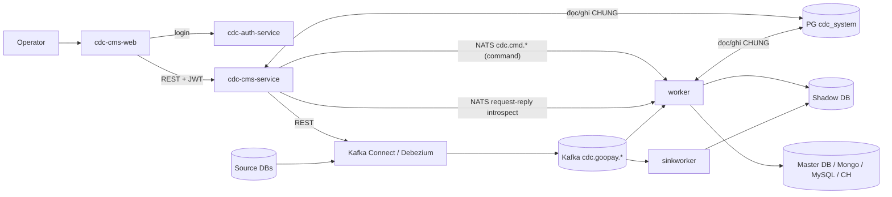
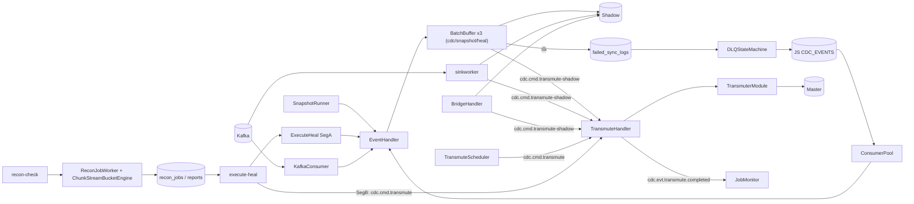

# Data-Hub — Tổng quan hệ thống & Design Pattern đích

> Mọi số liệu/khẳng định lấy từ 4 báo cáo khảo sát read-only trong `survey/` (có `path:line`). Mục nào chưa xác minh ghi `UNKNOWN`.

---
## PHẦN I — HỆ THỐNG HIỆN TẠI

### 1. Bức tranh tổng thể

Data-Hub là nền tảng **CDC (Change Data Capture)**: kéo thay đổi từ DB nguồn (Mongo/PG/MariaDB/SFTP) → lưu **shadow** (bản sao thô, theo nguồn) → **transmute** thành **master** (mô hình chuẩn hoá cho nghiệp vụ) → **recon** đối soát 2 đoạn (Source↔Shadow = Segment A, Shadow↔Master = Segment B) → **heal** sửa lệch.

Hệ thống chia 2 mặt phẳng:

| Mặt phẳng | Thành phần | Vai trò |
|---|---|---|
| **Control plane** (cấu hình, ra lệnh) | `cdc-cms-web` (React), `cdc-cms-service` (Fiber, :8083), `cdc-auth-service` (:8081) | Người vận hành đăng ký nguồn, binding, mapping, lịch; bấm recon/heal; xem báo cáo |
| **Data plane** (chạy dữ liệu) | `centralized-data-service`: `worker` (:8082 binary chính), `sinkworker` (Kafka→shadow độc lập), `admin-api` (:8090, 1 route) | Ingest, ghi shadow, transmute, DDL, snapshot, recon, heal, DLQ |
| **Hạ tầng** | Kafka + Kafka Connect/Debezium, Schema Registry, NATS JetStream, Postgres (`cdc_system` control-plane, shadow DB, master DB), Mongo, Redis, OTel/SigNoz | |
| Ngoài luồng | `cdc-control` (FastAPI, MySQL) — quản trị Kafka Connect kiểu Mongo connector, **chưa thấy deploy** (SD3 §C) | |



### 2. Luồng dữ liệu (data plane — `centralized-data-service`)



Chi tiết từng chặng (entry `path:line`, input, output): `survey/SD1_data_service.md` §2.

### 3. Control plane (`cdc-cms-service`)
- Kiến trúc dự định: **Hexagonal + CQRS** — `api → app/commands|queries → domain`, `app/ports` là interface, `infra/{persistence,messaging,http}` hiện thực (SD2 §2).
- Thực tế: chỉ `CommandBus` chạy (NATS + bảng `cdc_jobs`); `QueryBus` khai báo nhưng **không có impl**; wiring trong 1 constructor `server.go:82-397`.
- Trong 170 method handler: 52 qua bus, 14 gọi command trực tiếp, 44 gọi query, 16 publish/RPC NATS trực tiếp, **≈57 bỏ qua app layer** (SD2 §2).

### 4. Web (`cdc-cms-web`)
- Chỉ 3/20 page đi đúng `page → hook → api` (SystemHealth, AdminAudit, DataIntegrity); còn lại gọi `cmsApi` trực tiếp với path hardcode; logic nghiệp vụ (dựng config Debezium) nằm ở client `SourceConnectors.tsx:190-360` (SD3 §A).
- 5 page là god-file 1.8k–2.6k dòng.

### 5. Hợp đồng giữa service (điểm hay vỡ tương thích ngược)
- **NATS**: ~40 subject `cdc.cmd.*`, `cdc.evt.*`, `cdc.result.*` — tên subject và struct payload **khai báo riêng ở mỗi repo**, không có module chung (SD1 §3, SD2 §4).
- **Bảng dùng chung `cdc_system`**: ≥20 bảng được cả CMS và worker đọc/ghi (source_object_registry, connection_registry, shadow_binding, master_binding, mapping_rule_v2, mapping_rule_master, transmute_schedule, recon_jobs, cdc_reconciliation_report, failed_sync_logs, snapshot_progress…) — mỗi bên có GORM struct riêng; migration do CMS chạy (`internal/migrate/runner.go:33`).
- **HTTP web↔cms**: TS type viết tay ở `src/types/index.ts`, không sinh từ contract.
- Chi tiết: `survey/SD4_contracts.md`.

**Lỗi hợp đồng ĐANG tồn tại (do không có nguồn chung) — SD4:**
| # | Lỗi | Bằng chứng |
|---|---|---|
| C1 | `cdc.cmd.backfill`: CMS dispatch, worker **đã comment subscriber** → backfill không bao giờ chạy | CMS `server.go:280`, `mapping_rule_handler_batch.go:27,70`; DS `server_setup.go:282` |
| C2 | Whitelist `data_type` lệch: DS chỉ nhận tên chuẩn (`INTEGER`, `BOOLEAN`, `VARCHAR(n)`, `NUMERIC(p,s)`), CMS dùng validator khác (2 bản) — các alias như `INT`, `BOOL`, `VARCHAR` trần, `NUMERIC(10)` có thể qua CMS nhưng DS từ chối (Agent đã tự kiểm regex DS; validator CMS chưa đọc hết) | CMS `pkgs/utils/pg_validator.go:9`, `dbutil/validate.go:7`; DS `base_handler.go:194-199` |
| C3 | Job async `cdc_jobs` không có đường đóng (DS không ghi, CMS không nghe `cdc.result.*`/`cdc.evt.*`; reaper chỉ quét `status='running'`, job dispatch là pending) — HYPOTHESIS: web poll thấy pending mãi | `infra/messaging/stuck_job_reaper.go:117-125`, `nats_command_bus.go:206-255` |
| C4 | `master_binding`: model CMS thiếu 4 cột NOT NULL, gán `MasterSchema = ShadowSchema` | CMS `master_repo_gorm.go:163-179` vs `032_v2_master_binding.sql:7-15` |
| C5 | `source_count`: DS `*int64` (NULL = chưa biết) vs CMS `int64 default 0` | DS `model/recon/reconciliation_report.go:19`, CMS `:15` |
| C6 | Tên shadow schema suy ra bằng **4 thuật toán khác nhau** | CMS `source_object_v2_sync_helpers.go:148`; DS `provisioning_shadow_bind.go:203`, `sinkworker/utils.go:321`, `registration.go:390` |
| C7 | Cả 2 service cùng `EnsureStreams` 4 stream JetStream với logic subject khác (CMS hardcode `cdc.goopay.>`) | DS `nats_client.go:25-78`, CMS `nats_client.go:25-80` |
| C8 | Provisioning orchestrator tồn tại ở **cả 2 repo**, cùng publish `cdc.cmd.*.bind` | DS `service/orchestration/*`, CMS `infra/persistence/governance/provisioning_orchestrator.go` |
| C9 | DTO web lệch: `JobResponse` (payload/result string, `updated_at` không có), `SourceObjectRow.notes` không tồn tại | WEB `useAsyncJob.ts:22-31`, `types/index.ts:92`; CMS `get_job.go:35-48` |
| C10 | `snapshot.v2` struct CMS thiếu `progress_id`; transform_fn allowlist chép tay ở 2 repo | CMS `recon_async.go:145-153`; DS `transform_registry.go:31-43`, CMS `master_mapping_rule_handler.go:174-187` |

Đây là bằng chứng trực tiếp: **mỗi lần sửa 1 bên mà không có hợp đồng chung là 1 lần vỡ âm thầm** — đúng hiện tượng "làm feature mới lỗi cái cũ".

### 6. Bổ sung Đính chính & Bản đồ 5 Điểm Giao Cắt Dùng Chung (Cập nhật 2026-11-09 theo Live Production Baseline)
- **Trạng thái hệ thống:** Hệ thống `data-hub` đang vận hành thực tế (**LIVE PRODUCTION**) và hoạt động ổn định. Các nhận định tĩnh ở mục 5 (C1..C10) và mục 11–16 bên dưới không được dùng để phán hệ thống đang lỗi hay đề xuất đập bỏ cây thư mục hiện hữu.
- **Chuẩn kiến trúc bất biến đã khóa tại `agent/memory/global/project/data-hub/system_overview_and_design_pattern.md`:**
  1. Giữ nguyên 100% **Clean Layered Architecture** theo 7 nhóm chức năng (`base`, `source`, `shadow`, `master`, `recon`, `governance`, `orchestration`) của `centralized-data-service` và **Hexagonal + CQRS + Screaming Architecture** theo 7 nhóm chức năng (`source`, `shadow`, `master`, `governance`, `recon`, `scheduler`, `system`) của `cdc-cms-service`.
  2. Bảo toàn tuyệt đối **5 Điểm Giao Cắt Dùng Chung (`CP-1..CP-5`)**:
     - `CP-1`: `MetadataRegistryService.ResolveSourceRoutes` (`internal/service/source/metadata_registry_service.go:469`)
     - `CP-2`: `EventHandler.HandleRaw` & `processEvent` (`internal/handler/shadow/event_handler.go:95,248`)
     - `CP-3`: `BatchBuffer` & `shadow.DedupByConflictKey` (`internal/handler/shadow/batch_buffer.go:181,454`, `internal/model/shadow/upsert_dedup.go:14`)
     - `CP-4`: `TransmuteHandler` + `TableDebouncer` + `TransmuterModule` (`internal/handler/master/transmute_handler.go:132,293`, `internal/service/master/transmuter.go:167,653`)
     - `CP-5`: `ReconCore` + `ChunkStreamBucketEngine` + `ExecuteHealHandler` (`internal/service/recon/recon_smoke.go:681`, `recon_stream_bucket_engine.go:233`, `internal/handler/recon/recon_execute_heal_handler.go:79`, `recon_execute_heal_segb.go:26`)
  3. Kiểm tra **Ma trận Đa hình 3 Chiều** (Nguồn: `mongodb`/`postgresql`/`mysql`/`sftp` × Tuyến: `1-1`/`1->N`/`N->1`/`child_explode` × Đích: `postgresql`/`mongodb`/`mysql`/`clickhouse`) trước mọi thay đổi code.
  4. Áp dụng **Code-Level Design Patterns (Strategy + Self-Registering Driver Registry + Lifecycle Hooks)** cho 4 trục mở rộng đa hình (chi tiết tại mục 4 của `system_overview_and_design_pattern.md`):
     - **Trục 1 (`TransformType`):** `transmute.Strategy` + 3 Optional Hooks (`DeletePolicyProvider`, `BatchPreEnricher`, `PostIncrementalCatchupHook`) trong `internal/service/master/transmute/`.
     - **Trục 2 (`Master Engine`):** `MasterSinkDriver` + `MasterDDLDriver` + `ReconDestDriver` tự đăng ký theo `engine_type` (`transmuter_<engine>.go`, `master_ddl_generator_<engine>.go`, `recon_dest_<engine>.go`).
     - **Trục 3 (`Source Engine`):** `SourceIntrospectorDriver` + `ReconSourceDriver` + `SourceHealFetcherDriver` tự đăng ký theo `engine_type`/scheme (`introspect_<engine>.go`, `recon_source_<engine>.go`, `recon_heal_<engine>.go`).
     - **Trục 4 (`Field Transform / @directive`):** `FieldDirectiveFunc` + `TransformFunc` trong `transform_registry.go`.
     - **Quy luật bắt buộc:** `1 Loại Mới = 1 File Thực Thi Mới + init() Register(...) = 0 if/else mới trong Core Engine`.

### 6.1. Ghi chú lịch sử khảo sát tĩnh trước khi chuẩn hóa Live Baseline
| # | Gốc rễ | Bằng chứng |
|---|---|---|
| G1 | **Không có chủ sở hữu duy nhất cho dữ liệu dùng chung** — 2 service cùng ghi 1 bảng, mỗi bên 1 struct | SD2 §5, SD1 §4 |
| G2 | **Hợp đồng NATS không tập trung** — subject là string rải rác, payload struct inline/nhân bản | SD1 §3 (`transmute_handler.go:154-163` struct inline), SD2 §4 |
| G3 | **Nhiều đường làm cùng 1 việc** — 3 đường ghi shadow, 3 bản trigger transmute, 3–4 bản Avro decode, 3 bản DLQ, ~15 hàm resolve PK/TS | SD1 §5 mục 1–7 |
| G4 | **Mô hình cũ/mới song song** — registry V1 (`cdc_table_registry`) vs V2 (`source_object_registry`+`shadow_binding`); mapping v1/v2/master; recon legacy/mới | SD1 §5 mục 1,2,8; SD2 §6 |
| G5 | **Tầng bị xuyên** — SQL nằm ở service/handler (DS: 400+ lời gọi `.Raw/.Exec` ngoài repository vs 12 trong repository); CMS api gọi infra/DB/NATS trực tiếp | SD1 §5 mục 9; SD2 §2 |
| G6 | **Code chết còn nằm trong luồng đọc** — EventBridge, DLQCircuitBreaker, WALMonitor, DLQWorker, BinaryDrillDown, RegistryService legacy, QueryBus, bootstrap/registry_mirror | SD1 §3/§5, SD2 §1 |
| G7 | **Wiring khổng lồ 1 chỗ** — `server_setup.go` 574 dòng, `server.go` CMS 82-397 | SD1 §1, SD2 §1 |

---
## PHẦN II — DESIGN PATTERN ĐÍCH

### 7. Nguyên tắc nền (áp cho cả hệ thống)
1. **Một khái niệm — một chủ sở hữu — một đường đi.** Mỗi bảng, mỗi subject, mỗi luật (PK, timestamp, naming, transform_fn) chỉ có **một** nơi định nghĩa; nơi khác gọi lại.
2. **Control plane ra lệnh, data plane thực thi.** CMS không tự chạy dữ liệu; worker không tự sửa cấu hình.
3. **Giao tiếp giữa service chỉ qua hợp đồng có phiên bản** (NATS payload + bảng có chủ). Không chia sẻ struct bằng copy-paste.
4. **Tương thích ngược là mặc định** — đổi hợp đồng theo kiểu *expand → migrate → contract* (thêm mới, chạy song song, bỏ cũ sau).
5. **Bên trong mỗi service: Ports & Adapters theo bounded context** — cùng một khuôn cho cả CMS và worker để Agent/dev không phải đoán.

### 8. Bounded contexts (dùng chung tên cho cả 2 service)
| Context | Khái niệm | Control plane (CMS) làm gì | Data plane (worker) làm gì |
|---|---|---|---|
| **source** | connection, source object, connector Debezium | CRUD nguồn, connector | discover, scan, introspect, bridge |
| **shadow** | shadow binding, ingest, schema DDL shadow | khai báo binding, duyệt DDL | consume CDC, ghi shadow, DDL shadow, DLQ |
| **master** | master binding, mapping rule, transmute, DDL master | khai báo master/mapping, duyệt | transmute, DDL master |
| **recon** | recon job, report, smoke, heal | ra lệnh check/heal, xem report | chạy check/heal/smoke |
| **governance** | masking, schema drift, index, sensitive fields | cấu hình | thực thi |
| **schedule** | worker schedule, transmute schedule, snapshot, provisioning | CRUD lịch | chạy lịch, snapshot |
| **system** | activity log, alerts, jobs, health | xem | ghi |

### 9. Quyền sở hữu dữ liệu `cdc_system` (giải G1)
Luật: **mỗi bảng có đúng 1 service được ghi**; service kia chỉ đọc qua read-model, muốn đổi thì gửi command.

| Nhóm bảng | Chủ (được ghi) | Bên kia |
|---|---|---|
| Cấu hình: `connection_registry`, `sources`, `source_object_registry`, `shadow_binding`, `master_binding`, `mapping_rule_v2`, `mapping_rule_master`, `sensitive_fields`, `cdc_worker_schedule`, `transmute_schedule`, `cdc_wizard_sessions` | **CMS** | Worker chỉ đọc (cache trong `MetadataRegistryService`, reload qua `schema.config.reload` / `connection.config.changed`) |
| Runtime: `recon_jobs`, `cdc_reconciliation_report`, `cdc_recon_smoke_result`, `failed_sync_logs`, `snapshot_progress`, `sync_runtime_state`, `transmute_jobs`, `transform_jobs`, `pending_fields`, `daily_source_counts`, `cdc_activity_log` | **Worker** | CMS chỉ đọc để hiển thị; thao tác (xoá report, pause snapshot, retry) gửi command |
| `cdc_jobs`, `admin_actions`, `cdc_alerts` | CMS | — |
| Legacy: `cdc_table_registry`, `cdc_mapping_rules` | **Đóng băng** — không thêm cột/logic mới, lộ trình bỏ (mục 14) | |

Migration DDL `cdc_system`: **chỉ CMS** (`internal/migrate`) — worker không DDL `cdc_system` lúc runtime.
Cần xác nhận với User các ngoại lệ hiện có (vd worker cập nhật `shadow_binding.ddl_status`, `transmute_schedule.last_run`) → chuyển thành bảng/cột runtime riêng do worker sở hữu, hoặc giữ làm ngoại lệ có ghi chép.

### 10. Hợp đồng liên service (giải G2)
- Tạo **1 Go module dùng chung** `data-hub-contracts` (repo hoặc thư mục module riêng), chỉ chứa:
  ```
  contracts/
    subjects.go        // const SubjectReconCheck = "cdc.cmd.recon-check" ...
    envelope.go        // type Envelope struct{ Version int; JobID, CorrelationID string; Payload json.RawMessage }
    recon/   source/   shadow/   master/   schedule/   // payload struct có json tag, mỗi struct có Version
  ```
- Cả CMS và worker **import** module này; cấm khai báo subject/payload inline.
- Luật đổi payload: chỉ thêm field (optional); đổi nghĩa → subject/version mới, chạy song song tới khi bên kia chuyển xong.
- Contract test: mỗi payload có fixture JSON; test ở cả 2 repo decode fixture → không lỗi.
- Bảng dùng chung: struct read-model cho bên **không sở hữu** cũng đặt trong module này (chỉ field cần đọc), để đổi cột là thấy ngay ở cả 2 bên.

### 11. Khuôn bên trong mỗi Go service (giải G3, G5, G7)
Cùng một khuôn cho **cả CMS và worker** (CMS đã gần đúng; worker chuyển dần):
```
internal/
  <context>/                 # source | shadow | master | recon | governance | schedule | system
    domain/                  # entity, value object, luật thuần (KHÔNG gorm/nats/http)
    app/                     # use case: 1 file = 1 command/query handler; phụ thuộc domain + ports
    ports/                   # interface ra ngoài: Repository, Publisher, SourceReader, ShadowWriter...
    adapter/
      in/                    # NATS subscriber, Kafka consumer, HTTP handler → gọi app
      out/                   # Postgres repo, Mongo, NATS publisher, Kafka Connect client → implement ports
  platform/                  # hạ tầng dùng chung: db registry, nats conn, kafka, redis, otel, idgen
  bootstrap/                 # wiring DUY NHẤT, chia file theo context: wire_shadow.go, wire_recon.go ...
```
Luật import (máy kiểm, mục 15):
- `domain` → không import gì ngoài stdlib/domain khác.
- `app` → `domain`, `ports`, `contracts`.
- `adapter/in` → `app`, `contracts`. **Không** SQL, không repo.
- `adapter/out` → `ports`, `domain`, `platform`. **Chỉ đây được có SQL/GORM/Mongo query.**
- Context A gọi context B **chỉ qua `B/app` hoặc `B/ports`**, không chọc vào `B/adapter`.

### 12. Một nguồn sự thật cho các luật cốt lõi (giải G3)
| Luật | Hiện tại (SD1 §5) | Đích |
|---|---|---|
| Xác định PK | ~9 hàm (`extractPrimaryKey`, `detectPrimaryKey`, `resolvePGPrimaryKeyCol`, `resolveMasterPKFromSpec`, `parsePKFromSpec`, `resolvePKFields`, `getPrimaryKeyColumn`, `resolveShadowPKField`, `ResolveSegmentBPKPair`) | `shadow/domain/keyspec` (PK shadow) + `master/domain/keyspec` (PK master từ spec); mọi nơi gọi lại |
| Xác định timestamp | ~6 hàm (`resolveTimestampField`, `ParseTransformSpecTimestampField`, `ParseTimestampField`, `resolveMaster/SourceTimestampField`, `resolveSourceAndDestTSFields`) | cùng package keyspec |
| Ghi shadow | 3–4 đường upsert (BatchBuffer, Bridge, SinkWorker+SchemaManager, Healer) | 1 port `shadow/ports.ShadowWriter` + 1 adapter `shadow/adapter/out/pg_writer` |
| Trigger transmute | 3 bản (`batch_buffer_fanout.go`, `sinkworker/worker.go`, `bridge_upsert_fanout.go`) | 1 port `master/ports.TransmuteTrigger` |
| Avro decode | 3–4 bản | `platform/kafka/avro` |
| DLQ | 3 bản (2 chết) | 1 `shadow/app/dlq` |
| Tên bảng shadow/master | `internal/naming` ở cả 2 repo + 4 thuật toán suy tên schema (C6) | `data-hub-contracts/naming` — 1 hàm `ShadowSchema(conn)`, `ShadowTable(obj)` |
| Whitelist data_type | 3 bản (CMS×2, DS×1) lệch nhau (C2) | `data-hub-contracts/ddltype` |
| transform_fn allowlist | chép tay 2 repo (C10) | `data-hub-contracts/transformfn` |
| Provision JetStream streams | cả 2 service tự `EnsureStreams` (C7) | 1 chủ: worker (data plane) hoặc job hạ tầng; CMS chỉ đọc |
| Provisioning orchestrator | 2 bản ở 2 repo (C8) | 1 bản — CMS điều phối (control plane), worker chỉ thực thi lệnh bind |
| Trạng thái job async | `cdc_jobs` không có ai đóng (C3) | worker publish `cdc.evt.job.<status>` theo `contracts`; CMS subscribe để đóng job |
| Registry | V1 + V2 | V2 là nguồn; V1 chỉ còn view đọc cho recon/scheduler tới khi chuyển xong |
| Mapping | v1 / v2 / master (raw SQL, không model) | v2 + `mapping_rule_master` có model/repo; v1 đóng băng |

### 13. Web (`cdc-cms-web`)
```
src/
  api/<context>.ts        # 1 file/context, mọi call HTTP ở đây (thay services/api.ts + path hardcode trong page)
  api/types.gen.ts        # SINH từ swagger của CMS (cms đã có docs/docs.go) — cấm viết tay DTO
  features/<context>/     # hooks react-query + component của context
  pages/                  # chỉ lắp ráp feature, ≤ 300 dòng
```
- Logic nghiệp vụ (dựng config Debezium `buildConnectorConfig`, `detectDbKind`…) chuyển về CMS (`source/app`).
- Page không gọi `cmsApi` trực tiếp.

### 14. Ánh xạ hiện trạng → đích (rút gọn)
| Hiện tại | Đích |
|---|---|
| DS `internal/handler/shadow/*` (EventHandler, BatchBuffer, ConsumerPool, KafkaConsumer) | `shadow/adapter/in` (consumer) + `shadow/app/ingest` + `shadow/adapter/out/pg_writer` |
| DS `internal/sinkworker/*` | Gộp vào `shadow` dùng chung `ShadowWriter`/`TransmuteTrigger` (hoặc bỏ nếu trùng worker — cần User xác nhận deploy) |
| DS `internal/handler/master/*`, `service/master/*` | `master/adapter/in` + `master/app/transmute` + `master/adapter/out/{pg,mongo,mysql,ch}` |
| DS `internal/handler/recon/*`, `service/recon/*` (31 file) | `recon/app/{check,heal,smoke,job}` + `recon/adapter/out/{source_mongo,dest_sql}`; xoá legacy/chết |
| DS `service/source/*`, `handler/source/*` | `source/*` |
| DS `service/governance/*` | `governance/*` |
| DS `handler/orchestration/*`, `service/orchestration/*`, scheduler | `schedule/*` |
| DS `internal/repository/*`, `internal/model/*` | chia về `<context>/adapter/out` + `<context>/domain` |
| DS `internal/server/server_setup.go` | `bootstrap/wire_<context>.go` |
| CMS `internal/api/*` | `<context>/adapter/in/http` (bỏ import infra; `WithMetadata` chuyển vào bus) |
| CMS `internal/infra/persistence/*` (có ApprovalService, ProvisioningOrchestrator, ShadowAutomator) | repo → `adapter/out`; logic nghiệp vụ → `<context>/app` |
| CMS `internal/model/*` | chỉ dùng trong `adapter/out` |
| CMS `app/ports/QueryBus`, `ports.MasterDDLPublisher`, `bootstrap/registry_mirror.go` | xoá (chết) |
| CMS + DS `pkgs/natsconn`, `internal/naming` | `platform/nats` + `data-hub-contracts` |

### 15. Máy kiểm pattern (để không ai — kể cả Agent — phá được)
- `arch_check` (bản nháp đã chạy: `scratch/arch_check.py`, 225 vi phạm hiện tại) mở rộng theo luật import mục 11 + luật sở hữu bảng mục 9 (grep tên bảng trong SQL của repo không sở hữu → vi phạm).
- Contract test (mục 10) chạy ở cả 2 repo.
- Allowlist vi phạm hiện có: chỉ được giảm.
- Gắn vào `.agent-project.json` → hook H6/H7.

### 16. Lộ trình (chỉ bắt đầu sau khi recon-heal lên prod và User cho phép)
| Bước | Nội dung | Rủi ro runtime |
|---|---|---|
| 1 | Duyệt tài liệu này (bounded context, sở hữu bảng, khuôn) | không |
| 2 | Dựng `data-hub-contracts` — chỉ **khai báo lại** subject/payload đang có, 2 service import thay hằng/struct cũ, không đổi giá trị | thấp (contract test chứng minh JSON giống hệt) |
| 3 | Máy kiểm + allowlist + manifest | không |
| 4 | Xoá code chết (G6) | thấp |
| 5 | Gộp nguồn sự thật: keyspec → ShadowWriter → TransmuteTrigger → Avro → DLQ (mỗi cái 1 PR, test so khớp hành vi trước/sau) | trung bình |
| 6 | Chuyển thư mục theo context (move + đổi import, không đổi logic), từng context một | thấp |
| 7 | Dời SQL về `adapter/out`, CMS api bỏ infra | trung bình |
| 8 | Bỏ registry V1 / mapping v1 (expand → migrate → contract) | cao — cần kế hoạch dữ liệu riêng |
| 9 | Web: api theo context + types sinh từ swagger + tách page | thấp |

### 17. Ngoài phạm vi pattern nhưng phải báo (bảo mật — SD2 §7, SD3 §B/§D)
- CMS `middleware/jwt.go:21-26`: `Bearer dev-token` → admin, không chặn theo môi trường.
- Auth `register` public và tự chọn role admin (`auth_service.go:94-99`).
- DSN có user/pass hardcode: CMS `cmd/dump/dump.go:17`, `cmd/sync_v2/main.go:16`; DS `service/source/test_routing2.go:18`.
- Secret literal trong Helm values `goopay-testing/.../centralized-data-service.yaml:78,86,94,134`.

### 18. Cần User quyết
1. Đồng ý **bounded contexts** mục 8 và **bảng sở hữu** mục 9? Liệt kê ngoại lệ nào worker cần ghi bảng cấu hình.
2. `data-hub-contracts`: repo riêng hay thư mục module trong 1 repo hiện có?
3. Khuôn **Ports & Adapters theo context** (mục 11) cho cả worker — hay worker giữ layered nhưng siết luật?
4. `sinkworker` và `worker` (kafka.enabled) có cùng chạy trên prod không? (nếu có → mỗi event ghi shadow 2 lần — SD1 §3, UNKNOWN)
5. Nguồn publish vào `CDC_EVENTS` `cdc.goopay.>` trên prod là gì? (UNKNOWN)
