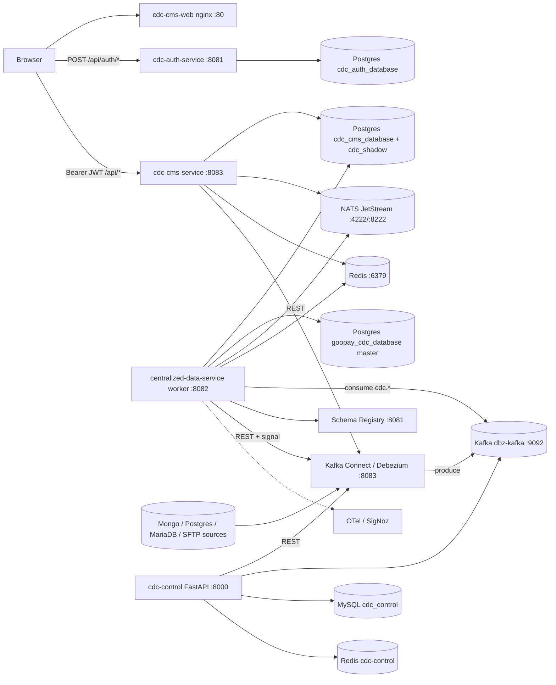

# Báo cáo READ-ONLY: cdc-cms-web / auth / control / docker / deploy (data-hub)
Không file nào bị sửa. Đường dẫn tương đối so với `/Users/trainguyen/Documents/work/data-hub/`. Secret đã được mask `***`.

## A. cdc-cms-web (React + Vite + AntD + TanStack Query + axios)

### Cấu trúc
- Routes: `src/App.tsx:19-37`, mỗi page được lazy-load. `ProtectedRoute` chỉ kiểm tra `localStorage.access_token` có tồn tại hay không (`App.tsx:51-63`), không kiểm tra hạn token. Danh sách route ở `App.tsx:209-230`.
- Menu đang ẩn (comment out): source-to-master, schema-proposals, nats-monitor, schema-changes, audit (`App.tsx:88-92,115-119,140-144,152-161`). Route của các page này vẫn còn nên vẫn vào được bằng URL trực tiếp.
- Tầng API: `src/services/api.ts` (44 dòng) có 3 axios instance: `authApi`, `cmsApi`, `workerApi` (`api.ts:8-14`). `workerApi` **không được dùng ở đâu** (grep `workerApi.` không ra kết quả nào).
- `services/connectorCheck.ts` (143 dòng) gọi `POST /api/introspection/mongo/databases`, `/mongo/collections` và `/postgres/tables` (`connectorCheck.ts:29-30,40-41,110-111`). Được bọc bởi `hooks/useConnectorCheck.ts` (useMutation, `:37,:75`).
- Thư mục hooks: useRegistry, useProvisioningMode, useAuditStatus, useSystemHealth, useConnectorCheck, useAsyncJob, useAsyncDispatch, useReconStatus. Riêng `useReconStatus` dài 674 dòng, ôm toàn bộ API của recon.
- Còn sót file backup trong src: `pages/SourceConnectors.tsx.bak-before-kafka-config-2026-07-20` (1333 dòng).

### Các page (dòng | byte | số lệnh gọi `cmsApi.` trực tiếp trong page | layer)
| Page | Mục đích | Endpoint chính (file:line) | Layer |
|---|---|---|---|
| Dashboard (137) | Tổng quan | GET `/api/v1/source-objects/stats`, `/api/schema-changes/pending`, `/api/sync/health` (`Dashboard.tsx:34-36`) | page→cmsApi (bỏ qua hook) |
| Login (51) | Đăng nhập | POST `/api/auth/login` qua authApi (`Login.tsx:18`) | page→authApi |
| SourceConnectors (**2046 dòng / 82KB**, 8 lệnh gọi) | CRUD Debezium connector | GET `/api/v1/system/connectors` (`:601`), GET `/api/v1/sources` (`:613`), POST `/api/v1/system/connectors` (`:639-640`), POST `.../recover` (`:670-671`), POST `.../bridge-oplog` (`:709`), PATCH `.../{name}/config` (`:729-730`), DELETE `.../{name}` (`:774-775`) | page→cmsApi trực tiếp; check DB/collection thì đi qua useConnectorCheck |
| TableRegistry (**1850 / 78KB**, 17 lệnh gọi) | Shadow registry | GET/PATCH `/api/v1/source-objects*`, `/api/v1/shadow-bindings` (`:788-885`), POST `register` (`:954`), `register-batch` (`:1130`), `transform` (`:565`), `snapshot-v2` (`:1033`), `transform-cancel` (`:1103`), GET `/api/v1/system/connectors` (`:121`) | chủ yếu gọi trực tiếp; một phần qua useRegistry/useAsyncDispatch |
| MasterRegistry (**1952 / 80KB**, 19 lệnh gọi) | Master tables và kết nối | `/api/v1/masters` (`:335,:680,:838`), `/api/v1/master-connections` CRUD + `/test` (`:355,457,541,556,588`), `/api/v1/schedules` + `run-now` (`:768-793`) | trực tiếp, dùng useAsyncJob |
| ActivityManager (**2083 / 80KB**, 12 lệnh gọi) | Lịch worker (Operations) | CRUD `/api/worker-schedule` (`:1087,1113,1126,1148,1242,1391`); lookup connections, shadow-bindings, masters, mapping-rules, source-objects (`:1055-1098`), master-mapping-rules (`:432`) | trực tiếp |
| NatsMonitor (**2597 / 95KB**, 7 lệnh gọi) | Quản trị NATS JetStream | GET `/api/system/nats/overview` (`:446`), GET `streams/{s}/messages` (`:489-490`), POST `purge` (`:781-782`), PATCH `config` (`:788-789`), DELETE message/stream/consumer (`:795-811`) | trực tiếp (menu đang ẩn) |
| MappingFieldsPage (801, 14) | Mapping rule cho shadow | `/api/mapping-rules*` (`:127,195,237,346,355`), `/api/introspection/*` (`:213,316,328`), preview (`:106`) | trực tiếp |
| MasterMappingFieldsPage (1388 / 57KB, 20) | Mapping cho master | `/api/v1/master-mapping-rules*`: approve-ddl, drop-column, batch, sync-from-shadow… (`:209-406,787`) | trực tiếp |
| TransmuteSchedules (564) | Lịch transmute | `/api/v1/schedules` CRUD + `run-now` (`:93-209`) | trực tiếp + react-query |
| DataIntegrity (614) | Recon / heal | `/api/reconciliation/*`, `/api/failed-sync-logs*`, `/api/recon/backfill-source-ts` (`useReconStatus.ts:147-663`) | page→**hook** (đúng layer) |
| SystemHealth (636) | Health hệ thống | GET `/api/system/health` (`useSystemHealth.ts:44`), POST `/api/tools/restart-debezium` (`:62`) | page→hook ✅ |
| AdminAudit (338) | Audit QA | `/api/v1/audit/qa-summary`, `/metric-health`, `/gaps` (`useAuditStatus.ts:15-49`) | page→hook ✅ |
| ActivityLog (335) | Log hoạt động | GET `/api/activity-log`, `/stats` (`:82,:91`) | trực tiếp |
| SnapshotMonitor (292) | Theo dõi tiến độ snapshot | GET `/api/snapshot-progress` (`:72`), POST `/api/v1/snapshot-progress/{id}/{action}` (`:278`) | trực tiếp |
| SchemaChanges (218) | Review schema | `/api/mapping-rules` GET/PATCH (`:46,:83`) | trực tiếp |
| SchemaProposals (285) | Duyệt đề xuất schema | `/api/v1/schema-proposals` (`:51-52`), POST `/{id}/{op}` (`:74-75`) | trực tiếp |
| SensitiveFieldsPage (248) | Masking field | CRUD `/api/v1/sensitive-fields` (`:42,65,79,92`) | trực tiếp |
| SourceToMasterWizard (263) | Wizard | `/api/v1/wizard/sessions*` (`:79,97,126,142`), `/api/v1/sources` (`:117`) | trực tiếp (menu ẩn) |

Một vài component cũng gọi API trực tiếp: `ReconPipelineGrid.tsx` (1730 dòng; `:1370-1388`), `TableIndexManager.tsx` (`/api/introspection/indexes`, `:48,67,99`), `MappingRuleList.tsx`, `AddMappingModal.tsx:28`, `ShadowSourceBadge.tsx:49,87`.

**Những điểm cần lưu ý (flag)**
- Phần lớn page bỏ qua tầng hook/service và gọi thẳng `cmsApi` với path hardcode. Chỉ 3 page đi đúng layer page→hook→api: SystemHealth, AdminAudit, DataIntegrity.
- Business logic nặng nằm ngay trong page. Ví dụ SourceConnectors tự dựng Debezium connector config ở client: `buildConnectorConfig` (`SourceConnectors.tsx:211`), `detectDbKind` (`:190`), `extractKafkaConfig` (`:201`), `parseConnectionSeed` (`:360`). Page này còn đọc Kafka bootstrap, schema-registry, topic prefix và consumer group từ env (`:47-61`).
- Các page khác có logic tương tự: TableRegistry (`slugifyForPostgres` `:60`, `AsyncRowActions` `:362`), ActivityManager (`CascadingSourceSelector` `:114`, `normalizeSavedBranches` `:556`).
- Mấy page lớn đều là god-file 1.8k–2.6k dòng.

### Auth trên web
- Login lưu `access_token`, `refresh_token`, `user` vào **localStorage** (`Login.tsx:19-21`).
- Interceptor gắn `Authorization: Bearer` và `X-Correlation-Id`/`traceparent` cho cmsApi (`api.ts:17-30`).
- Khi gặp 401 thì xóa token và redirect về `/login` (`api.ts:33-44`).
- **Không có luồng refresh**: không chỗ nào gọi `/api/auth/refresh`. `refresh_token` được lưu nhưng không bao giờ dùng (grep chỉ thấy ở `App.tsx:72`, `Login.tsx:20`, `types/index.ts:206`). Logout chỉ xóa phía client (`App.tsx:70-75`).
- Base URL: `import.meta.env.VITE_* || '__VITE_*__' || localhost` (`api.ts:3-5`). Placeholder được `docker-entrypoint.sh:17-28` thay bằng `sed` lúc container start (bắt buộc đủ env, `:4-13`). Vì chuỗi `'__X__'` luôn truthy nên fallback localhost **không bao giờ được dùng**.
- Nginx phục vụ SPA, không proxy API (`nginx.conf:32-34`), nên browser gọi thẳng sang auth/cms ở domain khác (CORS).
- Env dev: `.env.development` dùng auth 8081, cms 8083, worker 8090, Kafka/Schema Registry trỏ IP 10.200.186.x.

## B. cdc-auth-service (Go, Fiber v2, GORM, golang-jwt v5)
- Mục đích: cấp JWT cho cdc-cms-web (`README.md:3-11`), port `:8081` (`config/config-sample.yml`).
- Endpoint (`internal/server/server.go:55-61`): `GET /swagger/*`, `GET /health`, `POST /api/auth/login`, `POST /api/auth/register`, `POST /api/auth/refresh`. **Tất cả đều public, kể cả register.** `Register` cho phép tự chọn role `admin` (`internal/service/auth_service.go:94-99`), nên ai gọi được API là tự tạo được tài khoản admin. CORS `AllowOrigins: "*"` (`server.go:47-52`).
- Token: HS256 với secret dùng chung `cfg.JWT.Secret`.
  - Access token: `user_id, username, email, role, type=access, exp` (`auth_service.go:153-163`), hạn 24h.
  - Refresh token: `user_id, type=refresh` (`:169-176`), hạn 168h.
  - Refresh có kiểm tra `type=="refresh"` (`:135-138`). Không có revoke hay blacklist.
- DB: Postgres, bảng `cdc_auth_service.auth_users` (`migrations/001_auth_users.sql:5-17`; `internal/model/user.go:17`). README ghi `users`, lệch với code. Migration seed sẵn user `admin` với hash bcrypt, comment để lộ mật khẩu gốc (`001_auth_users.sql:24-31`).
- Service khác validate token như thế nào: cdc-cms-service **tự verify** bằng cùng shared secret, không gọi sang auth service.
  - `cdc-cms-service/internal/middleware/jwt.go:28-33` parse HMAC; middleware được gắn ở `router.go:130`; RBAC qua `RequireRole("admin","operator")` (`router.go:275`) và `RequireRole("admin")` (`router.go:373`).
  - ⚠️ Có **bypass `"dev-token"` → admin vô điều kiện** (`jwt.go:21-26`).
  - ⚠️ Middleware không kiểm tra claim `type`. Refresh token vẫn qua bước verify nhưng không có `role`, nên bị RequireRole chặn.
  - centralized-data-service cũng có `JWT.Secret` (`centralized-data-service/config/config.go:379-382`).

## C. cdc-control (Python FastAPI, port 8000)
- Mục đích (`README.md:3`): quản trị Kafka Connect connectors (source Mongo, sink JDBC/MySQL/Postgres có SMT), export/apply schema, index, view từ Mongo source sang dest, so sánh source/dest. Runtime config lưu trong MySQL.
- Gọi **Kafka Connect REST** qua env `KAFKA_CONNECT_HOST` (`app/connect_ops.py:44`), dùng `/connectors`, `/connectors/{n}/config|status|restart` (`:354-464`).
- Gọi thêm Kafka Admin để xóa topic và consumer group (`connect_ops.py:272-274`), và Redis (`app/core.py:141`).
- Connector class mặc định là `com.mongodb.kafka.connect.MongoSourceConnector` (`core.py:40`). Như vậy cdc-control dùng MongoDB Kafka connector, **không phải Debezium**, cho source.
- Endpoint: route đăng ký ở `app/main.py:952-959`.
  - `/mongo-endpoints*` (`mongo_endpoint_routes.py:39-146`)
  - `/connectors/register` (`connector_register_routes.py:224,291`)
  - `/api/connectors`, `/live`, `/{name}`, DELETE, `/sink/status`, `/connector-registry/sync` (`connectors_routes.py:13-109`)
  - `/jdbc-destinations*` (`jdbc_routes.py:48-168`)
  - `/scan`, `/export`, `/api/apply/{db}`, `/retry`, `/delete`, `/api/source-mongo/*` (`schema_routes.py:172-369`)
  - `/api/runtime-configs*`, `/metrics` (`runtime_routes.py:13-70`)
  - `/sink-smt*` (`sink_smt_routes.py:117-611`)
  - UI HTML `/` (`dashboard_routes.py:69`)
- **Không tìm thấy cơ chế auth nào**: grep `Depends|login|authorization` trong `app/*.py` không có kết quả.
- Bảng MySQL (`cdc_control.sql`): `connector_registry` (:25), `jdbc_destinations` (:62), `mongo_endpoints` (:97), `runtime_configs` (:129), `schema_files` (:157), `sink_smt_connectors` (:195), `timeline` (:242). Config secret được mã hóa bằng `KEY_ENCRYPT` (`app/security.py:18-64`).
- File `.env` (17 dòng, có MYSQL_PASSWORD/KEY_ENCRYPT) đang nằm trong thư mục. Có bị track git hay không: UNKNOWN (chưa kiểm tra).

## D. Deploy topology
**`docker/docker-compose.yml`** là stack local dùng để test Kafka Connect + SFTP:
- `zookeeper` 2181 (`:2-10`)
- `kafka` cp-kafka 7.7.0, port 9092/29092 (`:12-30`)
- `kafka-connect`: build từ `Dockerfile.connect` = cp-kafka-connect 7.7.0 + Debezium 3.0.0 cho Mongo/Postgres/MySQL + kafka-connect-fs, map host 8084→8083 (`:32-61`; `Dockerfile.connect:3-31`)
- `kafka-connect-strimzi`: Strimzi kafka 4.2.0 + kafka-connect-fs bản patch, map 8086→8083 (`:64-76`; `Dockerfile.connect-strimzi:1-17`; `connect-distributed-strimzi.properties:4-26`, group `strimzi-connect-group`, topic `_strimzi-connect-*`)
- `kafka-ui` 8085 (`:78-92`)
- `sftp-host` 2022, mật khẩu SFTP nằm thẳng trong `command` (`:101`, mask ***)
- File này **không có** NATS, Postgres, Mongo, Redis, Go service hay web.
- `config.md` và `config-debezium.md` là tài liệu mẫu cấu hình JSON connector cho SFTP/Mongo/Postgres và cheat sheet REST.

Stack local đầy đủ nằm ở chỗ khác: `centralized-data-service/docker-compose.yml` có `nats` 14222/18222 (`:17-23`), `postgres-cdc` 5433 (`:36-44`), `redis` 16379 (`:62-66`), `cdc-worker` (`:77`), `kafka` 19092 (`:119`), `schema-registry` 18081 (`:157`), `kafka-connect` 18083 (`:182`), `kafka-exporter`, `redpanda-console` 18088, `otel-collector` 14317/14318 (`:233-292`). `cdc-auth-service/docker-compose.yml:2-10` có `postgres-auth` 5432.

**`goopay-testing/data-hub/onpremise-fpt/`** là Helm values (chart `goopay-backend-v3`), namespace `data-hub`, image lấy từ `harbor.goopay.vn/data-hub/*`, mỗi service 1 replica:
- `cdc-auth-service.yaml`: port 8081, ingress `testing-cdc-auth.goopay.vn`, Postgres 10.200.186.80:5432 db `cdc_auth_database`.
- `cdc-cms-service.yaml`: port 8083, ingress `testing-cdc-cms-api.goopay.vn`, db `cdc_cms_database` + `cdc_shadow`, NATS `nats-data-hub.data-hub:4222` (monitor :8222), Redis `redis-data-hub.data-hub:6379`, kafkaConnectUrl `cdc-kafka-connect-connect.data-hub:8083`. Có `workerUrl: http://localhost:8090`, nhiều khả năng sai trong k8s (HYPOTHESIS).
- `centralized-data-service.yaml`: port 8082, `mode: worker` (`:67`), 3 DB system/shadow/master trên 10.200.186.80 (`:74-96`), NATS (`:99`), Kafka `dbz-kafka-kafka-bootstrap:9092` với topicPrefix `cdc.gpay/goopay/mariadb` (`:104-112`), schema-registry `schema-registry-v1.data-hub:8081` (`:113`), OTel SigNoz (`:118`), Redis (`:133`), Debezium connect + signal collection (`:152-157`), ingress `testing-cdc-centralized.goopay.vn` (`:169`).
- `cdc-cms-web.yaml`: port 80, ingress `testing-cdc-cms.goopay.vn`, khai báo các env `VITE_*` (`:53-61`).
- ⚠️ **Secret lộ**:
  - `centralized-data-service.yaml:78,86,94,134` chứa password DB/Redis dạng **literal** trong configMap.
  - `maskingHmacKey`/`maskingAesKey` (`:159-160`) có giá trị kiểu `local…`. JWT secret (`:148` và `cdc-cms-service.yaml:108`) có prefix `chan…`, nhiều khả năng là placeholder change-me (HYPOTHESIS, đã mask).
  - Env `*_PASSWORD` dùng tham chiếu dạng `secret…` (`:57-60`).
  - Thư mục `__secrets/` (4 file) nằm ngay cạnh, chưa mở đọc.

Phần cdc-control trong sơ đồ: kết nối lấy từ code; **chưa thấy manifest deploy** cho service này trong `onpremise-fpt` (UNKNOWN). Nó chỉ có `.gitlab-ci.yml`, trong đó `enable_deploy: false`.

## E. Repo tham khảo
- `go-hexagonal`: bản clone của template open-source `github.com/RanchoCooper/go-hexagonal` (git remote; `README.md:1-20`, DDD + Ports/Adapters + Wire). Không thấy README của team trỏ tới repo này. `cdc-cms-service/README.md:14` tự mô tả là "hexagonal layout" (`internal/` có `domain/infra/app/api`). Vì vậy repo này **có khả năng là tham khảo**, nhưng chưa có bằng chứng đây là template bắt buộc (UNKNOWN).
- `demo-cdc-debezium` (remote gitlab.goopay.vn): demo PoC Mongo → Debezium → Kafka → MongoSinkConnector → mongo-dest, kèm Kafka UI, Prometheus, Grafana (`README.md:1-9`). Đây là sandbox thử nghiệm, không phải template code.
