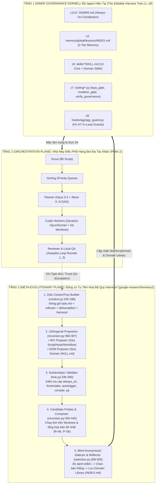

# 13 — Architectural Analysis & Comparative Evaluation: `google-research/harness2` vs. Bộ `/agent` & `Modular Queue-Driven Orchestrator` (`harness2_recursive_integration`)

> **Chế độ:** `Audit & Architectural Analysis — Propose-Only` (Rule #1, Rule #13 — Chỉ đọc, đối sánh thực chứng kèm `REF: file:line`, tuyệt đối không tự ý sửa source code khi chưa có lệnh `APPROVE`).
> **Workspace:** `feature-harness2-recursive-integration-2026-10-20` | **Suffix:** `harness2_recursive_integration` | **Tier:** `T2`

---

## 0. Bức tranh Tổng quan Vận hành Vật lý (`Macro Runtime & Integration Topology` — Tuân thủ Lesson `L001`)

Trước khi đi vào chi tiết từng file và hàm trong kho mã nguồn **[google-research/harness2](https://github.com/google-research/harness2)** (*Harness²: Recursive Agent Harnessing for an Open World*, arXiv:2610.14224), chúng ta cần định vị chính xác **bản chất vận hành vật lý ở tầng vĩ mô** thông qua 4 câu hỏi cốt lõi:

### 0.1. `Harness` và `Harness²` thực chất là gì trong thế giới thực?
1. **`Harness` (Bộ Khung Võ Giáp quanh Model — `README.md:19-21, 70-73` & `harness2/core/tree.py:15-20`):**
   - Một mô hình ngôn ngữ (LLM như Gemini, Claude, GPT/Codex, GLM-5) tự bản thân nó chỉ nhận text và trả về text. Toàn bộ hệ thống bao quanh LLM để biến nó thành một Agent biết làm việc thực tế — gồm **8 thành phần có thể chỉnh sửa (`c1..c8`: `systemprompt.md`/`AGENTS.md`, `guardrails.md`, `LongTermMEMORY.md`, `tool_guidance.md`, `sub_agents/`, `skills/`, `scripts/*.py`, `plugin/*.ts` hoặc `.codex/hooks.json`)** — được Google Research gọi chung là một **`Harness`**.
   - **Chiếu sang hệ thống hiện tại của anh:** Thư mục `/Users/trainguyen/Documents/work/agent/` (`GEMINI.md`, `OPERATOR_MAP.md`, `skills/*/SKILL.md`, `hooks/agy/agy_guard.py`, `tooling/*.py`, `memory/global/lessons/INDEX.md`) **chính là một `Base Harness` (`c1..c8`) hoàn chỉnh!**
2. **`Harness²` (Harness-Squared — Động cơ Đệ quy Tự Tối ưu Bộ Khung `/agent` — `README.md:23-34` & `harness2/core/schedule.py:566-666`):**
   - Trong môi trường mở (*Open World*), khi Agent gặp một bài toán/dự án mới mà lúc thiết kế bộ `/agent` ban đầu chưa lường hết, thay vì con người phải ngồi đọc lỗi rồi sửa tay `GEMINI.md` hay viết thêm `SKILL.md` / `agy_guard.py`, **`Harness²` là một trình điều phối Meta-Agent chạy ở tầng trên dùng một Agent (`Proposer / Improver`) để tự động chỉnh sửa, thử nghiệm và tiến hóa chính bộ `Harness` (`c1..c8`) của Agent giải bài (`Solver`)!**

### 0.2. Mỗi con Agent trong `Harness²` chạy ở đâu, bằng tiến trình OS gì, và khác gì với phiên chat IDE hiện tại?
| Tiêu chí Vật lý | Phiên Chat Tương tác Hiện tại (Antigravity IDE) | Nhà máy Điều phối Hàng đợi (Phiên 2: `Queue-Driven Orchestrator`) | Động cơ Tự Tiến hóa Đệ quy (`google-research/harness2`) |
| :--- | :--- | :--- | :--- |
| **Vai trò cốt lõi** | **1 Người $\leftrightarrow$ 1 Agent:** Anh ngồi gõ lệnh trực tiếp trên cửa sổ chat IDE, Agent đọc `/agent` và làm từng bước `S0 → S6`. | **Băng chuyền Sản xuất (`Task Factory`):** Chạy ngầm bốc hàng chục ticket từ `Jira/GitHub → Priority Queue → Wave 0..N DAG → Multi-Coder → Reviewer`. | **Phòng R&D Tự Tiến Hóa Bộ `/agent` (`Meta-Optimizer`):** Khi Agent giải bài (`Solver`) làm chưa tốt, `Harness²` tự động sinh ra các phiên bản `/agent` cải tiến, chạy thử (`Probe`) và giữ lại bộ `/agent` mạnh nhất cho các task sau. |
| **Tiến trình OS thực thi (`Process Model`)** | Tiến trình con bên trong ứng dụng Antigravity IDE của anh. | Daemon Python điều khiển các worker CLI độc lập trên từng `git worktree`. | Tiến trình Python độc lập (`harness2` CLI tại `harness2/cli.py`), điều phối song song bằng `ThreadPoolExecutor` (`recursion.py:24, 328, 369`) và khóa tiến trình bằng `fcntl.flock` (`schedule.py:294-328`). |
| **Cơ chế gọi Model (`Substrates & Channels`)** | Gọi qua kết nối nội bộ của Antigravity IDE. | Gọi qua CLI (`claude`, `codex`, `gemini`, `opencode`). | Tách làm 2 kênh tiến trình OS độc lập:<br>1. **`Solver Substrate` (`substrate/opencode.py:226-266`, `substrate/codex.py:149-174`):** Chạy `bun run ... opencode run --format json` hoặc `codex exec --ephemeral --json -C <ws>` để giải task.<br>2. **`Improver/Proposer Channel` (`core/proposer.py:210-312`):** Chạy `claude -p --output-format json` hoặc `opencode` trong thư mục tạm `tempfile.mkdtemp(prefix="harness2-prop-")` để đọc log và sửa trực tiếp thư mục `context/harness/`. |

### 0.3. Sơ đồ Ghép nối Vật lý 3 Tầng: `Lõi /agent` + `Băng chuyền Queue-Driven` + `Động cơ Đệ quy Harness²`



---

## 1. Giải phẫu Kiến trúc Mã nguồn `google-research/harness2` (`VERIFIED` kèm `file:line`)

Kho mã nguồn `google-research/harness2` được thiết kế cực kỳ tinh gọn, tách bạch tuyệt đối **3 trục độc lập (`harness2/core/spec.py:15-20`)**:
1. **`Method` (`harness2/core/`):** Thuật toán đệ quy 2 tầng (`recursion.py`), xây dựng cây bằng chứng (`context.py`), kiểm định cây cấu hình `c1..c8` (`tree.py`), bộ đề xuất (`proposer.py`), chọn lọc ẩn danh & phản tỉnh (`selection.py`), thư viện tích lũy theo miền (`library.py`), và sổ cái kiểm toán ngân sách (`ledger.py`).
2. **`Substrate` (`harness2/substrate/`):** Khung thực thi Agent giải bài (`opencode.py` cho OpenCode và `codex.py` cho Codex CLI).
3. **`Benchmark` (`harness2/benchmarks/`):** Bộ chuyển đổi (`BenchmarkAdapter` protocol tại `spec.py:201-251`) cho `JobBench`, `LAB`, và `WorkBuddy-Bench`.

### 1.1. Mô hình Cây Cấu hình 8 Thành phần (`c1..c8` SurfaceSpec — `tree.py:15-110`) & Đối chiếu 1:1 với `/agent`
Tại `harness2/core/tree.py:40-61`, `harness2/substrate/opencode.py:42-88` và `harness2/substrate/codex.py:39-103`, `Harness²` định nghĩa mọi thành phần quanh LLM thành một từ điển `Tree = dict[str, str]` kiểm soát bởi `SurfaceSpec`:

| Mã `c1..c8` | Thành phần trong `Harness²` (`opencode.py` / `codex.py`) | Thời điểm nạp vào Context (`prompts.py:98-110`) | Thành phần Tương đương 1:1 trong `/Users/trainguyen/Documents/work/agent/` |
| :---: | :--- | :--- | :--- |
| **`c1`** | `systemprompt.md` / `AGENTS.md` | **ALWAYS ON** (Luôn tốn token ở mọi lượt) | `/Users/trainguyen/Documents/work/agent/GEMINI.md` (`130` dòng, `17,039` bytes) |
| **`c2`** | `guardrails.md` | **ALWAYS ON** | Các quy tắc bất biến & Tripwires `G1–G5` trong `GEMINI.md` và `memory/global/lessons/INDEX.md:14-19` |
| **`c3`** | `LongTermMEMORY.md` | **ALWAYS ON** | `/Users/trainguyen/Documents/work/agent/memory/global/lessons/INDEX.md` + `memory/global/project/<name>/` |
| **`c4`** | `tool_descriptions/tool_guidance.md` | **ALWAYS ON** | `/Users/trainguyen/Documents/work/agent/OPERATOR_MAP.md` (`32` dòng) & Rule #7, #11 |
| **`c5`** | `sub_agents/<name>/AGENT.md` | **ON DEMAND** (Chạy trong context riêng, chỉ trả về kết quả tóm tắt) | Cơ chế `invoke_subagent` / `define_subagent` và `Clean-Room Builder` (`GEMINI.md:95-97`, `agy_guard.py:282-301`) |
| **`c6`** | `skills/<name>/SKILL.md` | **ON DEMAND** (Chỉ quảng bá `name + description`, thân bài chỉ nạp khi kích hoạt) | `/Users/trainguyen/Documents/work/agent/skills/*/SKILL.md` (10 Core Skills: `brain-delegate`, `muscle-execute`, `laya-router`, `qa-agent`, v.v.) |
| **`c7`** | `scripts/<name>.py` | **ON DEMAND** (Trợ thủ Python tất định gọi qua Bash, tốn 0 token suy luận) | `/Users/trainguyen/Documents/work/agent/tooling/*.py` (`laya_gate.py`, `mutation_gate.py`, `verify_governance.py`, `build_lessons_index.py`) |
| **`c8`** | `plugin/<name>.ts` hoặc `.codex/hooks.json` | **INSIDE TOOL LOOP** (Chạy cưỡng chế bên trong vòng lặp công cụ, tốn 0 token prompt, Model không thể bỏ qua) | `/Users/trainguyen/Documents/work/agent/hooks/agy/agy_guard.py` (`H1–H7` Lifecycle Hooks: `PreInvocation`, `PreToolUse`, `PostInvocation`, `Stop`) |

### 1.2. Cơ chế Đệ quy Cấp 1 (`Task-Level Recursion: Propose–Probe–Compose` — `recursion.py:343-567`)
Khi giải một task phức tạp với ngân sách đệ quy $k \ge 1$:
1. **Chạy mẫu cơ sở (`Base Rollouts` — `schedule.py:619-626`):** Chạy $k$ lượt thực thi (`base1..basek`) với bộ `Base Harness` chưa chỉnh sửa.
2. **Đề xuất Cải tiến theo 2 Trục Trực giao (`INV` & `DOM` — `recursion.py:368, 483` & `prompts.py:347-407`):**
   - **`INV` (Task-Invariant Workflow Lever — `prompts.py:347-370`):** Chẩn đoán lỗi quy trình/tool trong trajectory, viết script `.py` cho thao tác tính toán/kiểm tra lặp lại, hoặc thêm hook chặn lỗi lặp. Cấm thêm quy tắc nghiệp vụ.
   - **`DOM` (Domain Practitioner Lever — `prompts.py:372-407`):** Bổ sung mô hình tư duy chuyên gia ngành (`analytic move`, `artifact contract`, `decision rule`), ưu tiên đóng gói thành `skills/<name>/SKILL.md`. Cấm chạm vào bash/retry/hook.
3. **2 Chế độ Mở rộng Đệ quy (`recursion.py:343-567`):**
   - **Chế độ Song song (`run_parallel` / `mode="agg"` — `recursion.py:343-450`):** Từ bằng chứng `base`, sinh song song $2k$ ứng viên độc lập (`inv1..invk`, `dom1..domk`), chạy thử (`Probe`) toàn bộ $2k$ ứng viên, sau đó chạy $k$ phiên tổng hợp độc lập (`agg1..aggk`) đọc toàn bộ diff + trajectory của pool (`context/pool/<label>/`) để kết hợp ưu điểm của cả `INV` và `DOM`.
   - **Chế độ Tuần tự (`run_sequential` / `mode="seq"` — `recursion.py:452-567`):** Tinh chỉnh sâu qua $k$ vòng nối tiếp (`t = 1..k`). Ở mỗi vòng $t$, xuất phát từ bản tổng hợp `c_{t-1}` của vòng trước, đề xuất `inv_t` và `dom_t`, chạy thử, rồi tổng hợp thành `c_t` (`prompts.compose_round`).
4. **Hằng đẳng thức Ngân sách Tất định (`Ledger.assert_identity` — `ledger.py:26-33, 89-113`):**
   - Cả 2 chế độ đều tiêu thụ chính xác **$R = 4k$ lượt thực thi (`rollouts`)** ($k$ base + $2k$ candidates + $k$ finals) và **$P = 3k$ phiên đề xuất (`sessions`)** ($k$ INV + $k$ DOM + $k$ compositions). Hàm `ledger.assert_identity()` kiểm tra không có nhãn trùng lặp (`dupes`) và khớp tuyệt đối $R=4k, P=3k$.

### 1.3. Cơ chế Đệ quy Cấp 2 (`Harnessing-Level Recursion: Blind Selection, Reflector & Domain Library` — `selection.py` & `library.py`)
1. **Tuyển chọn Ẩn danh Chống Thiên kiến (`run_selection` — `selection.py:71-86, 268-357`):**
   - Hàm `assign_ids()` băm `SHA-1(f"{task_id}|{k}|{mode}")` làm seed để xáo trộn và gán nhãn ẩn danh `A, B, C...` cho các ứng viên. Selector bắt buộc đọc sản phẩm đã render (`context/candidates/<id>.md`) mà không biết bản nào là bản nào (`prompts.py:66-83`).
2. **Phản tỉnh & Tích lũy Thư viện theo Miền (`reflect_adoption` & `Library.add` — `selection.py:402-505`, `library.py:106-181`):**
   - Sau khi chọn được bản thắng `sel.chosen_label`, hàm `_distil()` (`selection.py:454-505`) đối chiếu `context/harness/` với `context/base_harness/` và `context/pool/`, trích xuất bài học có bằng chứng (`cue`, `lesson`, `evidence`, `confidence`, `edits`).
   - `Library.add()` (`library.py:106-152`) lưu **nguyên vẹn toàn bộ cây `c1..c8` đã thắng** vào `<domain>/harnesses/<task_id>/harness/` kèm file giải thích `<domain>/harnesses/<task_id>/EXPERIENCE.md` và tái tạo chỉ mục `<domain>/INDEX.md` (`library.py:154-181`).

---

## 2. Bảng Đối Sánh 10 Trục Kiến Trúc: `google-research/harness2` vs. Hệ sinh thái `/agent` Hiện tại (`VERIFIED`)

| Trục kiến trúc | `google-research/harness2` | Bộ `/agent` + `Modular Orchestrator` hiện tại | Đánh giá & Hướng Hợp Nhất |
| :--- | :--- | :--- | :--- |
| **1. Định nghĩa Cấu hình Agent (`SurfaceSpec c1..c8`)** | Tường minh hóa bằng `SurfaceSpec` (`tree.py:40-61`), kiểm soát chặt những đường dẫn nào được phép tồn tại (`is_allowed` tại `tree.py:92-110`). | Đã có đủ 8 thành phần (`GEMINI.md`, `OPERATOR_MAP.md`, `lessons/INDEX.md`, `skills/*/SKILL.md`, `tooling/*.py`, `hooks/agy/agy_guard.py`), nhưng chưa đóng gói thành `SurfaceSpec` có trình kiểm định tự động. | Đóng gói cây `/agent` thành `AGENT_SURFACE_SPEC` để kiểm định tự động trước mọi phiên. |
| **2. Kiểm soát Ngân sách Context Always-On (`Always-On Cap`)** | Áp trần cứng `always_on_max` (`24,000` ký tự cho OpenCode tại `opencode.py:50`; `8,000` ký tự cho Codex tại `codex.py:42`) và bắt buộc ưu tiên `Skill → Script → Subagent → Hook → Always-On` (`prompts.py:134-146`). | `build_lessons_index.py:21` đã áp trần `MAX_INDEX_BYTES = 15000` cho `INDEX.md`, nhưng chưa áp trần tự động cho tổng dung lượng `GEMINI.md` + `OPERATOR_MAP.md`. | Bổ sung kiểm tra `always_on_max` cho `GEMINI.md` + `OPERATOR_MAP.md` trong trình kiểm định bề mặt. |
| **3. Tự động Gắn Dòng Kích hoạt Skill (`Skill Auto-Trigger`)** | `tree.autotrigger()` (`tree.py:192-213`) và `_check_skills()` (`tree.py:267-298`) đảm bảo 100% `SKILL.md` có frontmatter chuẩn và được nhắc tên nguyên văn trong `always_on`. | Từng vấp bài học `L009` (`Skill Context-Budget Exclusion`) do skill không được gọi khi thiếu dòng dẫn chiếu trực tiếp trong `GEMINI.md`. | Tích hợp `_check_skills` và `autotrigger` của `Harness²` để không bao giờ còn "skill chết (`dead weight`)". |
| **4. Kiểm định Tham chiếu & Cú pháp Script (`_check_script_refs` & `_py_compiles`)** | Quét regex tìm mọi lệnh `python3 scripts/*.py` trong `SKILL.md` và `always_on`, kiểm tra file tồn tại thật (`tree.py:317-334`) và chạy `compile(src, rel, "exec")` (`tree.py:254-264`). | Chưa có bước quét chéo xem mọi đường dẫn `tooling/*.py` viết trong `GEMINI.md` / `skills/*/SKILL.md` có tồn tại và compile sạch hay không. | Đưa `_check_script_refs` và `_py_compiles` vào `verify_governance.py` / `AgentSurfaceValidator`. |
| **5. Cơ chế Tiến hóa Bộ Quy tắc (`Self-Improvement`)** | Tự động 2 tầng: `Task-Level (Propose INV/DOM → Probe → Compose)` (`recursion.py:343-567`) + `Harnessing-Level (Reflector → Domain Library)` (`selection.py:402-505`). | Thủ công / Phản ứng sau khi User nhắc nhở (`Mid-Session Fix` tại `GEMINI.md:47-55`), chỉ ghi thêm vào `lessons.md` chứ chưa tự động tách nhánh `INV`/`DOM` để probe thử nghiệm. | Tích hợp vòng lặp `Propose (INV/DOM) → Probe → Compose` vào trạm Escalation khi Worker trượt QA. |
| **6. Lưu trữ Tri thức Theo Miền (`Domain Library`)** | Lưu cả **bài học (`EXPERIENCE.md`)** lẫn **bản chụp toàn bộ cây cấu hình đã thắng (`harnesses/<task>/harness/`)** theo từng `domain` (`library.py:15-24, 106-181`). | Lưu bài học văn bản 5 phần (`A/B/X/Y`) phân nhóm theo 5 chủ đề `T1..T5` (`build_lessons_index.py:23-70`), nhưng chưa lưu snapshot bộ skill/script/hook thắng cuộc theo từng domain. | Kết hợp chuẩn bài học 5 phần `A/B/X/Y` của `/agent` với `Domain Harness Library` (`harnesses/<task>/`) của `Harness²`. |
| **7. Truyền Bằng chứng cho Model (`ContextTree` vs Prompt)** | Ghi toàn bộ bằng chứng ra cây thư mục vật lý `context/` (`task.md`, `rollouts/`, `deliverables/`, `pool/<lbl>/harness.diff`), còn prompt chỉ là con trỏ ngắn `mission()` (`context.py:42-103, 521-546`). | Đã dùng thư mục `memory/workspaces/<ws>/` (`01..14`), nhưng khi gọi Sub-agent hoặc Reviewer chưa đóng gói chuẩn hóa `pool/<candidate>/harness.diff` + `rollout.md` như `ContextTree`. | Áp dụng cấu trúc `ContextTree` + `mission()` pointer cho các Worker của Orchestrator. |
| **8. Cách ly Phòng sạch & Chống Rò rỉ (`Clean-Room & Leak Tripwire`)** | Tiền kiểm vật lý: quét `assert_no_leak_paths` và `assert_no_grader_verdicts` trên toàn bộ thư mục `context/` **trước** khi Model chạy (`context.py:399-519`) + `EVIDENCE_BOUNDARY` chống prompt injection (`prompts.py:56-63`). | Hậu kiểm trên transcript: `contaminated_clean_room_reads` (`hooks/agy/agy_guard.py:282-301`) kiểm tra xem Brain đã lỡ gọi `view_file`/`grep_search` vào nguồn cấm hay chưa. | Kết hợp **Tiền kiểm Vật lý (`assert_no_leak_paths`)** của `Harness²` với **Hậu kiểm Transcript (`contaminated_clean_room_reads`)** của `/agent`. |
| **9. Cổng Thẩm định Chất lượng & Chống Gian lận (`Quality Gate`)** | Dùng `Blind Anonymized Selection` (`A, B, C...` tại `selection.py:71-86`) để chọn sản phẩm tốt nhất mà không cần grader trong lúc chạy. Tuy nhiên chưa có cổng chặn mock `*Fn`/`sqlmock` hay `3-Mutant Gate`. | **Vượt trội về độ khắt khe kỹ thuật:** Có 7 Hooks `H1–H7` chặn gắn mock `*Fn`/`sqlmock` (`agy_guard.py:51-53`), cổng toán học `/laya_router` `DG1–DG3` (`laya_gate.py:44-46`) và `3-Mutant Gate` (`mutation_gate.py:29`). | Ghép `Blind Anonymized Selection` + `Line-Jaccard Diversity` của `Harness²` với `H1–H7` + `/laya_router` `DG1–DG3` + `3-Mutant Gate` của `/agent`. |
| **10. Kiểm toán Ngân sách & Khôi phục Phiên (`Ledger & Resume`)** | Có hằng đẳng thức `Ledger.assert_identity()` (`R=4k, P=3k` tại `ledger.py:89-113`), cache theo nội dung `_call_fingerprint` SHA-256 (`proposer.py:507-534`) và khóa file `fcntl.flock` (`schedule.py:289-329`). | Có bảng `autopilot_rounds` và `05_progress_*.md`, nhưng chưa có `assert_identity()` bắt lỗi ghi đè trùng nhãn và chưa có SHA-256 content-addressed session cache. | Đưa `Ledger.assert_identity()`, `_call_fingerprint` SHA-256 và `fcntl.flock` vào tầng Orchestrator. |

---

## 3. Phân tích Chi tiết 6 Khoảng trống Kiến trúc (`F1–F6`) Cần Bổ Sung Từ `google-research/harness2` (`VERIFIED` — Tuân thủ Lesson `L002`)

### `F1 [P1 - High]` — Cơ chế Tự Học của `/agent` Đang Là Phản Ứng Thủ Công Sau Lỗi (`Manual Post-Mortem`), Thiếu Vòng Lặp Đệ Quy 2 Tầng Tự Động (`Task-Level Propose–Probe–Compose` + `Harnessing-Level Domain Library`)
- **Bằng chứng tại `/agent` (`REF: /Users/trainguyen/Documents/work/agent/GEMINI.md:46-50`):**
  ```markdown
  ### 5. Quy tắc Tự học & Khắc phục sai lầm (Self-Improvement Loop)
  - **Đầu phiên:** Đọc `agent/memory/global/lessons/INDEX.md`.
  - **Mid-Session Fix:** Khi bị User sửa lưng/nhắc nhở → **DỪNG NGAY**, ghi lesson vào `lessons.md`, chạy `python3 agent/tooling/build_lessons_index.py`, rồi mới làm tiếp. Cấm sửa mò.
  - **Cuối phiên:** Rà soát và báo cáo xem có vi phạm lesson nào không.
  ```
- **Đối chứng với `google-research/harness2` (`harness2/core/recursion.py:343-567` & `harness2/core/library.py:106-181`):**
  - Hiện tại `/agent` chỉ cập nhật bài học khi con người phát hiện sai sót và nhắc nhở, đồng thời chỉ lưu văn bản bài học vào `lessons.md` chứ chưa có cơ chế tự động chạy phép thử tương phản **`Propose → Probe → Compose`** ngay khi gặp task khó và chưa lưu kèm **bản chụp cây cấu hình `/agent` đã thắng (`harnesses/<task_id>/harness/`)** theo từng `domain`.

### `F2 [P1 - High]` — Thiếu Sự Phân Tách Trực Giao Giữa 2 Trục Cải Tiến `INV (Workflow/Tool Invariant)` vs `DOM (Domain Practitioner Rules)` Và Thứ Bậc Bảo Toàn Ngân Sách `Always-On`
- **Bằng chứng tại `/agent` (`REF: /Users/trainguyen/Documents/work/agent/tooling/build_lessons_index.py:18-22` & `GEMINI.md:56-57`):**
  ```python
  AGENT_ROOT = Path(__file__).resolve().parents[1]
  DEFAULT_SOURCE = AGENT_ROOT / "memory" / "global" / "lessons.md"
  DEFAULT_OUT_DIR = AGENT_ROOT / "memory" / "global" / "lessons"
  MAX_INDEX_BYTES = 15000
  ```
- **Đối chứng với `google-research/harness2` (`harness2/core/prompts.py:129-146, 347-407`):**
  - Khi bổ sung quy tắc mới vào `/agent`, nếu không tách bạch trục **`INV`** (cải tiến công cụ/script `tooling/*.py`/hook `agy_guard.py`) với trục **`DOM`** (bổ sung tri thức chuyên ngành dự án vào `skills/<domain>/SKILL.md`), lập trình viên/Agent rất dễ nhồi nhét thêm văn bản vào file `Always-On` (`GEMINI.md`) làm tiêu hao ngân sách token đầu ra của Model ở mọi lượt chạy, hoặc vi phạm nguyên tắc Agnostic Core (Rule #3 — trộn lẫn quy tắc dự án vào core).

### `F3 [P1 - High]` — Linter Hiện Tại (`verify_governance.py`) Mới Kiểm Tra Hồ Sơ Task (`01..14`), Chưa Có Bộ Kiểm Định Bề Mặt Cây Cấu Hình `/agent` (`SurfaceSpec Validator & Skill Auto-Trigger`)
- **Bằng chứng tại `/agent` (`REF: /Users/trainguyen/Documents/work/agent/tooling/verify_governance.py:28-33` & `59-61`):**
  ```python
  TIER_RULES: dict[str, List[Tuple[str, Tuple[str, ...]]]] = {
      "T1": [
          ("01_requirements_*.md", ("01_requirements*.md",)),
          ("05_progress_*.md", ("05_progress*.md",)),
          ("08_tasks_*.md", ("08_tasks*.md",)),
      ],
  ...
  STAGE_S3_PREFIXES = ("01_requirements", "05_progress", "08_tasks", "09_tasks_solution")
  SUFFIX_SCOPED_PREFIXES = ("01_requirements", "08_tasks", "09_tasks_solution", "audit_report")
  ```
- **Đối chứng với `google-research/harness2` (`harness2/core/tree.py:192-390`):**
  - `verify_governance.py` kiểm soát rất chặt hồ sơ trong `memory/workspaces/<ws>/`, nhưng chưa kiểm định chính cấu trúc cây `/agent`: (1) Kiểm tra tổng ký tự `always_on` (`GEMINI.md` + `OPERATOR_MAP.md`) $\le$ `always_on_max`; (2) Kiểm tra mọi `skills/<name>/SKILL.md` có đủ frontmatter `name:` khớp tên thư mục và `description:`; (3) Kiểm tra mọi skill đều có dòng Trigger nhắc tên nguyên văn trong `GEMINI.md` hoặc `OPERATOR_MAP.md` (`_check_skills` / `autotrigger`); (4) Kiểm tra mọi script `.py` được gọi trong `GEMINI.md` và `SKILL.md` đều tồn tại thật trên đĩa và vượt qua `compile(src, rel, "exec")` (`_check_script_refs` & `_py_compiles`).

### `F4 [P1 - High]` — Cơ Chế Cách Ly Phòng Sạch (`Clean-Room Isolation`) Hiện Tại Mới Kiểm Tra Hậu Kiểm Trên Transcript (`Post-Read Check`), Thiếu Cây Bằng Chứng Vật Lý Đóng Gói Sẵn (`ContextTree`) & Chốt Chặn Tiền Kiểm (`Pre-Flight Leak & Grader Verdict Tripwire`)
- **Bằng chứng tại `/agent` (`REF: /Users/trainguyen/Documents/work/agent/hooks/agy/agy_guard.py:282-301`):**
  ```python
  def contaminated_clean_room_reads(st: List[Dict[str, Any]], forbidden: List[str]) -> List[str]:
      if not forbidden:
          return []
      hits: List[str] = []
      for _, n, a in calls(st):
          if n in ("view_file", "grep_search", "find_by_name"):
  ```
- **Đối chứng với `google-research/harness2` (`harness2/core/context.py:105-188, 399-519` & `prompts.py:56-63`):**
  - Hàm `contaminated_clean_room_reads` trong `agy_guard.py` phát hiện vi phạm **sau khi** phiên làm việc đã gọi `view_file`/`grep_search` vào file cấm. Ngược lại, `Harness²` đóng gói một thư mục `context/` biệt lập cho từng phiên (`copy_source` tự động loại bỏ `leak_globs` tại `context.py:191-216`) và chạy chốt chặn tiền kiểm **`assert_no_leak_paths` + `assert_no_grader_verdicts` (`context.py:399-519`) trước khi tiến trình Model được phép khởi chạy**, đồng thời tiêm rào chắn chống Prompt Injection từ dữ liệu **`EVIDENCE_BOUNDARY` (`prompts.py:56-63`)**.

### `F5 [P2 - Medium]` — Thiếu Cơ Chế Tuyển Chọn Ẩn Danh Chống Thiên Kiến (`Blind Anonymized Selection`) Và Phép Đo Độ Đa Dạng Cấu Hình (`Pairwise Line-Jaccard Diversity`)
- **Bằng chứng tại `/agent` (`REF: /Users/trainguyen/Documents/work/agent/tooling/laya_gate.py:44-46` & `tooling/mutation_gate.py:27-30`):**
  ```python
  DECISIVE_CONF = 0.5
  BLOCK_CONF = 0.8
  DEBATE_APPROVE_CONF = 0.95
  ```
- **Đối chứng với `google-research/harness2` (`harness2/core/selection.py:71-86, 268-357` & `harness2/core/tree.py:407-428`):**
  - `/agent` đã có cổng thẩm định toán học `/laya_router` (`DG1–DG3`) và `3-Mutant Gate` (`MIN_MUTANTS = 3`), nhưng khi so sánh nhiều bản ứng viên (`candidates`) trong chế độ chạy song song (`agg1..aggk`) hoặc đối chiếu với bản gốc (`base`), chưa có bước **ẩn danh hóa nhãn bằng `assign_ids()` (`A, B, C...` theo SHA-1 seed)** để loại bỏ thiên kiến ưu ái bản sửa sau (Elaboration/Recency Bias) và chưa đo chỉ số **`diversity()` (`mean_line_jaccard`)** để phát hiện hiện tượng các nhánh song song bị suy biến về cùng một nội dung (`mode collapse`).

### `F6 [P2 - Medium]` — Thiếu Hằng Đẳng Thức Kiểm Toán Ngân Sách Tất Định (`Ledger.assert_identity: R=4k, P=3k`), Bộ Nhớ Đệm Định Danh Nội Dung SHA-256 (`_call_fingerprint`) Và Khóa Ghi Nguyên Tử Đa Tiến Trình (`fcntl.flock`)
- **Bằng chứng tại `/agent` (`REF: /Users/trainguyen/Documents/work/agent/hooks/agy/agy_guard.py:39-40` & `tooling/laya_gate.py:10-15`):**
  ```python
  SRC_EXT = {".go", ".ts", ".tsx", ".js", ".py", ".sql"}
  APPEND_ONLY = re.compile(r"(05_progress[^/]*|04_decisions[^/]*|lessons|governance_metrics)\.md$")
  ```
- **Đối chứng với `google-research/harness2` (`harness2/core/ledger.py:89-113`, `harness2/core/proposer.py:507-534`, `harness2/core/schedule.py:289-329`):**
  - Khi chạy nhiều Worker song song trong `ThreadPoolExecutor` hoặc nhiều tiến trình Daemon, hệ thống cần: (1) **`Ledger.assert_identity()`** kiểm tra nghiêm ngặt tổng số lượt thực thi $R = 4k$, tổng số phiên đề xuất $P = 3k$ và không có bất kỳ nhãn `label` nào bị ghi đè trùng lặp (`dupes`); (2) **`_call_fingerprint()`** băm SHA-256 toàn bộ `(label, mission, system, context_dir)` để tái sử dụng kết quả đã chạy tốn `$0.00` khi resume; và (3) **`fcntl.flock(LOCK_EX)` + `os.replace`** khi cập nhật file trạng thái chung để không bao giờ bị hỏng JSON khi nhiều worker kết thúc cùng lúc.

---

## 4. Bảng Kết quả Kiểm định Decision Gate `DG3` (`PASS`)

Toàn bộ các phát hiện và dẫn chứng trong báo cáo phân tích này đã được kiểm định qua `/laya_router` (`tooling/laya_gate.py run --stage dg3`, file claims: `06_laya_claims_dg3_harness2_recursive_integration.json`, file summary: `06_laya_summary_dg3_20261020T145126.json`, `gate: PASS`, `trusted_rounds: ["r2"]`):

| Claim ID | Loại | Nội dung Kiểm chứng | Ground Truth `REF:` | Kết quả (`r1 / r2 / r3`) | Trạng thái |
| :---: | :---: | :--- | :--- | :---: | :---: |
| `A-F1` | `audit` | Rule #5 trong `GEMINI.md` quy định đọc `INDEX.md` đầu phiên và thực hiện Mid-Session Fix (`lessons.md` + `build_lessons_index.py`). | `GEMINI.md:46-50` | `0.67 / 0.45 / 0.69` (`Resolved`) | **PASS** 🟢 |
| `A-F2` | `audit` | `TIER_RULES["T1"]` trong `verify_governance.py` kiểm tra `01_requirements_*.md`, `05_progress_*.md`, `08_tasks_*.md`. | `tooling/verify_governance.py:28-33` | `0.82 / 0.74 / 0.90` (`ACCEPT`) | **PASS** 🟢 |
| `A-F3` | `audit` | `contaminated_clean_room_reads` trong `agy_guard.py` quét hậu kiểm các lệnh `view_file`, `grep_search`, `find_by_name` trong transcript. | `hooks/agy/agy_guard.py:282-301` | `0.58 / 0.63 / 0.86` (`ACCEPT`) | **PASS** 🟢 |
| `A-SCOPE` | `audit` | `laya_gate.py` quy định mã thoát `0` (`PASS`), `2` (`BLOCK/NEEDS_RESOLUTION`), `3` (`INVALID_INPUT`), `4` (`LAYA_DOWN`). | `tooling/laya_gate.py:10-15` | `0.85 / 0.65 / 0.85` (`ACCEPT`) | **PASS** 🟢 |
| `A-K1` | `control_false` | Bẫy sai: `laya_gate.py` trả về mã thoát `0` khi `LAYA_DOWN`. | `tooling/laya_gate.py:10-15` | Bác bỏ chính xác (`REJECT`) | **PASS** 🟢 |
| `A-K2` | `control_false` | Bẫy sai: `contaminated_clean_room_reads` chỉ kiểm tra `write_to_file`. | `hooks/agy/agy_guard.py:282-301` | Bác bỏ chính xác (`REJECT`) | **PASS** 🟢 |
| `A-K3` | `control_true` | Mốc đúng: `laya_gate.py` quy định mã thoát `0` cho `PASS`. | `tooling/laya_gate.py:10-15` | Chấp thuận chính xác (`ACCEPT`) | **PASS** 🟢 |
