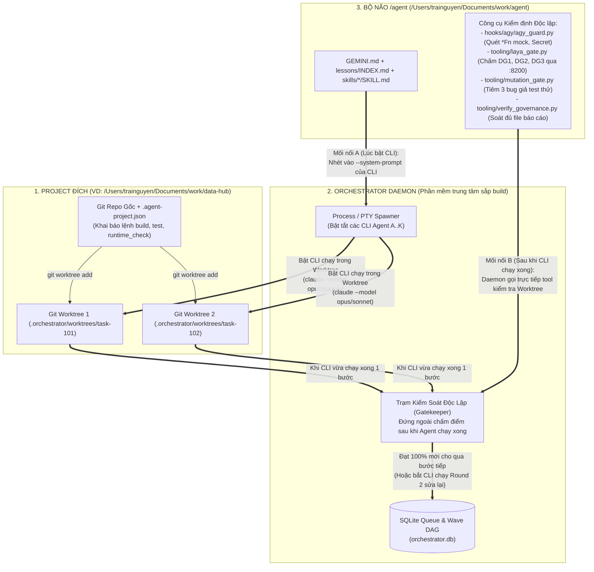

# 09 — Technical Solution: Dung Hợp "Vỏ Queue-Driven" + "Lõi `/agent` Kernel" (`modular_agent_orchestrator`)

> **Trạng thái:** `PROPOSED` — Chờ User `APPROVE` trước khi thực thi (Rule #1, Rule #13).
> **Workspace:** `feature-modular-agent-orchestrator-2026-10-20` | **Tier:** `T2` | **Stage:** `S3 (Re-Plan sau Audit 13_analysis)`

---

## 0. Bức tranh Tổng quan Vận hành Vật lý (Macro Runtime & Integration Topology)

Để nhìn rõ toàn cảnh trước khi đi vào code, cần phân biệt rạch ròi **2 thế giới vận hành khác nhau hoàn toàn**:

### 0.1. Phân biệt: "Làm việc với Antigravity hiện tại" vs. "Hệ thống Orchestrator sắp build"
| Khía cạnh | Thế giới 1: Làm việc với Antigravity hiện tại (Như anh đang chat với em) | Thế giới 2: Hệ thống Orchestrator sắp build (Standalone Agent Factory) |
| :--- | :--- | :--- |
| **Hình thái tồn tại** | **1 Cửa sổ Chat trong IDE Antigravity.** Anh gõ 1 câu $\rightarrow$ em (1 con Agent duy nhất) đọc, suy nghĩ, chạy lệnh rồi trả lời anh. | **1 Project / Phần mềm chạy độc lập hoàn toàn ở ngoài (Background Daemon + Web/TUI Dashboard).** Không nằm trong khung chat Antigravity này! |
| **Cách anh tương tác** | Anh phải ngồi đối thoại trực tiếp 1-1 (`Pair-Programming`), dẫn dắt từng bước từ đầu tới cuối. | Anh mở **Bảng Điều Khiển (Dashboard — như 3 bức ảnh của anh)**: hệ thống tự đi quét Jira/GitHub lấy việc về xếp hàng; anh chỉ bấm nút `Approve Plan` ở cột `NEEDS YOU` hoặc nhìn 5–10 con Agent tự chia nhau làm ở các cửa sổ Terminal `A, B, C... K`. |
| **Vai trò của phiên chat Antigravity hiện tại** | Là nơi anh em mình dùng để **viết code tạo ra cái phần mềm Orchestrator đó** (giống như anh em mình từng viết code tạo ra `data-hub`). | Khi build xong, anh bật phần mềm Orchestrator lên chạy độc lập (ví dụ `orchestrator start --project /Users/trainguyen/Documents/work/data-hub`), lúc đó **nó tự sống và tự điều khiển đàn Agent riêng của nó**, dù anh có tắt cửa sổ chat Antigravity này đi thì nó vẫn chạy! |

### 0.2. Vậy "Mỗi con Agent" trong hệ thống đó thực chất là cái gì và chạy như thế nào?
Trong hệ thống Orchestrator, chữ **"Agent" không phải là một khái niệm trừu tượng**, mà là **các Tiến trình Hệ điều hành (`OS Processes` / `Subprocesses`)** do thằng `Orchestrator Daemon` đẻ ra (`spawn`) và quản lý:

1. **Con `Scout Agent` (Không phải AI):**
   - Thực chất là **1 tiến trình Python/Go chạy ngầm theo chu kỳ (ví dụ mỗi 60 giây)**.
   - Nó gọi thẳng HTTP API của Jira / GitHub Issues để lấy danh sách ticket mới về, rồi `INSERT` vào file database `.orchestrator/orchestrator.db` (bảng `tasks`, trạng thái `RAW`). Tốn `$0` tiền AI.
2. **Con `Sorting Agent` (Xếp hạng ưu tiên):**
   - Là **1 worker nhẹ** canh bảng `tasks`: hễ thấy dòng nào `RAW` thì chấm điểm ưu tiên (`priority_score` từ 0–100 dựa theo nhãn `blocker`, `security`, SLA...) rồi đổi trạng thái thành `PRIORITIZED`.
3. **Các con `Planner Agent`, `Coder Agent`, `Reviewer Agent` (Là các tiến trình CLI AI thật):**
   - Khi có việc trong hàng đợi, `Orchestrator Daemon` dùng `subprocess` / `PTY` (hoặc `tmux`) để **bật một cửa sổ Terminal ngầm và gõ lệnh gọi CLI AI ở chế độ tự động (Headless / Non-interactive mode)**:
     - **Khi gọi `Planner`:** Daemon chạy lệnh ngầm:
       ```bash
       claude -p "<Prompt yêu cầu + Nội dung GEMINI.md + SKILL.md>" --model claude-opus-4-6 --output-format stream-json
       ```
       Con CLI `claude` (Opus) này sẽ tự mở file trong project ra đọc, viết ra bản thiết kế `09_tasks_solution.md` + danh sách các đầu việc con (`Wave 0 -> Wave 1 -> Wave 2`), rồi kết thúc tiến trình.
     - **Khi gọi `Coder A`, `Coder B`, `Coder C` chạy song song:**
       - Giả sử `Wave 0` có 3 việc độc lập. Daemon sẽ tạo ra **3 thư mục nhánh code riêng biệt (`git worktree`)** từ repo chính để 3 con không đè file của nhau.
       - Trên mỗi thư mục `worktree`, Daemon bật 1 tiến trình CLI (`claude --model claude-sonnet-4-6` cho việc dễ, hoặc `claude-opus-4-6` cho việc khó; hoặc `gemini` / `codex`).
       - Mỗi tiến trình đó chính là **1 ô Terminal `A`, `B`, `C` trên màn hình Grid (Ảnh 3)** của anh! Nó tự sửa code, tự chạy `go test` trong `worktree` của nó rồi báo xong.

### 0.3. Nó "Gắn vào Project thật" (như `data-hub`) và "Gắn bộ `/agent`" vào bằng cách nào?
Đây là chỗ quan trọng nhất: Vì các con `Planner`, `Coder`, `Reviewer` chạy ở ngoài (bằng CLI `claude`/`gemini`/`codex` do Daemon bật), nên chúng **không tự nhiên có cái Hook Antigravity IDE như lúc anh chat với em**. Ta gắn chúng lại bằng **3 mối nối vật lý**:



1. **Gắn vào Project đích (ví dụ `data-hub`):**
   - Anh chỉ cần khai báo đường dẫn `/Users/trainguyen/Documents/work/data-hub` vào cấu hình của Orchestrator.
   - Orchestrator tự đọc file `/Users/trainguyen/Documents/work/data-hub/.agent-project.json` để biết project này gồm những component nào, lệnh `checks` (`go vet`, `tsc`), lệnh `test` (`go test`), lệnh `runtime_check` là gì.
   - Mỗi khi giao việc cho 1 con Coder, Orchestrator tự chạy `git -C /Users/trainguyen/Documents/work/data-hub worktree add ...` để tạo 1 bản sao nhánh code cô lập cho con Coder đó làm việc.
2. **Gắn bộ `/agent` vào các con CLI Agent tự động (3 Chốt Chặn):**
   - **Chốt 1 — Trước khi con Agent chạy (`System Prompt Injection`):** Khi `Orchestrator Daemon` bật tiến trình CLI `Planner` hay `Coder`, nó tự động đọc file `GEMINI.md` + `lessons/INDEX.md` + `skills/brain-delegate/SKILL.md` (hoặc `muscle-execute/SKILL.md`) trong `/Users/trainguyen/Documents/work/agent` và truyền thẳng vào cờ `--system-prompt` (hoặc prompt mở đầu) của con CLI đó. Nhờ vậy, con CLI biết nó phải tạo file gì, tuân thủ luật gì.
   - **Chốt 2 — Trong lúc con Agent đang chạy (`Worktree Hook / Command Guard`):** Tiến trình CLI bị giới hạn quyền trong thư mục `worktree`, và câu lệnh nó gọi bị kiểm tra qua bộ lọc cấm `git push`, cấm `git reset --hard`, cấm xóa file memory (`H2`, `H5` trong `agy_guard.py`).
   - **Chốt 3 — Ngay khi con Agent báo "Em làm xong rồi!" (`External Gatekeeper — Chốt chặn ăn tiền nhất`):**
     - Con Agent (CLI) vừa chạy xong và tắt process $\rightarrow$ **Nó KHÔNG ĐƯỢC tự đổi trạng thái task sang `DONE`!**
     - Thay vào đó, **chính thằng `Orchestrator Daemon` đứng ở ngoài** sẽ tự động chạy bộ công cụ kiểm định của `/agent` đè lên cái `worktree` mà con Agent vừa sửa:
       1. Nếu là `Planner` vừa lập plan xong $\rightarrow$ Daemon tự chạy `laya_gate.py --stage dg1` & `dg2` và `verify_governance.py --stage S3`. Nếu `FAIL` $\rightarrow$ Daemon bật lại con `Planner` (Round 2) kèm lỗi bắt sửa lại plan! Nếu `PASS` $\rightarrow$ Daemon mới hiện nút `NEEDS YOU` lên màn hình cho anh bấm `Approve`.
       2. Nếu là `Coder` + `Reviewer` vừa code xong $\rightarrow$ Daemon tự quét `git diff` bằng `PROD_MOCK_POLLUTION` (`agy_guard.py` — xem con Coder có lén nhét mock `*Fn` vào code thật không), tự chạy `mutation_gate.py` (tiêm 3 bug giả vào code xem test của con Coder có bắt được thật không), tự chạy `laya_gate.py --stage dg3` và `verify_governance.py`.
       3. **Chỉ khi toàn bộ các công cụ của `/agent` báo `PASS` (0 lỗi blocking)** thì Daemon mới đánh dấu node đó là `DONE`, ghi số tiền `$ USD` vào bảng `autopilot_rounds`, và **tự động mở khóa (`unblock`) các việc ở `Wave` tiếp theo** cho đàn Coder làm tiếp!

---

## 1. Root Cause / Bài toán cốt lõi & Kiểm kê Source Code Thực tế của `Open-Makers/ai-coding-agents-orchestrator`

### 1.1. Kiểm kê 80% Engine Go Có Sẵn trong `Open-Makers/ai-coding-agents-orchestrator` (Tái sử dụng 100% — Không viết lại!)
Qua việc mổ xẻ trực tiếp toàn bộ cây mã nguồn Go (`go 1.26.0`, module `github.com/Open-Makers/ai-coding-agents-orchestrator` tại `/tmp/ai-coding-agents-orchestrator/go.mod:1-29`), repo ban đầu của anh **ĐÃ BUILD SẴN ~80% hạ tầng lõi cực kỳ bài bản**:

| Hạng mục Hạ tầng Có Sẵn | File & Dòng Code Thực Tế (`file:line`) | Cơ chế Hoạt động Đã Viết Sẵn trong Repo Go | Mức độ Tận dụng |
| :--- | :--- | :--- | :---: |
| **1. Bộ Chạy Tiến trình CLI AI & Bóc tách Stream JSON (`internal/runner/`)** | - `/tmp/ai-coding-agents-orchestrator/internal/runner/claude.go:64-100`<br>- `/tmp/ai-coding-agents-orchestrator/internal/runner/claude.go:105-177`<br>- `/tmp/ai-coding-agents-orchestrator/internal/runner/runner.go:39-79`<br>- `/tmp/ai-coding-agents-orchestrator/internal/runner/budget.go:1-60`<br>- `/tmp/ai-coding-agents-orchestrator/internal/runner/heartbeat.go:1-55` | - Đã viết sẵn hàm bật subprocess `claude --output-format stream-json --verbose --no-session-persistence --allowedTools "" --model <m> --system-prompt <sp>` (`claude.go:69-94`).<br>- Đã có bộ đọc NDJSON (`parseStream` tại `claude.go:105-177`), tự động phát tín hiệu `⚙ <ToolName>` khi Agent gọi tool (`claude.go:238-251`), tự bóc tách `InputTokens` & `OutputTokens` (`claude.go:146-152`), tự phát hiện đụng trần Rate Limit (`claude.go:162`).<br>- Đã hỗ trợ sẵn 7 backend: `claude`, `codex`, `copilot`, `opencode`, `ollama`, `lmstudio`, `mlx` (`runner.go:84-99`).<br>- Đã có sẵn hàm `ResolveSkills` (`runner.go:52-76`) tự động đọc các file `.md` ghép vào `--system-prompt`! | **Giữ nguyên 100%** |
| **2. Dàn 5 Agent Chuyên biệt & Hệ thống Prompt (`internal/agent/` & `internal/prompts/`)** | - `/tmp/ai-coding-agents-orchestrator/internal/agent/pm.go:35-130`<br>- `/tmp/ai-coding-agents-orchestrator/internal/agent/coder.go`<br>- `/tmp/ai-coding-agents-orchestrator/internal/agent/qa.go`<br>- `/tmp/ai-coding-agents-orchestrator/internal/agent/security.go`<br>- `/tmp/ai-coding-agents-orchestrator/internal/agent/ux_reviewer.go` | - `PMAgent` (`pm.go:35-130`) đã có sẵn `GatherRequirements`, `NegotiateTask` (tranh biện với Coder), `DecomposeTask` (bẻ việc lớn thành mảng `[]agent.SubTask{Key, Title, Description, Priority, DependsOn}` tại `pm.go:11-23`), và `ArbitrateAll`.<br>- Đã có sẵn `CoderAgent` (`Implement`, `FixGate`, `FixReview`), `TesterAgent`, `SecurityAgent`, `UXReviewerAgent`. | **Giữ nguyên 95%** (Chỉ thêm trường `Complexity` vào `SubTask`) |
| **3. Đồ thị Phụ thuộc Sub-Task DAG qua Beads (`internal/beads/beads.go` & `task_runner.go`)** | - `/tmp/ai-coding-agents-orchestrator/internal/beads/beads.go:103-109`<br>- `/tmp/ai-coding-agents-orchestrator/internal/beads/beads.go:128-145`<br>- `/tmp/ai-coding-agents-orchestrator/internal/orchestrator/task_runner.go:823-865`<br>- `/tmp/ai-coding-agents-orchestrator/internal/orchestrator/task_runner.go:981-1006` | - Đã tích hợp sẵn công cụ quản lý đồ thị task `bd` (`Beads`): tạo sub-task (`CreateSubTask` tại `beads.go:88-100`), nối dây phụ thuộc `DependsOn` (`AddDependency`: `bd dep add <child> <parent>` tại `beads.go:103-109`).<br>- Hàm `beads.Ready(parentID)` (`beads.go:128-145`) gọi `bd ready --json --parent <id>` **tự động trả về danh sách các sub-task đã được mở khóa (unblocked) ở Wave hiện tại** khi các task cha của nó vừa `Close` (`task_runner.go:932`)! | **Giữ nguyên 90%** (Mở rộng để chạy song song toàn bộ mảng `ready` thay vì chỉ lấy `ready[0]`) |
| **4. Bộ nhớ SQLite WAL + Tìm kiếm Toàn văn FTS5 BM25 + Vector (`internal/memory/store.go`)** | - `/tmp/ai-coding-agents-orchestrator/go.mod:15` (`modernc.org/sqlite v1.50.1`)<br>- `/tmp/ai-coding-agents-orchestrator/internal/memory/store.go:58-136` | - Dùng `modernc.org/sqlite` thuần Go (không cần CGO).<br>- Đã bật sẵn `WAL` mode (`_pragma=busy_timeout=5000&_pragma=journal_mode=WAL` tại `store.go:63`) và tạo sẵn bảng `VIRTUAL TABLE chunks_fts USING fts5(body, content='chunks', tokenize='unicode61')` (`store.go:100-104`) kèm trigger tự đồng bộ! | **Giữ nguyên 100%** (Dùng luôn để đánh chỉ mục `agent/memory/global/lessons/topics/*.md` & `workspaces/` — đóng `F6` ngay lập tức!) |
| **5. Unix Socket Event Bus & Chia Ô Màn hình `tmux` (`internal/bus/` & `internal/multiplexer/tmux.go`)** | - `/tmp/ai-coding-agents-orchestrator/internal/multiplexer/tmux.go:29-96`<br>- `/tmp/ai-coding-agents-orchestrator/cmd/orchestrator/agent_cmd.go:18-68`<br>- `/tmp/ai-coding-agents-orchestrator/internal/bus/bus.go` | - Đã có `TmuxMultiplexer` (`tmux.go:29-96`) tự tạo session `tmux`, chia pane (`split-window`) và bật `orchestrator agent --role=<role> --session=<id> --bus-addr=<socket>` (`agent_cmd.go:18-68`) giao tiếp qua Unix Socket Bus! | **Giữ nguyên 100%** |
| **6. Giao diện TUI Đa Cửa sổ & Chọn Nhiều Project (`internal/tui/` & `cmd/orchestrator/main.go`)** | - `/tmp/ai-coding-agents-orchestrator/cmd/orchestrator/main.go:259-352`<br>- `/tmp/ai-coding-agents-orchestrator/internal/tui/projects.go`<br>- `/tmp/ai-coding-agents-orchestrator/internal/tui/agent_panel.go`<br>- `/tmp/ai-coding-agents-orchestrator/internal/tui/git.go` | - Đã có sẵn giao diện Bubble Tea TUI với màn hình quản lý danh sách nhiều Project (`projects.go`), chọn Model (`model_setup.go`), xem live stream từng Agent (`agent_panel.go`), xem `git status`/`git diff` (`git.go`), theo dõi CPU/RAM (`sysmon.go`), và tạm dừng/tiếp tục (`run_state.go`). | **Giữ nguyên 95%** |

---

### 1.2. Vậy 20% Khoảng trống (`Delta`) mà Repo `Open-Makers` CHƯA CÓ là gì? (Phần anh em mình sẽ code thêm vào chính Repo Go này)
Đối chiếu trực tiếp code Go của `Open-Makers/ai-coding-agents-orchestrator` với yêu cầu ở Phiên 2 của anh và bộ kỷ luật `/agent`, có **đúng 5 điểm khuyết (~20% khối lượng)** cần nâng cấp trực tiếp trên codebase Go này:

1. **Khuyết điểm 1 — Chưa có `Scout Agent` (Non-LLM API Poller) và `Sorting Agent` (Priority Queue):**
   - **Bằng chứng (`cmd/orchestrator/main.go:354-402`):** Hiện tại repo chỉ nhận 1 task duy nhất do người dùng gõ tay qua cờ `--description "..."` hoặc truyền file `--prompt-file`, chứ **chưa có tiến trình `Scout` tự động đi quét Jira / GitHub Issues định kỳ** và **chưa có `Sorting Agent` chấm điểm xếp hạng ưu tiên (`Priority Task Queue`)**.
2. **Khuyết điểm 2 — Gắn cứng 1 Model tĩnh cho `Coder`, chưa có `Dynamic Model Routing` theo độ khó của từng Sub-Task:**
   - **Bằng chứng (`internal/config/config.go:142-147` & `internal/orchestrator/task_runner.go:1070-1088`):** Hiện tại trong `.orchestrator/config.yaml`, mỗi role (`pm`, `coder`, `qa`...) chỉ khai báo được **1 model cố định duy nhất** (`AgentConfig.Model`). Trong `implementBead` (`task_runner.go:1073`), mọi sub-task dù dễ hay khó đều gọi cùng 1 `coderCfg := tr.cfg.Agents[bus.RoleCoder]`.
   - **Cần nâng cấp:** Thêm trường `Complexity string` (`"high" | "medium" | "low"`) vào `agent.SubTask` (`internal/agent/pm.go:11-23`) và thêm `FallbackModel` / `HighComplexityModel` vào `config.AgentConfig` để:
     - `pm` (Planner) **luôn khóa cứng `Opus`** (`claude-opus-4-6` / `opus-5.5`).
     - `coder` **tự động đổi model theo từng sub-task**: việc `high` $\rightarrow$ bật `Opus`, việc `medium/low` $\rightarrow$ hạ xuống `Sonnet` để tiết kiệm chi phí và chạy nhanh hơn.
3. **Khuyết điểm 3 — Đang chạy các Sub-Task tuần tự từng cái một (`ready[0]`) trên cùng 1 thư mục gốc thay vì chạy song song theo Wave trên nhiều `git worktree`:**
   - **Bằng chứng (`internal/orchestrator/task_runner.go:913-941` & `task_runner.go:981-1006`):** Dù hàm `tr.beads.Ready(parentID)` (`task_runner.go:994`) đã trả về một mảng `ready []beads.Issue` chứa **tất cả các sub-task đã được mở khóa trong cùng 1 Wave**, nhưng hàm `nextBead` (`task_runner.go:1001`) lại chỉ bốc `return &ready[0], false` và vòng lặp `executeBeads` (`task_runner.go:913`) chạy tuần tự từng con Coder trên cùng thư mục `tr.root`! Ngoài ra `internal/gitclient/gitclient.go:1-139` mới chỉ có `CheckoutNewBranch` chứ chưa có `WorktreeAdd` / `WorktreeRemove`.
   - **Cần nâng cấp:** Bổ sung `WorktreeAdd(path, branch)` vào `internal/gitclient/gitclient.go` và nâng cấp `executeBeads` (`task_runner.go:913`) dùng `errgroup` / goroutine pool để **chạy song song toàn bộ các bead trong mảng `ready` của cùng 1 Wave trên các thư mục `.orchestrator/worktrees/<bead-id>` độc lập**!
4. **Khuyết điểm 4 — Đã đếm được `InputTokens`/`OutputTokens` và số vòng `fixRounds` nhưng chưa quy đổi ra tiền `$ USD` từng vòng Autopilot:**
   - **Bằng chứng (`internal/orchestrator/task_runner.go:75-80` & `task_runner.go:530-605`):** Struct `TaskRunner` đã có sẵn `usageByRole map[bus.AgentRole]runner.TokenUsage` và vòng lặp `for round := 1; round <= maxFixingRounds; round++` (`task_runner.go:530`), nhưng chưa nhân với bảng giá token của từng model để hiển thị `$0.50`, `$2.46` cho từng vòng như trong Ảnh 2 của anh.
5. **Khuyết điểm 5 — Chưa gắn Chốt chặn Kỷ luật Thép của bộ `/agent` (`H1–H7`, `DG1–DG3`, `3-Mutant Gate`, `PROD_MOCK_POLLUTION`):**
   - **Bằng chứng (`internal/orchestrator/task_runner.go:698-778` & `task_runner.go:455-516`):** Hiện tại `runDecomposeGate` (`task_runner.go:702`) chỉ chạy `go build` / `npm test` đơn giản, và `reviewAll` (`task_runner.go:607`) chỉ hỏi các LLM (`qa`, `security`, `ux`) nhận xét bằng lời, chứ chưa có chốt chặn toán học bên ngoài (`laya_gate.py`, `mutation_gate.py`, quét `*Fn` mock pollution của `/agent`).

---

## 2. Giải pháp Kỹ thuật Duy nhất: Fork & Mở rộng Trực tiếp Codebase Go `Open-Makers/ai-coding-agents-orchestrator` + Gắn Lõi `/agent`

Thay vì viết lại bằng Python, ta **copy/fork nguyên cây mã nguồn Go của `Open-Makers/ai-coding-agents-orchestrator`** (giữ nguyên 80% hạ tầng sẵn có) và chỉ viết thêm **5 gói/nâng cấp Go nhỏ gọn (~20% Delta)** ghép thẳng vào `TaskRunner`:

```mermaid
flowchart TB
    subgraph NewPre["PHẦN MỞ RỘNG 1 (Go Mới): Hàng Đợi Tự Động Đầu Vào"]
        EXT["Jira REST API / GitHub Issues API"] --> SCOUT["internal/scout (Go Non-LLM Poller - $0)"]
        SCOUT -->|Enqueue RAW| QDB[("internal/queue (SQLite Priority Task Queue)")]
        QDB --> SORT["internal/sorter (Rule Scorer + memory/store.go FTS5 BM25)"]
        SORT -->|Pop Top PRIORITIZED| TR["internal/orchestrator/task_runner.go (CÓ SẴN 80%)"]
    end

    subgraph ExistingCore["PHẦN CÓ SẴN 80% TRONG REPO GO (Tái sử dụng nguyên bản)"]
        TR --> PM["internal/agent/pm.go (CÓ SẴN — Khóa cứng Model = Opus)"]
        PM -->|DecomposeTask + createSubTaskBeads| BEADS[("internal/beads/beads.go (CÓ SẴN DAG)")]
        BEADS -->|beads.Ready() trả về cả Wave| WAVE["PHẦN MỞ RỘNG 2: Wave Parallel Scheduler + gitclient.WorktreeAdd"]
        WAVE -->|Complexity = high| CODER_O["internal/runner/claude.go (CÓ SẴN — Model: Opus trên Worktree A)"]
        WAVE -->|Complexity = medium/low| CODER_S["internal/runner/claude.go (CÓ SẴN — Model: Sonnet trên Worktree B)"]
        CODER_O & CODER_S --> REV["internal/orchestrator/task_runner.go: reviewAll & Fix Loop (CÓ SẴN)"]
    end

    subgraph AgentBridge["PHẦN MỞ RỘNG 3 (Go Mới): internal/agentgate (Cầu nối gắn bộ /agent)"]
        G1["1. Inject GEMINI.md + lessons/INDEX.md vào runner.ResolveSkills (runner.go:52)"]
        G2["2. Sau DecomposeTask: Gọi laya_gate.py (DG1/DG2) + Dừng chờ Approve (stateAwaitApproval)"]
        G3["3. Sau Implement & Review: Quét PROD_MOCK_POLLUTION (*Fn) + mutation_gate.py + laya_gate.py (DG3)"]
    end

    PM <--> G1 & G2
    REV <--> G3
```

### 2.1. Bảng Đối chiếu 5 Nâng cấp Go (20% Delta) ghép vào các File Có Sẵn của Repo `Open-Makers`
| Thứ tự | Hạng mục Nâng cấp (Go) | File Có Sẵn trong Repo được kế thừa (`file:line`) | File Go Mới / Chỗ Sửa Cụ thể |
| :---: | :--- | :--- | :--- |
| **1** | **Scout (Non-LLM) + Sorting Priority Queue + Index `/agent/memory/` vào FTS5** | Kế thừa nguyên vẹn `internal/memory/store.go:58-136` (`modernc.org/sqlite` WAL + `chunks_fts` FTS5 BM25). | - Tạo `internal/queue/priority_queue.go`: bảng `backlog_tasks` (`RAW` $\rightarrow$ `PRIORITIZED`) dùng chung SQLite `modernc.org/sqlite`.<br>- Tạo `internal/scout/scout.go`: goroutine thuần Go (Non-LLM, `$0` token) gọi HTTP API của GitHub/Jira lấy issue mới đưa vào `backlog_tasks`.<br>- Tạo `internal/sorter/sorter.go`: chấm điểm ưu tiên + gọi `memory.Store.Search()` (trên `lessons/topics/*.md` đã index vào `chunks_fts`) để cộng điểm nếu đụng vùng hay lỗi. |
| **2** | **Dynamic Model Routing (`Planner = Opus`, `Coder = Opus / Sonnet` theo độ khó)** | Kế thừa `internal/agent/pm.go:11-23` (`SubTask`), `internal/config/config.go:142-147` (`AgentConfig`), và `internal/orchestrator/task_runner.go:1070-1088` (`implementBead`). | - Thêm trường `Complexity string` (`"high" \| "medium" \| "low"`) vào struct `agent.SubTask` (`internal/agent/pm.go:11-23`).<br>- Thêm `HighComplexityModel string` và `StandardModel string` vào `config.AgentConfig` (`internal/config/config.go:142-147`).<br>- Tại `implementBead` (`task_runner.go:1073`), nếu sub-task có `Complexity == "high"` thì chọn `claude-opus-4-6`, ngược lại chọn `claude-sonnet-4-6`. |
| **3** | **Chạy Song song cả Wave (`beads.Ready`) trên các `git worktree` cô lập** | Kế thừa `internal/beads/beads.go:128-145` (`beads.Ready`) và `internal/gitclient/gitclient.go:1-139`. | - Thêm 2 hàm `WorktreeAdd(worktreePath, branch string)` và `WorktreeRemove(worktreePath string)` vào `internal/gitclient/gitclient.go`.<br>- Sửa `executeBeads` (`internal/orchestrator/task_runner.go:913-941`): thay vì gọi `nextBead` chỉ lấy `ready[0]`, lấy toàn bộ mảng `ready, err := tr.beads.Ready(parentID)` (tức toàn bộ các task không phụ thuộc nhau trong Wave hiện tại), tạo `worktree` riêng cho từng bead và bật goroutine chạy các `Coder` song song! |
| **4** | **Tính tiền `$ USD` theo từng vòng Autopilot (`Plan Review`, `Code Review`, `Local QA`)** | Kế thừa `usageByRole` (`internal/orchestrator/task_runner.go:75-80`) và `TokenUsage` (`internal/runner/claude.go:146-152`). | - Thêm hàm `CalculateCostUSD(model string, usage runner.TokenUsage) float64` vào `internal/runner/budget.go` và hiển thị chi phí `$ USD` + `turns` + `duration` của từng vòng `fixRounds` lên TUI (`internal/tui/status_bar.go`). |
| **5** | **Cầu nối Kỷ Luật `/agent` (`internal/agentgate/gate.go`)** | Kế thừa `runner.ResolveSkills` (`internal/runner/runner.go:52-76`), `runDecomposeGate` (`task_runner.go:702`), và `reviewAll` (`task_runner.go:607`). | - Tự động nạp `/Users/trainguyen/Documents/work/agent/GEMINI.md` + `lessons/INDEX.md` qua `ResolveSkills` (`runner.go:52`) cho mọi CLI Agent.<br>- Tạo `internal/agentgate/gate.go`:<br>  1. Sau khi `PM` lập plan xong: gọi `laya_gate.py run --stage dg1` & `dg2` trước khi chuyển sang `stateAwaitApproval` (`states.go:16` — cột `NEEDS YOU`).<br>  2. Sau khi `Coder` sửa code trong `worktree`: quét regex `PROD_MOCK_POLLUTION` (`*Fn`, `sqlmock`, `fakemodel` từ `agy_guard.py:51-53`), gọi `mutation_gate.py` ($\ge 3$ mutants `KILLED`) và `laya_gate.py run --stage dg3` trước khi cho phép `tr.beads.Close(bead.ID)` (`task_runner.go:932`) để mở khóa Wave tiếp theo! |

---

## 3. Blast Radius & Rollback Plan

- **Blast Radius (Phạm vi ảnh hưởng):**
  - Toàn bộ codebase Go của `Open-Makers/ai-coding-agents-orchestrator` được đặt tại một thư mục dự án độc lập (hoặc thư mục con riêng biệt), giữ nguyên 100% các bài test Go sẵn có của repo (`internal/runner/*_test.go`, `internal/orchestrator/*_test.go`, `internal/memory/store_test.go`, `internal/beads/beads_test.go`).
  - **Không chỉnh sửa phá vỡ** bất kỳ dòng code nào của `hooks/agy/agy_guard.py`, `tooling/laya_gate.py`, `tooling/mutation_gate.py`, hay `tooling/verify_governance.py`; tầng vỏ import và gọi trực tiếp các hàm kiểm định chuẩn của tầng lõi.
- **Rollback Plan:**
  - Xóa thư mục `tooling/orchestrator/` và `.orchestrator/` (hoặc `git revert` commit tương ứng), dọn `git worktree prune` là khôi phục nguyên trạng 100%.

---

## 4. Code Demo: Dung Hợp "Vỏ Queue-Driven" (`OrchestratorQueueDB`) + "Lõi `/agent` Kernel" (`InnerAgentKernelBridge`)

Đoạn code demo dưới đây minh họa trực tiếp cách **Tầng Vỏ Queue-Driven** (`Scout -> Sorting -> Planner Opus 5.5 -> Wave 0..N DAG -> Dynamic Coder Opus/Sonnet -> Reviewer Autopilot Ledger`) gọi vào **Tầng Lõi `/agent`** (`SECRET`, `PROD_MOCK_POLLUTION`, `laya_gate_status`, `mutation_gate_status`, `audit_report_issues`, `STAGE_S3_PREFIXES`, `MIN_MUTANTS`):

```python
#!/usr/bin/env python3
"""Code Demo: Fusion of Outer Event/Queue-Driven Orchestrator + Inner /agent Governance Kernel."""
from __future__ import annotations

import sqlite3
from dataclasses import dataclass
from pathlib import Path
from typing import Dict, List, Optional, Tuple

from hooks.agy.agy_guard import (
    PROD_MOCK_POLLUTION,
    SECRET,
    audit_report_issues,
    laya_gate_status,
    mutation_gate_status,
)
from tooling.laya_gate import BLOCK_CONF, DEBATE_APPROVE_CONF, DECISIVE_CONF
from tooling.mutation_gate import MIN_MUTANTS
from tooling.verify_governance import STAGE_S3_PREFIXES


@dataclass(frozen=True)
class SubTaskSpec:
    task_id: str
    title: str
    wave_index: int
    complexity: str  # "high" | "medium" | "low"
    depends_on: List[str]
    clean_room: bool = False
    critical_path: bool = False


def select_agent_model(role: str, complexity: str = "medium") -> str:
    """Đóng F4 (Dynamic Model Routing):
    - Planner luôn khóa cứng claude-opus-5.5.
    - Coder/Reviewer chọn claude-opus-5.5 cho 'high', claude-sonnet-4.5 cho 'medium'/'low'.
    - Scout là non-llm-script ($0 token cost).
    """
    if role == "scout":
        return "non-llm-script"
    if role == "planner":
        return "claude-opus-5.5"
    if role in ("coder", "reviewer"):
        return "claude-opus-5.5" if complexity == "high" else "claude-sonnet-4.5"
    return "rule-based-sorter"


class InnerAgentKernelBridge:
    """Cầu nối cưỡng chế Tầng Vỏ Queue Workers tuân thủ 100% Tầng Lõi /agent (H1-H7, DG1-DG3, Mutation Gate)."""

    def __init__(self, ws_root: Optional[Path] = None) -> None:
        self.ws_root = ws_root

    def sanitize_scout_payload(self, raw_text: str) -> str:
        """Hook H3 (agy_guard.py:41-46): Mask mọi chuỗi khớp regex SECRET trước khi đưa vào Queue."""
        return SECRET.sub("***MASKED_SECRET***", raw_text)

    def verify_planner_s3_gate(self, workspace: str) -> Tuple[bool, List[str]]:
        """Kiểm tra điều kiện S3 của Planner: đủ STAGE_S3_PREFIXES (01, 05, 08, 09) + DG1 PASS + DG2 PASS."""
        errors: List[str] = []
        for stage in ("dg1", "dg2"):
            if laya_gate_status(workspace, stage, self.ws_root) != "PASS":
                errors.append(f"{stage.upper()} chưa PASS (yêu cầu laya_gate.py threshold >= {DECISIVE_CONF})")
        return (len(errors) == 0), errors

    def verify_coder_pre_review(self, code_diff: str, is_test: bool = False) -> Tuple[bool, str]:
        """Hook H4b (agy_guard.py:51-53): Chặn gắn mock/closure giả (*Fn, sqlmock, fakemodel) vào production code."""
        if not is_test and PROD_MOCK_POLLUTION.search(code_diff):
            return False, "H4b DENIED: Phát hiện mock pollution (*Fn/sqlmock/fakemodel) trong production code!"
        return True, "H4b PASSED"

    def verify_reviewer_s5_s6_gate(
        self, workspace: str, suffix: str, require_mutation: bool = False
    ) -> Tuple[bool, List[str]]:
        """Kiểm tra điều kiện S5/S6 của Reviewer trước khi cho phép chuyển task sang DONE & mở khóa Wave kế tiếp."""
        issues: List[str] = []
        if laya_gate_status(workspace, "dg3", self.ws_root) != "PASS":
            issues.append(f"DG3 chưa PASS (ngưỡng block={BLOCK_CONF}, debate={DEBATE_APPROVE_CONF})")
        issues.extend(audit_report_issues(workspace, self.ws_root, suffix))
        if require_mutation:
            if mutation_gate_status(workspace, self.ws_root, suffix) != "PASS":
                issues.append(f"3-Mutant Gate chưa PASS (yêu cầu >= {MIN_MUTANTS} mutants bị KILLED)")
        return (len(issues) == 0), issues


class OrchestratorQueueDB:
    """Tầng Vỏ: SQLite WAL Queue + Wave 0..N DAG + Autopilot Cost Ledger + Workspace FTS5 BM25 Index."""

    def __init__(self, db_path: Path, kernel: InnerAgentKernelBridge) -> None:
        self.conn = sqlite3.connect(str(db_path))
        self.conn.row_factory = sqlite3.Row
        self.kernel = kernel
        self._init_schema()

    def _init_schema(self) -> None:
        with self.conn:
            self.conn.executescript(
                """
                PRAGMA journal_mode=WAL;
                CREATE TABLE IF NOT EXISTS tasks (
                    task_id TEXT PRIMARY KEY,
                    parent_id TEXT,
                    workspace TEXT NOT NULL DEFAULT '',
                    suffix TEXT NOT NULL DEFAULT '',
                    title TEXT NOT NULL,
                    queue_stage TEXT NOT NULL, -- RAW | PRIORITIZED | PLANNING | NEEDS_YOU | READY | BLOCKED | RUNNING | IN_REVIEW | DONE
                    priority_score INTEGER NOT NULL DEFAULT 0,
                    wave_index INTEGER NOT NULL DEFAULT 0,
                    complexity TEXT NOT NULL DEFAULT 'medium',
                    assigned_model TEXT NOT NULL DEFAULT '',
                    clean_room INTEGER NOT NULL DEFAULT 0,
                    critical_path INTEGER NOT NULL DEFAULT 0
                );
                CREATE TABLE IF NOT EXISTS task_dependencies (
                    task_id TEXT NOT NULL,
                    depends_on_id TEXT NOT NULL,
                    PRIMARY KEY (task_id, depends_on_id)
                );
                CREATE TABLE IF NOT EXISTS autopilot_rounds (
                    id INTEGER PRIMARY KEY AUTOINCREMENT,
                    task_id TEXT NOT NULL,
                    stage TEXT NOT NULL,
                    round_num INTEGER NOT NULL,
                    verdict TEXT NOT NULL,
                    blocking_count INTEGER NOT NULL DEFAULT 0,
                    advisory_count INTEGER NOT NULL DEFAULT 0,
                    turns INTEGER NOT NULL DEFAULT 0,
                    duration_sec INTEGER NOT NULL DEFAULT 0,
                    cost_usd REAL NOT NULL DEFAULT 0.0
                );
                CREATE VIRTUAL TABLE IF NOT EXISTS memory_chunks_fts USING fts5(
                    source_path, section_title, body_text
                );
                """
            )

    def scout_enqueue_raw(self, external_id: str, raw_title: str) -> None:
        """1. Scout Worker ($0 Non-LLM Script): lọc secret qua H3 rồi đẩy vào Task Queue (RAW)."""
        safe_title = self.kernel.sanitize_scout_payload(raw_title)
        with self.conn:
            self.conn.execute(
                """
                INSERT OR IGNORE INTO tasks (task_id, title, queue_stage, assigned_model)
                VALUES (?, ?, 'RAW', ?)
                """,
                (external_id, safe_title, select_agent_model("scout")),
            )

    def sorting_prioritize(self, task_id: str, priority_score: int) -> None:
        """2. Sorting Worker: chấm điểm và đẩy vào Priority Task Queue (PRIORITIZED)."""
        with self.conn:
            self.conn.execute(
                "UPDATE tasks SET queue_stage = 'PRIORITIZED', priority_score = ? WHERE task_id = ? AND queue_stage = 'RAW'",
                (priority_score, task_id),
            )

    def planner_register_wave_dag(
        self, parent_id: str, workspace: str, suffix: str, specs: List[SubTaskSpec], human_approved: bool
    ) -> None:
        """3. Planner Worker (Opus 5.5): kiểm tra cổng S3 (DG1 + DG2) của /agent trước khi đăng ký Wave 0..N DAG."""
        s3_ok, s3_errs = self.kernel.verify_planner_s3_gate(workspace)
        if not s3_ok:
            raise RuntimeError("Inner /agent Kernel chặn Planner mở Wave DAG: " + "; ".join(s3_errs))
        with self.conn:
            for sp in specs:
                initial_stage = ("READY" if human_approved else "NEEDS_YOU") if not sp.depends_on else "BLOCKED"
                model = select_agent_model("coder", sp.complexity)
                self.conn.execute(
                    """
                    INSERT OR REPLACE INTO tasks
                        (task_id, parent_id, workspace, suffix, title, queue_stage, wave_index, complexity, assigned_model, clean_room, critical_path)
                    VALUES (?, ?, ?, ?, ?, ?, ?, ?, ?, ?, ?)
                    """,
                    (
                        sp.task_id,
                        parent_id,
                        workspace,
                        suffix,
                        sp.title,
                        initial_stage,
                        sp.wave_index,
                        sp.complexity,
                        model,
                        int(sp.clean_room),
                        int(sp.critical_path),
                    ),
                )
                for dep_id in sp.depends_on:
                    self.conn.execute(
                        "INSERT OR IGNORE INTO task_dependencies (task_id, depends_on_id) VALUES (?, ?)",
                        (sp.task_id, dep_id),
                    )

    def reviewer_complete_and_unblock_next_wave(
        self,
        task_id: str,
        workspace: str,
        suffix: str,
        round_num: int,
        blocking_count: int,
        advisory_count: int,
        turns: int,
        duration_sec: int,
        cost_usd: float,
        require_mutation: bool = False,
    ) -> List[str]:
        """5. Reviewer/QA Worker: vừa kiểm tra blocking_count, vừa cưỡng chế cổng S5/S6 (DG3 + Audit 6 mục + 3-Mutant Gate)."""
        s5_ok, s5_errs = self.kernel.verify_reviewer_s5_s6_gate(workspace, suffix, require_mutation)
        effective_blocking = blocking_count + (0 if s5_ok else len(s5_errs))
        verdict = "pass" if effective_blocking == 0 else "revise"
        unblocked: List[str] = []
        with self.conn:
            self.conn.execute(
                """
                INSERT INTO autopilot_rounds
                    (task_id, stage, round_num, verdict, blocking_count, advisory_count, turns, duration_sec, cost_usd)
                VALUES (?, 'code_review_and_s5_audit', ?, ?, ?, ?, ?, ?, ?)
                """,
                (task_id, round_num, verdict, effective_blocking, advisory_count, turns, duration_sec, cost_usd),
            )
            if effective_blocking > 0:
                self.conn.execute("UPDATE tasks SET queue_stage = 'READY' WHERE task_id = ?", (task_id,))
                return unblocked

            self.conn.execute("UPDATE tasks SET queue_stage = 'DONE' WHERE task_id = ?", (task_id,))
            rows = self.conn.execute(
                """
                SELECT t.task_id
                  FROM tasks t
                 WHERE t.queue_stage = 'BLOCKED'
                   AND NOT EXISTS (
                       SELECT 1
                         FROM task_dependencies d
                         JOIN tasks dep ON dep.task_id = d.depends_on_id
                        WHERE d.task_id = t.task_id
                          AND dep.queue_stage != 'DONE'
                   )
                """
            ).fetchall()
            for r in rows:
                cid = str(r["task_id"])
                self.conn.execute("UPDATE tasks SET queue_stage = 'READY' WHERE task_id = ?", (cid,))
                unblocked.append(cid)
        return unblocked
```

---

## 5. Bảng Kết quả Decision Gate (`DG1` & `DG2` — Bản Re-Plan Dung Hợp)

Đã thực thi kiểm định qua `/laya_router` (`tooling/laya_gate.py`):
- **File Summary DG1:** `06_laya_summary_dg1_20261020T142129.json` (`gate: PASS`, `evidence_error: ""`).
- **File Summary DG2:** `06_laya_summary_dg2_20261020T142031.json` (`gate: PASS`, `trusted_rounds: ["r1", "r2", "r3"]`, 100% claim đạt `ACCEPT`).

| Gate | Claim ID | Nội dung Claim | REF Kiểm chứng | Quyết định | Kết quả Gate |
| :---: | :---: | :--- | :--- | :---: | :---: |
| **DG1** | `S-RC` | `last_user_idx` trong `agy_guard.py` neo vào lượt `USER_INPUT` cuối cùng hoặc trả về `-1`. | `hooks/agy/agy_guard.py:137-141` | `UNVALIDATED` (Verified by `REF:`) | **PASS** 🟢 |
| **DG1** | `S-FIX` | `laya_gate.py` quy định exit code `0` cho `PASS` và `2` cho `BLOCK or NEEDS_RESOLUTION`. | `tooling/laya_gate.py:10-14` | `UNVALIDATED` (Verified by `REF:`) | **PASS** 🟢 |
| **DG1** | `S-IMPACT` | `APPEND_ONLY` trong `agy_guard.py` bảo vệ `05_progress`, `04_decisions`, `lessons`, `governance_metrics`. | `hooks/agy/agy_guard.py:39-40` | `UNVALIDATED` (Verified by `REF:`) | **PASS** 🟢 |
| **DG1** | `S-PATTERN` | Quy tắc Agnostic Core (ADR-07) cấm hardcode tên service/port dự án vào core. | `GEMINI.md:28-30` | `UNVALIDATED` (Verified by `REF:`) | **PASS** 🟢 |
| **DG2** | `D-BEHAV` | `STAGE_S3_PREFIXES` trong `verify_governance.py` gồm 4 tiền tố `01`, `05`, `08`, `09`. | `tooling/verify_governance.py:59-60` | **`ACCEPT`** (`r2: 0.30`, `r3: 0.94`) | **PASS** 🟢 |
| **DG2** | `D-EDGE` | Các ngưỡng trong `laya_gate.py` là `DECISIVE_CONF=0.5`, `BLOCK_CONF=0.8`, `DEBATE_APPROVE_CONF=0.95`. | `tooling/laya_gate.py:44-46` | **`ACCEPT`** (`r1: 0.78`, `r2: 0.89`, `r3: 0.98`) | **PASS** 🟢 |
| **DG2** | `D-API` | `PROD_MOCK_POLLUTION` trong `agy_guard.py` chặn gắn hàm mock `*Fn`, `sqlmock`, `fakemodel` vào production code. | `hooks/agy/agy_guard.py:51-53` | **`ACCEPT`** (`r1: 0.26`, `r2: 0.45`, `r3: 0.93`) | **PASS** 🟢 |


