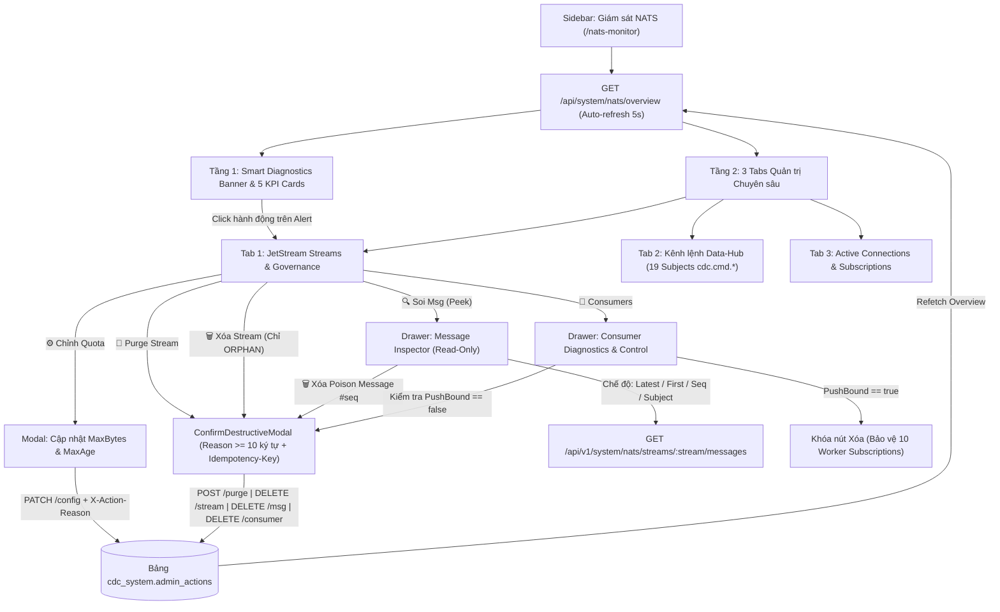

# 03. UI/UX Architecture & Interactive Flow Spec — `/nats-monitor` (`nats_monitor_v2`)

> **Trạng thái:** `PROPOSED` (Tài liệu hóa kiến trúc UI/UX Flow & Wireframe Design phục vụ duyệt `APPROVE`)

---

## 1. Sơ đồ Tổng thể Luồng Tương tác Người dùng (Operator / OpsAdmin UX Flow)

---

## 2. Thiết kế Bố cục 4 Khu vực (Layout & Visual Hierarchy)

### 2.1. Khu vực 1 — Header, Smart Diagnostics Banner & 5 KPI Cards
1. **Top Action Bar:**
   - Tiêu đề **Data-Hub NATS Control Center**, trạng thái kết nối (`HEALTHY` / `DEGRADED` / `DOWN`), thời điểm cập nhật cuối.
   - Bộ chọn chu kỳ Auto-refresh (`3s`, `5s`, `10s`, `30s`, `Tạm dừng`), nút **Làm mới ngay**, nút **Xem Raw JSON**.
2. **Smart Diagnostics Banner (`overview.governance.alerts`):**
   - Tự động hiển thị khi phát hiện:
     - `STREAM_DRIFT` (ví dụ: `CDC_TRANSMUTE` đang ở `limits` hoặc `max_bytes = -1`) $\rightarrow$ Nút bấm mở ngay Modal chỉnh Quota.
     - `ORPHAN_STREAM` (ví dụ: `TEST_WQ_CHECK` không thuộc 4 Core Streams) $\rightarrow$ Nút bấm mở ngay `ConfirmDestructiveModal` để xóa.
     - `CONSUMER_STALLED` (ví dụ: `num_ack_pending / max_ack_pending >= 80%` hoặc `num_redelivered > 0`) $\rightarrow$ Nút bấm mở ngay Drawer Consumer & Message Inspector.
     - `MISSING_COMMAND_LISTENER` (có kênh lệnh trong 19 kênh bắt buộc `active_listeners == 0`) $\rightarrow$ Nút bấm chuyển sang Tab 2 xem kênh bị mất listener.
3. **5 KPI Cards:**
   - **Card 1 — NATS Broker & Uptime:** Tên server, Version, Uptime, CPU %, Memory, Slow Consumers badge.
   - **Card 2 — JetStream Storage Quota:** `formatBytes(storage) / formatBytes(max_storage)` kèm thanh `Progress` đổi màu theo ngưỡng (`<70%` xanh, `70-89%` cam, `>=90%` đỏ).
   - **Card 3 — Stream Governance:** Số lượng Core Streams đạt chuẩn (`4/4 SYNCED`), số lượng Stream Drift, số lượng Orphan Streams.
   - **Card 4 — Consumer & In-Flight Backlog:** Tổng `num_pending`, tổng `num_ack_pending` (In-Flight), tổng `num_redelivered`.
   - **Card 5 — Command Channels (`cdc.cmd.*`):** Số kênh lệnh có Worker lắng nghe (`19/19 READY`) và tổng số Worker Connections.

### 2.2. Khu vực 2 — Tab 1: `JetStream Streams & Governance`
Bảng quản trị Streams với 7 cột thông tin giàu ngữ cảnh:
1. **Stream & Vai trò Nghiệp vụ:** Tên Stream, Tag `CORE` (xanh dương) hoặc `ORPHAN` (đỏ), dòng mô tả vai trò trong Data-Hub (`CDC_TRANSMUTE`: Hàng đợi WorkQueue điều phối job Shadow $\rightarrow$ Master).
2. **Chính sách & Chuẩn hóa:** Tag `WORKQUEUE` (tím) / `LIMITS` (xanh), `MaxAge` (`1h`, `24h`, `7d`), badge trạng thái `SYNCED` 🟢 hoặc `DRIFT` 🟠 (di chuột xem danh sách `drift_reasons`).
3. **Subjects:** Danh sách các subject pattern đang gắn vào stream (`cdc.cmd.transmute-shadow`, `cdc.raw.>`).
4. **Messages & Sequence Range:**
   - Nếu `messages === 0`: Hiển thị `0 msgs` và tag `Trống (Next: #first_seq)` (không hiện `#83 → #82` hay `1970-01-01`).
   - Nếu `messages > 0`: Hiển thị số lượng messages và dải `#first_seq → #last_seq`.
5. **Dung lượng & Quota (`Bytes / MaxBytes`):**
   - Nếu `max_bytes <= 0`: Hiển thị `formatBytes(bytes)` kèm tag cảnh báo `UNLIMITED (NO CAP)` màu cam.
   - Nếu `max_bytes > 0`: Hiển thị `formatBytes(bytes) / formatBytes(max_bytes)` kèm thanh `Progress` `%`.
6. **Consumers:** Số lượng consumer, tổng `Pending` và `AckPending`.
7. **Thao tác Kiểm soát (Control Plane Actions):**
   - `🔍 Soi Msg`: Mở Drawer **Message Inspector**.
   - `👥 Consumers`: Mở Drawer **Consumer Diagnostics & Control**.
   - `⚙️ Quota`: Mở Modal cập nhật `MaxBytes` & `MaxAge`.
   - `🧹 Purge`: Mở `ConfirmDestructiveModal` làm sạch hàng đợi.
   - `🗑️ Xóa`: Chỉ hiển thị cho stream `ORPHAN` (khóa bảo vệ 4 Core Streams).

### 2.3. Khu vực 3 — 2 Drawers Chuyên sâu & `ConfirmDestructiveModal`
1. **Drawer 1 — `JetStream Message Inspector (Read-Only Peek)`:**
   - Thanh công cụ chọn chế độ: `10 tin mới nhất (Latest)`, `10 tin đầu hàng đợi (Oldest/First)`, `Tra cứu theo Sequence #`, `Tin cuối theo Subject`.
   - Bảng danh sách message (`Seq #`, `Subject`, `Timestamp`, `Size`, nút `Xem JSON`, nút `🗑️ Xóa #seq`).
   - Khung chi tiết Message đang chọn: hiển thị `Headers` (`Nats-Msg-Id`, `traceparent`) và `Payload JSON` đã format (`shadow_table`, `_source_ids`, `triggered_at`...).
2. **Drawer 2 — `Consumer Diagnostics & Control`:**
   - Thông tin kết nối Worker: Badge `PushBound: TRUE (Đang gắn Worker)` 🟢 hoặc `PushBound: FALSE (Mồ côi)` 🟠, `DeliverGroup` (`cdc-transmute-workers`), `AckWait` (`30s`), `MaxDeliver` (`5`).
   - Cột **Tiến độ Sequence:** `AckFloor #82 → Delivered #82 / Stream #82`.
   - Cột **Cửa sổ In-Flight (`AckPending / MaxAckPending`):** Thanh Progress hiển thị mức độ bão hòa (ví dụ `480 / 500 = 96%` $\rightarrow$ báo đỏ khi worker bị nghẽn DB).
   - Cột **Thao tác:** Nút `🗑️ Xóa Consumer` — tự động `disabled` kèm Tooltip giải thích nếu `push_bound === true` (bảo vệ kết nối của 10 worker goroutines), chỉ bật khi `push_bound === false`.
3. **Modal Xác nhận Chuẩn Hệ thống (`ConfirmDestructiveModal`):**
   - Áp dụng cho mọi thao tác `Purge Stream`, `Xóa Poison Message`, `Xóa Orphan Stream`, `Xóa Consumer Mồ côi`.
   - Yêu cầu nhập `Lý do thực hiện (tối thiểu 10 ký tự)` và gõ lại tên `Stream`/`Consumer` để xác nhận, tự động gắn `Idempotency-Key` và `X-Action-Reason` lưu vào bảng `cdc_system.admin_actions`.

### 2.4. Khu vực 4 — Tab 2 (`Kênh lệnh Data-Hub cdc.cmd.*`) & Tab 3 (`Active Connections`)
1. **Tab 2 — `Kênh lệnh Data-Hub (19 Core Subjects)`:**
   - Bộ lọc theo Nhóm nghiệp vụ (`Tất cả`, `Master Transmute`, `Reconciliation & Heal`, `Source & Discovery`, `Connector & Snapshot`, `Master Table DDL`, `Schema Config`) và ô tìm kiếm subject.
   - Bảng hiển thị: `Subject`, `Nhóm nghiệp vụ`, `Queue Group` (`cdc-worker`, `cdc-transmute-workers`), `Active Listeners` (ví dụ `10 subscriptions` / `1 subscription`), `Worker CIDs` (`CID #15`), `Msgs Delivered`, và trạng thái `READY` 🟢 / `NO_LISTENER` 🔴.
2. **Tab 3 — `Active Connections & Subscriptions`:**
   - Bảng kết nối hiển thị `CID`, `Name`, `Role` (`CDC Worker`, `CMS Service`), `IP:Port`, `Uptime`, `RTT`, `In/Out Traffic`, `Pending Bytes`, `Subscriptions Count`.
   - Bấm mở rộng (`+`) trên từng dòng Connection để xem bảng chi tiết `subscriptions_list_detail` (`SID`, `Subject`, `Queue Group`, `Msgs Delivered`).
