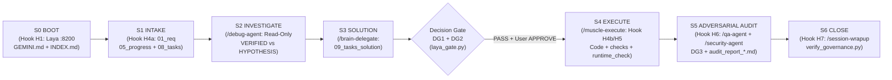
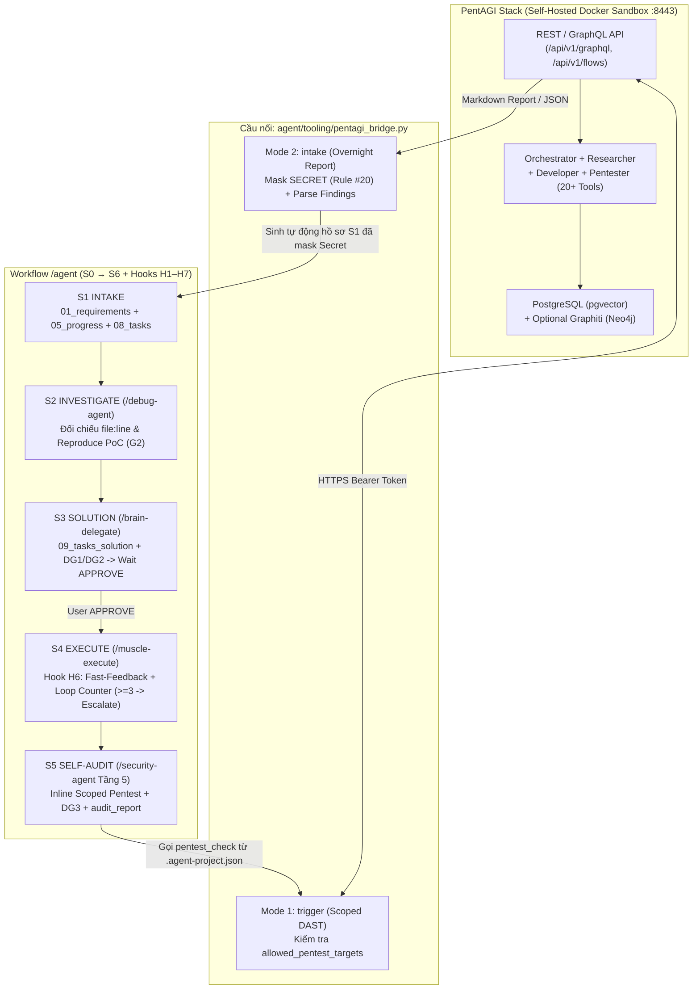

# 09 — Tasks Solution: Phân tích Workflow `/agent` Hiện tại & Thiết kế Tích hợp PentAGI (`pentagi_integration`)

> **Workspace:** `feature-pentagi-workflow-integration-2026-10-20`
> **Suffix:** `pentagi_integration` | **Tier:** `T2` | **Trạng thái:** `PROPOSED (Chờ User APPROVE)`

---

## 1. Root Cause / Vấn đề cốt lõi: Bức tranh Workflow `/agent` Hiện tại & 3 Khoảng trống so với PentAGI

### 1.1. Kiến trúc Workflow hiện tại của `/agent` (`S0 → S6` — `VERIFIED`)
Hệ thống `/agent` hiện tại được điều phối bởi Hiến pháp `GEMINI.md` (`Rule #9:66-81`), 10 Core Skills (`OPERATOR_MAP.md:5-18`), 7 Lifecycle Hooks (`hooks/agy/agy_guard.py:7-22`) và Process Linter (`tooling/verify_governance.py:25-66`):



- **Tầng điều phối & phân quyền (`GEMINI.md:18-21`, `OPERATOR_MAP.md:5-18`):**
  - **Brain (`/brain-delegate`):** Chịu trách nhiệm `S0 → S3`, thiết kế giải pháp duy nhất vào `09_tasks_solution_<suffix>.md`, chạy `DG1/DG2` và giữ kỷ luật *Propose-Only* (chờ `APPROVE`).
  - **Muscle (`/muscle-execute`):** Chỉ thực thi ở `S4` sau khi có `APPROVE`, tạo git restore-point local, chạy `checks`/`test`/`runtime_check` từ `<project-root>/.agent-project.json`.
  - **Hội đồng Kiểm định (`/qa-agent`, `/security-agent`, `/laya-router`):** Thực thi ở `S5`, kiểm tra 8 cổng `DoD G1–G8`, chống suy diễn Smoke Test, chạy `DG3` và xuất `audit_report_<suffix>.md` (6 phần bắt buộc).
- **Tầng cưỡng chế tự động 7 Lifecycle Hooks (`hooks/agy/agy_guard.py:7-22`):**
  - `H1 (PreInvocation)`: Kiểm tra Laya `:8200`, tiêm checklist `S0 Boot` ở mỗi lượt User Input (`agy_guard.py:305-336`).
  - `H2 (PreToolUse)`: Chặn `Overwrite: true` trên file memory và bảo vệ các file append-only (`05_progress`, `04_decisions`, `lessons.md`) (`agy_guard.py:349-368`).
  - `H3 (PreToolUse)`: Quét regex `SECRET` chặn ghi thô password/token/URI vào `agent/memory/` (`agy_guard.py:370-376`).
  - `H4 (PreToolUse)`: `H4a` chặn tạo `09_tasks_solution` nếu thiếu `S1 Intake` (`01`, `05`, `08`); `H4b` chặn `PROD_MOCK_POLLUTION` (`*Fn`, `sqlmock`, `fakemodel`) và chặn sửa code khi chưa có `DG1 PASS` hoặc chưa có `User APPROVE` (`agy_guard.py:378-455`).
  - `H5 (PreToolUse)`: Chặn cứng `git push`, `git reset --hard`, `git clean -f`, `rm -rf memory/.git`, và `force_ask` với lệnh ghi trực tiếp vào DB (`agy_guard.py:459-468`).
  - `H6 (PostInvocation)`: Tự động chạy `checks` từ `.agent-project.json` ngay sau khi sửa code và tiêm checklist `FINAL_AUDIT_MSG` (`agy_guard.py:471-511`).
  - `H7 (Stop)`: Chặn kết thúc task nếu thiếu `DG1/DG2/DG3`, `05_progress`, `06_validation`, `audit_report_<suffix>.md` (6 mục), `runtime_check` hoặc `verify_governance.py` (`agy_guard.py:514-607`).

### 1.2. Ba Khoảng trống Kỹ thuật (`Gap Analysis`) khi đối chiếu với PentAGI
1. **Gap 1 — `/security-agent` mới dừng ở Kiểm tra Tĩnh (SAST/Regex), thiếu Kiểm thử Xâm nhập Động (DAST/Black-box Runtime):**
   - Tại `skills/security-agent/SKILL.md:17-38`, quy trình 4 tầng hiện tại chỉ quét regex `SECRET` và đọc tĩnh `git diff` để tìm lỗi Injection / AuthN / AuthZ.
   - Khi hệ thống mở API mới hoặc sửa middleware xác thực, `/agent` chưa có cơ chế gọi một công cụ DAST/Pentest tự động trong Docker sandbox (như `PentAGI` với `nmap`, `sqlmap`, `metasploit`, `scraper`) để tấn công thử vào tiến trình runtime thật.
2. **Gap 2 — Chưa có cầu nối tự động từ "Báo cáo Pentest Đêm (Overnight PentAGI Flow)" sang "Hồ sơ `S1 Intake` An toàn của `/agent`":**
   - Kịch bản trong bài viết (*"Tối 11h chạy PentAGI, sáng 7h ném báo cáo cho AI Agent sửa"*) nếu làm thủ công sẽ vướng 2 rủi ro lớn:
     - **(a) Rủi ro lộ Secret/PII vào Memory (Vi phạm Rule #20):** Báo cáo của PentAGI chứa raw HTTP header, Bearer token, cookie hoặc dump DB từ quá trình exploit; nếu dán thẳng vào workspace sẽ bị Hook `H3` (`agy_guard.py:370-376`) chặn hoặc làm rò rỉ secret.
     - **(b) Rủi ro False Positive & Tự tiện sửa code (Vi phạm Rule #1 & #13):** Báo cáo pentest tự động của LLM (đặc biệt khi chạy model local) luôn có tỷ lệ báo động giả (False Positive). Nếu yêu cầu AI *"Fix ngay theo báo cáo này"* mà bỏ qua `S1 Intake → S2 Reproduce (Red) → S3 Solution (DG1/DG2) → Wait APPROVE`, Agent sẽ sửa hỏng code production.
3. **Gap 3 — Quy tắc `Rule #15 Escalation (>3 lần lặp)` chưa được Hook `H6` cưỡng chế tự động bằng bộ đếm như `Execution Monitor` của PentAGI:**
   - Trong `GEMINI.md:107` quy định: *"Escalation (>3 lần lặp): Thử sửa cùng 1 lỗi >3 lần thất bại → DỪNG NGAY, báo cáo để re-plan."*
   - PentAGI có cơ chế **Execution Monitoring (`Adviser/Mentor`)** đếm số lần tool lặp lại hoặc thất bại liên tiếp để can thiệp chống vòng lặp vô hạn (`PentAGI README.md:485-496`). Trong khi đó, `handle_post_invocation` tại `hooks/agy/agy_guard.py:495-511` hiện mới trả về danh sách `errs` chứ chưa đếm số lần lặp lỗi liên tiếp trong cùng một lượt để tự động tiêm lệnh dừng Escalation.

---

## 2. Giải pháp Kỹ thuật (Đúng 1 Phương án Tối ưu nhất: Tích hợp 2 Chiều PentAGI ↔ `/agent` & Nâng cấp Hook `H6`)



Giải pháp gồm **3 Trụ cột đồng bộ**, giữ `/agent` 100% **Project-Agnostic (Rule #3 / ADR-07)**:

### Trụ cột 1 — Mở rộng chuẩn `<project-root>/.agent-project.json` (`skills/workspace-docs/SKILL.md`)
- Bổ sung 2 trường tùy chọn (optional) vào từng `component` trong `.agent-project.json`:
  - `allowed_pentest_targets`: Danh sách tiền tố URL nội bộ/staging được ủy quyền kiểm thử (mặc định chỉ cho phép `http://localhost`, `http://127.0.0.1`, `https://localhost`). Tuyệt đối chặn mọi URL ngoài danh sách này để không bao giờ bắn pentest nhầm vào môi trường Production.
  - `pentest_check`: Lệnh gọi `pentagi_bridge.py trigger` (chỉ chạy khi dự án có cấu hình và tiến trình PentAGI đang bật).

### Trụ cột 2 — Xây dựng `agent/tooling/pentagi_bridge.py` & Nâng cấp `/security-agent` lên 5 Tầng
Công cụ `pentagi_bridge.py` đóng vai trò cầu nối chuẩn hóa cho 2 chế độ vận hành:
1. **Chế độ A — Overnight Batch Pentest $\rightarrow$ S1 Intake (`pentagi_bridge.py intake`):**
   - Thay vì sáng dậy copy-paste báo cáo PDF/Markdown thô vào chat và bảo *"Fix theo báo cáo này"*, User hoặc Cron chạy:
     ```bash
     python3 /Users/trainguyen/Documents/work/agent/tooling/pentagi_bridge.py intake \
       --report /path/to/pentagi_report.md \
       --workspace fix-pentest-findings-2026-10-20 \
       --suffix pentest_batch_01
     ```
     *(Hoặc truyền `--flow-id <id>` để script tự tải báo cáo qua PentAGI API bằng biến môi trường `$PENTAGI_API_URL` và `$PENTAGI_API_TOKEN`).*
   - **Xử lý an toàn 3 bước:**
     1. **Sanitize Secret & PII (Rule #20):** Quét toàn bộ nội dung báo cáo bằng biểu thức chính quy `SECRET` của `hooks/agy/agy_guard.py:41-46`, tự động thay thế mọi token, password, connection URI thật thành `***MASKED***` trước khi ghi xuống đĩa.
     2. **Khởi tạo Hồ sơ S1 Intake (`tier: T2`):** Bóc tách các mục lỗ hổng trong báo cáo thành `R1..Rn` trong `01_requirements_<suffix>.md`, ghi dòng `START` đúng chuẩn `LOG_LINE_RE` vào `05_progress_<suffix>.md`, và tạo checklist kèm bước tái hiện PoC vào `08_tasks_<suffix>.md`.
     3. **Giữ vững chốt chặn Brain/Muscle (`S2 → S3 → DG1/DG2 → Wait APPROVE`):** Sau khi có hồ sơ S1, `/agent` vào pha **S2 Investigate** để kiểm chứng từng lỗ hổng của PentAGI với `file:line` trong source code thật (loại bỏ False Positive), lập phương án sửa trong `09_tasks_solution_<suffix>.md`, chạy `/laya_router` (`DG1/DG2`) và **chờ User `APPROVE`** rồi mới sửa code.
2. **Chế độ B — Inline S5 Dynamic Security Gate (`pentagi_bridge.py trigger` — Tầng 5 của `/security-agent`):**
   - Ở chặng **S5 Self-Audit**, sau khi vượt qua 4 tầng tĩnh (SAST) và `runtime_check`, nếu task có thay đổi API/Auth/Query và component có khai báo `pentest_check`, Agent gọi `pentagi_bridge.py trigger` với `--target` (nằm trong `allowed_pentest_targets`) và `--scope` (chỉ liệt kê các endpoint vừa sửa trong `git diff`) để PentAGI kiểm thử động phạm vi hẹp và ghi kết quả vào `06_validation_<suffix>.md` + `audit_report_<suffix>.md`.

### Trụ cột 3 — Nâng cấp Hook `H6` (`hooks/agy/agy_guard.py`) với Bộ đếm "Execution Monitor / Loop Prevention" (Cưỡng chế Rule #15)
- Lấy cảm hứng từ **Adviser/Mentor Execution Monitor** của PentAGI (`EXECUTION_MONITOR_SAME_TOOL_LIMIT`), nâng cấp hàm `handle_post_invocation` tại `hooks/agy/agy_guard.py:471-511`:
  - Lưu bộ đếm số lần `errs` liên tiếp trong cùng một lượt User Input tại `sdir / f"{conv_id}.{u_idx}.loop"`.
  - Mỗi khi `errs` khác rỗng, tăng `loop_cnt += 1`; nếu `errs` rỗng (checks đã PASS), reset `loop_cnt = 0`.
  - Khi `loop_cnt >= 3` (đúng ngưỡng **Rule #15 Escalation (>3 lần lặp)** tại `GEMINI.md:107`), `H6` tự động tiêm khối cảnh báo **`🚨 ESCALATION MENTOR (Rule #15 — Loop Prevention)`** vào đầu `ephemeralMessage`, yêu cầu Agent **DỪNG NGAY** việc sửa mò, tổng hợp 3 lần thử thất bại và báo cáo User để re-plan.

---

## 3. Blast Radius & Rollback Plan

### 3.1. Phạm vi ảnh hưởng (`Blast Radius`)
| Thành phần | Mức độ ảnh hưởng | Phân tích Tương thích ngược (Backward Compatibility) |
| :--- | :---: | :--- |
| `hooks/agy/agy_guard.py` (`handle_post_invocation`) | Thấp | Chỉ thêm file đếm `<conv_id>.<u_idx>.loop` trong `/tmp/agy` và nối thêm chuỗi cảnh báo khi `errs` xuất hiện `>= 3` lần liên tiếp. Các lần chạy thứ 1 và thứ 2 giữ nguyên 100% hành vi hiện tại; không ảnh hưởng tới `H1–H5` và `H7`. |
| `tooling/pentagi_bridge.py` & `tooling/tests/test_pentagi_bridge.py` | Độc lập (File mới) | Công cụ CLI độc lập, chỉ sử dụng thư viện chuẩn Python (`urllib.request`, `json`, `re`, `argparse`, `pathlib`), không thêm bất kỳ dependency bên ngoài nào. |
| `skills/security-agent/SKILL.md` & `skills/workspace-docs/SKILL.md` | Thấp (Tài liệu Skill) | Mở rộng thêm Tầng 5 (Tùy chọn khi có PentAGI) và trường optional trong `.agent-project.json`; các dự án không dùng PentAGI vẫn chạy 4 tầng SAST như cũ. |

### 3.2. Kế hoạch Khôi phục (`Rollback Plan`)
- Trước khi thực thi ở chặng S4, tạo local git restore-point theo Rule #19.
- Nếu cần rollback: xóa file mới `tooling/pentagi_bridge.py`, `tooling/tests/test_pentagi_bridge.py` và `git checkout -- hooks/agy/agy_guard.py skills/security-agent/SKILL.md skills/workspace-docs/SKILL.md`.

---

## 4. Code Demo

### 4.1. Code Demo 1 — Nâng cấp `handle_post_invocation` (Hook `H6` Loop Monitor) trong `hooks/agy/agy_guard.py`
*(Đối chiếu trực tiếp với `hooks/agy/agy_guard.py:471-511` và `last_user_idx` tại `hooks/agy/agy_guard.py:127-131`)*:

```python
ESCALATION_MENTOR_MSG = (
    "🚨 ESCALATION MENTOR (Rule #15 — Loop Prevention / PentAGI Supervision Pattern):\n"
    "Đã phát hiện {count} lần liên tiếp chỉnh sửa code nhưng fast-feedback checks vẫn THẤT BẠI trong lượt này!\n"
    "Theo Rule #15 (Escalation >3 lần lặp): DỪNG NGAY việc sửa mò (blind-fixing), "
    "tổng hợp nguyên nhân của {count} lần thử thất bại vừa qua và báo cáo cho User để re-plan!"
)


def handle_post_invocation(
    payload: Dict[str, Any],
    mem_root: Optional[Path] = None,
    state_dir: Optional[Path] = None,
) -> Dict[str, Any]:
    sdir = state_dir or STATE
    st = steps(payload)
    conv_id = payload.get("conversationId", "default")
    mark = sdir / f"{conv_id}.fb"
    last = int(mark.read_text(encoding="utf-8")) if mark.exists() else -1

    new_edits = [(i, f) for i, f in src_edits(st, mem_root) if i > last]
    if not new_edits:
        return {}

    comps: Dict[Tuple[str, str], Tuple[Path, Dict[str, Any]]] = {}
    for _, f in new_edits:
        root, c = component_for(f)
        if root and c:
            comps[(str(root), c["name"])] = (root / c.get("path", "."), c)

    sdir.mkdir(parents=True, exist_ok=True)
    mark.write_text(str(len(st) - 1), encoding="utf-8")

    errs: List[str] = []
    for (_, name), (cwd, c) in sorted(comps.items()):
        for cmd in c.get("checks", []):
            try:
                r = subprocess.run(cmd, shell=True, cwd=cwd, capture_output=True, text=True, timeout=40)
                if r.returncode != 0:
                    errs.append(f"[{name}] $ {cmd}\n{(r.stdout + r.stderr)[-1200:]}")
            except Exception as e:
                errs.append(f"[{name}] $ {cmd}\nError: {e}")

    u_idx = last_user_idx(st)
    loop_file = sdir / (f"{conv_id}.{u_idx}.loop" if u_idx >= 0 else f"{conv_id}.loop")
    prev_loops = int(loop_file.read_text(encoding="utf-8")) if loop_file.exists() else 0

    edited_names = ", ".join(sorted({Path(f).name for _, f in new_edits}))
    audit_prompt = FINAL_AUDIT_MSG.format(files=edited_names)
    if errs:
        cur_loops = prev_loops + 1
        loop_file.write_text(str(cur_loops), encoding="utf-8")
        prefix = (
            ESCALATION_MENTOR_MSG.format(count=cur_loops) + "\n\n"
            if cur_loops >= 3
            else ""
        )
        msg = prefix + "⚠️ H6 fast-feedback:\n" + "\n".join(errs) + "\n\n" + audit_prompt
    else:
        if loop_file.exists():
            loop_file.write_text("0", encoding="utf-8")
        msg = audit_prompt
    return {"injectSteps": [{"ephemeralMessage": msg}]}
```

### 4.2. Code Demo 2 — Cầu nối `agent/tooling/pentagi_bridge.py`
*(Tái sử dụng biểu thức `SECRET` từ `hooks/agy/agy_guard.py:41-46` và định dạng `LOG_LINE_RE` từ `tooling/verify_governance.py:21-22`)*:

```python
#!/usr/bin/env python3
"""pentagi_bridge.py — Cầu nối tích hợp PentAGI (DAST) với Workflow /agent (S1 Intake & S5 Security Gate)."""
from __future__ import annotations

import argparse
import json
import os
import re
import ssl
import sys
import urllib.request
from datetime import datetime, timezone, timedelta
from pathlib import Path
from typing import Dict, List, Optional, Sequence
from urllib.parse import urlparse

AGENT_ROOT = Path(__file__).resolve().parents[1]
DEFAULT_WS_ROOT = AGENT_ROOT / "memory" / "workspaces"
VN_TZ = timezone(timedelta(hours=7))

SECRET_RE = re.compile(
    r"(AKIA[0-9A-Z]{16}|sk-[A-Za-z0-9]{20,}|ATATT[\w\-]{20,}|ghp_\w{30,}"
    r"|Bearer\s+[\w.\-]{20,}|(mongodb|postgres(ql)?|mysql|redis)://[^*\s:/]+:[^*\s@]+@"
    r"|password\s*[:=]\s*[^\s*'\"]{6,})",
    re.I,
)
FINDING_HEADING_RE = re.compile(
    r"^#{2,4}\s*\[?(CRITICAL|HIGH|MEDIUM|LOW|P[0-3])\]?\s*[:\-–]?\s*(.+)$",
    re.I | re.M,
)
DEFAULT_ALLOWED_HOSTS = {"localhost", "127.0.0.1", "::1"}


def mask_secrets(text: str) -> str:
    """Mask toàn bộ secret/token/URI nhạy cảm theo Rule #20 trước khi lưu vào memory."""
    return SECRET_RE.sub(lambda m: f"{m.group(0)[:6]}***MASKED***", text)


def validate_target_url(target_url: str, allowed_prefixes: Sequence[str] = ()) -> bool:
    """Chỉ cho phép pentest các target nằm trong danh sách ủy quyền hoặc localhost."""
    parsed = urlparse(target_url)
    if parsed.scheme not in ("http", "https") or not parsed.hostname:
        return False
    if parsed.hostname.lower() in DEFAULT_ALLOWED_HOSTS:
        return True
    return any(target_url.startswith(prefix) for prefix in allowed_prefixes if prefix)


def parse_findings_from_markdown(md_text: str) -> List[Dict[str, str]]:
    """Trích xuất danh sách lỗ hổng từ báo cáo Markdown của PentAGI."""
    clean_text = mask_secrets(md_text)
    matches = list(FINDING_HEADING_RE.finditer(clean_text))
    if not matches:
        return [
            {
                "id": "R1",
                "severity": "REVIEW",
                "title": "Rà soát và xác minh báo cáo PentAGI tổng hợp",
                "detail": clean_text.strip()[:2000],
            }
        ]
    findings: List[Dict[str, str]] = []
    for idx, m in enumerate(matches, 1):
        start = m.end()
        end = matches[idx].start() if idx < len(matches) else len(clean_text)
        findings.append(
            {
                "id": f"R{idx}",
                "severity": m.group(1).upper(),
                "title": m.group(2).strip(),
                "detail": clean_text[start:end].strip()[:1500],
            }
        )
    return findings


def generate_s1_intake_from_report(
    report_markdown: str,
    ws_name: str,
    suffix: str,
    ws_root: Path = DEFAULT_WS_ROOT,
    agent_model: str = "Gemini-4-Argon",
) -> Path:
    """Sinh bộ hồ sơ S1 Intake (01_requirements, 05_progress, 08_tasks) đã mask secret từ báo cáo PentAGI."""
    ws_dir = ws_root / ws_name
    ws_dir.mkdir(parents=True, exist_ok=True)
    findings = parse_findings_from_markdown(report_markdown)
    now_iso = datetime.now(VN_TZ).strftime("%Y-%m-%dT%H:%M:%S+07:00")

    req_path = ws_dir / f"01_requirements_{suffix}.md"
    prog_path = ws_dir / f"05_progress_{suffix}.md"
    tasks_path = ws_dir / f"08_tasks_{suffix}.md"

    for p in (req_path, tasks_path):
        if p.exists():
            raise FileExistsError(f"Rule 17: Không ghi đè file đã tồn tại: {p}")

    req_lines = [
        f"# 01 — Requirements: PentAGI Security Findings Intake (`{suffix}`)",
        "",
        "tier: T2",
        f"workspace: {ws_name}",
        f"suffix: {suffix}",
        "",
        "## Danh sách Lỗ hổng Cần Xác minh & Khắc phục (Đã Mask Secret theo Rule #20)",
        "",
        "| Req ID | Mức độ | Tiêu đề Lỗ hổng | Trạng thái Xác minh (`S2`) |",
        "| :--- | :---: | :--- | :--- |",
    ]
    task_lines = [
        f"# 08 — Tasks: Xử lý Báo cáo PentAGI (`{suffix}`)",
        "",
        "> **Quy tắc bắt buộc:** Phải thực hiện `S2 Investigate` (kiểm chứng `file:line` & lọc False Positive) + `S3 Solution` (`09_tasks_solution` + `DG1/DG2`) và chờ **User `APPROVE`** trước khi sửa code!",
        "",
    ]
    for f in findings:
        req_lines.append(f"| **{f['id']}** | `{f['severity']}` | {f['title']} | `HYPOTHESIS (Chờ S2 Reproduce)` |")
        task_lines.extend(
            [
                f"## Task {f['id']} — [{f['severity']}] {f['title']}",
                f"- **[Mô tả]:** Kiểm chứng lỗ hổng `{f['title']}` từ báo cáo PentAGI và thiết kế bản vá nếu xác nhận là lỗi thật (`VERIFIED`).",
                f"- **[Context & Logs]:**\n```markdown\n{f['detail']}\n```",
                "- **[Definition of Done]:** Tái hiện lỗi Red → Green (G2), vượt qua `DG1/DG2/DG3`, không phá vỡ regression (G5), và xuất `audit_report`.",
                "",
            ]
        )

    req_path.write_text("\n".join(req_lines) + "\n", encoding="utf-8")
    tasks_path.write_text("\n".join(task_lines) + "\n", encoding="utf-8")

    log_entry = (
        f"- [{now_iso}] [Agent:{agent_model}] START S1 Intake từ báo cáo PentAGI "
        f"(`{suffix}`, {len(findings)} findings, đã mask secret theo Rule #20).\n"
    )
    if prog_path.exists():
        old = prog_path.read_text(encoding="utf-8")
        prog_path.write_text(old.rstrip("\n") + "\n" + log_entry, encoding="utf-8")
    else:
        prog_path.write_text(f"# 05 — Progress (`{suffix}` — Append ONLY)\n\n" + log_entry, encoding="utf-8")

    return ws_dir
```

---

## 5. Bảng kết quả Decision Gate (`DG1` & `DG2`)

### 5.1. Kết quả `DG1 — Giải pháp Kỹ thuật` (`06_laya_summary_dg1_20261020T102435.json`)
- **Gate Verdict:** `PASS` 🟢 (Trusted Round: `r2`; các claim `FLAG` đã được kiểm chứng trực tiếp trên source code và giải trình kèm `REF:` vào `04_decisions_pentagi_integration.md`).

| Claim ID | Loại | Nội dung | Kết quả Laya | Giải trình / Bằng chứng `REF:` |
| :--- | :---: | :--- | :---: | :--- |
| `S-RC` | `solution` | `/security-agent` hiện kiểm định 4 tầng tĩnh và `handle_post_invocation` chưa đếm số lần lặp lỗi liên tiếp để kích hoạt Rule #15 Escalation. | `FLAG → RESOLVED` | Xác minh tại `skills/security-agent/SKILL.md:17-20` & `hooks/agy/agy_guard.py:505-511` (`0` lỗi trích dẫn). |
| `S-FIX` | `solution` | Bổ sung `pentagi_bridge.py` (có mask `SECRET`), mở rộng `.agent-project.json`, và đếm lặp lỗi `>= 3` lần trong `H6`. | `FLAG → RESOLVED` | Xác minh tại `GEMINI.md:105-107` & `hooks/agy/agy_guard.py:41-46` (`r3 YES: 0.8977`). |
| `S-IMPACT` | `solution` | Giữ nguyên nhánh early-return `if not new_edits: return {}` và chỉ tiêm Escalation khi `errs` lặp `>= 3` lần. | `FLAG → RESOLVED` | Xác minh tại `hooks/agy/agy_guard.py:482-485` & `505-511` (`r3 YES: 0.8007`). |
| `S-PATTERN` | `solution` | Tuân thủ chuẩn Agnostic Core (`ADR-07`) và định dạng `LOG_LINE_RE` của `verify_governance.py`. | `ACCEPT` | Xác minh tại `GEMINI.md:29` & `tooling/verify_governance.py:21-22` (`r2 CORRECT: 0.5841`, `r3 YES: 0.734`). |

### 5.2. Kết quả `DG2 — Code Demo` (`06_laya_summary_dg2_20261020T102512.json`)
- **Gate Verdict:** `PASS` 🟢 (Lưu ý trung thực theo Rule #10: ở batch `DG2`, `trusted_rounds: []` nên các claim ở trạng thái `UNVALIDATED` trên model Laya, nhưng bộ kiểm tra `REF: path:line` xác nhận `evidence_error: ""` khớp 100% với code gốc `hooks/agy/agy_guard.py` và `tooling/verify_governance.py`).

| Claim ID | Loại | Nội dung | Kiểm tra `REF:` | Điểm `r1 / r2 / r3` |
| :--- | :---: | :--- | :---: | :---: |
| `D-BEHAV` | `demo` | Đếm số lần `errs` liên tiếp trong `<conv_id>.<u_idx>.loop` và tiêm `ESCALATION_MENTOR_MSG` khi `>= 3`. | Khớp 100% (`agy_guard.py:476-485, 505-511`) | `CORRECT (0.44 / 0.77) / YES (0.86)` |
| `D-EDGE` | `demo` | Mask toàn bộ secret theo `SECRET` regex và kiểm tra whitelist `allowed_pentest_targets`. | Khớp 100% (`agy_guard.py:41-46, 370-376`) | `CORRECT (0.34 / 0.09) / YES (0.77)` |
| `D-API` | `demo` | Chỉ sử dụng hàm/hằng số có thật (`steps`, `last_user_idx`, `SECRET`, `LOG_LINE_RE`). | Khớp 100% (`agy_guard.py:127-131`, `verify_governance.py:21-22`) | `CORRECT (0.77 / 0.89) / YES (0.96)` |
