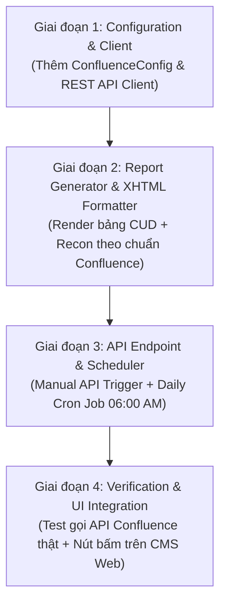

# Kế Hoạch Triển Khai: Confluence Daily Data Report Là Child Của Core Trans Proxy History Service

- **Ngày khởi tạo:** 2026-10-12
- **Tác giả:** Brain (Architect)

---

## 1. Roadmap Cao Tầng (Phân rã 4 giai đoạn)

---

## 2. Chi Tiết Từng Giai Đoạn

### Giai đoạn 1: Configuration & Confluence REST API Client
- Thêm `ConfluenceConfig` vào `cdc-cms-service/config/config.go`.
- Tạo `cdc-cms-service/internal/infra/external/confluence/client.go`:
  - `NewConfluenceClient(cfg config.ConfluenceConfig)`
  - `FindChildPage(ctx, parentID, title) (*Page, error)`
  - `CreateChildPage(ctx, parentID, title, htmlStorage) (*Page, error)`
  - `UpdatePage(ctx, pageID, title, htmlStorage, version) (*Page, error)`

### Giai đoạn 2: Report Generator & Storage Format Builder
- Tạo `cdc-cms-service/internal/service/reporting/confluence_report_builder.go`:
  - Lấy dữ liệu qua `DailyFlowQuery` (đã có từ Phase 2) cho ngày $D$.
  - Lấy kết quả đối soát mới nhất từ `ReconciliationReportRepo`.
  - Format thành XHTML Confluence Storage Format:
    - `<ac:structured-macro ac:name="status">` cho Badge 🟢 HEALTHY / 🔴 DRIFT.
    - `<table class="wrapped">` cho ma trận Kafka In, Shadow In, Master Inserted/Updated/Skipped.
    - `<ac:structured-macro ac:name="info">` cho hộp tóm tắt điều hành.

### Giai đoạn 3: Service Handler, Route & Scheduler
- Tạo service `cdc-cms-service/internal/service/reporting/confluence_daily_report_service.go`:
  - `PublishReportForDate(ctx, dateStr string) (string, error)`
- Thêm HTTP Handler & Route trong `cdc-cms-service`:
  - `POST /api/reconciliation/reports/confluence/publish`
- Đăng ký Cron Job vào scheduler:
  - Chạy lúc `06:00:00` hàng ngày, lấy `date = yesterday` để chốt số liệu.

### Giai đoạn 4: Kiểm Thử & Tích Hợp Giao Diện
- Test mock và test thật khi có API Token từ User.
- Thêm nút *"Xuất Báo Cáo Confluence"* trên CMS Web `ReconPipelineGrid.tsx`.
- Ghi nhận Audit Log vào `05_progress.md` và tạo báo cáo `11_report_*.md`.
