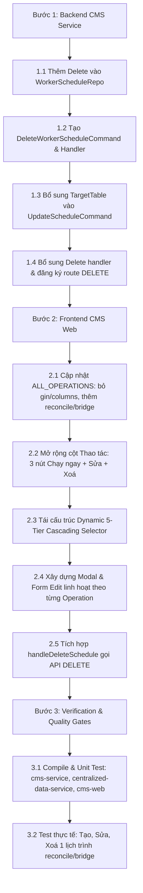

# Kế Hoạch Triển Khai: Edit, Delete và Danh Mục Tác Vụ trên Activity Manager

---

## 1. MỤC TIÊU & PHẠM VI
Triển khai hoàn chỉnh 3 chức năng chính trên trang `/activity-manager`:
1. Chức năng Xoá lịch trình (`DELETE /api/worker-schedule/:id`) với xác nhận Popconfirm.
2. Chức năng Chỉnh sửa lịch trình (Modal Edit tải dữ liệu cũ, cho phép sửa `params`, `interval_minutes`, `run_at_time`, `target_table`, `notes`, `is_enabled`).
3. Chuẩn hóa danh sách `ALL_OPERATIONS`: Bỏ `drop-gin-index`, `create-default-columns`; Thêm `reconcile`, `bridge`.

---

## 2. KẾ HOẠCH CÁC BƯỚC THỰC THI (THE SINGLE BEST APPROACH)

---

## 3. PHÂN BỔ TRÁCH NHIỆM ROLE
- **Brain (Chairman & Architect):** Lập kế hoạch, thiết kế kiến trúc, rà soát bảo mật và rủi ro, xuất bản tài liệu giải pháp và chờ `APPROVE` từ User.
- **Muscle (Chief Engineer):** Khi nhận lệnh `APPROVE`, trực tiếp sửa code trên backend và frontend, chạy test, build và nghiệm thu thực tế.
