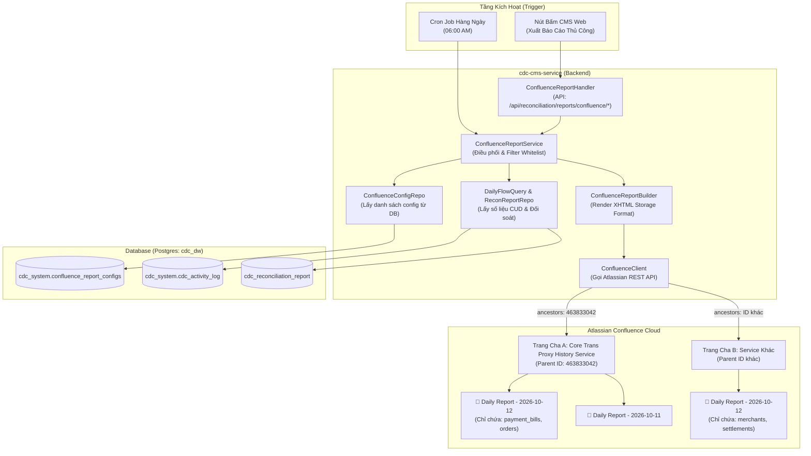

# Kế Hoạch Triển Khai Hoàn Chỉnh: Báo Cáo Đối Soát Dữ Liệu Confluence (Multi-Target & Pipeline Whitelist)

- **Ngày khởi tạo:** 2026-10-12
- **Tác giả:** Brain (Architect)
- **Mục tiêu:** Cung cấp giải pháp toàn diện cho phép lưu cấu hình Confluence trong Database Table (`confluence_report_configs`). Mỗi mục tiêu Confluence có Parent Page ID, Space Key, thông tin xác thực riêng và chỉ xuất dữ liệu của các pipeline được chỉ định (Whitelist).

---

## 1. Kiến Trúc Tổng Thể & Luồng Xử Lý (System Architecture)

---

## 2. Kế Hoạch Triển Khai Chi Tiết Từng Phase (4 Phases)

### Phase 1: Cơ Sở Dữ Liệu & Model Cấu Hình Multi-Target (Database & Model)
- **Mục tiêu:** Tạo bảng lưu trữ cấu hình Confluence trong DB, hỗ trợ trường `pipelines` (JSONB) để whitelist danh sách bảng cho từng đích Confluence.
- **Tập tin tạo mới:**
  1. `migrations/schema/recon_dlq/105_create_confluence_report_configs.sql`:
     - Bảng `cdc_system.confluence_report_configs`.
     - Seed bản ghi đầu tiên cho trang `Core Trans Proxy History Service` (Parent ID: `463833042`, Space: `~712020a3dcebcbe93646fea463f119dd38b08c`).
  2. `internal/model/recon/confluence_config.go`:
     - Định nghĩa `ConfluenceReportConfig` struct và `PipelineTarget` struct.
  3. `internal/infra/persistence/recon/confluence_config_repo_gorm.go`:
     - Các phương thức: `FindAllEnabled()`, `FindByName(name)`, `Create()`, `Update()`, `UpdateRunStatus()`.

---

### Phase 2: Confluence REST API Client & Storage Format Builder
- **Mục tiêu:** Xây dựng Client gọi Confluence Cloud REST API (Idempotent: tìm trang $\rightarrow$ update nếu đã có, tạo mới nếu chưa có) và Builder render HTML bảng CUD + Đối soát đẹp mắt.
- **Tập tin tạo mới:**
  1. `internal/infra/external/confluence/client.go`:
     - Kết nối HTTPS tới Atlassian Cloud với Basic Auth (`user_email:api_token`).
     - `FindChildPage(ctx, parentPageID, title)`: Kiểm tra trang đã tồn tại chưa để tránh sinh trang trùng lặp.
     - `CreateChildPage(ctx, parentPageID, spaceKey, title, xhtmlStorage)`: Tạo trang con mới.
     - `UpdatePage(ctx, pageID, title, xhtmlStorage, newVersion)`: Cập nhật trang cũ khi re-run.
  2. `internal/app/commands/recon/confluence_report_builder.go`:
     - Lọc dữ liệu từ `DailyFlowRecord` và `ReconciliationReport` khớp với danh sách `pipelines` của config.
     - Render thành Confluence Storage Format XHTML:
       - Header Info Macro (Ngày, Trạng thái, Số bảng).
       - Ma trận Table (Kafka In CUD, Shadow Written, Master Inserted/Updated/Skipped, Missing/Stale).
       - Macro Status (🟢 BALANCED, 🔴 DRIFT, 🟡 WARNING).
       - Chi tiết Drift / Exception (nếu có lỗi).

---

### Phase 3: Service Điều Phối, HTTP API & Scheduler
- **Mục tiêu:** Cung cấp API quản lý/kích hoạt báo cáo và cron job chạy định kỳ tự động.
- **Tập tin tạo mới & chỉnh sửa:**
  1. `internal/app/commands/recon/confluence_report_service.go`:
     - `ExecuteReport(ctx, configName string, dateStr string)`: Chạy báo cáo cho 1 cấu hình cụ thể.
     - `ExecuteAllEnabledReports(ctx, dateStr string)`: Chạy báo cáo cho toàn bộ cấu hình đang bật.
  2. `internal/api/recon/confluence_report_handler.go`:
     - `GET /api/reconciliation/confluence/configs`: Lấy danh sách cấu hình.
     - `POST /api/reconciliation/confluence/publish`: Kích hoạt xuất báo cáo thủ công theo ngày và tên config.
     - `PUT /api/reconciliation/confluence/configs/:id`: Cập nhật cấu hình (bật/tắt, sửa danh sách pipeline).
  3. `internal/router/router.go`: Đăng ký routes vào router của CMS.
  4. Scheduler: Đăng ký cron job `0 6 * * *` tự động gọi `ExecuteAllEnabledReports(ctx, yesterday)`.

---

### Phase 4: Kiểm Thử Toàn Trình (Verification & Quality Gates)
- **Mục tiêu:** Đảm bảo hệ thống đạt chuẩn DoD (Rule #14) và không có regression.
- **Các bước kiểm thử:**
  1. Chạy migration tạo bảng trên Postgres Docker local: `105_create_confluence_report_configs.sql`.
  2. Seed dữ liệu mẫu với Parent Page ID `463833042` và danh sách pipeline `payment_bills`, `orders`.
  3. Chạy lệnh build Go: `go build ./cmd/...` và `go test ./...`.
  4. Kiểm thử API endpoint `POST /api/reconciliation/confluence/publish` trả về URL Confluence thành công.
  5. Cập nhật tài liệu Workspace và Audit Log `05_progress.md`.
