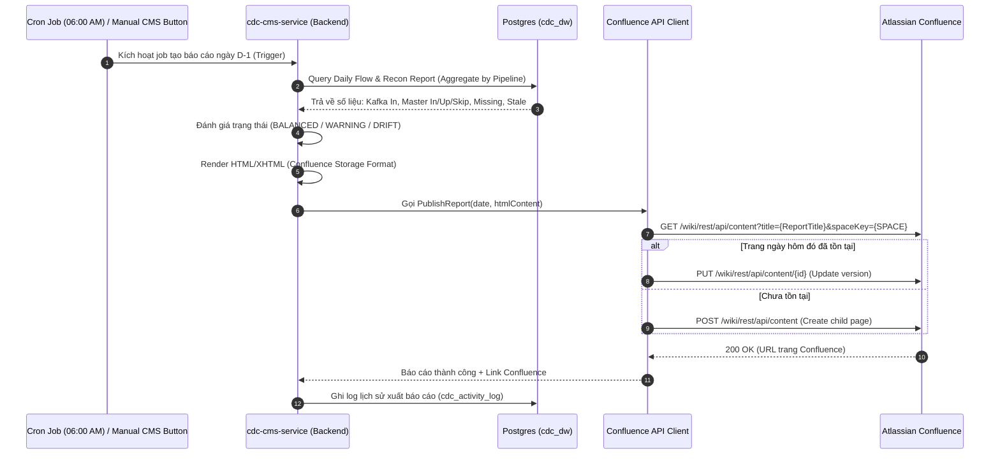

# Phân Tích Thiết Kế Kỹ Thuật: Báo Cáo Kiểm Tra Dữ Liệu Hàng Ngày Lên Confluence (Confluence Daily Data Check Report)

- **Ngày khởi tạo:** 2026-10-12
- **Tác giả:** Brain (Architect)
- **Mục tiêu:** Thiết kế giải pháp tự động tổng hợp số liệu luồng dữ liệu (Daily Flow CUD) và kết quả đối soát (Reconciliation), xuất thành trang báo cáo chuẩn hóa trên Atlassian Confluence hàng ngày.

---

## 1. Mục Đích & Bối Cảnh Nghiệp Vụ

Trong hệ thống CDC & Data Warehouse:
- **Người xem báo cáo:** Data Engineers, Data Lead, QA, Quản trị viên hệ thống (Operator) và các Stakeholders nghiệp vụ.
- **Vấn đề hiện tại:** Số liệu đối soát và luồng CUD chỉ có thể xem trực tiếp trên CMS Web hoặc qua câu lệnh DB/Grafana. Chưa có tài liệu lưu trữ chính thức dạng văn bản (official audit document) trên Confluence để:
  1. Lưu trữ lịch sử chất lượng dữ liệu từng ngày (Data Quality Audit Log).
  2. Báo cáo tự động mỗi sáng cho cả team biết trạng thái dữ liệu ngày hôm trước (D-1).
  3. Cung cấp bằng chứng tuân thủ (Compliance / Governance) và phát hiện sớm các bất thường (Drift, Missing, DLQ).

---

## 2. Luồng Hoạt Động (Architecture & Workflow)



---

## 3. Cấu Trúc Nội Dung Trang Báo Cáo Trên Confluence

Trang Confluence sẽ được tổ chức chuyên nghiệp theo chuẩn Atlassian XHTML Storage Format gồm 4 phần:

### 3.1. Executive Summary (Tóm tắt điều hành)
- **Ngày chốt số liệu:** YYYY-MM-DD
- **Thời gian xuất báo cáo:** YYYY-MM-DD HH:mm:ss
- **Tổng số Pipeline hoạt động:** X pipelines
- **Trạng thái chung:** 🟢 **HEALTHY** (hoặc 🔴 **DRIFT DETECTED**)
- **Tổng records đã đồng bộ:** X records
- **Tỷ lệ toàn vẹn (Integrity Rate):** 100% (hoặc 99.8%)

### 3.2. Bảng Thống Kê Chi Tiết Từng Pipeline (Detailed Matrix Table)
| Pipeline (Source $\rightarrow$ Master) | Kafka CDC In (C/U/D) | Shadow Written | Master Inserted | Master Updated | Master Skipped | Missing / Stale | Trạng Thái |
| :--- | :--- | :--- | :--- | :--- | :--- | :--- | :--- |
| `goopay.payment_bills` $\rightarrow$ `payment_bills` | 164 / 120 / 0 | 164 | 164 | 120 | 0 | 0 / 0 | <span style="color:green">🟢 BALANCED</span> |
| `goopay.orders` $\rightarrow$ `orders` | 500 / 30 / 0 | 500 | 500 | 30 | 0 | 0 / 0 | <span style="color:green">🟢 BALANCED</span> |

### 3.3. Chi Tiết Lỗi & Bất Thường (Exception & Drift Details)
- Nếu có bảng bị `Missing > 0` hoặc `Stale > 0` hoặc `DLQ > 0`: Liệt kê danh sách ID và nguyên nhân cảnh báo.
- Nếu không có lỗi: Hiển thị box thông báo xanh: *"Tất cả các pipeline đều khớp 100%, không ghi nhận lệch dữ liệu."*

### 3.4. Action Items & Khuyến Nghị
- Gán tự động danh sách task (Checklist) cho Data On-call Engineer nếu phát hiện pipeline bị DRIFT.

---

## 4. Các Thành Phần Kỹ Thuật Cần Triển Khai (Components)

### 4.1. Cấu hình biến môi trường (Config / Secrets)
```env
CONFLUENCE_BASE_URL=https://your-company.atlassian.net
CONFLUENCE_USER_EMAIL=cdc-bot@company.com
CONFLUENCE_API_TOKEN=ATATT3xFfGF0... (API token tạo từ Atlassian Account)
CONFLUENCE_SPACE_KEY=DATA
CONFLUENCE_PARENT_PAGE_ID=123456789  # ID trang cha "Daily Data Quality Reports"
```

### 4.2. Confluence REST API Client (`internal/infra/external/confluence_client.go`)
- Sử dụng chuẩn REST API v1 (`/wiki/rest/api/content`) hoặc REST API v2 (`/wiki/api/v2/pages`).
- Cơ chế xác thực: HTTP Basic Auth (`base64(email:api_token)`).
- Tính năng:
  - `FindPageByTitle(spaceKey, title)`: Kiểm tra trang đã tồn tại chưa.
  - `CreatePage(spaceKey, parentID, title, htmlBody)`: Tạo trang mới.
  - `UpdatePage(pageID, title, htmlBody, currentVersion)`: Cập nhật trang.

### 4.3. Report Generator Service (`internal/service/reporting/confluence_report_service.go`)
- Thu thập dữ liệu từ:
  - `system.DailyFlowParams` (Query `daily_flow.go` đã làm ở Phase 2).
  - `reconmodel.ReconciliationReport` (Query các báo cáo đối soát mới nhất).
- Render ra chuỗi Confluence Storage Format XHTML.

### 4.4. Trigger (Cơ chế kích hoạt)
1. **Scheduled Cron Job**: Cấu hình trong scheduler của `cdc-cms-service` (hoặc Kubernetes CronJob) chạy lúc `06:00:00` hàng ngày để chốt số liệu ngày hôm trước.
2. **API Endpoint CMS**: Cho phép Trigger thủ công:
   - `POST /api/reconciliation/reports/confluence/publish`
   - Body: `{"date": "2026-10-11", "force_update": true}`
   - Phản hồi: `{"status": "success", "page_url": "https://company.atlassian.net/wiki/spaces/DATA/pages/..."}`
3. **UI CMS Web**: Thêm nút *"Xuất Báo Cáo Confluence"* trên thanh công cụ của trang Reconciliation.
