# 09. Tasks Solution — Đề xuất Khắc phục Code Review `feat/GP2-4633 -> develop` (`PartnerUserReserveExport`)

## 1. Direct Summary
Nhánh `origin/feat/GP2-4633` (`7d9bcf1`, +14 files, +863/-1 dòng so với `origin/develop`) triển khai bộ xử lý xuất Excel bất đồng bộ `PartnerUserReserveExport` (UC04 — Biến động khoản đảm bảo user) với bố cục Pure/Adapter/CQRS rõ ràng, có chống CSV/Excel Formula Injection (`safeText`), công thức tính số dư ví đảm bảo (`DAA <-> DRA`) khớp với `core-trans-proxy-history-service-v2`, đạt kết quả unit test (`EV-20261117T113407-0bb6`) và MongoMemoryServer integration test (`EV-20261117T113410-f2aa`). Tuy nhiên, qua kiểm định phản biện từng dòng và đối chiếu xuyên tầng với `core-trans-proxy-history-service-v2` & `admin-portal-web`, nhánh hiện còn **6 vấn đề xác thực (`F1`–`F6`)**, trong đó có **3 vấn đề mức `P1 (High)` cần khắc phục trước khi merge vào `develop`**: (1) lỗi ESLint `arrow-parens` làm gãy `npm run lint` (`EV-20261117T113440-cced`), (2) phân trang `skip(cursor)` với `sort` thiếu khóa phụ `_id` gây trùng/mất bản ghi và suy thoái $O(N^2)$ tới `2,000,000` dòng, và (3) bỏ qua cơ chế chuyển nguồn `TRANS_HIS_EXPORT_SOURCE=postgres` khiến job văng lỗi thiếu `TransHisModel` hoặc lệch nguồn dữ liệu so với API danh sách v2 khi cutover sang PostgreSQL.

---

## 2. Macro Runtime Topology

```mermaid
flowchart LR
    CMS["CMS admin-portal-web\nPartnerUserReserveList"] -->|"GET /export-async\nexportType=PartnerUserReserveExport"| GW["admin-portal-gateway\nauthenticate + authorization"]
    GW -->|"Moleculer RPC\nexportAsync"| EL["centralized-export-service\nExportLogic -> PartnerUserReserveExport.process()"]
    EL -->|"validateParams + enqueue"| RQ[("Redis\nexport:queue")]
    RQ -->|"dequeue"| EW["ExportWorker\nPartnerUserReserveExport.execute() SAGA"]
    EW -->|"QueryBus (chunk loop)"| QF{"getTransHisExportSource()"}
    QF -->|"mongo (keyset _id)"| MH["GetAllPartnerUserReserveExportHandler\nTransHisModel + MerchantModel"]
    QF -->|"postgres (keyset id)"| PGH["GetAllPartnerUserReserveExportPgHandler\nTransHisPgModel + MerchantModel"]
    MH --> FG["FileGenerator (ExcelJS stream)\n+ LocalFileUploader (.xlsx)"]
    PGH --> FG
```



---

## 3. Bảng Tổng Hợp Phát Hiện (`Executive Issues Summary Table`)

| Mã | Nhóm | Mức độ | Vị trí (`file:line`) | Mô tả ngắn | Trạng thái & Hành động |
| :--- | :--- | :---: | :--- | :--- | :--- |
| **F1** | CI / Lint | **P1 (High)** | `logics/export/trans-his/partner-user-reserve-export.pure.ts:38` | Bọc ngoặc đơn `(s) =>` vi phạm rule ESLint `arrow-parens`, làm `npx eslint` trả mã lỗi `exit=1` (`EV-20261117T113440-cced`). | **Open** — Chờ `APPROVE` để sửa |
| **F2** | Data Integrity & Perf | **P1 (High)** | `domain/handlers/trans-his/GetAllPartnerUserReserveExportHandler.ts:31-35,74`<br>`logics/export/trans-his/partner-user-reserve-export.pure.ts:51-58,118` | Dùng `skip(cursor)` tới `maxRecords: 2_000_000` và `sort` 1 trường không có tie-breaker `_id`: gây lặp/mất dòng khi trùng `value`/`status`/`createdAt` hoặc khi có giao dịch mới ghi vào DB, quét $O(N^2)$ và có nguy cơ vượt ngưỡng 100MB RAM sort của MongoDB. | **Open** — Chờ `APPROVE` để sửa |
| **F3** | Architecture / Cutover | **P1 (High)** | `domain/QueryHandlerFactory.ts:155-160`<br>`logics/export/trans-his/partner-user-reserve.export.ts:22-24`<br>`models/trans-his-pg/trans-his-pg.query.ts:119-123` | Hardcode `TransHisModel` (Mongo) thay vì `transHisModelNames()` + `TransHisPgModel`: khi bật `TRANS_HIS_EXPORT_SOURCE=postgres` và tắt `TRANS_HIS_MONGO_URI`, job gãy ở `validatePrerequisites` hoặc lệch dữ liệu với màn danh sách v2 (đọc Postgres). | **Open** — Chờ `APPROVE` để sửa |
| **F4** | Filter & Coercion | **P2 (Medium)** | `logics/export/trans-his/partner-user-reserve-export.pure.ts:34-40,67-72` | `params.status.split(",")` không `trim()`/lọc rỗng (truyền `"FAILED, SUCCESS"` kèm `statusAfter` trả về 0 dòng); `toNumber` ép nhầm chuỗi trắng `"   "`, `boolean`, `[]` thành `0` thay vì `null`. | **Open** — Chờ `APPROVE` để sửa |
| **F5** | Validation, Sort & TZ | **P2 (Medium)** | `data-transfers/params/trans-his/partner-user-reserve-export.params.ts:22-23`<br>`logics/export/trans-his/partner-user-reserve-export.pure.ts:54,115-116` | `ExceedDateRangeValidator` cho lọt `dateTo < dateFr` (`dateDiff < 0`); `buildSort` biến `"ASC"`/`"ascend"` thành `-1`; `fileName` dùng `moment()` giờ UTC container thiếu `.utcOffset(7)` làm lệch ngày lúc `00:00–06:59` GMT+7. | **Open** — Chờ `APPROVE` để sửa |
| **F6** | Lookup & Test Hygiene | **P2 (Low)** | `domain/handlers/trans-his/GetAllPartnerUserReserveExportHandler.ts:41-43,64`<br>`test/unit/pure/partner-user-reserve.pure.test.ts:8-10` | `_.isEmpty(v)` trả về `true` nếu `merchantCode` là kiểu `number` (làm mất tra cứu merchant); unit test mock cứng `validateParams` nên chưa kiểm chứng lỗi `ValidationError` thực tế cho `Pure.validate()`. | **Open** — Chờ `APPROVE` để sửa |

---

## 4. Phương Án Kỹ Thuật Duy Nhất & Ánh Xạ 1-1 (`F1` → `F6`)

### 4.1. Giải pháp cho `F1`, `F4`, `F5` (`partner-user-reserve-export.pure.ts` & `partner-user-reserve-export.params.ts`)
1. **Tại `data-transfers/params/trans-his/partner-user-reserve-export.params.ts` (`F5`):**
   - Kiểm tra chặt `dateDiff >= 0 && dateDiff <= MAX_DAYS_EXPORT` trong `ExceedDateRangeValidator.validate` để chặn ngay request có `dateTo < dateFr` bằng `422 ValidationError` trước khi đẩy vào Redis queue.
2. **Tại `logics/export/trans-his/partner-user-reserve-export.pure.ts` (`F1`, `F4`, `F5`):**
   - Tạo hàm phụ `splitCsv(value: unknown): string[]` thực hiện `String(value).split(",").map(s => s.trim()).filter(Boolean)` dùng chung cho cả `params.status` và `params.statusAfter`, đồng thời viết `s => s === STATUS_SUCCESS` không ngoặc đơn tuân thủ rule ESLint `arrow-parens` (`F1`, `F4`).
   - Trong `buildSort` (`F5`): chuẩn hóa `const normType = String(params.sortType).trim().toLowerCase(); const asc = normType === "asc" || normType === "ascend" || normType === "1";`.
   - Trong `toNumber` (`F4`): loại trừ rõ `typeof raw === "boolean" || Array.isArray(raw)` và `trim()` chuỗi trước khi kiểm tra rỗng `""`, tránh `Number("   ") === 0`.
   - Trong `getConfig` (`F5`): đổi `moment().format("DD-MM-YYYY")` sang `moment().utcOffset(7).format("DD-MM-YYYY")` đồng nhất với múi giờ GMT+7 của `transformRow` (độ dài tên sheet 28 ký tự $\le 31$).

### 4.2. Giải pháp cho `F2` & `F6` (`GetAllPartnerUserReserveExportHandler.ts`)
- Bổ sung `_id: 1` vào `PARTNER_USER_RESERVE_SELECT_FIELDS` và triển khai **Keyset Pagination** có khóa phụ duy nhất `_id` cùng chiều (`{ [sortField]: sortDir, _id: sortDir }`) kèm `.allowDiskUse(true)`:
  - Khi `cursor` là chuỗi keyset base64url `{ k, v, id }` do trang trước sinh ra: dựng điều kiện `$or: [{ [sortField]: { [op]: sortVal } }, { [sortField]: sortVal, _id: { [op]: lastId } }]` kết hợp với `filter` gốc qua `$and` — đạt độ phức tạp $O(1)$ mỗi trang, không trượt dòng khi có giao dịch mới và không bao giờ lặp/mất dòng khi trùng `value`/`status`/`createdAt`.
  - Vẫn tương thích ngược với `cursor` kiểu `number > 0` nếu có bài test đơn vị cũ truyền số nguyên.
- Tách hàm helper dùng chung `enrichPartnerReserveMerchants(rawData, Merchant, logger)` chuẩn hóa `merchantCode` bằng `String(d?.info?.extData?.merchantCode ?? "").trim()` thay cho `!_.isEmpty(v)` (`F6`), tái sử dụng cho cả Mongo handler và Postgres handler.

### 4.3. Giải pháp cho `F3` (Hỗ trợ đầy đủ `TRANS_HIS_EXPORT_SOURCE=postgres`)
1. **Tại `models/trans-his-pg/trans-his-pg.query.ts`:**
   - Khai báo thêm 4 đường dẫn vào `JSON_STRING_PATHS`: `info.extData.reserveId` (`["eq"]`), `info.extData.merchantCode` (`["eq"]`), `info.extData.partnerUserId` (`["eq"]`), `info.extData.statusAfter` (`["$in"]`), và mở rộng `jsonStringSql` hỗ trợ toán tử `"$in"`.
2. **Tạo mới `domain/handlers/trans-his/GetAllPartnerUserReserveExportPgHandler.ts`:**
   - Gọi `TransHisPgModel.getPage(filter, sort, PARTNER_USER_RESERVE_SELECT_FIELDS, cursor, limit)` + `countDocuments(filter)`, rồi gọi `enrichPartnerReserveMerchants(...)`.
3. **Tại `domain/QueryHandlerFactory.ts` & `logics/export/trans-his/partner-user-reserve.export.ts`:**
   - Trong `partner-user-reserve.export.ts`: trả về `[...transHisModelNames(), "MerchantModel"]`.
   - Trong `QueryHandlerFactory.ts`: phân nhánh đăng ký `GetAllPartnerUserReserveExportPgHandler` khi `getTransHisExportSource() === "postgres"`, ngược lại đăng ký `GetAllPartnerUserReserveExportHandler`.

---

## 5. Code Demo Đề Xuất (Nguyên văn đối chiếu với HEAD `7d9bcf1`)

### 5.1. `data-transfers/params/trans-his/partner-user-reserve-export.params.ts` (`F5`)
```diff
--- a/data-transfers/params/trans-his/partner-user-reserve-export.params.ts
+++ b/data-transfers/params/trans-his/partner-user-reserve-export.params.ts
@@ -19,6 +19,6 @@ class ExceedDateRangeValidator implements ValidatorConstraintInterface {
         if (!params.dateFr || !params.dateTo) {
             return true;
         }
         const dateDiff = moment.duration(moment(new Date(params.dateTo)).diff(moment(new Date(params.dateFr)))).asDays();
-        return dateDiff <= MAX_DAYS_EXPORT;
+        return dateDiff >= 0 && dateDiff <= MAX_DAYS_EXPORT;
     }
```

### 5.2. `logics/export/trans-his/partner-user-reserve-export.pure.ts` (`F1`, `F4`, `F5`)
```diff
--- a/logics/export/trans-his/partner-user-reserve-export.pure.ts
+++ b/logics/export/trans-his/partner-user-reserve-export.pure.ts
@@ -20,6 +20,10 @@ export const RESERVE_STATUS_LABELS: Record<string, { vi: string; en: string }> =
 
 const isEmptyValue = (v: any): boolean => v === undefined || v === null || v === "";
 
+const splitCsv = (v: unknown): string[] =>
+    String(v)
+        .split(",")
+        .map(s => s.trim())
+        .filter(Boolean);
+
 /** Conditions of the screen (same as the list API: the gateway adds trans_type IN (PARTNER_RESERVE, PARTNER_RESERVE_RELEASE)) */
 export const baseFilter = (): Record<string, any> => ({
     transType: { $in: [TRANS_TYPE_RESERVE, TRANS_TYPE_RELEASE] }
@@ -31,11 +35,14 @@ export const buildFilter = (params: any): Record<string, any> => {
     if (!isEmptyValue(params.reserveId)) { filter["info.extData.reserveId"] = String(params.reserveId).trim(); }
     if (!isEmptyValue(params.merchantCode)) { filter["info.extData.merchantCode"] = String(params.merchantCode).trim(); }
     if (!isEmptyValue(params.partnerUserId)) { filter["info.extData.partnerUserId"] = String(params.partnerUserId).trim(); }
-    let statuses: string[] | null = isEmptyValue(params.status) ? null : String(params.status).split(",");
+    const rawStatuses = isEmptyValue(params.status) ? [] : splitCsv(params.status);
+    let statuses: string[] | null = rawStatuses.length > 0 ? rawStatuses : null;
     if (!isEmptyValue(params.statusAfter)) {
-        filter["info.extData.statusAfter"] = { $in: String(params.statusAfter).split(",").map((s: string) => s.trim()) };
-        // statusAfter is only known for a successful transfer and is shown for those rows only, so the filter must not return the others
-        statuses = (statuses ?? [STATUS_SUCCESS]).filter((s) => s === STATUS_SUCCESS);
+        const afterList = splitCsv(params.statusAfter);
+        if (afterList.length > 0) {
+            filter["info.extData.statusAfter"] = { $in: afterList };
+            // statusAfter is only known for a successful transfer and is shown for those rows only, so the filter must not return the others
+            statuses = (statuses ?? [STATUS_SUCCESS]).filter(s => s === STATUS_SUCCESS);
+        }
     }
     if (statuses) { filter.status = { $in: statuses }; }
     if (params.dateFr || params.dateTo) {
@@ -51,7 +58,8 @@ const SORTABLE: Record<string, string> = { createdAt: "createdAt", value: "value
 export const buildSort = (params: any): object => {
     const field = params?.sortBy ? SORTABLE[params.sortBy] : undefined;
     if (field && !isEmptyValue(params?.sortType)) {
-        const asc = params.sortType === "asc" || params.sortType === "1" || params.sortType === 1;
+        const normType = String(params.sortType).trim().toLowerCase();
+        const asc = normType === "asc" || normType === "ascend" || normType === "1";
         return { [field]: asc ? 1 : -1 };
     }
     return { createdAt: -1 };
@@ -66,8 +74,10 @@ export const safeText = (value: any): string => {
 /** Balances come as numbers, numeric strings or Extended JSON wrappers such as {"$numberInt": "10"} */
 export const toNumber = (value: unknown): number | null => {
     const raw = _.isPlainObject(value) ? Object.values(value as object)[0] : value;
-    if (raw === null || raw === undefined || raw === "") { return null; }
-    const parsed = Number(raw);
+    if (raw === null || raw === undefined || typeof raw === "boolean" || Array.isArray(raw)) { return null; }
+    const normalized = typeof raw === "string" ? raw.trim() : raw;
+    if (normalized === "") { return null; }
+    const parsed = Number(normalized);
     return Number.isFinite(parsed) ? parsed : null;
 };
@@ -112,8 +122,9 @@ export const getConfig = (params: any, langCode: string = "vi"): ExportConfig =>
         ],
         fileName: {
             // The file name is also the sheet name, and Excel allows at most 31 characters in a sheet name
-            vi: moment().format("DD-MM-YYYY") + "_Bien_dong_dam_bao",
-            en: moment().format("DD-MM-YYYY") + "_Reserve_movements"
+            vi: moment().utcOffset(7).format("DD-MM-YYYY") + "_Bien_dong_dam_bao",
+            en: moment().utcOffset(7).format("DD-MM-YYYY") + "_Reserve_movements"
         },
         maxRecords: 2_000_000
     };
```

### 5.3. `domain/handlers/trans-his/GetAllPartnerUserReserveExportHandler.ts` (`F2`, `F6`)
```diff
--- a/domain/handlers/trans-his/GetAllPartnerUserReserveExportHandler.ts
+++ b/domain/handlers/trans-his/GetAllPartnerUserReserveExportHandler.ts
@@ -1,13 +1,15 @@
 // Export of UC04 "Biến động khoản đảm bảo user": trans-his rows + email / name of the merchant
 import * as _ from "lodash";
+import { Types } from "mongoose";
 import { IQueryHandler } from "../../IQueryHandler";
 import { GetAllPartnerUserReserveExportQuery } from "../../queries";
 import MainProcess from "../../../data-transfers/main-process";
 
-const SELECT_FIELDS = {
+export const PARTNER_USER_RESERVE_SELECT_FIELDS = {
+    _id: 1,
     transId: 1,
     transType: 1,
     status: 1,
     value: 1,
     noted: 1,
     sender: 1,
     info: 1,
     createdAt: 1
 };
```
*(Bổ sung keyset cursor `{ [sortField]: sortDir, _id: sortDir }` kèm `.allowDiskUse(true)`, tương thích ngược khi `typeof cursor === "number" && cursor > 0`, và hàm `enrichPartnerReserveMerchants` chuẩn hóa `String(d?.info?.extData?.merchantCode ?? "").trim()`).*

### 5.4. `logics/export/trans-his/partner-user-reserve.export.ts`, `domain/QueryHandlerFactory.ts` & `models/trans-his-pg/trans-his-pg.query.ts` (`F3`)
```diff
--- a/logics/export/trans-his/partner-user-reserve.export.ts
+++ b/logics/export/trans-his/partner-user-reserve.export.ts
@@ -2,6 +2,7 @@
 import { RequestHelper } from "@goopay/goopay-library/helpers";
 import { BaseExportProcessor, ExportConfig } from "../../processors/BaseExportProcessor";
 import { PartnerUserReserveExportPure } from "../index";
+import { transHisModelNames } from "../../../utils/trans-his-export-source";
@@ -20,5 +21,5 @@ export class PartnerUserReserveExport extends BaseExportProcessor {
     protected getRequiredModelName(): string[] {
-        return ["TransHisModel", "MerchantModel"];
+        return [...transHisModelNames(), "MerchantModel"];
     }
 }
```
```diff
--- a/domain/QueryHandlerFactory.ts
+++ b/domain/QueryHandlerFactory.ts
@@ -73,6 +73,7 @@ import { GetListCategoryByIdsHandler } from "./handlers/ticket/GetListCategoryBy
 import { GetAllTransHisExportHandler } from "./handlers/trans-his/GetAllTransHisExportHandler";
 import { GetListTransHisByTransIdHandler } from "./handlers/trans-his/GetListTransHisByTransIdHandler";
 import { GetAllPartnerUserReserveExportHandler } from "./handlers/trans-his/GetAllPartnerUserReserveExportHandler";
+import { GetAllPartnerUserReserveExportPgHandler } from "./handlers/trans-his/GetAllPartnerUserReserveExportPgHandler";
 import { GetAllTransHisExportPgHandler } from "./handlers/trans-his/GetAllTransHisExportPgHandler";
 import { GetListTransHisByTransIdPgHandler } from "./handlers/trans-his/GetListTransHisByTransIdPgHandler";
@@ -152,11 +153,11 @@ export default class QueryHandlerFactory {
     // trans-his
-    // UC04 export reads the trans-his Mongo collection (the Postgres source does not take these filters yet)
-    this.handlers.set("GetAllPartnerUserReserveExportQuery", new GetAllPartnerUserReserveExportHandler(mainProcess));
     if (getTransHisExportSource() === "postgres") {
       this.handlers.set("GetAllTransHisExportQuery", new GetAllTransHisExportPgHandler(mainProcess));
       this.handlers.set("GetListTransHisByTransIdQuery", new GetListTransHisByTransIdPgHandler(mainProcess));
+      this.handlers.set("GetAllPartnerUserReserveExportQuery", new GetAllPartnerUserReserveExportPgHandler(mainProcess));
     } else {
       this.handlers.set("GetAllTransHisExportQuery", new GetAllTransHisExportHandler(mainProcess));
       this.handlers.set("GetListTransHisByTransIdQuery", new GetListTransHisByTransIdHandler(mainProcess));
+      this.handlers.set("GetAllPartnerUserReserveExportQuery", new GetAllPartnerUserReserveExportHandler(mainProcess));
     }
```
```diff
--- a/models/trans-his-pg/trans-his-pg.query.ts
+++ b/models/trans-his-pg/trans-his-pg.query.ts
@@ -119,5 +119,9 @@ const TEXT_OPERATORS: Readonly<Record<string, readonly string[]>> = {
 const JSON_STRING_PATHS: Readonly<Record<string, { column: "info" | "sender"; segments: readonly string[]; operators: readonly string[] }>> = {
 	"info.masterMerchantInfo.merchantEmail": { column: "info", segments: ["masterMerchantInfo", "merchantEmail"], operators: ["eq"] },
 	"info.bankConnector": { column: "info", segments: ["bankConnector"], operators: ["eq"] },
-	"info.bankTransferResponse.partnerCode": { column: "info", segments: ["bankTransferResponse", "partnerCode"], operators: ["$regex"] }
+	"info.bankTransferResponse.partnerCode": { column: "info", segments: ["bankTransferResponse", "partnerCode"], operators: ["$regex"] },
+	"info.extData.reserveId": { column: "info", segments: ["extData", "reserveId"], operators: ["eq"] },
+	"info.extData.merchantCode": { column: "info", segments: ["extData", "merchantCode"], operators: ["eq"] },
+	"info.extData.partnerUserId": { column: "info", segments: ["extData", "partnerUserId"], operators: ["eq"] },
+	"info.extData.statusAfter": { column: "info", segments: ["extData", "statusAfter"], operators: ["$in"] }
 };
```
